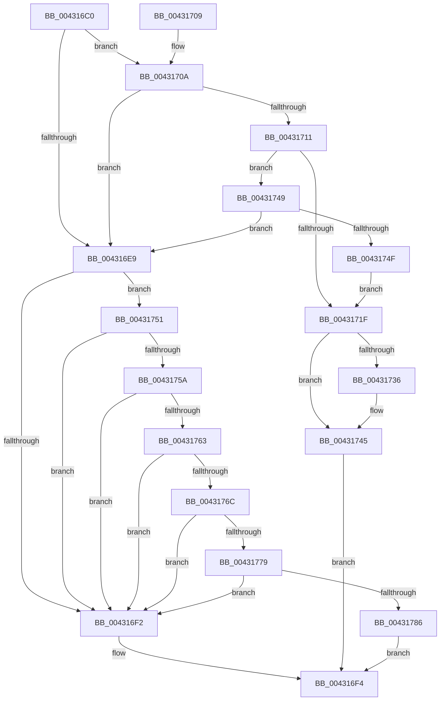

# KdpStub

- RVA: `0x004316C0`–`0x004317AE` (길이 `238` bytes)
- VA: `0x00000001404316C0`
- 실행 섹션: `.text`
- PDB 이름 있음: `예`; PDB Function 태그: `아니요`
- unwind 정보 RVA: `0x000A2200`
- 디코드: `60`개 명령, `238/238` bytes 표시
- 미해석 바이트: `0` (있으면 어셈블리에 `.byte`로 보존)

> 이 문서는 커널 이미지의 기계어와 PDB 기호를 분석해 생성했습니다. 4번과 5번은 함수 원형과 자료형을 바이너리 사용 방식에서 추정한 C 해석이며 원본 소스 복구 결과는 아닙니다.

## 1. Dependencies

- 직접 호출 지점: **2**; 고유 호출 대상: **2**
- 직접 호출자로 확인된 함수: **1**
- RIP 상대 이미지 참조: **4**

### Outgoing calls
- `0x0043176C` → [KdEnableDebugger](../5B/KdEnableDebugger_function_005B0A40.md) (function, `0x005B0A40`)
- `0x004317A4` → [KdpTrap](../../pagekd/B8/KdpTrap_function_00B852B8.md) (function, `0x00B852B8`)

### Direct callers
- [KdTrap](KdTrap_function_00431680.md) at `0x0043169F`

### Static image references
- `0x004316E9` → RVA `0x00E0AA1C` (`.data`; read)
- `0x00431751` → RVA `0x00F55CA1` (`.data`; read)
- `0x0043175A` → RVA `0x00E66748` (`.data`; read)
- `0x00431763` → RVA `0x00F475F8` (`.data`; read)

## 2. Other-region calls and transfers

- 다른 실행 섹션으로 향하는 call: **1**
  - `0x004317A4` → [KdpTrap](../../pagekd/B8/KdpTrap_function_00B852B8.md) (`.text` → `PAGEKD`)
- 별도 외부 분기/꼬리 이동을 확인하지 못했습니다.

## 3. Assembly (complete function range)

```asm
004316C0  48 89 5C 24 08                  mov qword ptr [rsp + 8], rbx
004316C5  48 89 6C 24 10                  mov qword ptr [rsp + 0x10], rbp
004316CA  48 89 74 24 18                  mov qword ptr [rsp + 0x18], rsi
004316CF  57                              push rdi
004316D0  48 83 EC 30                     sub rsp, 0x30
004316D4  41 81 38 03 00 00 80            cmp dword ptr [r8], 0x80000003
004316DB  49 8B F9                        mov rdi, r9
004316DE  49 8B D8                        mov rbx, r8
004316E1  48 8B F2                        mov rsi, rdx
004316E4  48 8B E9                        mov rbp, rcx
004316E7  74 21                           je 0x14043170a
004316E9  80 3D 2C 93 9D 00 00            cmp byte ptr [rip + 0x9d932c], 0
004316F0  74 5F                           je 0x140431751
004316F2  32 C0                           xor al, al
004316F4  48 8B 5C 24 40                  mov rbx, qword ptr [rsp + 0x40]
004316F9  48 8B 6C 24 48                  mov rbp, qword ptr [rsp + 0x48]
004316FE  48 8B 74 24 50                  mov rsi, qword ptr [rsp + 0x50]
00431703  48 83 C4 30                     add rsp, 0x30
00431707  5F                              pop rdi
00431708  C3                              ret
00431709  CC                              int3
0043170A  41 83 78 18 00                  cmp dword ptr [r8 + 0x18], 0
0043170F  76 D8                           jbe 0x1404316e9
00431711  49 8B 48 20                     mov rcx, qword ptr [r8 + 0x20]
00431715  48 8D 41 FD                     lea rax, [rcx - 3]
00431719  48 83 F8 02                     cmp rax, 2
0043171D  77 2A                           ja 0x140431749
0043171F  41 8B 41 30                     mov eax, dword ptr [r9 + 0x30]
00431723  49 FF 81 F8 00 00 00            inc qword ptr [r9 + 0xf8]
0043172A  25 80 00 10 00                  and eax, 0x100080
0043172F  3D 80 00 10 00                  cmp eax, 0x100080
00431734  75 0F                           jne 0x140431745
00431736  49 63 81 E8 04 00 00            movsxd rax, dword ptr [r9 + 0x4e8]
0043173D  4A FF 84 08 D8 04 00 00         inc qword ptr [rax + r9 + 0x4d8]
00431745  B0 01                           mov al, 1
00431747  EB AB                           jmp 0x1404316f4
00431749  48 83 F9 01                     cmp rcx, 1
0043174D  75 9A                           jne 0x1404316e9
0043174F  EB CE                           jmp 0x14043171f
00431751  80 3D 49 45 B2 00 00            cmp byte ptr [rip + 0xb24549], 0
00431758  74 98                           je 0x1404316f2
0043175A  80 3D E7 4F A3 00 00            cmp byte ptr [rip + 0xa34fe7], 0
00431761  74 8F                           je 0x1404316f2
00431763  80 3D 8E 5E B1 00 00            cmp byte ptr [rip + 0xb15e8e], 0
0043176A  75 86                           jne 0x1404316f2
0043176C  E8 CF F2 17 00                  call 0x1405b0a40
00431771  85 C0                           test eax, eax
00431773  0F 88 79 FF FF FF               js 0x1404316f2
00431779  80 3D 78 5E B1 00 00            cmp byte ptr [rip + 0xb15e78], 0
00431780  0F 84 6C FF FF FF               je 0x1404316f2
00431786  0F B6 44 24 68                  movzx eax, byte ptr [rsp + 0x68]
0043178B  4C 8B CF                        mov r9, rdi
0043178E  88 44 24 28                     mov byte ptr [rsp + 0x28], al
00431792  4C 8B C3                        mov r8, rbx
00431795  0F B6 44 24 60                  movzx eax, byte ptr [rsp + 0x60]
0043179A  48 8B D6                        mov rdx, rsi
0043179D  48 8B CD                        mov rcx, rbp
004317A0  88 44 24 20                     mov byte ptr [rsp + 0x20], al
004317A4  E8 0F 3B 75 00                  call 0x140b852b8
004317A9  E9 46 FF FF FF                  jmp 0x1404316f4
```

## 4. C-style interpretation (structured pseudocode)

```c
__int64 __fastcall KdpStub(__int64 a1, __int64 a2, __int64 a3, __int64 a4, unsigned __int8 a5, unsigned __int8 a6)
{
    __int64 result;
    __int64 v_rsp;
    unsigned __int64 v_stack_p10;
    unsigned __int64 v_stack_p18;
    unsigned __int8 v_stack_p20;
    unsigned __int8 v_stack_p28;
    unsigned __int64 v_stack_p8;

    v_stack_p8 = v_rbx;
    v_stack_p10 = v_rbp;
    v_stack_p18 = v_rsi;
    v_rsp = (v_rsp) - (48);
    if ((*(unsigned int *)(a3)) == 0x80000003ULL) goto loc_0043170A;
loc_004316E9:
    if ((*(unsigned __int8 *)(v_rip + 10326828)) == 0) goto loc_00431751;
loc_004316F2:
    result = 0;
loc_004316F4:
    v_rsp = (v_rsp) + (48);
    return result;
loc_0043170A:
    if ((*(unsigned int *)(a3 + 24)) <= 0) goto loc_004316E9;
    if ((*(unsigned __int64 *)(a3 + 32) - 3) > 2) goto loc_00431749;
loc_0043171F:
    result = (unsigned int)(((unsigned int)(*(unsigned int *)(a4 + 48))) & (0x100080ULL));
    if (((unsigned int)(result)) == 0x100080ULL) {
        result = (int)(*(unsigned int *)(a4 + 1256));
    }
    goto loc_004316F4;
loc_00431749:
    if ((*(unsigned __int64 *)(a3 + 32)) != 1) goto loc_004316E9;
    goto loc_0043171F;
loc_00431751:
    if ((*(unsigned __int8 *)(v_rip + 11683145)) == 0) goto loc_004316F2;
    if ((*(unsigned __int8 *)(v_rip + 10702823)) == 0) goto loc_004316F2;
    if ((*(unsigned __int8 *)(v_rip + 11624078)) != 0) goto loc_004316F2;
    result = KdEnableDebugger(*(unsigned __int64 *)(a3 + 32), a2, a3, a4);
    if (sign_flag) goto loc_004316F2;
    if ((*(unsigned __int8 *)(v_rip + 11624056)) == 0) goto loc_004316F2;
    v_stack_p28 = a6;
    v_stack_p20 = a5;
    result = KdpTrap(v_stack_p10, v_stack_p18, v_stack_p8, a4);
    goto loc_004316F4;
}
```

## 5. (Beta) C Style

```c
int64_t KdpStub(int64_t Arg1, int64_t Arg2, void *Arg3, void *Arg4, uint8_t Arg5, uint8_t Arg6)
{
    uint8_t *arg3 = (uint8_t *)Arg3;
    uint8_t *arg4 = (uint8_t *)Arg4;

    int64_t result;
    int64_t local_rsp;
    uint64_t v_stack_p10;
    uint64_t v_stack_p18;
    uint8_t v_stack_p20;
    uint8_t v_stack_p28;
    uint64_t v_stack_p8;

    v_stack_p8 = local_rbx;
    v_stack_p10 = local_rbp;
    v_stack_p18 = local_rsi;
    local_rsp = (local_rsp) - (48);
    if ((*(uint32_t *)(arg3)) == 0x80000003ULL) goto loc_0043170A;
loc_004316E9:
    if ((*(uint8_t *)(v_rip + 0x9D932C)) == 0) goto loc_00431751;
loc_004316F2:
    result = 0;
loc_004316F4:
    local_rsp = (local_rsp) + (48);
    return result;
loc_0043170A:
    if ((*(uint32_t *)(arg3 + 0x18)) <= 0) goto loc_004316E9;
    if ((*(uint64_t *)(arg3 + 0x20) - 3) > 2) goto loc_00431749;
loc_0043171F:
    result = (uint32_t)(((uint32_t)(*(uint32_t *)(arg4 + 0x30))) & (0x100080ULL));
    if (((uint32_t)(result)) == 0x100080ULL) {
        result = (int32_t)(*(uint32_t *)(arg4 + 0x4E8));
    }
    goto loc_004316F4;
loc_00431749:
    if ((*(uint64_t *)(arg3 + 0x20)) != 1) goto loc_004316E9;
    goto loc_0043171F;
loc_00431751:
    if ((*(uint8_t *)(v_rip + 0xB24549)) == 0) goto loc_004316F2;
    if ((*(uint8_t *)(v_rip + 0xA34FE7)) == 0) goto loc_004316F2;
    if ((*(uint8_t *)(v_rip + 0xB15E8E)) != 0) goto loc_004316F2;
    result = KdEnableDebugger(*(uint64_t *)(arg3 + 0x20), Arg2, Arg3, Arg4);
    if (sign_flag) goto loc_004316F2;
    if ((*(uint8_t *)(v_rip + 0xB15E78)) == 0) goto loc_004316F2;
    v_stack_p28 = Arg6;
    v_stack_p20 = Arg5;
    result = KdpTrap(v_stack_p10, v_stack_p18, v_stack_p8, Arg4);
    goto loc_004316F4;
}
```

### 관측된 메모리 오프셋

구조체 형식이 확인되지 않은 접근은 인자 기준의 오프셋으로만 기록했습니다.

| 기준 인자 | 오프셋 표현 | 폭 (bit) | 접근 |
|---|---:|---:|---|
| `Arg3` | `+ 0x0` | `32` | `R` |
| `Arg3` | `+ 0x18` | `32` | `R` |
| `Arg3` | `+ 0x20` | `64` | `R` |
| `Arg4` | `+ 0x30` | `32` | `R` |
| `Arg4` | `+ 0xF8` | `64` | `R/W` |
| `Arg4` | `+ 0x4E8` | `32` | `R` |

## 6. Execution-region graph

[열기: 2D/3D 그래프와 함수 탐색 컨트롤 패널](../../../control-panel.html?section=text&rva=0x004316C0&view=graph)

- 2D 그래프는 위에서 아래로 흐르고, 3D 그래프는 빈 공간을 드래그해 회전합니다. Shift+드래그는 이동, 휠은 확대·축소, 함수 노드 선택은 대상 보고서 이동입니다.

### Static fallback


