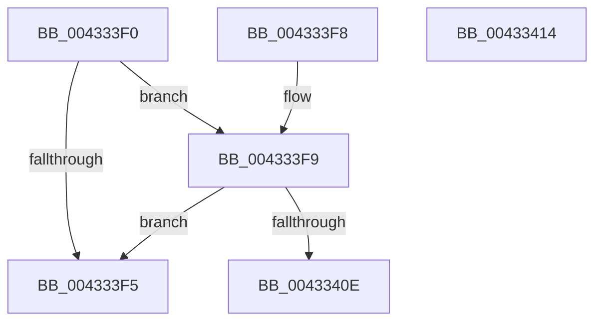

# KeAbIsValidUserModeLockAddress

- RVA: `0x004333F0`–`0x00433415` (길이 `37` bytes)
- VA: `0x00000001404333F0`
- 실행 섹션: `.text`
- PDB 이름 있음: `예`; PDB Function 태그: `아니요`
- unwind 정보 RVA: `0x000DB714`
- 디코드: `13`개 명령, `37/37` bytes 표시
- 미해석 바이트: `0` (있으면 어셈블리에 `.byte`로 보존)

> 이 문서는 커널 이미지의 기계어와 PDB 기호를 분석해 생성했습니다. 4번과 5번은 함수 원형과 자료형을 바이너리 사용 방식에서 추정한 C 해석이며 원본 소스 복구 결과는 아닙니다.

## 1. Dependencies

- 직접 호출 지점: **0**; 고유 호출 대상: **0**
- 직접 호출자로 확인된 함수: **2**
- RIP 상대 이미지 참조: **0**

### Outgoing calls
- 직접 디코드된 call 명령이 없습니다.

### Direct callers
- [NtSetEventEx](../../page/99/NtSetEventEx_function_0099C570.md) at `0x0099C613`
- [sub_009A78D4](../../page/9A/Unknown_function_009A78D4.md) at `0x009A78EC`

### Static image references
- 디코드된 RIP-relative 메모리 참조가 없습니다.

## 2. Other-region calls and transfers

- 다른 실행 섹션으로 향하는 call: **0**
- 별도 외부 분기/꼬리 이동을 확인하지 못했습니다.

## 3. Assembly (complete function range)

```asm
004333F0  48 85 C9                        test rcx, rcx
004333F3  75 04                           jne 0x1404333f9
004333F5  33 C0                           xor eax, eax
004333F7  C3                              ret
004333F8  CC                              int3
004333F9  48 8B C1                        mov rax, rcx
004333FC  48 BA FC FF FF FF FF FF FF 7F   movabs rdx, 0x7ffffffffffffffc
00433406  48 23 C2                        and rax, rdx
00433409  48 3B C1                        cmp rax, rcx
0043340C  75 E7                           jne 0x1404333f5
0043340E  B8 01 00 00 00                  mov eax, 1
00433413  C3                              ret
00433414  CC                              int3
```

## 4. C-style interpretation (structured pseudocode)

```c
__int64 __fastcall KeAbIsValidUserModeLockAddress(__int64 a1)
{
    __int64 result;

    if (a1 != 0) goto loc_004333F9;
loc_004333F5:
    result = 0;
    return result;
loc_004333F9:
    result = (a1) & (a2);
    if (result != a1) goto loc_004333F5;
    return 1;
}
```

## 5. (Beta) C Style

```c
int64_t KeAbIsValidUserModeLockAddress(int64_t Arg1)
{
    int64_t result;

    if (Arg1 != 0) goto loc_004333F9;
loc_004333F5:
    result = 0;
    return result;
loc_004333F9:
    result = (Arg1) & (a2);
    if (result != Arg1) goto loc_004333F5;
    return 1;
}
```

## 6. Execution-region graph

[열기: 2D/3D 그래프와 함수 탐색 컨트롤 패널](../../../control-panel.html?section=text&rva=0x004333F0&view=graph)

- 2D 그래프는 위에서 아래로 흐르고, 3D 그래프는 빈 공간을 드래그해 회전합니다. Shift+드래그는 이동, 휠은 확대·축소, 함수 노드 선택은 대상 보고서 이동입니다.

### Static fallback


