# KeCapturePersistentThreadState

- RVA: `0x00435D90`–`0x0043622A` (길이 `1,178` bytes)
- VA: `0x0000000140435D90`
- 실행 섹션: `.text`
- PDB 이름 있음: `예`; PDB Function 태그: `예`
- unwind 정보 RVA: `0x000A2D78`
- 디코드: `236`개 명령, `1,178/1,178` bytes 표시
- 미해석 바이트: `0` (있으면 어셈블리에 `.byte`로 보존)

> 이 문서는 커널 이미지의 기계어와 PDB 기호를 분석해 생성했습니다. 4번과 5번은 함수 원형과 자료형을 바이너리 사용 방식에서 추정한 C 해석이며 원본 소스 복구 결과는 아닙니다.

## 1. Dependencies

- 직접 호출 지점: **9**; 고유 호출 대상: **7**
- 직접 호출자로 확인된 함수: **2**
- RIP 상대 이미지 참조: **10**

### Outgoing calls
- `0x00435E04` → [memset](../6C/memset_function_006C6C40.md) (function, `0x006C6C40`)
- `0x00435EA7` → [KeQueryActiveProcessorCountEx](../24/KeQueryActiveProcessorCountEx_function_00249EF0.md) (function, `0x00249EF0`)
- `0x00435F6D` → [RtlGetNtProductType](RtlGetNtProductType_function_00436270.md) (function, `0x00436270`)
- `0x0043607E` → [KdCopyDataBlock](../5B/KdCopyDataBlock_function_005B04E4.md) (function, `0x005B04E4`)
- `0x004360AA` → [memcpy](../6C/memcpy_function_006C6840.md) (function, `0x006C6840`)
- `0x004360D4` → [memcpy](../6C/memcpy_function_006C6840.md) (function, `0x006C6840`)
- `0x004360FA` → [memcpy](../6C/memcpy_function_006C6840.md) (function, `0x006C6840`)
- `0x00436158` → [MmIsAddressValidEx](../27/MmIsAddressValidEx_function_0027FDD0.md) (function, `0x0027FDD0`)
- `0x00436210` → [IopValidateSectionSize](../4E/IopValidateSectionSize_function_004E27C0.md) (function, `0x004E27C0`)

### Direct callers
- [DbgkpWerCaptureLiveTriageDump](../../page/71/DbgkpWerCaptureLiveTriageDump_function_00712000.md) at `0x007120C4`
- [LkmdTelCreateReport](../../page/84/LkmdTelCreateReport_function_008414CC.md) at `0x008416C9`

### Static image references
- `0x00435DD1` → RVA `0x00E660BC` (`.data`; read)
- `0x00435DDE` → RVA `0x00E0A9BA` (`.data`; read)
- `0x00435DEB` → RVA `0x00E661B4` (`.data`; read)
- `0x00435E4E` → RVA `0x00E0A74C` (`.data`; read)
- `0x00435E7F` → RVA `0x00FC6C38` (`ALMOSTRO`; read)
- `0x00435E8A` → RVA `0x00EF54C0` (`.data`; read)
- `0x00435E95` → RVA `0x00F067C0` (`.data`; read)
- `0x00435F9F` → RVA `0x00FC41C0` (`.data`; read)
- `0x0043605C` → RVA `0x00E01060` (`.data`; read)
- `0x004361EA` → RVA `0x00E661B0` (`.data`; read)

## 2. Other-region calls and transfers

- 다른 실행 섹션으로 향하는 call: **0**
- call이 아닌 외부 분기/꼬리 이동: **3**
  - `0x0043617C` → [sub_006EEE7E + 0x3C](../6E/Unknown_function_006EEE7E.md) (`tail-transfer`)
  - `0x00436217` → [sub_006EEE7E](../6E/Unknown_function_006EEE7E.md) (`tail-transfer`)
  - `0x00436225` → [sub_006EEE7E](../6E/Unknown_function_006EEE7E.md) (`tail-transfer`)

## 3. Assembly (complete function range)

```asm
00435D90  48 8B C4                        mov rax, rsp
00435D93  48 89 58 08                     mov qword ptr [rax + 8], rbx
00435D97  48 89 70 10                     mov qword ptr [rax + 0x10], rsi
00435D9B  48 89 78 18                     mov qword ptr [rax + 0x18], rdi
00435D9F  4C 89 68 20                     mov qword ptr [rax + 0x20], r13
00435DA3  55                              push rbp
00435DA4  41 56                           push r14
00435DA6  41 57                           push r15
00435DA8  48 8B EC                        mov rbp, rsp
00435DAB  48 83 EC 40                     sub rsp, 0x40
00435DAF  48 8B 5D 58                     mov rbx, qword ptr [rbp + 0x58]
00435DB3  4D 8B F1                        mov r14, r9
00435DB6  45 8B F8                        mov r15d, r8d
00435DB9  48 8B F2                        mov rsi, rdx
00435DBC  4C 8B E9                        mov r13, rcx
00435DBF  48 85 DB                        test rbx, rbx
00435DC2  0F 84 2F 04 00 00               je 0x1404361f7
00435DC8  48 85 D2                        test rdx, rdx
00435DCB  0F 84 2A 04 00 00               je 0x1404361fb
00435DD1  80 3D E4 02 A3 00 00            cmp byte ptr [rip + 0xa302e4], 0
00435DD8  0F 85 19 04 00 00               jne 0x1404361f7
00435DDE  80 3D D5 4B 9D 00 00            cmp byte ptr [rip + 0x9d4bd5], 0
00435DE5  0F 84 0C 04 00 00               je 0x1404361f7
00435DEB  80 3D C2 03 A3 00 00            cmp byte ptr [rip + 0xa303c2], 0
00435DF2  0F 85 F2 03 00 00               jne 0x1404361ea
00435DF8  48 8D 4B 04                     lea rcx, [rbx + 4]
00435DFC  33 D2                           xor edx, edx
00435DFE  41 B8 FC FF 03 00               mov r8d, 0x3fffc
00435E04  E8 37 0E 29 00                  call 0x1406c6c40
00435E09  48 8B D3                        mov rdx, rbx
00435E0C  F6 C3 04                        test bl, 4
00435E0F  0F 85 A5 03 00 00               jne 0x1404361ba
00435E15  4C 8D 53 04                     lea r10, [rbx + 4]
00435E19  B9 00 04 00 00                  mov ecx, 0x400
00435E1E  45 33 C9                        xor r9d, r9d
00435E21  41 B8 FC 1F 00 00               mov r8d, 0x1ffc
00435E27  48 B8 50 41 47 45 50 41 47 45   movabs rax, 0x4547415045474150
00435E31  48 8B FA                        mov rdi, rdx
00435E34  F3 48 AB                        rep stosq qword ptr [rdi], rax
00435E37  B8 50 41 47 45                  mov eax, 0x45474150
00435E3C  4D 85 C9                        test r9, r9
00435E3F  74 04                           je 0x140435e45
00435E41  42 89 04 02                     mov dword ptr [rdx + r8], eax
00435E45  89 03                           mov dword ptr [rbx], eax
00435E47  41 C7 02 44 55 36 34            mov dword ptr [r10], 0x34365544
00435E4E  0F B7 05 F7 48 9D 00            movzx eax, word ptr [rip + 0x9d48f7]
00435E55  89 43 0C                        mov dword ptr [rbx + 0xc], eax
00435E58  8B 05 EE 48 9D 00               mov eax, dword ptr [rip + 0x9d48ee]
00435E5E  C1 E8 1C                        shr eax, 0x1c
00435E61  89 43 08                        mov dword ptr [rbx + 8], eax
00435E64  48 8B 86 B8 00 00 00            mov rax, qword ptr [rsi + 0xb8]
00435E6B  48 8B 48 28                     mov rcx, qword ptr [rax + 0x28]
00435E6F  48 81 E1 00 F0 FF FF            and rcx, 0xfffffffffffff000
00435E76  48 89 4B 10                     mov qword ptr [rbx + 0x10], rcx
00435E7A  B9 FF FF 00 00                  mov ecx, 0xffff
00435E7F  48 8B 05 B2 0D B9 00            mov rax, qword ptr [rip + 0xb90db2]
00435E86  48 89 43 18                     mov qword ptr [rbx + 0x18], rax
00435E8A  48 8D 05 2F F6 AB 00            lea rax, [rip + 0xabf62f]
00435E91  48 89 43 20                     mov qword ptr [rbx + 0x20], rax
00435E95  48 8D 05 24 09 AD 00            lea rax, [rip + 0xad0924]
00435E9C  48 89 43 28                     mov qword ptr [rbx + 0x28], rax
00435EA0  C7 43 30 64 86 00 00            mov dword ptr [rbx + 0x30], 0x8664
00435EA7  E8 44 40 E1 FF                  call 0x140249ef0
00435EAC  48 83 A3 08 0F 00 00 00         and qword ptr [rbx + 0xf08], 0
00435EB4  48 8D 8B 40 10 00 00            lea rcx, [rbx + 0x1040]
00435EBB  83 A3 18 0F 00 00 00            and dword ptr [rbx + 0xf18], 0
00435EC2  BF 00 00 04 00                  mov edi, 0x40000
00435EC7  89 43 34                        mov dword ptr [rbx + 0x34], eax
00435ECA  48 8B 45 40                     mov rax, qword ptr [rbp + 0x40]
00435ECE  48 89 43 48                     mov qword ptr [rbx + 0x48], rax
00435ED2  48 8B 45 48                     mov rax, qword ptr [rbp + 0x48]
00435ED6  48 89 43 50                     mov qword ptr [rbx + 0x50], rax
00435EDA  48 8B 45 50                     mov rax, qword ptr [rbp + 0x50]
00435EDE  48 89 43 58                     mov qword ptr [rbx + 0x58], rax
00435EE2  44 89 7B 38                     mov dword ptr [rbx + 0x38], r15d
00435EE6  4C 89 73 40                     mov qword ptr [rbx + 0x40], r14
00435EEA  C7 83 00 0F 00 00 03 00 00 80   mov dword ptr [rbx + 0xf00], 0x80000003
00435EF4  C7 83 04 0F 00 00 01 00 00 00   mov dword ptr [rbx + 0xf04], 1
00435EFE  49 8B 85 F8 00 00 00            mov rax, qword ptr [r13 + 0xf8]
00435F05  48 89 83 10 0F 00 00            mov qword ptr [rbx + 0xf10], rax
00435F0C  48 89 BB A0 0F 00 00            mov qword ptr [rbx + 0xfa0], rdi
00435F13  A1 14 00 00 00 80 F7 FF FF      movabs eax, dword ptr [0xfffff78000000014]
00435F1C  89 83 A8 0F 00 00               mov dword ptr [rbx + 0xfa8], eax
00435F22  A1 18 00 00 00 80 F7 FF FF      movabs eax, dword ptr [0xfffff78000000018]
00435F2B  89 83 AC 0F 00 00               mov dword ptr [rbx + 0xfac], eax
00435F31  A1 08 00 00 00 80 F7 FF FF      movabs eax, dword ptr [0xfffff78000000008]
00435F3A  89 83 30 10 00 00               mov dword ptr [rbx + 0x1030], eax
00435F40  A1 0C 00 00 00 80 F7 FF FF      movabs eax, dword ptr [0xfffff7800000000c]
00435F49  89 83 34 10 00 00               mov dword ptr [rbx + 0x1034], eax
00435F4F  C7 83 98 0F 00 00 04 00 00 00   mov dword ptr [rbx + 0xf98], 4
00435F59  C7 83 38 10 00 00 82 00 00 00   mov dword ptr [rbx + 0x1038], 0x82
00435F63  C7 83 50 10 00 00 18 00 00 00   mov dword ptr [rbx + 0x1050], 0x18
00435F6D  E8 FE 02 00 00                  call 0x140436270
00435F72  A1 D0 02 00 00 80 F7 FF FF      movabs eax, dword ptr [0xfffff780000002d0]
00435F7B  BA 09 00 00 00                  mov edx, 9
00435F80  89 83 44 10 00 00               mov dword ptr [rbx + 0x1044], eax
00435F86  49 8B CD                        mov rcx, r13
00435F89  A1 C4 02 00 00 80 F7 FF FF      movabs eax, dword ptr [0xfffff780000002c4]
00435F92  89 83 54 10 00 00               mov dword ptr [rbx + 0x1054], eax
00435F98  83 A3 44 20 00 00 00            and dword ptr [rbx + 0x2044], 0
00435F9F  8B 05 1B E2 B8 00               mov eax, dword ptr [rip + 0xb8e21b]
00435FA5  83 A3 40 20 00 00 00            and dword ptr [rbx + 0x2040], 0
00435FAC  89 83 00 20 00 00               mov dword ptr [rbx + 0x2000], eax
00435FB2  48 8D 83 48 03 00 00            lea rax, [rbx + 0x348]
00435FB9  89 BB 04 20 00 00               mov dword ptr [rbx + 0x2004], edi
00435FBF  8D 7A 77                        lea edi, [rdx + 0x77]
00435FC2  C7 83 10 20 00 00 00 0F 00 00   mov dword ptr [rbx + 0x2010], 0xf00
00435FCC  83 8B 38 10 00 00 01            or dword ptr [rbx + 0x1038], 1
00435FD3  C7 83 0C 20 00 00 48 03 00 00   mov dword ptr [rbx + 0x200c], 0x348
00435FDD  0F 10 01                        movups xmm0, xmmword ptr [rcx]
00435FE0  0F 11 00                        movups xmmword ptr [rax], xmm0
00435FE3  0F 10 49 10                     movups xmm1, xmmword ptr [rcx + 0x10]
00435FE7  0F 11 48 10                     movups xmmword ptr [rax + 0x10], xmm1
00435FEB  0F 10 41 20                     movups xmm0, xmmword ptr [rcx + 0x20]
00435FEF  0F 11 40 20                     movups xmmword ptr [rax + 0x20], xmm0
00435FF3  0F 10 49 30                     movups xmm1, xmmword ptr [rcx + 0x30]
00435FF7  0F 11 48 30                     movups xmmword ptr [rax + 0x30], xmm1
00435FFB  0F 10 41 40                     movups xmm0, xmmword ptr [rcx + 0x40]
00435FFF  0F 11 40 40                     movups xmmword ptr [rax + 0x40], xmm0
00436003  0F 10 49 50                     movups xmm1, xmmword ptr [rcx + 0x50]
00436007  0F 11 48 50                     movups xmmword ptr [rax + 0x50], xmm1
0043600B  0F 10 41 60                     movups xmm0, xmmword ptr [rcx + 0x60]
0043600F  0F 11 40 60                     movups xmmword ptr [rax + 0x60], xmm0
00436013  48 03 C7                        add rax, rdi
00436016  0F 10 49 70                     movups xmm1, xmmword ptr [rcx + 0x70]
0043601A  48 03 CF                        add rcx, rdi
0043601D  0F 11 48 F0                     movups xmmword ptr [rax - 0x10], xmm1
00436021  48 83 EA 01                     sub rdx, 1
00436025  75 B6                           jne 0x140435fdd
00436027  0F 10 01                        movups xmm0, xmmword ptr [rcx]
0043602A  0F 11 00                        movups xmmword ptr [rax], xmm0
0043602D  0F 10 49 10                     movups xmm1, xmmword ptr [rcx + 0x10]
00436031  0F 11 48 10                     movups xmmword ptr [rax + 0x10], xmm1
00436035  0F 10 41 20                     movups xmm0, xmmword ptr [rcx + 0x20]
00436039  0F 11 40 20                     movups xmmword ptr [rax + 0x20], xmm0
0043603D  0F 10 49 30                     movups xmm1, xmmword ptr [rcx + 0x30]
00436041  0F 11 48 30                     movups xmmword ptr [rax + 0x30], xmm1
00436045  0F 10 41 40                     movups xmm0, xmmword ptr [rcx + 0x40]
00436049  0F BA AB 38 10 00 00 0A         bts dword ptr [rbx + 0x1038], 0xa
00436051  48 8D 8B 80 20 00 00            lea rcx, [rbx + 0x2080]
00436058  0F 11 40 40                     movups xmmword ptr [rax + 0x40], xmm0
0043605C  48 8D 05 FD AF 9C 00            lea rax, [rip + 0x9caffd]
00436063  48 89 83 80 00 00 00            mov qword ptr [rbx + 0x80], rax
0043606A  C7 83 70 20 00 00 80 20 00 00   mov dword ptr [rbx + 0x2070], 0x2080
00436074  C7 83 74 20 00 00 A0 03 00 00   mov dword ptr [rbx + 0x2074], 0x3a0
0043607E  E8 61 A4 17 00                  call 0x1405b04e4
00436083  83 8B 38 10 00 00 04            or dword ptr [rbx + 0x1038], 4
0043608A  48 8D 8B 20 24 00 00            lea rcx, [rbx + 0x2420]
00436091  C7 83 1C 20 00 00 20 24 00 00   mov dword ptr [rbx + 0x201c], 0x2420
0043609B  41 B8 00 CF 00 00               mov r8d, 0xcf00
004360A1  65 48 8B 14 25 20 00 00 00      mov rdx, qword ptr gs:[0x20]
004360AA  E8 91 07 29 00                  call 0x1406c6840
004360AF  83 8B 38 10 00 00 08            or dword ptr [rbx + 0x1038], 8
004360B6  48 8D 8B 20 F3 00 00            lea rcx, [rbx + 0xf320]
004360BD  C7 83 20 20 00 00 20 F3 00 00   mov dword ptr [rbx + 0x2020], 0xf320
004360C7  41 B8 40 08 00 00               mov r8d, 0x840
004360CD  48 8B 96 B8 00 00 00            mov rdx, qword ptr [rsi + 0xb8]
004360D4  E8 67 07 29 00                  call 0x1406c6840
004360D9  83 8B 38 10 00 00 10            or dword ptr [rbx + 0x1038], 0x10
004360E0  48 8D 8B 60 FB 00 00            lea rcx, [rbx + 0xfb60]
004360E7  48 8B D6                        mov rdx, rsi
004360EA  C7 83 24 20 00 00 60 FB 00 00   mov dword ptr [rbx + 0x2024], 0xfb60
004360F4  41 B8 98 07 00 00               mov r8d, 0x798
004360FA  E8 41 07 29 00                  call 0x1406c6840
004360FF  65 48 8B 04 25 88 01 00 00      mov rax, qword ptr gs:[0x188]
00436108  41 BF F8 02 01 00               mov r15d, 0x102f8
0043610E  48 3B F0                        cmp rsi, rax
00436111  75 63                           jne 0x140436176
00436113  F7 46 78 00 00 02 00            test dword ptr [rsi + 0x78], 0x20000
0043611A  74 5A                           je 0x140436176
0043611C  48 8B 46 30                     mov rax, qword ptr [rsi + 0x30]
00436120  48 8B 7E 38                     mov rdi, qword ptr [rsi + 0x38]
00436124  49 8B B5 98 00 00 00            mov rsi, qword ptr [r13 + 0x98]
0043612B  48 3B C6                        cmp rax, rsi
0043612E  0F 87 A3 00 00 00               ja 0x1404361d7
00436134  48 3B FE                        cmp rdi, rsi
00436137  0F 86 9A 00 00 00               jbe 0x1404361d7
0043613D  2B FE                           sub edi, esi
0043613F  B8 FF 7F 00 00                  mov eax, 0x7fff
00436144  3B F8                           cmp edi, eax
00436146  0F 43 F8                        cmovae edi, eax
00436149  45 33 F6                        xor r14d, r14d
0043614C  85 FF                           test edi, edi
0043614E  74 19                           je 0x140436169
00436150  41 8B CE                        mov ecx, r14d
00436153  33 D2                           xor edx, edx
00436155  48 03 CE                        add rcx, rsi
00436158  E8 73 9C E4 FF                  call 0x14027fdd0
0043615D  84 C0                           test al, al
0043615F  74 08                           je 0x140436169
00436161  41 FF C6                        inc r14d
00436164  44 3B F7                        cmp r14d, edi
00436167  72 E7                           jb 0x140436150
00436169  44 89 75 58                     mov dword ptr [rbp + 0x58], r14d
0043616D  45 85 F6                        test r14d, r14d
00436170  0F 85 93 00 00 00               jne 0x140436209
00436176  44 0F 20 C0                     mov rax, cr8
0043617A  3C 02                           cmp al, 2
0043617C  0F 82 38 8D 2B 00               jb 0x1406eeeba
00436182  C7 83 08 20 00 00 FC FF 03 00   mov dword ptr [rbx + 0x2008], 0x3fffc
0043618C  B8 00 00 04 00                  mov eax, 0x40000
00436191  C7 83 FC FF 03 00 54 52 47 44   mov dword ptr [rbx + 0x3fffc], 0x44475254
0043619B  48 8B 5C 24 60                  mov rbx, qword ptr [rsp + 0x60]
004361A0  48 8B 74 24 68                  mov rsi, qword ptr [rsp + 0x68]
004361A5  48 8B 7C 24 70                  mov rdi, qword ptr [rsp + 0x70]
004361AA  4C 8B 6C 24 78                  mov r13, qword ptr [rsp + 0x78]
004361AF  48 83 C4 40                     add rsp, 0x40
004361B3  41 5F                           pop r15
004361B5  41 5E                           pop r14
004361B7  5D                              pop rbp
004361B8  C3                              ret
004361B9  CC                              int3
004361BA  48 8D 53 04                     lea rdx, [rbx + 4]
004361BE  B9 FF 03 00 00                  mov ecx, 0x3ff
004361C3  4C 8B D2                        mov r10, rdx
004361C6  41 B9 01 00 00 00               mov r9d, 1
004361CC  41 B8 F8 1F 00 00               mov r8d, 0x1ff8
004361D2  E9 50 FC FF FF                  jmp 0x140435e27
004361D7  48 8B F0                        mov rsi, rax
004361DA  48 3B F8                        cmp rdi, rax
004361DD  0F 87 5A FF FF FF               ja 0x14043613d
004361E3  33 FF                           xor edi, edi
004361E5  E9 55 FF FF FF                  jmp 0x14043613f
004361EA  83 3D BF FF A2 00 02            cmp dword ptr [rip + 0xa2ffbf], 2
004361F1  0F 85 01 FC FF FF               jne 0x140435df8
004361F7  33 C0                           xor eax, eax
004361F9  EB A0                           jmp 0x14043619b
004361FB  65 48 8B 34 25 88 01 00 00      mov rsi, qword ptr gs:[0x188]
00436204  E9 C8 FB FF FF                  jmp 0x140435dd1
00436209  48 8D 55 58                     lea rdx, [rbp + 0x58]
0043620D  41 8B CF                        mov ecx, r15d
00436210  E8 AB C5 0A 00                  call 0x1404e27c0
00436215  84 C0                           test al, al
00436217  0F 85 61 8C 2B 00               jne 0x1406eee7e
0043621D  0F BA AB 44 20 00 00 08         bts dword ptr [rbx + 0x2044], 8
00436225  E9 54 8C 2B 00                  jmp 0x1406eee7e
```

## 4. C-style interpretation (structured pseudocode)

```c
__int64 __fastcall KeCapturePersistentThreadState(__int64 a1, __int64 a2, int a3, __int64 a4, __int64 a5, __int64 a6, __int64 a7, __int64 a8)
{
    __int64 result;
    __int64 v_r14;
    __int64 v_rdi;
    __int64 v_rsp;
    unsigned __int64 v_stack_p10;
    unsigned __int64 v_stack_p18;
    unsigned __int64 v_stack_p20;
    unsigned int v_stack_p40;
    unsigned __int64 v_stack_p8;

    *(unsigned __int64 *)(v_rsp + 8) = v_rbx;
    *(unsigned __int64 *)(v_rsp + 16) = v_rsi;
    *(unsigned __int64 *)(v_rsp + 24) = v_rdi;
    *(unsigned __int64 *)(v_rsp + 32) = v_r13;
    v_rsp = (v_rsp) - (64);
    if (a8 == 0) goto loc_004361F7;
    if (a2 == 0) goto loc_004361FB;
loc_00435DD1:
    if ((*(unsigned __int8 *)(v_rip + 10683108)) != 0) goto loc_004361F7;
    if ((*(unsigned __int8 *)(v_rip + 10308565)) == 0) goto loc_004361F7;
    if ((*(unsigned __int8 *)(v_rip + 10683330)) != 0) goto loc_004361EA;
loc_00435DF8:
    a2 = 0;
    result = memset(a8 + 4, a2, (unsigned int)(0x3FFFCULL), a4);
    if ((((unsigned __int8)(a8)) & (4)) != 0) goto loc_004361BA;
    a4 = 0;
loc_00435E27:
    if (0 != 0) {
        *(unsigned int *)(a8 + (unsigned int)(0x1FFCULL) * 1) = (unsigned int)((unsigned int)(0x45474150ULL));
    }
    *(unsigned int *)(a8) = (unsigned int)((unsigned int)(0x45474150ULL));
    *(unsigned int *)(a8 + 4) = 0x34365544ULL;
    *(unsigned int *)(a8 + 12) = (unsigned int)(*(unsigned __int16 *)(v_rip + 10307831));
    result = (unsigned int)(((unsigned int)(*(unsigned int *)(v_rip + 10307822))) >> (28));
    *(unsigned int *)(a8 + 8) = (unsigned int)(result);
    a1 = (*(unsigned __int64 *)(*(unsigned __int64 *)(a2 + 184) + 40)) & (0xFFFFFFFFFFFFF000ULL);
    *(unsigned __int64 *)(a8 + 16) = a1;
    *(unsigned __int64 *)(a8 + 24) = *(unsigned __int64 *)(v_rip + 12127666);
    *(unsigned __int64 *)(a8 + 32) = v_rip + 11269679;
    *(unsigned __int64 *)(a8 + 40) = v_rip + 11340068;
    *(unsigned int *)(a8 + 48) = 0x8664ULL;
    result = KeQueryActiveProcessorCountEx((unsigned int)(0xFFFFULL), a8, (unsigned int)(0x1FFCULL), a4);
    *(unsigned int *)(a8 + 52) = (unsigned int)(result);
    *(unsigned __int64 *)(a8 + 72) = a5;
    *(unsigned __int64 *)(a8 + 80) = a6;
    *(unsigned __int64 *)(a8 + 88) = a7;
    *(unsigned int *)(a8 + 56) = (unsigned int)((unsigned int)(a3));
    *(unsigned __int64 *)(a8 + 64) = 0;
    *(unsigned int *)(a8 + 3840) = 0x80000003ULL;
    *(unsigned int *)(a8 + 3844) = 1;
    *(unsigned __int64 *)(a8 + 3856) = *(unsigned __int64 *)(a1 + 248);
    *(unsigned __int64 *)(a8 + 4000) = (unsigned int)(0x40000ULL);
    *(unsigned int *)(a8 + 4008) = (unsigned int)(*(unsigned __int64 *)(a1 + 248));
    *(unsigned int *)(a8 + 4012) = (unsigned int)(*(unsigned __int64 *)(a1 + 248));
    *(unsigned int *)(a8 + 4144) = (unsigned int)(*(unsigned __int64 *)(a1 + 248));
    *(unsigned int *)(a8 + 4148) = (unsigned int)(*(unsigned __int64 *)(a1 + 248));
    *(unsigned int *)(a8 + 3992) = 4;
    *(unsigned int *)(a8 + 4152) = 130;
    *(unsigned int *)(a8 + 4176) = 24;
    result = RtlGetNtProductType(a8 + 4160, a8, (unsigned int)(0x1FFCULL), a4);
    *(unsigned int *)(a8 + 4164) = (unsigned int)(result);
    *(unsigned int *)(a8 + 4180) = (unsigned int)(result);
    *(unsigned int *)(a8 + 8192) = (unsigned int)((unsigned int)(*(unsigned int *)(v_rip + 12116507)));
    *(unsigned int *)(a8 + 8196) = (unsigned int)((unsigned int)(0x40000ULL));
    *(unsigned int *)(a8 + 8208) = 0xF00ULL;
    *(unsigned int *)(a8 + 8204) = 840;
loc_00435FDD:
    *(unsigned __int64 *)(a8 + 840) = v_xmm0;
    *(unsigned __int64 *)(a8 + 840 + 16) = v_xmm1;
    *(unsigned __int64 *)(a8 + 840 + 32) = v_xmm0;
    *(unsigned __int64 *)(a8 + 840 + 48) = v_xmm1;
    *(unsigned __int64 *)(a8 + 840 + 64) = v_xmm0;
    *(unsigned __int64 *)(a8 + 840 + 80) = v_xmm1;
    *(unsigned __int64 *)(a8 + 840 + 96) = v_xmm0;
    result = (a8 + 840) + (9 + 119);
    a1 = (a1) + (9 + 119);
    *(unsigned __int64 *)(result - 16) = v_xmm1;
    a2 = (9) - (1);
    if (condition_is_not_equal) goto loc_00435FDD;
    *(unsigned __int64 *)(result) = v_xmm0;
    *(unsigned __int64 *)(result + 16) = v_xmm1;
    *(unsigned __int64 *)(result + 32) = v_xmm0;
    *(unsigned __int64 *)(result + 48) = v_xmm1;
    *(unsigned __int64 *)(result + 64) = v_xmm0;
    *(unsigned __int64 *)(a8 + 128) = v_rip + 10268669;
    *(unsigned int *)(a8 + 8304) = 0x2080ULL;
    *(unsigned int *)(a8 + 8308) = 928;
    result = KdCopyDataBlock(a8 + 8320, a2, (unsigned int)(0x1FFCULL), a4);
    *(unsigned int *)(a8 + 8220) = 0x2420ULL;
    result = memcpy(a8 + 9248, *(unsigned __int64 *)(gs_base + (0 + 32)), (unsigned int)(0xCF00ULL), a4);
    *(unsigned int *)(a8 + 8224) = 0xF320ULL;
    result = memcpy(a8 + 62240, *(unsigned __int64 *)(a2 + 184), (unsigned int)(0x840ULL), a4);
    *(unsigned int *)(a8 + 8228) = 0xFB60ULL;
    result = memcpy(a8 + 64352, a2, (unsigned int)(0x798ULL), a4);
    if (a2 != (*(unsigned __int64 *)(gs_base + (0 + 392)))) goto loc_00436176;
    if (((*(unsigned int *)(a2 + 120)) & (0x20000ULL)) == 0) goto loc_00436176;
    if ((*(unsigned __int64 *)(a2 + 48)) > (*(unsigned __int64 *)(a1 + 152))) goto loc_004361D7;
    if ((*(unsigned __int64 *)(a2 + 56)) <= (*(unsigned __int64 *)(a1 + 152))) goto loc_004361D7;
loc_0043613D:
    v_rdi = (unsigned int)((*(unsigned __int64 *)(a2 + 56)) - ((unsigned int)(*(unsigned __int64 *)(a1 + 152))));
loc_0043613F:
    if (((unsigned int)(v_rdi)) >= ((unsigned int)((unsigned int)(0x7FFFULL)))) { v_rdi = (unsigned int)((unsigned int)(0x7FFFULL)); }
    v_r14 = 0;
    if ((unsigned int)(v_rdi) == 0) goto loc_00436169;
loc_00436150:
    a2 = 0;
    a1 = (0) + (*(unsigned __int64 *)(a1 + 152));
    result = MmIsAddressValidEx(a1, a2, (unsigned int)(0x798ULL), a4);
    if ((unsigned __int8)(result) == 0) goto loc_00436169;
    v_r14 = (unsigned int)((v_r14) + 1);
    if (((unsigned int)(v_r14)) < ((unsigned int)(v_rdi))) goto loc_00436150;
loc_00436169:
    v_stack_p40 = (unsigned int)(v_r14);
    if ((unsigned int)(v_r14) != 0) goto loc_00436209;
loc_00436176:
    *(unsigned int *)(a8 + 8200) = 0x3FFFCULL;
    *(unsigned int *)(a8 + 262140) = 0x44475254ULL;
loc_0043619B:
    v_rsp = (v_rsp) + (64);
    return (unsigned int)(0x40000ULL);
loc_004361BA:
    goto loc_00435E27;
loc_004361D7:
    if (v_stack_p18 > ((unsigned int)(0x40000ULL))) goto loc_0043613D;
    v_rdi = 0;
    goto loc_0043613F;
loc_004361EA:
    if ((*(unsigned int *)(v_rip + 10682303)) != 2) goto loc_00435DF8;
loc_004361F7:
    result = 0;
    goto loc_0043619B;
loc_004361FB:
    goto loc_00435DD1;
loc_00436209:
    result = IopValidateSectionSize((unsigned int)((unsigned int)((unsigned int)(0x102F8ULL))), a8, (unsigned int)(0x1FF8ULL), 1);
}
```

## 5. (Beta) C Style

```c
int64_t KeCapturePersistentThreadState(void *Arg1, int64_t Arg2, int32_t Arg3, int64_t Arg4, int64_t Arg5, int64_t Arg6, int64_t Arg7, int64_t Arg8)
{
    uint8_t *arg1 = (uint8_t *)Arg1;

    int64_t result;
    int64_t local_r14;
    int64_t local_rdi;
    int64_t local_rsp;
    uint64_t v_stack_p10;
    uint64_t v_stack_p18;
    uint64_t v_stack_p20;
    uint32_t v_stack_p40;
    uint64_t v_stack_p8;

    *(uint64_t *)(local_rsp + 0x8) = local_rbx;
    *(uint64_t *)(local_rsp + 0x10) = local_rsi;
    *(uint64_t *)(local_rsp + 0x18) = local_rdi;
    *(uint64_t *)(local_rsp + 0x20) = local_r13;
    local_rsp = (local_rsp) - (64);
    if (Arg8 == 0) goto loc_004361F7;
    if (Arg2 == 0) goto loc_004361FB;
loc_00435DD1:
    if ((*(uint8_t *)(v_rip + 0xA302E4)) != 0) goto loc_004361F7;
    if ((*(uint8_t *)(v_rip + 0x9D4BD5)) == 0) goto loc_004361F7;
    if ((*(uint8_t *)(v_rip + 0xA303C2)) != 0) goto loc_004361EA;
loc_00435DF8:
    Arg2 = 0;
    result = memset(Arg8 + 4, Arg2, (uint32_t)(0x3FFFCULL), Arg4);
    if ((((uint8_t)(Arg8)) & (4)) != 0) goto loc_004361BA;
    Arg4 = 0;
loc_00435E27:
    if (0 != 0) {
        *(uint32_t *)(Arg8 + (uint32_t)(0x1FFCULL) * 1) = (uint32_t)((uint32_t)(0x45474150ULL));
    }
    *(uint32_t *)(Arg8) = (uint32_t)((uint32_t)(0x45474150ULL));
    *(uint32_t *)(Arg8 + 0x4) = 0x34365544ULL;
    *(uint32_t *)(Arg8 + 0xC) = (uint32_t)(*(uint16_t *)(v_rip + 0x9D48F7));
    result = (uint32_t)(((uint32_t)(*(uint32_t *)(v_rip + 0x9D48EE))) >> (28));
    *(uint32_t *)(Arg8 + 0x8) = (uint32_t)(result);
    Arg1 = (*(uint64_t *)(*(uint64_t *)(Arg2 + 0xB8) + 0x28)) & (0xFFFFFFFFFFFFF000ULL);
    *(void **)(Arg8 + 0x10) = Arg1;
    *(uint64_t *)(Arg8 + 0x18) = *(uint64_t *)(v_rip + 0xB90DB2);
    *(uint64_t *)(Arg8 + 0x20) = v_rip + 11269679;
    *(uint64_t *)(Arg8 + 0x28) = v_rip + 11340068;
    *(uint32_t *)(Arg8 + 0x30) = 0x8664ULL;
    result = KeQueryActiveProcessorCountEx((uint32_t)(0xFFFFULL), Arg8, (uint32_t)(0x1FFCULL), Arg4);
    *(uint32_t *)(Arg8 + 0x34) = (uint32_t)(result);
    *(uint64_t *)(Arg8 + 0x48) = Arg5;
    *(uint64_t *)(Arg8 + 0x50) = Arg6;
    *(uint64_t *)(Arg8 + 0x58) = Arg7;
    *(uint32_t *)(Arg8 + 0x38) = (uint32_t)((uint32_t)(Arg3));
    *(uint64_t *)(Arg8 + 0x40) = 0;
    *(uint32_t *)(Arg8 + 0xF00) = 0x80000003ULL;
    *(uint32_t *)(Arg8 + 0xF04) = 1;
    *(uint64_t *)(Arg8 + 0xF10) = *(uint64_t *)(arg1 + 0xF8);
    *(uint64_t *)(Arg8 + 0xFA0) = (uint32_t)(0x40000ULL);
    *(uint32_t *)(Arg8 + 0xFA8) = (uint32_t)(*(uint64_t *)(arg1 + 0xF8));
    *(uint32_t *)(Arg8 + 0xFAC) = (uint32_t)(*(uint64_t *)(arg1 + 0xF8));
    *(uint32_t *)(Arg8 + 0x1030) = (uint32_t)(*(uint64_t *)(arg1 + 0xF8));
    *(uint32_t *)(Arg8 + 0x1034) = (uint32_t)(*(uint64_t *)(arg1 + 0xF8));
    *(uint32_t *)(Arg8 + 0xF98) = 4;
    *(uint32_t *)(Arg8 + 0x1038) = 130;
    *(uint32_t *)(Arg8 + 0x1050) = 24;
    result = RtlGetNtProductType(Arg8 + 4160, Arg8, (uint32_t)(0x1FFCULL), Arg4);
    *(uint32_t *)(Arg8 + 0x1044) = (uint32_t)(result);
    *(uint32_t *)(Arg8 + 0x1054) = (uint32_t)(result);
    *(uint32_t *)(Arg8 + 0x2000) = (uint32_t)((uint32_t)(*(uint32_t *)(v_rip + 0xB8E21B)));
    *(uint32_t *)(Arg8 + 0x2004) = (uint32_t)((uint32_t)(0x40000ULL));
    *(uint32_t *)(Arg8 + 0x2010) = 0xF00ULL;
    *(uint32_t *)(Arg8 + 0x200C) = 840;
loc_00435FDD:
    *(uint64_t *)(Arg8 + 0x348) = v_xmm0;
    *(uint64_t *)(Arg8 + 0x348 + 0x10) = v_xmm1;
    *(uint64_t *)(Arg8 + 0x348 + 0x20) = v_xmm0;
    *(uint64_t *)(Arg8 + 0x348 + 0x30) = v_xmm1;
    *(uint64_t *)(Arg8 + 0x348 + 0x40) = v_xmm0;
    *(uint64_t *)(Arg8 + 0x348 + 0x50) = v_xmm1;
    *(uint64_t *)(Arg8 + 0x348 + 0x60) = v_xmm0;
    result = (Arg8 + 840) + (9 + 119);
    Arg1 = (Arg1) + (9 + 119);
    *(uint64_t *)(result - 0x10) = v_xmm1;
    Arg2 = (9) - (1);
    if (condition_is_not_equal) goto loc_00435FDD;
    *(uint64_t *)(result) = v_xmm0;
    *(uint64_t *)(result + 0x10) = v_xmm1;
    *(uint64_t *)(result + 0x20) = v_xmm0;
    *(uint64_t *)(result + 0x30) = v_xmm1;
    *(uint64_t *)(result + 0x40) = v_xmm0;
    *(uint64_t *)(Arg8 + 0x80) = v_rip + 10268669;
    *(uint32_t *)(Arg8 + 0x2070) = 0x2080ULL;
    *(uint32_t *)(Arg8 + 0x2074) = 928;
    result = KdCopyDataBlock(Arg8 + 8320, Arg2, (uint32_t)(0x1FFCULL), Arg4);
    *(uint32_t *)(Arg8 + 0x201C) = 0x2420ULL;
    result = memcpy(Arg8 + 9248, *(uint64_t *)(gs_base + (0 + 0x20)), (uint32_t)(0xCF00ULL), Arg4);
    *(uint32_t *)(Arg8 + 0x2020) = 0xF320ULL;
    result = memcpy(Arg8 + 62240, *(uint64_t *)(Arg2 + 0xB8), (uint32_t)(0x840ULL), Arg4);
    *(uint32_t *)(Arg8 + 0x2024) = 0xFB60ULL;
    result = memcpy(Arg8 + 64352, Arg2, (uint32_t)(0x798ULL), Arg4);
    if (Arg2 != (*(uint64_t *)(gs_base + (0 + 0x188)))) goto loc_00436176;
    if (((*(uint32_t *)(Arg2 + 0x78)) & (0x20000ULL)) == 0) goto loc_00436176;
    if ((*(uint64_t *)(Arg2 + 0x30)) > (*(uint64_t *)(arg1 + 0x98))) goto loc_004361D7;
    if ((*(uint64_t *)(Arg2 + 0x38)) <= (*(uint64_t *)(arg1 + 0x98))) goto loc_004361D7;
loc_0043613D:
    local_rdi = (uint32_t)((*(uint64_t *)(Arg2 + 0x38)) - ((uint32_t)(*(uint64_t *)(arg1 + 0x98))));
loc_0043613F:
    if (((uint32_t)(local_rdi)) >= ((uint32_t)((uint32_t)(0x7FFFULL)))) { local_rdi = (uint32_t)((uint32_t)(0x7FFFULL)); }
    local_r14 = 0;
    if ((uint32_t)(local_rdi) == 0) goto loc_00436169;
loc_00436150:
    Arg2 = 0;
    Arg1 = (0) + (*(uint64_t *)(arg1 + 0x98));
    result = MmIsAddressValidEx(Arg1, Arg2, (uint32_t)(0x798ULL), Arg4);
    if ((uint8_t)(result) == 0) goto loc_00436169;
    local_r14 = (uint32_t)((local_r14) + 1);
    if (((uint32_t)(local_r14)) < ((uint32_t)(local_rdi))) goto loc_00436150;
loc_00436169:
    v_stack_p40 = (uint32_t)(local_r14);
    if ((uint32_t)(local_r14) != 0) goto loc_00436209;
loc_00436176:
    *(uint32_t *)(Arg8 + 0x2008) = 0x3FFFCULL;
    *(uint32_t *)(Arg8 + 0x3FFFC) = 0x44475254ULL;
loc_0043619B:
    local_rsp = (local_rsp) + (64);
    return (uint32_t)(0x40000ULL);
loc_004361BA:
    goto loc_00435E27;
loc_004361D7:
    if (v_stack_p18 > ((uint32_t)(0x40000ULL))) goto loc_0043613D;
    local_rdi = 0;
    goto loc_0043613F;
loc_004361EA:
    if ((*(uint32_t *)(v_rip + 0xA2FFBF)) != 2) goto loc_00435DF8;
loc_004361F7:
    result = 0;
    goto loc_0043619B;
loc_004361FB:
    goto loc_00435DD1;
loc_00436209:
    result = IopValidateSectionSize((uint32_t)((uint32_t)((uint32_t)(0x102F8ULL))), Arg8, (uint32_t)(0x1FF8ULL), 1);
}
```

### 관측된 메모리 오프셋

구조체 형식이 확인되지 않은 접근은 인자 기준의 오프셋으로만 기록했습니다.

| 기준 인자 | 오프셋 표현 | 폭 (bit) | 접근 |
|---|---:|---:|---|
| `Arg1` | `+ 0x0` | `128` | `R` |
| `Arg1` | `+ 0x10` | `128` | `R` |
| `Arg1` | `+ 0x20` | `128` | `R` |
| `Arg1` | `+ 0x30` | `128` | `R` |
| `Arg1` | `+ 0x40` | `128` | `R` |
| `Arg1` | `+ 0x50` | `128` | `R` |
| `Arg1` | `+ 0x60` | `128` | `R` |
| `Arg1` | `+ 0x70` | `128` | `R` |
| `Arg1` | `+ 0x98` | `64` | `R` |
| `Arg1` | `+ 0xF8` | `64` | `R` |

## 6. Execution-region graph

[열기: 2D/3D 그래프와 함수 탐색 컨트롤 패널](../../../control-panel.html?section=text&rva=0x00435D90&view=graph)

- 2D 그래프는 위에서 아래로 흐르고, 3D 그래프는 빈 공간을 드래그해 회전합니다. Shift+드래그는 이동, 휠은 확대·축소, 함수 노드 선택은 대상 보고서 이동입니다.

### Static fallback

```mermaid
flowchart TD
  bb_00435D90[BB_00435D90]
  bb_00435DC8[BB_00435DC8]
  bb_00435DD1[BB_00435DD1]
  bb_00435DDE[BB_00435DDE]
  bb_00435DEB[BB_00435DEB]
  bb_00435DF8[BB_00435DF8]
  bb_00435E15[BB_00435E15]
  bb_00435E27[BB_00435E27]
  bb_00435E41[BB_00435E41]
  bb_00435E45[BB_00435E45]
  bb_00435FDD[BB_00435FDD]
  bb_00436027[BB_00436027]
  bb_00436113[BB_00436113]
  bb_0043611C[BB_0043611C]
  bb_00436134[BB_00436134]
  bb_0043613D[BB_0043613D]
  bb_0043613F[BB_0043613F]
  bb_00436150[BB_00436150]
  bb_00436161[BB_00436161]
  bb_00436169[BB_00436169]
  bb_00436176[BB_00436176]
  bb_00436182[BB_00436182]
  bb_0043619B[BB_0043619B]
  bb_004361B9[BB_004361B9]
  bb_004361BA[BB_004361BA]
  bb_004361D7[BB_004361D7]
  bb_004361E3[BB_004361E3]
  bb_004361EA[BB_004361EA]
  bb_004361F7[BB_004361F7]
  bb_004361FB[BB_004361FB]
  bb_00436209[BB_00436209]
  bb_0043621D[BB_0043621D]
  bb_00435D90 -->|branch| bb_004361F7
  bb_00435D90 -->|fallthrough| bb_00435DC8
  bb_00435DC8 -->|branch| bb_004361FB
  bb_00435DC8 -->|fallthrough| bb_00435DD1
  bb_00435DD1 -->|branch| bb_004361F7
  bb_00435DD1 -->|fallthrough| bb_00435DDE
  bb_00435DDE -->|branch| bb_004361F7
  bb_00435DDE -->|fallthrough| bb_00435DEB
  bb_00435DEB -->|branch| bb_004361EA
  bb_00435DEB -->|fallthrough| bb_00435DF8
  bb_00435DF8 -->|branch| bb_004361BA
  bb_00435DF8 -->|fallthrough| bb_00435E15
  bb_00435E15 -->|flow| bb_00435E27
  bb_00435E27 -->|branch| bb_00435E45
  bb_00435E27 -->|fallthrough| bb_00435E41
  bb_00435E41 -->|flow| bb_00435E45
  bb_00435E45 -->|flow| bb_00435FDD
  bb_00435FDD -->|branch| bb_00435FDD
  bb_00435FDD -->|fallthrough| bb_00436027
  bb_00436027 -->|branch| bb_00436176
  bb_00436027 -->|fallthrough| bb_00436113
  bb_00436113 -->|branch| bb_00436176
  bb_00436113 -->|fallthrough| bb_0043611C
  bb_0043611C -->|branch| bb_004361D7
  bb_0043611C -->|fallthrough| bb_00436134
  bb_00436134 -->|branch| bb_004361D7
  bb_00436134 -->|fallthrough| bb_0043613D
  bb_0043613D -->|flow| bb_0043613F
  bb_0043613F -->|branch| bb_00436169
  bb_0043613F -->|fallthrough| bb_00436150
  bb_00436150 -->|branch| bb_00436169
  bb_00436150 -->|fallthrough| bb_00436161
  bb_00436161 -->|branch| bb_00436150
  bb_00436161 -->|fallthrough| bb_00436169
  bb_00436169 -->|branch| bb_00436209
  bb_00436169 -->|fallthrough| bb_00436176
  bb_00436176 -->|fallthrough| bb_00436182
  bb_00436182 -->|flow| bb_0043619B
  bb_004361B9 -->|flow| bb_004361BA
  bb_004361BA -->|branch| bb_00435E27
  bb_004361D7 -->|branch| bb_0043613D
  bb_004361D7 -->|fallthrough| bb_004361E3
  bb_004361E3 -->|branch| bb_0043613F
  bb_004361EA -->|branch| bb_00435DF8
  bb_004361EA -->|fallthrough| bb_004361F7
  bb_004361F7 -->|branch| bb_0043619B
  bb_004361FB -->|branch| bb_00435DD1
  bb_00436209 -->|fallthrough| bb_0043621D
```


