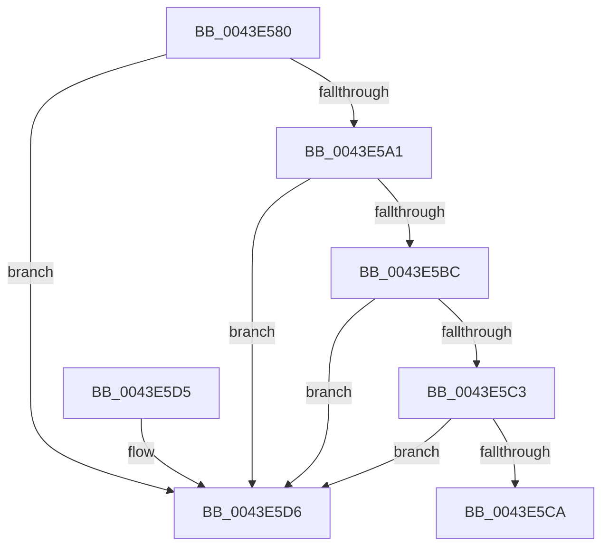

# KeCheckStackAndTargetAddress

- RVA: `0x0043E580`–`0x0043E5E0` (길이 `96` bytes)
- VA: `0x000000014043E580`
- 실행 섹션: `.text`
- PDB 이름 있음: `예`; PDB Function 태그: `아니요`
- unwind 정보 RVA: `0x000A4B2C`
- 디코드: `30`개 명령, `96/96` bytes 표시
- 미해석 바이트: `0` (있으면 어셈블리에 `.byte`로 보존)

> 이 문서는 커널 이미지의 기계어와 PDB 기호를 분석해 생성했습니다. 4번과 5번은 함수 원형과 자료형을 바이너리 사용 방식에서 추정한 C 해석이며 원본 소스 복구 결과는 아닙니다.

## 1. Dependencies

- 직접 호출 지점: **2**; 고유 호출 대상: **2**
- 직접 호출자로 확인된 함수: **4**
- RIP 상대 이미지 참조: **0**

### Outgoing calls
- `0x0043E5B3` → [KeQueryCurrentStackInformationEx](../2F/KeQueryCurrentStackInformationEx_function_002F7CD0.md) (function, `0x002F7CD0`)
- `0x0043E5DA` → [guard_icall_bugcheck](../6B/guard_icall_bugcheck_function_006BAA20.md) (function, `0x006BAA20`)

### Direct callers
- [_C_specific_handler](../4F/_C_specific_handler_function_004FD410.md) at `0x004FD446`
- [longjmp](../4F/longjmp_function_004FD5F0.md) at `0x004FD607`
- [RtlRestoreContext](../4F/RtlRestoreContext_function_004FE870.md) at `0x004FEA67`
- [RcConsolidateFrames](../4F/RcConsolidateFrames_function_004FEBC0.md) at `0x004FEC7D`

### Static image references
- 디코드된 RIP-relative 메모리 참조가 없습니다.

## 2. Other-region calls and transfers

- 다른 실행 섹션으로 향하는 call: **0**
- 별도 외부 분기/꼬리 이동을 확인하지 못했습니다.

## 3. Assembly (complete function range)

```asm
0043E580  48 89 5C 24 10                  mov qword ptr [rsp + 0x10], rbx
0043E585  57                              push rdi
0043E586  48 83 EC 20                     sub rsp, 0x20
0043E58A  33 C0                           xor eax, eax
0043E58C  48 8B DA                        mov rbx, rdx
0043E58F  48 89 44 24 48                  mov qword ptr [rsp + 0x48], rax
0043E594  48 8B F9                        mov rdi, rcx
0043E597  48 89 44 24 40                  mov qword ptr [rsp + 0x40], rax
0043E59C  48 85 C9                        test rcx, rcx
0043E59F  79 35                           jns 0x14043e5d6
0043E5A1  4C 8D 4C 24 48                  lea r9, [rsp + 0x48]
0043E5A6  48 8B CB                        mov rcx, rbx
0043E5A9  4C 8D 44 24 40                  lea r8, [rsp + 0x40]
0043E5AE  48 8D 54 24 30                  lea rdx, [rsp + 0x30]
0043E5B3  E8 18 97 EB FF                  call 0x1402f7cd0
0043E5B8  84 C0                           test al, al
0043E5BA  74 1A                           je 0x14043e5d6
0043E5BC  48 3B 5C 24 40                  cmp rbx, qword ptr [rsp + 0x40]
0043E5C1  72 13                           jb 0x14043e5d6
0043E5C3  48 3B 5C 24 48                  cmp rbx, qword ptr [rsp + 0x48]
0043E5C8  73 0C                           jae 0x14043e5d6
0043E5CA  48 8B 5C 24 38                  mov rbx, qword ptr [rsp + 0x38]
0043E5CF  48 83 C4 20                     add rsp, 0x20
0043E5D3  5F                              pop rdi
0043E5D4  C3                              ret
0043E5D5  CC                              int3
0043E5D6  CC                              int3
0043E5D7  48 8B CF                        mov rcx, rdi
0043E5DA  E8 41 C4 27 00                  call 0x1406baa20
0043E5DF  CC                              int3
```

## 4. C-style interpretation (structured pseudocode)

```c
__int64 __fastcall KeCheckStackAndTargetAddress(__int64 a1, __int64 a2)
{
    __int64 result;
    __int64 v_rsp;
    unsigned __int64 v_stack_p10;
    unsigned __int64 v_stack_p18;
    unsigned __int64 v_stack_p20;
    unsigned __int64 v_stack_p8;

    v_stack_p10 = v_rbx;
    v_rsp = (v_rsp) - (32);
    result = 0;
    v_stack_p20 = 0;
    v_stack_p18 = 0;
    if (!sign_flag) goto loc_0043E5D6;
    result = KeQueryCurrentStackInformationEx(a2, v_stack_p8, v_stack_p18, v_stack_p20);
    if ((unsigned __int8)(result) == 0) goto loc_0043E5D6;
    if (a2 < v_stack_p18) goto loc_0043E5D6;
    if (a2 >= v_stack_p20) goto loc_0043E5D6;
    v_rsp = (v_rsp) + (32);
    return result;
loc_0043E5D6:
    result = guard_icall_bugcheck(a1, v_stack_p8, v_stack_p18, v_stack_p20);
    return result;
}
```

## 5. (Beta) C Style

```c
int64_t KeCheckStackAndTargetAddress(int64_t Arg1, int64_t Arg2)
{
    int64_t result;
    int64_t local_rsp;
    uint64_t v_stack_p10;
    uint64_t v_stack_p18;
    uint64_t v_stack_p20;
    uint64_t v_stack_p8;

    v_stack_p10 = local_rbx;
    local_rsp = (local_rsp) - (32);
    result = 0;
    v_stack_p20 = 0;
    v_stack_p18 = 0;
    if (!sign_flag) goto loc_0043E5D6;
    result = KeQueryCurrentStackInformationEx(Arg2, v_stack_p8, v_stack_p18, v_stack_p20);
    if ((uint8_t)(result) == 0) goto loc_0043E5D6;
    if (Arg2 < v_stack_p18) goto loc_0043E5D6;
    if (Arg2 >= v_stack_p20) goto loc_0043E5D6;
    local_rsp = (local_rsp) + (32);
    return result;
loc_0043E5D6:
    result = guard_icall_bugcheck(Arg1, v_stack_p8, v_stack_p18, v_stack_p20);
    return result;
}
```

## 6. Execution-region graph

[열기: 2D/3D 그래프와 함수 탐색 컨트롤 패널](../../../control-panel.html?section=text&rva=0x0043E580&view=graph)

- 2D 그래프는 위에서 아래로 흐르고, 3D 그래프는 빈 공간을 드래그해 회전합니다. Shift+드래그는 이동, 휠은 확대·축소, 함수 노드 선택은 대상 보고서 이동입니다.

### Static fallback


