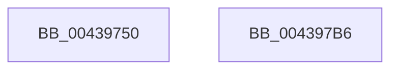

# KeCopyExceptionRecord

- RVA: `0x00439750`–`0x004397B7` (길이 `103` bytes)
- VA: `0x0000000140439750`
- 실행 섹션: `.text`
- PDB 이름 있음: `예`; PDB Function 태그: `아니요`
- unwind 정보 RVA: `0x0005C788`
- 디코드: `27`개 명령, `103/103` bytes 표시
- 미해석 바이트: `0` (있으면 어셈블리에 `.byte`로 보존)

> 이 문서는 커널 이미지의 기계어와 PDB 기호를 분석해 생성했습니다. 4번과 5번은 함수 원형과 자료형을 바이너리 사용 방식에서 추정한 C 해석이며 원본 소스 복구 결과는 아닙니다.

## 1. Dependencies

- 직접 호출 지점: **1**; 고유 호출 대상: **1**
- 직접 호출자로 확인된 함수: **5**
- RIP 상대 이미지 참조: **0**

### Outgoing calls
- `0x004397AC` → [memcpy](../6C/memcpy_function_006C6840.md) (function, `0x006C6840`)

### Direct callers
- [KiDispatchException](../3D/KiDispatchException_function_003D7650.md) at `0x003D7B1C`
- [KiDispatchException](../3D/KiDispatchException_function_003D7650.md) at `0x003D7CFD`
- [KiDispatchException$filt$0](../6D/KiDispatchException_filt_0_function_006D2CE0.md) at `0x006D2D03`
- [KiInitializeUserApc$filt$0](../6D/KiInitializeUserApc_filt_0_function_006D2D1A.md) at `0x006D2D42`
- [DbgkForwardException](../../page/8A/DbgkForwardException_function_008A2D60.md) at `0x008A2ED7`
- [DbgkpSendErrorMessage](../../page/92/DbgkpSendErrorMessage_function_009210A8.md) at `0x00921305`

### Static image references
- 디코드된 RIP-relative 메모리 참조가 없습니다.

## 2. Other-region calls and transfers

- 다른 실행 섹션으로 향하는 call: **0**
- 별도 외부 분기/꼬리 이동을 확인하지 못했습니다.

## 3. Assembly (complete function range)

```asm
00439750  48 83 EC 28                     sub rsp, 0x28
00439754  0F 57 C0                        xorps xmm0, xmm0
00439757  33 C0                           xor eax, eax
00439759  0F 11 01                        movups xmmword ptr [rcx], xmm0
0043975C  0F 11 41 10                     movups xmmword ptr [rcx + 0x10], xmm0
00439760  0F 11 41 20                     movups xmmword ptr [rcx + 0x20], xmm0
00439764  0F 11 41 30                     movups xmmword ptr [rcx + 0x30], xmm0
00439768  0F 11 41 40                     movups xmmword ptr [rcx + 0x40], xmm0
0043976C  0F 11 41 50                     movups xmmword ptr [rcx + 0x50], xmm0
00439770  0F 11 41 60                     movups xmmword ptr [rcx + 0x60], xmm0
00439774  0F 11 41 70                     movups xmmword ptr [rcx + 0x70], xmm0
00439778  0F 11 81 80 00 00 00            movups xmmword ptr [rcx + 0x80], xmm0
0043977F  48 89 81 90 00 00 00            mov qword ptr [rcx + 0x90], rax
00439786  0F 10 02                        movups xmm0, xmmword ptr [rdx]
00439789  0F 11 01                        movups xmmword ptr [rcx], xmm0
0043978C  F2 0F 10 4A 10                  movsd xmm1, qword ptr [rdx + 0x10]
00439791  F2 0F 11 49 10                  movsd qword ptr [rcx + 0x10], xmm1
00439796  8B 42 18                        mov eax, dword ptr [rdx + 0x18]
00439799  89 41 18                        mov dword ptr [rcx + 0x18], eax
0043979C  48 83 C1 20                     add rcx, 0x20
004397A0  44 8B 42 18                     mov r8d, dword ptr [rdx + 0x18]
004397A4  48 83 C2 20                     add rdx, 0x20
004397A8  49 C1 E0 03                     shl r8, 3
004397AC  E8 8F D0 28 00                  call 0x1406c6840
004397B1  48 83 C4 28                     add rsp, 0x28
004397B5  C3                              ret
004397B6  CC                              int3
```

## 4. C-style interpretation (structured pseudocode)

```c
__int64 __fastcall KeCopyExceptionRecord(__int64 a1, __int64 a2)
{
    __int64 result;
    __int64 v_rsp;

    v_rsp = (v_rsp) - (40);
    result = 0;
    *(unsigned __int64 *)(a1) = v_xmm0;
    *(unsigned __int64 *)(a1 + 16) = v_xmm0;
    *(unsigned __int64 *)(a1 + 32) = v_xmm0;
    *(unsigned __int64 *)(a1 + 48) = v_xmm0;
    *(unsigned __int64 *)(a1 + 64) = v_xmm0;
    *(unsigned __int64 *)(a1 + 80) = v_xmm0;
    *(unsigned __int64 *)(a1 + 96) = v_xmm0;
    *(unsigned __int64 *)(a1 + 112) = v_xmm0;
    *(unsigned __int64 *)(a1 + 128) = v_xmm0;
    *(unsigned __int64 *)(a1 + 144) = 0;
    *(unsigned __int64 *)(a1) = v_xmm0;
    *(unsigned __int64 *)(a1 + 16) = v_xmm1;
    *(unsigned int *)(a1 + 24) = (unsigned int)((unsigned int)(*(unsigned int *)(a2 + 24)));
    a1 = (a1) + (32);
    a2 = (a2) + (32);
    a3 = ((unsigned int)(*(unsigned int *)(a2 + 24))) << (3);
    result = memcpy(a1, a2, a3, a4);
    v_rsp = (v_rsp) + (40);
    return result;
}
```

## 5. (Beta) C Style

```c
int64_t KeCopyExceptionRecord(void *Arg1, void *Arg2)
{
    uint8_t *arg1 = (uint8_t *)Arg1;
    uint8_t *arg2 = (uint8_t *)Arg2;

    int64_t result;
    int64_t local_rsp;

    local_rsp = (local_rsp) - (40);
    result = 0;
    *(uint64_t *)(arg1) = v_xmm0;
    *(uint64_t *)(arg1 + 0x10) = v_xmm0;
    *(uint64_t *)(arg1 + 0x20) = v_xmm0;
    *(uint64_t *)(arg1 + 0x30) = v_xmm0;
    *(uint64_t *)(arg1 + 0x40) = v_xmm0;
    *(uint64_t *)(arg1 + 0x50) = v_xmm0;
    *(uint64_t *)(arg1 + 0x60) = v_xmm0;
    *(uint64_t *)(arg1 + 0x70) = v_xmm0;
    *(uint64_t *)(arg1 + 0x80) = v_xmm0;
    *(uint64_t *)(arg1 + 0x90) = 0;
    *(uint64_t *)(arg1) = v_xmm0;
    *(uint64_t *)(arg1 + 0x10) = v_xmm1;
    *(uint32_t *)(arg1 + 0x18) = (uint32_t)((uint32_t)(*(uint32_t *)(arg2 + 0x18)));
    Arg1 = (Arg1) + (32);
    Arg2 = (Arg2) + (32);
    a3 = ((uint32_t)(*(uint32_t *)(arg2 + 0x18))) << (3);
    result = memcpy(Arg1, Arg2, a3, a4);
    local_rsp = (local_rsp) + (40);
    return result;
}
```

### 관측된 메모리 오프셋

구조체 형식이 확인되지 않은 접근은 인자 기준의 오프셋으로만 기록했습니다.

| 기준 인자 | 오프셋 표현 | 폭 (bit) | 접근 |
|---|---:|---:|---|
| `Arg1` | `+ 0x0` | `128` | `R` |
| `Arg1` | `+ 0x10` | `64` | `W` |
| `Arg1` | `+ 0x10` | `128` | `R` |
| `Arg1` | `+ 0x18` | `32` | `W` |
| `Arg1` | `+ 0x20` | `128` | `R` |
| `Arg1` | `+ 0x30` | `128` | `R` |
| `Arg1` | `+ 0x40` | `128` | `R` |
| `Arg1` | `+ 0x50` | `128` | `R` |
| `Arg1` | `+ 0x60` | `128` | `R` |
| `Arg1` | `+ 0x70` | `128` | `R` |
| `Arg1` | `+ 0x80` | `128` | `R` |
| `Arg1` | `+ 0x90` | `64` | `W` |
| `Arg2` | `+ 0x0` | `128` | `R` |
| `Arg2` | `+ 0x10` | `64` | `R` |
| `Arg2` | `+ 0x18` | `32` | `R` |

## 6. Execution-region graph

[열기: 2D/3D 그래프와 함수 탐색 컨트롤 패널](../../../control-panel.html?section=text&rva=0x00439750&view=graph)

- 2D 그래프는 위에서 아래로 흐르고, 3D 그래프는 빈 공간을 드래그해 회전합니다. Shift+드래그는 이동, 휠은 확대·축소, 함수 노드 선택은 대상 보고서 이동입니다.

### Static fallback


