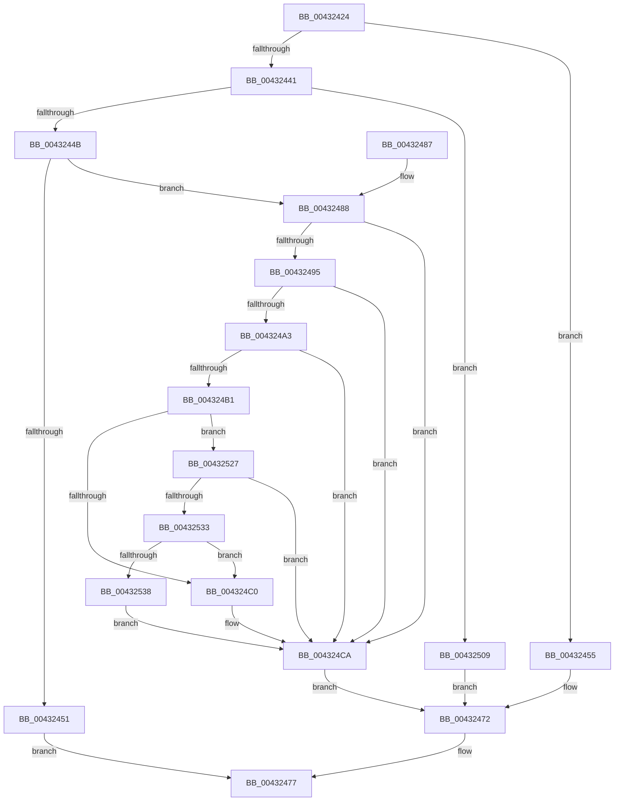

# KeQueryKvaShadowRegion

- RVA: `0x00432424`–`0x0043253A` (길이 `278` bytes)
- VA: `0x0000000140432424`
- 실행 섹션: `.text`
- PDB 이름 있음: `예`; PDB Function 태그: `아니요`
- unwind 정보 RVA: `0x000A22AC`
- 디코드: `70`개 명령, `278/278` bytes 표시
- 미해석 바이트: `0` (있으면 어셈블리에 `.byte`로 보존)

> 이 문서는 커널 이미지의 기계어와 PDB 기호를 분석해 생성했습니다. 4번과 5번은 함수 원형과 자료형을 바이너리 사용 방식에서 추정한 C 해석이며 원본 소스 복구 결과는 아닙니다.

## 1. Dependencies

- 직접 호출 지점: **1**; 고유 호출 대상: **1**
- 직접 호출자로 확인된 함수: **1**
- RIP 상대 이미지 참조: **3**

### Outgoing calls
- `0x004324DA` → [RtlSectionTableFromVirtualAddress](RtlSectionTableFromVirtualAddress_function_00432CF0.md) (function, `0x00432CF0`)

### Direct callers
- [MiCheckRelevantKernelShadows](MiCheckRelevantKernelShadows_function_004323B4.md) at `0x00432404`

### Static image references
- `0x00432488` → RVA `0x00000000` (`image boundary/outside`; read)
- `0x004324A3` → RVA `0x0000003C` (`image boundary/outside`; read)
- `0x004324CA` → RVA `0x00BCB100` (`KiDivideErrorFaultShadow`; read)

## 2. Other-region calls and transfers

- 다른 실행 섹션으로 향하는 call: **0**
- 별도 외부 분기/꼬리 이동을 확인하지 못했습니다.

## 3. Assembly (complete function range)

```asm
00432424  48 89 5C 24 08                  mov qword ptr [rsp + 8], rbx
00432429  48 89 74 24 10                  mov qword ptr [rsp + 0x10], rsi
0043242E  57                              push rdi
0043242F  48 83 EC 20                     sub rsp, 0x20
00432433  45 33 C9                        xor r9d, r9d
00432436  49 8B D8                        mov rbx, r8
00432439  48 8B FA                        mov rdi, rdx
0043243C  48 85 C9                        test rcx, rcx
0043243F  74 14                           je 0x140432455
00432441  48 83 E9 01                     sub rcx, 1
00432445  0F 84 BE 00 00 00               je 0x140432509
0043244B  48 83 F9 01                     cmp rcx, 1
0043244F  74 37                           je 0x140432488
00432451  33 C0                           xor eax, eax
00432453  EB 22                           jmp 0x140432477
00432455  65 48 8B 04 25 18 00 00 00      mov rax, qword ptr gs:[0x18]
0043245E  49 C7 00 00 50 00 00            mov qword ptr [r8], 0x5000
00432465  48 8B 08                        mov rcx, qword ptr [rax]
00432468  48 81 C1 50 D0 FF FF            add rcx, -0x2fb0
0043246F  48 89 0A                        mov qword ptr [rdx], rcx
00432472  B8 01 00 00 00                  mov eax, 1
00432477  48 8B 5C 24 30                  mov rbx, qword ptr [rsp + 0x30]
0043247C  48 8B 74 24 38                  mov rsi, qword ptr [rsp + 0x38]
00432481  48 83 C4 20                     add rsp, 0x20
00432485  5F                              pop rdi
00432486  C3                              ret
00432487  CC                              int3
00432488  48 8D 35 71 DB BC FF            lea rsi, [rip - 0x43248f]
0043248F  48 83 FE FF                     cmp rsi, -1
00432493  74 35                           je 0x1404324ca
00432495  B8 4D 5A 00 00                  mov eax, 0x5a4d
0043249A  66 39 05 5F DB BC FF            cmp word ptr [rip - 0x4324a1], ax
004324A1  75 27                           jne 0x1404324ca
004324A3  8B 15 93 DB BC FF               mov edx, dword ptr [rip - 0x43246d]
004324A9  48 03 D6                        add rdx, rsi
004324AC  48 3B D6                        cmp rdx, rsi
004324AF  72 19                           jb 0x1404324ca
004324B1  48 B9 FF FF FE FF FF 7F 00 00   movabs rcx, 0x7ffffffeffff
004324BB  48 3B F1                        cmp rsi, rcx
004324BE  76 67                           jbe 0x140432527
004324C0  81 3A 50 45 00 00               cmp dword ptr [rdx], 0x4550
004324C6  4C 0F 44 CA                     cmove r9, rdx
004324CA  4C 8D 05 2F 8C 79 00            lea r8, [rip + 0x798c2f]
004324D1  48 8B D6                        mov rdx, rsi
004324D4  44 2B C6                        sub r8d, esi
004324D7  49 8B C9                        mov rcx, r9
004324DA  E8 11 08 00 00                  call 0x140432cf0
004324DF  8B 48 0C                        mov ecx, dword ptr [rax + 0xc]
004324E2  48 03 CE                        add rcx, rsi
004324E5  48 89 0F                        mov qword ptr [rdi], rcx
004324E8  8B 48 08                        mov ecx, dword ptr [rax + 8]
004324EB  8B 40 10                        mov eax, dword ptr [rax + 0x10]
004324EE  3B C8                           cmp ecx, eax
004324F0  0F 46 C8                        cmovbe ecx, eax
004324F3  8B C1                           mov eax, ecx
004324F5  48 05 FF 0F 00 00               add rax, 0xfff
004324FB  48 25 00 F0 FF FF               and rax, 0xfffffffffffff000
00432501  48 89 03                        mov qword ptr [rbx], rax
00432504  E9 69 FF FF FF                  jmp 0x140432472
00432509  65 48 8B 04 25 20 00 00 00      mov rax, qword ptr gs:[0x20]
00432512  48 05 80 AE 00 00               add rax, 0xae80
00432518  49 C7 00 00 10 00 00            mov qword ptr [r8], 0x1000
0043251F  48 89 02                        mov qword ptr [rdx], rax
00432522  E9 4B FF FF FF                  jmp 0x140432472
00432527  48 8D 82 07 01 00 00            lea rax, [rdx + 0x107]
0043252E  48 3B C2                        cmp rax, rdx
00432531  72 97                           jb 0x1404324ca
00432533  48 3B C1                        cmp rax, rcx
00432536  76 88                           jbe 0x1404324c0
00432538  EB 90                           jmp 0x1404324ca
```

## 4. C-style interpretation (structured pseudocode)

```c
__int64 __fastcall KeQueryKvaShadowRegion(__int64 a1, __int64 a2, __int64 a3, int a4)
{
    __int64 result;
    __int64 v_rsp;
    unsigned __int64 v_stack_p10;
    unsigned __int64 v_stack_p8;

    v_stack_p8 = v_rbx;
    v_stack_p10 = v_rsi;
    v_rsp = (v_rsp) - (32);
    a4 = 0;
    if (a1 == 0) goto loc_00432455;
    a1 = (a1) - (1);
    if (condition_is_equal) goto loc_00432509;
    if (a1 == 1) goto loc_00432488;
    result = 0;
    goto loc_00432477;
loc_00432455:
    *(unsigned __int64 *)(a3) = 0x5000ULL;
    a1 = (*(unsigned __int64 *)(*(unsigned __int64 *)(gs_base + (0 + 24)))) + (0xFFFFFFFFFFFFD050ULL);
    *(unsigned __int64 *)(a2) = a1;
loc_00432472:
loc_00432477:
    v_rsp = (v_rsp) + (32);
    return 1;
loc_00432488:
    if ((v_rip - 4400271) == -1) goto loc_004324CA;
    if ((*(unsigned __int16 *)(v_rip - 4400289)) != ((unsigned __int16)((unsigned int)(0x5A4DULL)))) goto loc_004324CA;
    a2 = ((unsigned int)(*(unsigned int *)(v_rip - 4400237))) + (v_rip - 4400271);
    if (a2 < (v_rip - 4400271)) goto loc_004324CA;
    if ((v_rip - 4400271) <= a1) goto loc_00432527;
loc_004324C0:
    if ((*(unsigned int *)(a2)) == 0x4550ULL) { a4 = a2; }
loc_004324CA:
    a3 = (unsigned int)((v_rip + 7965743) - ((unsigned int)(v_rip - 4400271)));
    result = RtlSectionTableFromVirtualAddress(a4, v_rip - 4400271, a3, a4);
    a1 = ((unsigned int)(*(unsigned int *)(result + 12))) + (v_rip - 4400271);
    *(unsigned __int64 *)(a2) = a1;
    a1 = (unsigned int)(*(unsigned int *)(result + 8));
    if (((unsigned int)((unsigned int)(*(unsigned int *)(result + 8)))) <= ((unsigned int)((unsigned int)(*(unsigned int *)(result + 16))))) { a1 = (unsigned int)((unsigned int)(*(unsigned int *)(result + 16))); }
    result = ((unsigned int)((unsigned int)(a1))) + (0xFFFULL);
    result = (result) & (0xFFFFFFFFFFFFF000ULL);
    *(unsigned __int64 *)(v_stack_p8) = result;
    goto loc_00432472;
loc_00432509:
    result = (*(unsigned __int64 *)(gs_base + (0 + 32))) + (0xAE80ULL);
    *(unsigned __int64 *)(a3) = 0x1000ULL;
    *(unsigned __int64 *)(v_rip - 4400271) = result;
    goto loc_00432472;
loc_00432527:
    if ((v_rip - 4400271 + 263) < (v_rip - 4400271)) goto loc_004324CA;
    if ((v_rip - 4400271 + 263) <= a1) goto loc_004324C0;
    goto loc_004324CA;
}
```

## 5. (Beta) C Style

```c
int64_t KeQueryKvaShadowRegion(int64_t Arg1, void *Arg2, void *Arg3, int32_t Arg4)
{
    uint8_t *arg2 = (uint8_t *)Arg2;
    uint8_t *arg3 = (uint8_t *)Arg3;

    int64_t result;
    int64_t local_rsp;
    uint64_t v_stack_p10;
    uint64_t v_stack_p8;

    v_stack_p8 = local_rbx;
    v_stack_p10 = local_rsi;
    local_rsp = (local_rsp) - (32);
    Arg4 = 0;
    if (Arg1 == 0) goto loc_00432455;
    Arg1 = (Arg1) - (1);
    if (condition_is_equal) goto loc_00432509;
    if (Arg1 == 1) goto loc_00432488;
    result = 0;
    goto loc_00432477;
loc_00432455:
    *(uint64_t *)(arg3) = 0x5000ULL;
    Arg1 = (*(uint64_t *)(*(uint64_t *)(gs_base + (0 + 0x18)))) + (0xFFFFFFFFFFFFD050ULL);
    *(uint64_t *)(arg2) = Arg1;
loc_00432472:
loc_00432477:
    local_rsp = (local_rsp) + (32);
    return 1;
loc_00432488:
    if ((v_rip - 4400271) == -1) goto loc_004324CA;
    if ((*(uint16_t *)(v_rip - 0x4324A1)) != ((uint16_t)((uint32_t)(0x5A4DULL)))) goto loc_004324CA;
    Arg2 = ((uint32_t)(*(uint32_t *)(v_rip - 0x43246D))) + (v_rip - 4400271);
    if (Arg2 < (v_rip - 4400271)) goto loc_004324CA;
    if ((v_rip - 4400271) <= Arg1) goto loc_00432527;
loc_004324C0:
    if ((*(uint32_t *)(arg2)) == 0x4550ULL) { Arg4 = Arg2; }
loc_004324CA:
    Arg3 = (uint32_t)((v_rip + 7965743) - ((uint32_t)(v_rip - 4400271)));
    result = RtlSectionTableFromVirtualAddress(Arg4, v_rip - 4400271, Arg3, Arg4);
    Arg1 = ((uint32_t)(*(uint32_t *)(result + 0xC))) + (v_rip - 4400271);
    *(uint64_t *)(arg2) = Arg1;
    Arg1 = (uint32_t)(*(uint32_t *)(result + 0x8));
    if (((uint32_t)((uint32_t)(*(uint32_t *)(result + 0x8)))) <= ((uint32_t)((uint32_t)(*(uint32_t *)(result + 0x10))))) { Arg1 = (uint32_t)((uint32_t)(*(uint32_t *)(result + 0x10))); }
    result = ((uint32_t)((uint32_t)(Arg1))) + (0xFFFULL);
    result = (result) & (0xFFFFFFFFFFFFF000ULL);
    *(uint64_t *)(v_stack_p8) = result;
    goto loc_00432472;
loc_00432509:
    result = (*(uint64_t *)(gs_base + (0 + 0x20))) + (0xAE80ULL);
    *(uint64_t *)(arg3) = 0x1000ULL;
    *(uint64_t *)(v_rip - 0x43248F) = result;
    goto loc_00432472;
loc_00432527:
    if ((v_rip - 4400271 + 263) < (v_rip - 4400271)) goto loc_004324CA;
    if ((v_rip - 4400271 + 263) <= Arg1) goto loc_004324C0;
    goto loc_004324CA;
}
```

### 관측된 메모리 오프셋

구조체 형식이 확인되지 않은 접근은 인자 기준의 오프셋으로만 기록했습니다.

| 기준 인자 | 오프셋 표현 | 폭 (bit) | 접근 |
|---|---:|---:|---|
| `Arg2` | `+ 0x0` | `64` | `W` |
| `Arg3` | `+ 0x0` | `64` | `W` |

## 6. Execution-region graph

[열기: 2D/3D 그래프와 함수 탐색 컨트롤 패널](../../../control-panel.html?section=text&rva=0x00432424&view=graph)

- 2D 그래프는 위에서 아래로 흐르고, 3D 그래프는 빈 공간을 드래그해 회전합니다. Shift+드래그는 이동, 휠은 확대·축소, 함수 노드 선택은 대상 보고서 이동입니다.

### Static fallback


