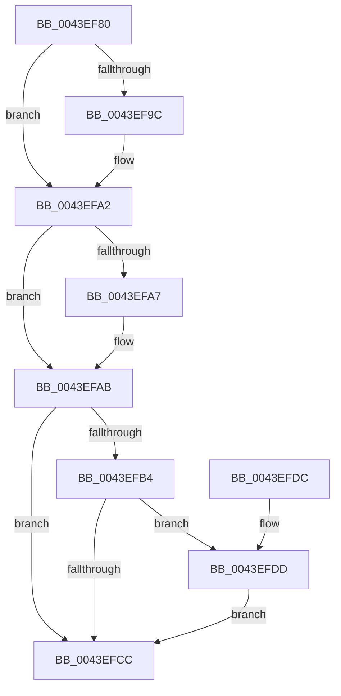

# KeQueryNodeActiveAffinity

- RVA: `0x0043EF80`–`0x0043EFED` (길이 `109` bytes)
- VA: `0x000000014043EF80`
- 실행 섹션: `.text`
- PDB 이름 있음: `예`; PDB Function 태그: `아니요`
- unwind 정보 RVA: `0x00083408`
- 디코드: `33`개 명령, `109/109` bytes 표시
- 미해석 바이트: `0` (있으면 어셈블리에 `.byte`로 보존)

> 이 문서는 커널 이미지의 기계어와 PDB 기호를 분석해 생성했습니다. 4번과 5번은 함수 원형과 자료형을 바이너리 사용 방식에서 추정한 C 해석이며 원본 소스 복구 결과는 아닙니다.

## 1. Dependencies

- 직접 호출 지점: **2**; 고유 호출 대상: **2**
- 직접 호출자로 확인된 함수: **10**
- RIP 상대 이미지 참조: **2**

### Outgoing calls
- `0x0043EFC2` → [KeGetNodePrimarySubNode](KeGetNodePrimarySubNode_function_0043EFF4.md) (function, `0x0043EFF4`)
- `0x0043EFE6` → [KiQuerySubNodeActiveAffinity](KiQuerySubNodeActiveAffinity_function_0043F060.md) (function, `0x0043F060`)

### Direct callers
- [PnpSetDeviceAffinityThread](../27/PnpSetDeviceAffinityThread_function_00271EA4.md) at `0x00271F17`
- [ExpSaPageGroupDescriptorAllocate](../3B/ExpSaPageGroupDescriptorAllocate_function_003B4224.md) at `0x003B447B`
- [MiComputeIdealDpcGang](MiComputeIdealDpcGang_function_0043EAAC.md) at `0x0043ECA2`
- [ExAllocateCacheAwarePushLock](../4C/ExAllocateCacheAwarePushLock_function_004C68C0.md) at `0x004C6A03`
- [EtwpProcessorRundown](../../page/7C/EtwpProcessorRundown_function_007C0868.md) at `0x007C0A32`
- [ExpPartitionStart](../../page/7C/ExpPartitionStart_function_007CFDCC.md) at `0x007CFE2D`
- [ExpWorkQueueManagerInitialize](../../page/7D/ExpWorkQueueManagerInitialize_function_007D01D4.md) at `0x007D0260`
- [ExpNodeCreateSystemThread](../../page/9E/ExpNodeCreateSystemThread_function_009ECFF0.md) at `0x009ED047`
- [ExpQueryNumaProcessorMap](../../page/A5/ExpQueryNumaProcessorMap_function_00A5E784.md) at `0x00A5E800`
- [MiComputeMemoryNodeProcessorAssignments](../../init/C6/MiComputeMemoryNodeProcessorAssignments_function_00C68F8C.md) at `0x00C6909A`

### Static image references
- `0x0043EFAB` → RVA `0x00FC5000` (`ALMOSTRO`; read)
- `0x0043EFB7` → RVA `0x00FCF6C0` (`CACHEALI`; read)

## 2. Other-region calls and transfers

- 다른 실행 섹션으로 향하는 call: **0**
- 별도 외부 분기/꼬리 이동을 확인하지 못했습니다.

## 3. Assembly (complete function range)

```asm
0043EF80  48 89 5C 24 08                  mov qword ptr [rsp + 8], rbx
0043EF85  48 89 74 24 10                  mov qword ptr [rsp + 0x10], rsi
0043EF8A  57                              push rdi
0043EF8B  48 83 EC 20                     sub rsp, 0x20
0043EF8F  33 F6                           xor esi, esi
0043EF91  49 8B D8                        mov rbx, r8
0043EF94  48 8B FA                        mov rdi, rdx
0043EF97  48 85 D2                        test rdx, rdx
0043EF9A  74 06                           je 0x14043efa2
0043EF9C  0F 57 C0                        xorps xmm0, xmm0
0043EF9F  0F 11 02                        movups xmmword ptr [rdx], xmm0
0043EFA2  48 85 DB                        test rbx, rbx
0043EFA5  74 04                           je 0x14043efab
0043EFA7  66 41 89 30                     mov word ptr [r8], si
0043EFAB  66 3B 0D 4E 60 B8 00            cmp cx, word ptr [rip + 0xb8604e]
0043EFB2  73 18                           jae 0x14043efcc
0043EFB4  0F B7 C9                        movzx ecx, cx
0043EFB7  48 8D 05 02 07 B9 00            lea rax, [rip + 0xb90702]
0043EFBE  48 8B 0C C8                     mov rcx, qword ptr [rax + rcx*8]
0043EFC2  E8 2D 00 00 00                  call 0x14043eff4
0043EFC7  48 85 C0                        test rax, rax
0043EFCA  75 11                           jne 0x14043efdd
0043EFCC  48 8B 5C 24 30                  mov rbx, qword ptr [rsp + 0x30]
0043EFD1  48 8B 74 24 38                  mov rsi, qword ptr [rsp + 0x38]
0043EFD6  48 83 C4 20                     add rsp, 0x20
0043EFDA  5F                              pop rdi
0043EFDB  C3                              ret
0043EFDC  CC                              int3
0043EFDD  4C 8B C3                        mov r8, rbx
0043EFE0  48 8B D7                        mov rdx, rdi
0043EFE3  48 8B C8                        mov rcx, rax
0043EFE6  E8 75 00 00 00                  call 0x14043f060
0043EFEB  EB DF                           jmp 0x14043efcc
```

## 4. C-style interpretation (structured pseudocode)

```c
__int64 __fastcall KeQueryNodeActiveAffinity(unsigned __int16 a1, __int64 a2, __int64 a3)
{
    __int64 result;
    __int64 v_rsi;
    __int64 v_rsp;
    unsigned __int64 v_stack_p10;
    unsigned __int64 v_stack_p8;

    v_stack_p8 = v_rbx;
    v_stack_p10 = v_rsi;
    v_rsp = (v_rsp) - (32);
    v_rsi = 0;
    if (a2 != 0) {
        *(unsigned __int64 *)(a2) = v_xmm0;
    }
    if (a3 != 0) {
        *(unsigned __int16 *)(a3) = 0;
    }
    if (a1 >= (*(unsigned __int16 *)(v_rip + 12083278))) goto loc_0043EFCC;
    result = KeGetNodePrimarySubNode(*(unsigned __int64 *)(v_rip + 12125954 + a1 * 8), a2, a3, a4);
    if (result != 0) goto loc_0043EFDD;
loc_0043EFCC:
    v_rsp = (v_rsp) + (32);
    return result;
loc_0043EFDD:
    result = KiQuerySubNodeActiveAffinity(result, a2, v_stack_p8, a4);
    goto loc_0043EFCC;
}
```

## 5. (Beta) C Style

```c
int64_t KeQueryNodeActiveAffinity(uint16_t Arg1, int64_t Arg2, void *Arg3)
{
    uint8_t *arg3 = (uint8_t *)Arg3;

    int64_t result;
    int64_t local_rsi;
    int64_t local_rsp;
    uint64_t v_stack_p10;
    uint64_t v_stack_p8;

    v_stack_p8 = local_rbx;
    v_stack_p10 = local_rsi;
    local_rsp = (local_rsp) - (32);
    local_rsi = 0;
    if (Arg2 != 0) {
        *(uint64_t *)(Arg2) = v_xmm0;
    }
    if (Arg3 != NULL) {
        *(uint16_t *)(arg3) = 0;
    }
    if (Arg1 >= (*(uint16_t *)(v_rip + 0xB8604E))) goto loc_0043EFCC;
    result = KeGetNodePrimarySubNode(*(uint64_t *)(v_rip + 0xB90702 + Arg1 * 8), Arg2, Arg3, a4);
    if (result != 0) goto loc_0043EFDD;
loc_0043EFCC:
    local_rsp = (local_rsp) + (32);
    return result;
loc_0043EFDD:
    result = KiQuerySubNodeActiveAffinity(result, Arg2, v_stack_p8, a4);
    goto loc_0043EFCC;
}
```

### 관측된 메모리 오프셋

구조체 형식이 확인되지 않은 접근은 인자 기준의 오프셋으로만 기록했습니다.

| 기준 인자 | 오프셋 표현 | 폭 (bit) | 접근 |
|---|---:|---:|---|
| `Arg3` | `+ 0x0` | `16` | `W` |

## 6. Execution-region graph

[열기: 2D/3D 그래프와 함수 탐색 컨트롤 패널](../../../control-panel.html?section=text&rva=0x0043EF80&view=graph)

- 2D 그래프는 위에서 아래로 흐르고, 3D 그래프는 빈 공간을 드래그해 회전합니다. Shift+드래그는 이동, 휠은 확대·축소, 함수 노드 선택은 대상 보고서 이동입니다.

### Static fallback


