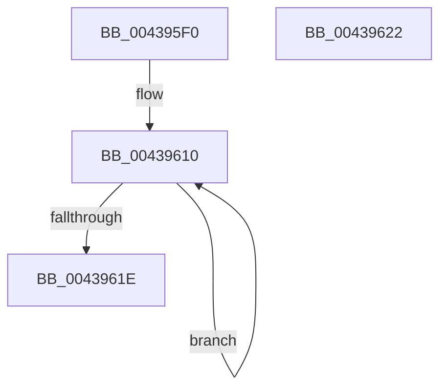

# KeQueryUnbiasedInterruptTime

- RVA: `0x004395F0`–`0x00439623` (길이 `51` bytes)
- VA: `0x00000001404395F0`
- 실행 섹션: `.text`
- PDB 이름 있음: `예`; PDB Function 태그: `아니요`
- unwind 정보 RVA: `0x000DB714`
- 디코드: `12`개 명령, `51/51` bytes 표시
- 미해석 바이트: `0` (있으면 어셈블리에 `.byte`로 보존)

> 이 문서는 커널 이미지의 기계어와 PDB 기호를 분석해 생성했습니다. 4번과 5번은 함수 원형과 자료형을 바이너리 사용 방식에서 추정한 C 해석이며 원본 소스 복구 결과는 아닙니다.

## 1. Dependencies

- 직접 호출 지점: **0**; 고유 호출 대상: **0**
- 직접 호출자로 확인된 함수: **0**
- RIP 상대 이미지 참조: **0**

### Outgoing calls
- 직접 디코드된 call 명령이 없습니다.

### Direct callers
- 이 함수 시작 RVA로 연결되는 직접 call은 확인되지 않았습니다. 간접 호출은 완전히 역산할 수 없습니다.

### Static image references
- 디코드된 RIP-relative 메모리 참조가 없습니다.

## 2. Other-region calls and transfers

- 다른 실행 섹션으로 향하는 call: **0**
- 별도 외부 분기/꼬리 이동을 확인하지 못했습니다.

## 3. Assembly (complete function range)

```asm
004395F0  49 B8 B0 03 00 00 80 F7 FF FF   movabs r8, 0xfffff780000003b0
004395FA  49 B9 08 00 00 00 80 F7 FF FF   movabs r9, 0xfffff78000000008
00439604  0F 1F 40 00                     nop dword ptr [rax]
00439608  0F 1F 84 00 00 00 00 00         nop dword ptr [rax + rax]
00439610  49 8B 08                        mov rcx, qword ptr [r8]
00439613  49 8B 01                        mov rax, qword ptr [r9]
00439616  49 8B 10                        mov rdx, qword ptr [r8]
00439619  48 3B CA                        cmp rcx, rdx
0043961C  75 F2                           jne 0x140439610
0043961E  48 2B C1                        sub rax, rcx
00439621  C3                              ret
00439622  CC                              int3
```

## 4. C-style interpretation (structured pseudocode)

```c
__int64 __fastcall KeQueryUnbiasedInterruptTime(void)
{
    __int64 result;

loc_00439610:
    if ((*(unsigned __int64 *)(a3)) != (*(unsigned __int64 *)(a3))) goto loc_00439610;
    result = (*(unsigned __int64 *)(a4)) - (*(unsigned __int64 *)(a3));
    return result;
}
```

## 5. (Beta) C Style

```c
void KeQueryUnbiasedInterruptTime(void)
{
    int64_t result;

loc_00439610:
    if ((*(uint64_t *)(a3)) != (*(uint64_t *)(a3))) goto loc_00439610;
    result = (*(uint64_t *)(a4)) - (*(uint64_t *)(a3));
    return result;
}
```

## 6. Execution-region graph

[열기: 2D/3D 그래프와 함수 탐색 컨트롤 패널](../../../control-panel.html?section=text&rva=0x004395F0&view=graph)

- 2D 그래프는 위에서 아래로 흐르고, 3D 그래프는 빈 공간을 드래그해 회전합니다. Shift+드래그는 이동, 휠은 확대·축소, 함수 노드 선택은 대상 보고서 이동입니다.

### Static fallback


