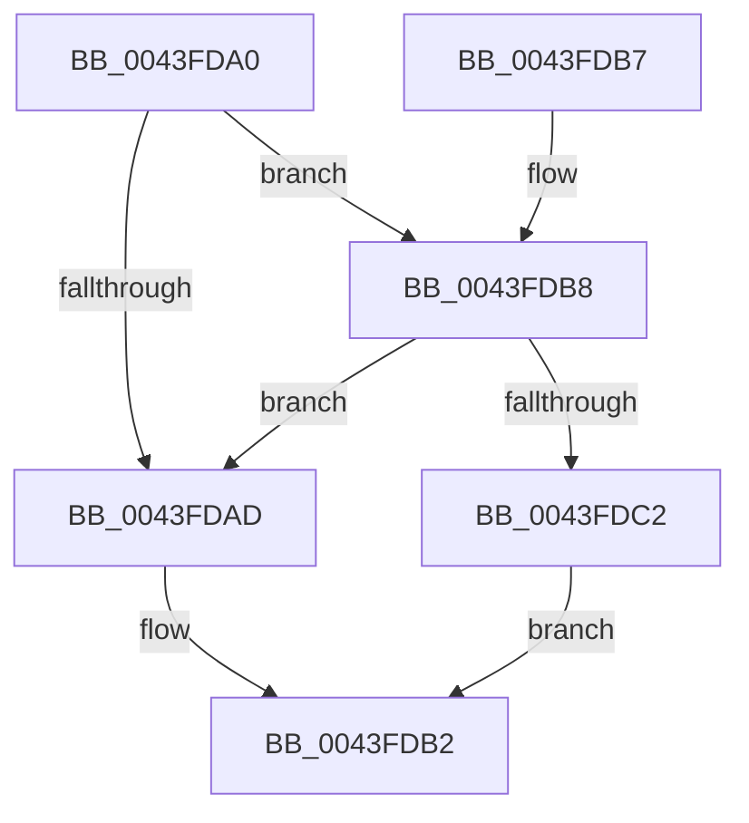

# KeReleaseSpinLockFromDpcLevel

- RVA: `0x0043FDA0`–`0x0043FDCE` (길이 `46` bytes)
- VA: `0x000000014043FDA0`
- 실행 섹션: `.text`
- PDB 이름 있음: `예`; PDB Function 태그: `아니요`
- unwind 정보 RVA: `0x00068370`
- 디코드: `13`개 명령, `46/46` bytes 표시
- 미해석 바이트: `0` (있으면 어셈블리에 `.byte`로 보존)

> 이 문서는 커널 이미지의 기계어와 PDB 기호를 분석해 생성했습니다. 4번과 5번은 함수 원형과 자료형을 바이너리 사용 방식에서 추정한 C 해석이며 원본 소스 복구 결과는 아닙니다.

## 1. Dependencies

- 직접 호출 지점: **1**; 고유 호출 대상: **1**
- 직접 호출자로 확인된 함수: **1**
- RIP 상대 이미지 참조: **2**

### Outgoing calls
- `0x0043FDC7` → [KiReleaseSpinLockInstrumented](../39/KiReleaseSpinLockInstrumented_function_00392EF0.md) (function, `0x00392EF0`)

### Direct callers
- [sub_0051AC80](../51/Unknown_function_0051AC80.md) at `0x0051ACA5`

### Static image references
- `0x0043FDA4` → RVA `0x00FC6B06` (`ALMOSTRO`; read)
- `0x0043FDB8` → RVA `0x00F0DE58` (`.data`; read)

## 2. Other-region calls and transfers

- 다른 실행 섹션으로 향하는 call: **0**
- 별도 외부 분기/꼬리 이동을 확인하지 못했습니다.

## 3. Assembly (complete function range)

```asm
0043FDA0  48 83 EC 28                     sub rsp, 0x28
0043FDA4  F6 05 5B 6D B8 00 01            test byte ptr [rip + 0xb86d5b], 1
0043FDAB  75 0B                           jne 0x14043fdb8
0043FDAD  F0 48 83 21 00                  lock and qword ptr [rcx], 0
0043FDB2  48 83 C4 28                     add rsp, 0x28
0043FDB6  C3                              ret
0043FDB7  CC                              int3
0043FDB8  8B 05 9A E0 AC 00               mov eax, dword ptr [rip + 0xace09a]
0043FDBE  85 C0                           test eax, eax
0043FDC0  75 EB                           jne 0x14043fdad
0043FDC2  48 8B 54 24 28                  mov rdx, qword ptr [rsp + 0x28]
0043FDC7  E8 24 31 F5 FF                  call 0x140392ef0
0043FDCC  EB E4                           jmp 0x14043fdb2
```

## 4. C-style interpretation (structured pseudocode)

```c
__int64 __fastcall KeReleaseSpinLockFromDpcLevel(__int64 a1)
{
    __int64 result;
    __int64 v_rsp;
    unsigned __int64 v_stack_p28;

    v_rsp = (v_rsp) - (40);
    if (((*(unsigned __int8 *)(v_rip + 12086619)) & (1)) != 0) goto loc_0043FDB8;
loc_0043FDAD:
loc_0043FDB2:
    v_rsp = (v_rsp) + (40);
    return result;
loc_0043FDB8:
    if ((unsigned int)((unsigned int)(*(unsigned int *)(v_rip + 11329690))) != 0) goto loc_0043FDAD;
    result = KiReleaseSpinLockInstrumented(a1, v_stack_p28, a3, a4);
    goto loc_0043FDB2;
}
```

## 5. (Beta) C Style

```c
int64_t KeReleaseSpinLockFromDpcLevel(void *Arg1)
{
    uint8_t *arg1 = (uint8_t *)Arg1;

    int64_t result;
    int64_t local_rsp;
    uint64_t v_stack_p28;

    local_rsp = (local_rsp) - (40);
    if (((*(uint8_t *)(v_rip + 0xB86D5B)) & (1)) != 0) goto loc_0043FDB8;
loc_0043FDAD:
loc_0043FDB2:
    local_rsp = (local_rsp) + (40);
    return result;
loc_0043FDB8:
    if ((uint32_t)((uint32_t)(*(uint32_t *)(v_rip + 0xACE09A))) != 0) goto loc_0043FDAD;
    result = KiReleaseSpinLockInstrumented(Arg1, v_stack_p28, a3, a4);
    goto loc_0043FDB2;
}
```

### 관측된 메모리 오프셋

구조체 형식이 확인되지 않은 접근은 인자 기준의 오프셋으로만 기록했습니다.

| 기준 인자 | 오프셋 표현 | 폭 (bit) | 접근 |
|---|---:|---:|---|
| `Arg1` | `+ 0x0` | `64` | `R/W` |

## 6. Execution-region graph

[열기: 2D/3D 그래프와 함수 탐색 컨트롤 패널](../../../control-panel.html?section=text&rva=0x0043FDA0&view=graph)

- 2D 그래프는 위에서 아래로 흐르고, 3D 그래프는 빈 공간을 드래그해 회전합니다. Shift+드래그는 이동, 휠은 확대·축소, 함수 노드 선택은 대상 보고서 이동입니다.

### Static fallback


