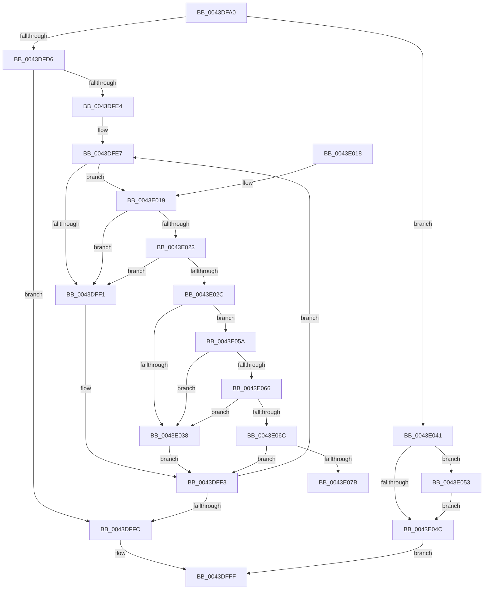

# KeSignalCallDpcSynchronize

- RVA: `0x0043DFA0`–`0x0043E085` (길이 `229` bytes)
- VA: `0x000000014043DFA0`
- 실행 섹션: `.text`
- PDB 이름 있음: `예`; PDB Function 태그: `예`
- unwind 정보 RVA: `0x000A4A40`
- 디코드: `79`개 명령, `229/229` bytes 표시
- 미해석 바이트: `0` (있으면 어셈블리에 `.byte`로 보존)

> 이 문서는 커널 이미지의 기계어와 PDB 기호를 분석해 생성했습니다. 4번과 5번은 함수 원형과 자료형을 바이너리 사용 방식에서 추정한 C 해석이며 원본 소스 복구 결과는 아닙니다.

## 1. Dependencies

- 직접 호출 지점: **4**; 고유 호출 대상: **4**
- 직접 호출자로 확인된 함수: **2**
- RIP 상대 이미지 참조: **3**

### Outgoing calls
- `0x0043E023` → [KiCheckVpBackingLongSpinWaitHypercall](../30/KiCheckVpBackingLongSpinWaitHypercall_function_0030F490.md) (function, `0x0030F490`)
- `0x0043E02F` → [KeCanUseHaltOnAddress](../4F/KeCanUseHaltOnAddress_function_004FC22C.md) (function, `0x004FC22C`)
- `0x0043E03A` → [HvlNotifyLongSpinWait](../30/HvlNotifyLongSpinWait_function_0030F460.md) (function, `0x0030F460`)
- `0x0043E053` → [KeWakeAddressAll](../21/KeWakeAddressAll_function_00217C20.md) (function, `0x00217C20`)

### Direct callers
- [KiInitializeDynamicProcessorDpc](../../pagelk/B6/KiInitializeDynamicProcessorDpc_function_00B67A30.md) at `0x00B67A6F`
- [MiApplyImageHotPatchDpc](../../pagelk/B7/MiApplyImageHotPatchDpc_function_00B74A20.md) at `0x00B74A3E`
- [MiApplyImageHotPatchDpc](../../pagelk/B7/MiApplyImageHotPatchDpc_function_00B74A20.md) at `0x00B74B14`

### Static image references
- `0x0043DFE9` → RVA `0x00FC52AC` (`ALMOSTRO`; reference)
- `0x0043E019` → RVA `0x00FC6AB8` (`ALMOSTRO`; read)
- `0x0043E05A` → RVA `0x00FC6B38` (`ALMOSTRO`; read)

## 2. Other-region calls and transfers

- 다른 실행 섹션으로 향하는 call: **0**
- call이 아닌 외부 분기/꼬리 이동: **1**
  - `0x0043E080` → [sub_006EF7B6](../6E/Unknown_function_006EF7B6.md) (`tail-transfer`)

## 3. Assembly (complete function range)

```asm
0043DFA0  48 89 5C 24 10                  mov qword ptr [rsp + 0x10], rbx
0043DFA5  48 89 6C 24 18                  mov qword ptr [rsp + 0x18], rbp
0043DFAA  56                              push rsi
0043DFAB  57                              push rdi
0043DFAC  41 54                           push r12
0043DFAE  41 56                           push r14
0043DFB0  41 57                           push r15
0043DFB2  48 83 EC 20                     sub rsp, 0x20
0043DFB6  48 8B F9                        mov rdi, rcx
0043DFB9  83 C8 FF                        or eax, 0xffffffff
0043DFBC  F0 0F C1 01                     lock xadd dword ptr [rcx], eax
0043DFC0  FF C8                           dec eax
0043DFC2  41 BC 00 00 00 80               mov r12d, 0x80000000
0043DFC8  8B D8                           mov ebx, eax
0043DFCA  F7 D3                           not ebx
0043DFCC  41 23 DC                        and ebx, r12d
0043DFCF  A9 FF FF FF 3F                  test eax, 0x3fffffff
0043DFD4  74 6B                           je 0x14043e041
0043DFD6  8B 01                           mov eax, dword ptr [rcx]
0043DFD8  33 ED                           xor ebp, ebp
0043DFDA  41 23 C4                        and eax, r12d
0043DFDD  45 33 FF                        xor r15d, r15d
0043DFE0  3B C3                           cmp eax, ebx
0043DFE2  74 18                           je 0x14043dffc
0043DFE4  8D 75 01                        lea esi, [rbp + 1]
0043DFE7  03 EE                           add ebp, esi
0043DFE9  85 2D BD 72 B8 00               test dword ptr [rip + 0xb872bd], ebp
0043DFEF  74 28                           je 0x14043e019
0043DFF1  F3 90                           pause
0043DFF3  8B 07                           mov eax, dword ptr [rdi]
0043DFF5  41 23 C4                        and eax, r12d
0043DFF8  3B C3                           cmp eax, ebx
0043DFFA  75 EB                           jne 0x14043dfe7
0043DFFC  90                              nop
0043DFFD  33 F6                           xor esi, esi
0043DFFF  48 8B 5C 24 58                  mov rbx, qword ptr [rsp + 0x58]
0043E004  8B C6                           mov eax, esi
0043E006  48 8B 6C 24 60                  mov rbp, qword ptr [rsp + 0x60]
0043E00B  48 83 C4 20                     add rsp, 0x20
0043E00F  41 5F                           pop r15
0043E011  41 5E                           pop r14
0043E013  41 5C                           pop r12
0043E015  5F                              pop rdi
0043E016  5E                              pop rsi
0043E017  C3                              ret
0043E018  CC                              int3
0043E019  8B 05 99 8A B8 00               mov eax, dword ptr [rip + 0xb88a99]
0043E01F  A8 40                           test al, 0x40
0043E021  74 CE                           je 0x14043dff1
0043E023  E8 68 14 ED FF                  call 0x14030f490
0043E028  84 C0                           test al, al
0043E02A  74 C5                           je 0x14043dff1
0043E02C  44 03 FE                        add r15d, esi
0043E02F  E8 F8 E1 0B 00                  call 0x1404fc22c
0043E034  84 C0                           test al, al
0043E036  75 22                           jne 0x14043e05a
0043E038  8B CD                           mov ecx, ebp
0043E03A  E8 21 14 ED FF                  call 0x14030f460
0043E03F  EB B2                           jmp 0x14043dff3
0043E041  0B 59 04                        or ebx, dword ptr [rcx + 4]
0043E044  87 19                           xchg dword ptr [rcx], ebx
0043E046  0F BA E3 1E                     bt ebx, 0x1e
0043E04A  72 07                           jb 0x14043e053
0043E04C  BE 01 00 00 00                  mov esi, 1
0043E051  EB AC                           jmp 0x14043dfff
0043E053  E8 C8 9B DD FF                  call 0x140217c20
0043E058  EB F2                           jmp 0x14043e04c
0043E05A  F7 05 D4 8A B8 00 00 00 02 00   test dword ptr [rip + 0xb88ad4], 0x20000
0043E064  74 D2                           je 0x14043e038
0043E066  41 F6 C7 07                     test r15b, 7
0043E06A  75 CC                           jne 0x14043e038
0043E06C  8B 0F                           mov ecx, dword ptr [rdi]
0043E06E  8B C1                           mov eax, ecx
0043E070  41 23 C4                        and eax, r12d
0043E073  3B C3                           cmp eax, ebx
0043E075  0F 84 78 FF FF FF               je 0x14043dff3
0043E07B  8B D1                           mov edx, ecx
0043E07D  44 8B C1                        mov r8d, ecx
0043E080  E9 31 17 2B 00                  jmp 0x1406ef7b6
```

## 4. C-style interpretation (structured pseudocode)

```c
__int64 __fastcall KeSignalCallDpcSynchronize(__int64 a1)
{
    __int64 result;
    __int64 v_r15;
    __int64 v_rbp;
    __int64 v_rbx;
    __int64 v_rsi;
    __int64 v_rsp;
    unsigned __int64 v_stack_p10;
    unsigned __int64 v_stack_p18;

    v_stack_p10 = v_rbx;
    v_stack_p18 = v_rbp;
    v_rsp = (v_rsp) - (32);
    result = (unsigned int)((result) | (0xFFFFFFFFULL));
    result = (unsigned int)((result) - 1);
    v_rbx = (unsigned int)(~((unsigned int)((unsigned int)(result))));
    v_rbx = (unsigned int)((v_rbx) & ((unsigned int)((unsigned int)(0x80000000ULL))));
    if ((((unsigned int)(result)) & (0x3FFFFFFFULL)) == 0) goto loc_0043E041;
    v_rbp = 0;
    result = (unsigned int)(((unsigned int)(*(unsigned int *)(a1))) & ((unsigned int)((unsigned int)(0x80000000ULL))));
    v_r15 = 0;
    if (((unsigned int)(result)) == ((unsigned int)(v_rbx))) goto loc_0043DFFC;
loc_0043DFE7:
    v_rbp = (unsigned int)((v_rbp) + ((unsigned int)(v_rbp + 1)));
    if (((*(unsigned int *)(v_rip + 12087997)) & ((unsigned int)(v_rbp))) == 0) goto loc_0043E019;
loc_0043DFF1:
loc_0043DFF3:
    result = (unsigned int)(((unsigned int)(*(unsigned int *)(a1))) & ((unsigned int)((unsigned int)(0x80000000ULL))));
    if (((unsigned int)(result)) != ((unsigned int)(v_rbx))) goto loc_0043DFE7;
loc_0043DFFC:
    v_rsi = 0;
loc_0043DFFF:
    v_rsp = (v_rsp) + (32);
    return 0;
loc_0043E019:
    if ((((unsigned __int8)((unsigned int)(*(unsigned int *)(v_rip + 12094105)))) & (64)) == 0) goto loc_0043DFF1;
    result = KiCheckVpBackingLongSpinWaitHypercall(a1, a2, a3, a4);
    if ((unsigned __int8)(result) == 0) goto loc_0043DFF1;
    v_r15 = (unsigned int)((v_r15) + (0));
    result = KeCanUseHaltOnAddress(a1, a2, a3, a4);
    if ((unsigned __int8)(result) != 0) goto loc_0043E05A;
loc_0043E038:
    result = HvlNotifyLongSpinWait((unsigned int)((unsigned int)(v_stack_p18)), a2, a3, a4);
    goto loc_0043DFF3;
loc_0043E041:
    v_rbx = (unsigned int)((v_stack_p10) | (*(unsigned int *)((unsigned int)((unsigned int)(v_stack_p18)) + 4)));
    if (condition_is_below) goto loc_0043E053;
loc_0043E04C:
    goto loc_0043DFFF;
loc_0043E053:
    result = KeWakeAddressAll((unsigned int)((unsigned int)(v_stack_p18)), a2, a3, a4);
    goto loc_0043E04C;
loc_0043E05A:
    if (((*(unsigned int *)(v_rip + 12094164)) & (0x20000ULL)) == 0) goto loc_0043E038;
    if ((((unsigned __int8)(v_r15)) & (7)) != 0) goto loc_0043E038;
    result = (unsigned int)(((unsigned int)((unsigned int)((unsigned int)(*(unsigned int *)(a1))))) & ((unsigned int)((unsigned int)(0x80000000ULL))));
    if (((unsigned int)(result)) == ((unsigned int)(v_rbx))) goto loc_0043DFF3;
}
```

## 5. (Beta) C Style

```c
int64_t KeSignalCallDpcSynchronize(void *Arg1)
{
    uint8_t *arg1 = (uint8_t *)Arg1;

    int64_t result;
    int64_t local_r15;
    int64_t local_rbp;
    int64_t local_rbx;
    int64_t local_rsi;
    int64_t local_rsp;
    uint64_t v_stack_p10;
    uint64_t v_stack_p18;

    v_stack_p10 = local_rbx;
    v_stack_p18 = local_rbp;
    local_rsp = (local_rsp) - (32);
    result = (uint32_t)((result) | (0xFFFFFFFFULL));
    result = (uint32_t)((result) - 1);
    local_rbx = (uint32_t)(~((uint32_t)((uint32_t)(result))));
    local_rbx = (uint32_t)((local_rbx) & ((uint32_t)((uint32_t)(0x80000000ULL))));
    if ((((uint32_t)(result)) & (0x3FFFFFFFULL)) == 0) goto loc_0043E041;
    local_rbp = 0;
    result = (uint32_t)(((uint32_t)(*(uint32_t *)(arg1))) & ((uint32_t)((uint32_t)(0x80000000ULL))));
    local_r15 = 0;
    if (((uint32_t)(result)) == ((uint32_t)(local_rbx))) goto loc_0043DFFC;
loc_0043DFE7:
    local_rbp = (uint32_t)((local_rbp) + ((uint32_t)(local_rbp + 1)));
    if (((*(uint32_t *)(v_rip + 0xB872BD)) & ((uint32_t)(local_rbp))) == 0) goto loc_0043E019;
loc_0043DFF1:
loc_0043DFF3:
    result = (uint32_t)(((uint32_t)(*(uint32_t *)(arg1))) & ((uint32_t)((uint32_t)(0x80000000ULL))));
    if (((uint32_t)(result)) != ((uint32_t)(local_rbx))) goto loc_0043DFE7;
loc_0043DFFC:
    local_rsi = 0;
loc_0043DFFF:
    local_rsp = (local_rsp) + (32);
    return 0;
loc_0043E019:
    if ((((uint8_t)((uint32_t)(*(uint32_t *)(v_rip + 0xB88A99)))) & (64)) == 0) goto loc_0043DFF1;
    result = KiCheckVpBackingLongSpinWaitHypercall(Arg1, a2, a3, a4);
    if ((uint8_t)(result) == 0) goto loc_0043DFF1;
    local_r15 = (uint32_t)((local_r15) + (0));
    result = KeCanUseHaltOnAddress(Arg1, a2, a3, a4);
    if ((uint8_t)(result) != 0) goto loc_0043E05A;
loc_0043E038:
    result = HvlNotifyLongSpinWait((uint32_t)((uint32_t)(v_stack_p18)), a2, a3, a4);
    goto loc_0043DFF3;
loc_0043E041:
    local_rbx = (uint32_t)((v_stack_p10) | (*(uint32_t *)((uint32_t)((uint32_t)(v_stack_p18)) + 0x4)));
    if (condition_is_below) goto loc_0043E053;
loc_0043E04C:
    goto loc_0043DFFF;
loc_0043E053:
    result = KeWakeAddressAll((uint32_t)((uint32_t)(v_stack_p18)), a2, a3, a4);
    goto loc_0043E04C;
loc_0043E05A:
    if (((*(uint32_t *)(v_rip + 0xB88AD4)) & (0x20000ULL)) == 0) goto loc_0043E038;
    if ((((uint8_t)(local_r15)) & (7)) != 0) goto loc_0043E038;
    result = (uint32_t)(((uint32_t)((uint32_t)((uint32_t)(*(uint32_t *)(arg1))))) & ((uint32_t)((uint32_t)(0x80000000ULL))));
    if (((uint32_t)(result)) == ((uint32_t)(local_rbx))) goto loc_0043DFF3;
}
```

### 관측된 메모리 오프셋

구조체 형식이 확인되지 않은 접근은 인자 기준의 오프셋으로만 기록했습니다.

| 기준 인자 | 오프셋 표현 | 폭 (bit) | 접근 |
|---|---:|---:|---|
| `Arg1` | `+ 0x0` | `32` | `R` |
| `Arg1` | `+ 0x0` | `32` | `R/W` |
| `Arg1` | `+ 0x4` | `32` | `R` |

## 6. Execution-region graph

[열기: 2D/3D 그래프와 함수 탐색 컨트롤 패널](../../../control-panel.html?section=text&rva=0x0043DFA0&view=graph)

- 2D 그래프는 위에서 아래로 흐르고, 3D 그래프는 빈 공간을 드래그해 회전합니다. Shift+드래그는 이동, 휠은 확대·축소, 함수 노드 선택은 대상 보고서 이동입니다.

### Static fallback


