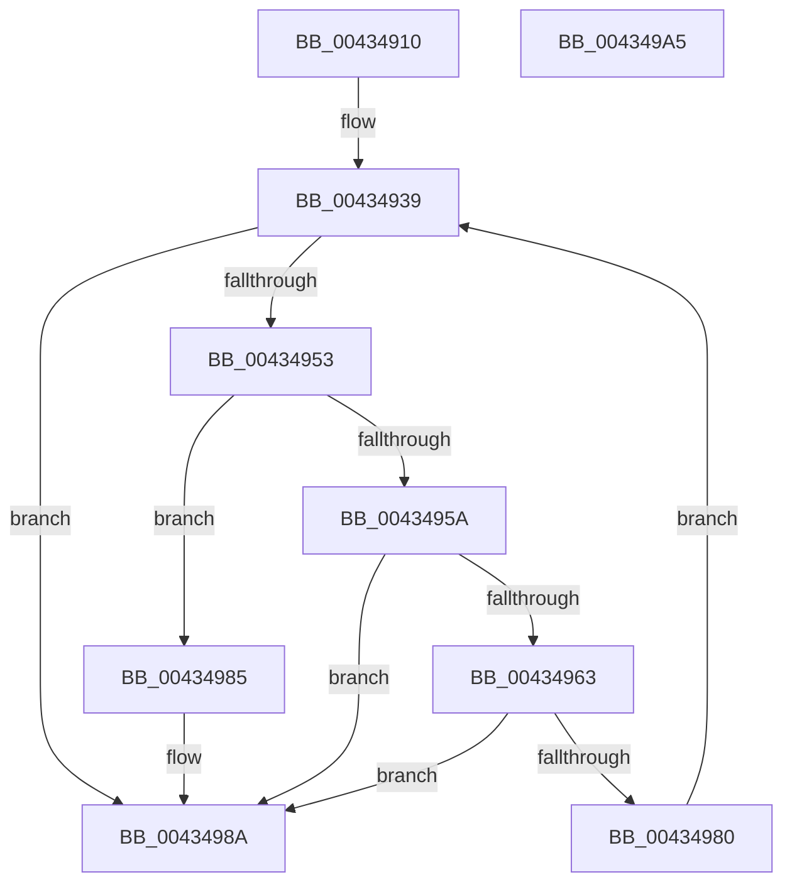

# KiAcquirePrcbLocksForPreemptionAttemptSlowPath

- RVA: `0x00434910`–`0x004349A6` (길이 `150` bytes)
- VA: `0x0000000140434910`
- 실행 섹션: `.text`
- PDB 이름 있음: `예`; PDB Function 태그: `아니요`
- unwind 정보 RVA: `0x0005E6B4`
- 디코드: `47`개 명령, `150/150` bytes 표시
- 미해석 바이트: `0` (있으면 어셈블리에 `.byte`로 보존)

> 이 문서는 커널 이미지의 기계어와 PDB 기호를 분석해 생성했습니다. 4번과 5번은 함수 원형과 자료형을 바이너리 사용 방식에서 추정한 C 해석이며 원본 소스 복구 결과는 아닙니다.

## 1. Dependencies

- 직접 호출 지점: **4**; 고유 호출 대상: **4**
- 직접 호출자로 확인된 함수: **5**
- RIP 상대 이미지 참조: **0**

### Outgoing calls
- `0x0043495A` → [KiTryUpgradeIsolationUnitLockHandle](../5B/KiTryUpgradeIsolationUnitLockHandle_function_005B23E0.md) (function, `0x005B23E0`)
- `0x00434966` → [KiReleasePrcbLocksForIsolationUnit](../39/KiReleasePrcbLocksForIsolationUnit_function_00399C50.md) (function, `0x00399C50`)
- `0x00434973` → [KiAcquirePrcbLocksForIsolationUnit](../30/KiAcquirePrcbLocksForIsolationUnit_function_0030ED60.md) (function, `0x0030ED60`)
- `0x00434985` → [KiDowngradeIsolationUnitLockHandle](../35/KiDowngradeIsolationUnitLockHandle_function_00353FB0.md) (function, `0x00353FB0`)

### Direct callers
- [sub_002546EC](../25/Unknown_function_002546EC.md) at `0x00254B73`
- [sub_002546EC](../25/Unknown_function_002546EC.md) at `0x00254B87`
- [KiHeteroSelectProcessorToPreempt](../25/KiHeteroSelectProcessorToPreempt_function_002560D0.md) at `0x002565FC`
- [KiEnterLongDpcProcessing](../30/KiEnterLongDpcProcessing_function_0030BE54.md) at `0x0030C223`
- [sub_0030ED47](../30/Unknown_function_0030ED47.md) at `0x0030ED50`
- [sub_004348BE](Unknown_function_004348BE.md) at `0x004348C7`

### Static image references
- 디코드된 RIP-relative 메모리 참조가 없습니다.

## 2. Other-region calls and transfers

- 다른 실행 섹션으로 향하는 call: **0**
- 별도 외부 분기/꼬리 이동을 확인하지 못했습니다.

## 3. Assembly (complete function range)

```asm
00434910  48 8B C4                        mov rax, rsp
00434913  48 89 58 08                     mov qword ptr [rax + 8], rbx
00434917  48 89 68 10                     mov qword ptr [rax + 0x10], rbp
0043491B  48 89 70 18                     mov qword ptr [rax + 0x18], rsi
0043491F  48 89 78 20                     mov qword ptr [rax + 0x20], rdi
00434923  41 56                           push r14
00434925  48 83 EC 20                     sub rsp, 0x20
00434929  45 8B 08                        mov r9d, dword ptr [r8]
0043492C  49 8B F0                        mov rsi, r8
0043492F  41 83 E1 01                     and r9d, 1
00434933  44 8B F2                        mov r14d, edx
00434936  48 8B E9                        mov rbp, rcx
00434939  48 8B 5D 38                     mov rbx, qword ptr [rbp + 0x38]
0043493D  41 8B FE                        mov edi, r14d
00434940  0F B6 1B                        movzx ebx, byte ptr [rbx]
00434943  8B C3                           mov eax, ebx
00434945  C1 E8 07                        shr eax, 7
00434948  44 3B F0                        cmp r14d, eax
0043494B  0F 4C F8                        cmovl edi, eax
0043494E  41 3B F9                        cmp edi, r9d
00434951  74 37                           je 0x14043498a
00434953  8B D7                           mov edx, edi
00434955  48 8B CE                        mov rcx, rsi
00434958  7C 2B                           jl 0x140434985
0043495A  E8 81 DA 17 00                  call 0x1405b23e0
0043495F  84 C0                           test al, al
00434961  75 27                           jne 0x14043498a
00434963  48 8B CE                        mov rcx, rsi
00434966  E8 E5 52 F6 FF                  call 0x140399c50
0043496B  4C 8B C6                        mov r8, rsi
0043496E  8B D7                           mov edx, edi
00434970  48 8B CD                        mov rcx, rbp
00434973  E8 E8 A3 ED FF                  call 0x14030ed60
00434978  48 8B 45 38                     mov rax, qword ptr [rbp + 0x38]
0043497C  32 18                           xor bl, byte ptr [rax]
0043497E  79 0A                           jns 0x14043498a
00434980  44 8B CF                        mov r9d, edi
00434983  EB B4                           jmp 0x140434939
00434985  E8 26 F6 F1 FF                  call 0x140353fb0
0043498A  48 8B 5C 24 30                  mov rbx, qword ptr [rsp + 0x30]
0043498F  48 8B 6C 24 38                  mov rbp, qword ptr [rsp + 0x38]
00434994  48 8B 74 24 40                  mov rsi, qword ptr [rsp + 0x40]
00434999  48 8B 7C 24 48                  mov rdi, qword ptr [rsp + 0x48]
0043499E  48 83 C4 20                     add rsp, 0x20
004349A2  41 5E                           pop r14
004349A4  C3                              ret
004349A5  CC                              int3
```

## 4. C-style interpretation (structured pseudocode)

```c
__int64 __fastcall KiAcquirePrcbLocksForPreemptionAttemptSlowPath(__int64 a1, int a2, __int64 a3)
{
    __int64 result;
    __int64 v_rbx;
    __int64 v_rdi;
    __int64 v_rsp;
    unsigned __int64 v_stack_p10;
    unsigned __int64 v_stack_p18;
    unsigned __int64 v_stack_p20;
    unsigned __int64 v_stack_p8;

    *(unsigned __int64 *)(v_rsp + 8) = v_rbx;
    *(unsigned __int64 *)(v_rsp + 16) = v_rbp;
    *(unsigned __int64 *)(v_rsp + 24) = v_rsi;
    *(unsigned __int64 *)(v_rsp + 32) = v_rdi;
    v_rsp = (v_rsp) - (32);
    a4 = (unsigned int)(((unsigned int)(*(unsigned int *)(a3))) & (1));
loc_00434939:
    result = (unsigned int)(((unsigned int)((unsigned int)(*(unsigned __int8 *)(*(unsigned __int64 *)(a1 + 56))))) >> (7));
    v_rdi = (unsigned int)((unsigned int)((unsigned int)(a2)));
    if (((unsigned int)((unsigned int)(a2))) < ((unsigned int)(result))) { v_rdi = (unsigned int)(result); }
    if (((unsigned int)(v_rdi)) == ((unsigned int)(a4))) goto loc_0043498A;
    if (((unsigned int)(v_rdi)) < ((unsigned int)(a4))) goto loc_00434985;
    result = KiTryUpgradeIsolationUnitLockHandle(a3, (unsigned int)((unsigned int)(v_rdi)), a3, a4);
    if ((unsigned __int8)(result) != 0) goto loc_0043498A;
    result = KiReleasePrcbLocksForIsolationUnit(a3, (unsigned int)((unsigned int)(v_rdi)), a3, a4);
    result = KiAcquirePrcbLocksForIsolationUnit(a1, (unsigned int)((unsigned int)(v_rdi)), a3, a4);
    v_rbx = (unsigned __int8)((*(unsigned __int8 *)(*(unsigned __int64 *)(a1 + 56))) ^ (*(unsigned __int8 *)(*(unsigned __int64 *)(a1 + 56))));
    if (!sign_flag) goto loc_0043498A;
    goto loc_00434939;
loc_00434985:
    result = KiDowngradeIsolationUnitLockHandle(a1, (unsigned int)((unsigned int)(v_rdi)), a3, (unsigned int)((unsigned int)(v_rdi)));
loc_0043498A:
    v_rsp = (v_rsp) + (32);
    return result;
}
```

## 5. (Beta) C Style

```c
int64_t KiAcquirePrcbLocksForPreemptionAttemptSlowPath(void *Arg1, int32_t Arg2, void *Arg3)
{
    uint8_t *arg1 = (uint8_t *)Arg1;
    uint8_t *arg3 = (uint8_t *)Arg3;

    int64_t result;
    int64_t local_rbx;
    int64_t local_rdi;
    int64_t local_rsp;
    uint64_t v_stack_p10;
    uint64_t v_stack_p18;
    uint64_t v_stack_p20;
    uint64_t v_stack_p8;

    *(uint64_t *)(local_rsp + 0x8) = local_rbx;
    *(uint64_t *)(local_rsp + 0x10) = local_rbp;
    *(uint64_t *)(local_rsp + 0x18) = local_rsi;
    *(uint64_t *)(local_rsp + 0x20) = local_rdi;
    local_rsp = (local_rsp) - (32);
    a4 = (uint32_t)(((uint32_t)(*(uint32_t *)(arg3))) & (1));
loc_00434939:
    result = (uint32_t)(((uint32_t)((uint32_t)(*(uint8_t *)(*(uint64_t *)(arg1 + 0x38))))) >> (7));
    local_rdi = (uint32_t)((uint32_t)((uint32_t)(Arg2)));
    if (((uint32_t)((uint32_t)(Arg2))) < ((uint32_t)(result))) { local_rdi = (uint32_t)(result); }
    if (((uint32_t)(local_rdi)) == ((uint32_t)(a4))) goto loc_0043498A;
    if (((uint32_t)(local_rdi)) < ((uint32_t)(a4))) goto loc_00434985;
    result = KiTryUpgradeIsolationUnitLockHandle(Arg3, (uint32_t)((uint32_t)(local_rdi)), Arg3, a4);
    if ((uint8_t)(result) != 0) goto loc_0043498A;
    result = KiReleasePrcbLocksForIsolationUnit(Arg3, (uint32_t)((uint32_t)(local_rdi)), Arg3, a4);
    result = KiAcquirePrcbLocksForIsolationUnit(Arg1, (uint32_t)((uint32_t)(local_rdi)), Arg3, a4);
    local_rbx = (uint8_t)((*(uint8_t *)(*(uint64_t *)(arg1 + 0x38))) ^ (*(uint8_t *)(*(uint64_t *)(arg1 + 0x38))));
    if (!sign_flag) goto loc_0043498A;
    goto loc_00434939;
loc_00434985:
    result = KiDowngradeIsolationUnitLockHandle(Arg1, (uint32_t)((uint32_t)(local_rdi)), Arg3, (uint32_t)((uint32_t)(local_rdi)));
loc_0043498A:
    local_rsp = (local_rsp) + (32);
    return result;
}
```

### 관측된 메모리 오프셋

구조체 형식이 확인되지 않은 접근은 인자 기준의 오프셋으로만 기록했습니다.

| 기준 인자 | 오프셋 표현 | 폭 (bit) | 접근 |
|---|---:|---:|---|
| `Arg1` | `+ 0x38` | `64` | `R` |
| `Arg3` | `+ 0x0` | `32` | `R` |

## 6. Execution-region graph

[열기: 2D/3D 그래프와 함수 탐색 컨트롤 패널](../../../control-panel.html?section=text&rva=0x00434910&view=graph)

- 2D 그래프는 위에서 아래로 흐르고, 3D 그래프는 빈 공간을 드래그해 회전합니다. Shift+드래그는 이동, 휠은 확대·축소, 함수 노드 선택은 대상 보고서 이동입니다.

### Static fallback


