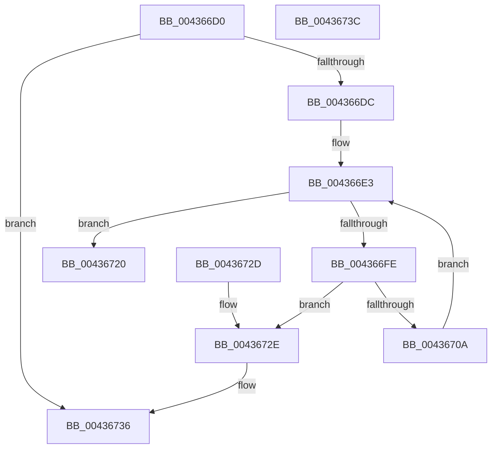

# KiAdvanceReadyListEnumerator

- RVA: `0x004366D0`–`0x0043673D` (길이 `109` bytes)
- VA: `0x00000001404366D0`
- 실행 섹션: `.text`
- PDB 이름 있음: `예`; PDB Function 태그: `아니요`
- unwind 정보 RVA: `0x000DB714`
- 디코드: `36`개 명령, `109/109` bytes 표시
- 미해석 바이트: `0` (있으면 어셈블리에 `.byte`로 보존)

> 이 문서는 커널 이미지의 기계어와 PDB 기호를 분석해 생성했습니다. 4번과 5번은 함수 원형과 자료형을 바이너리 사용 방식에서 추정한 C 해석이며 원본 소스 복구 결과는 아닙니다.

## 1. Dependencies

- 직접 호출 지점: **0**; 고유 호출 대상: **0**
- 직접 호출자로 확인된 함수: **1**
- RIP 상대 이미지 참조: **0**

### Outgoing calls
- 직접 디코드된 call 명령이 없습니다.

### Direct callers
- [KiSearchForNewThreadsOnTarget](../30/KiSearchForNewThreadsOnTarget_function_0030F500.md) at `0x00310DE9`

### Static image references
- 디코드된 RIP-relative 메모리 참조가 없습니다.

## 2. Other-region calls and transfers

- 다른 실행 섹션으로 향하는 call: **0**
- 별도 외부 분기/꼬리 이동을 확인하지 못했습니다.

## 3. Assembly (complete function range)

```asm
004366D0  48 8B 41 08                     mov rax, qword ptr [rcx + 8]
004366D4  4C 8B D2                        mov r10, rdx
004366D7  48 85 C0                        test rax, rax
004366DA  74 5A                           je 0x140436736
004366DC  4C 8B 49 10                     mov r9, qword ptr [rcx + 0x10]
004366E0  45 33 DB                        xor r11d, r11d
004366E3  48 8B 10                        mov rdx, qword ptr [rax]
004366E6  44 0F B6 41 04                  movzx r8d, byte ptr [rcx + 4]
004366EB  41 8B C0                        mov eax, r8d
004366EE  48 89 51 08                     mov qword ptr [rcx + 8], rdx
004366F2  48 C1 E0 04                     shl rax, 4
004366F6  49 03 C1                        add rax, r9
004366F9  48 3B D0                        cmp rdx, rax
004366FC  75 22                           jne 0x140436720
004366FE  8B 11                           mov edx, dword ptr [rcx]
00436700  44 0F B3 C2                     btr edx, r8d
00436704  89 11                           mov dword ptr [rcx], edx
00436706  85 D2                           test edx, edx
00436708  74 24                           je 0x14043672e
0043670A  0F BD C2                        bsr eax, edx
0043670D  88 41 04                        mov byte ptr [rcx + 4], al
00436710  0F B6 C0                        movzx eax, al
00436713  48 C1 E0 04                     shl rax, 4
00436717  49 03 C1                        add rax, r9
0043671A  48 89 41 08                     mov qword ptr [rcx + 8], rax
0043671E  EB C3                           jmp 0x1404366e3
00436720  48 8D 82 28 FF FF FF            lea rax, [rdx - 0xd8]
00436727  49 89 02                        mov qword ptr [r10], rax
0043672A  33 C0                           xor eax, eax
0043672C  C3                              ret
0043672D  CC                              int3
0043672E  44 88 59 04                     mov byte ptr [rcx + 4], r11b
00436732  4C 89 59 08                     mov qword ptr [rcx + 8], r11
00436736  B8 1A 00 00 80                  mov eax, 0x8000001a
0043673B  C3                              ret
0043673C  CC                              int3
```

## 4. C-style interpretation (structured pseudocode)

```c
__int64 __fastcall KiAdvanceReadyListEnumerator(__int64 a1, __int64 a2)
{
    __int64 result;
    __int64 v_r11;

    if (*(unsigned __int64 *)(a1 + 8) == 0) goto loc_00436736;
    v_r11 = 0;
loc_004366E3:
    *(unsigned __int64 *)(a1 + 8) = *(unsigned __int64 *)(*(unsigned __int64 *)(a1 + 8));
    result = ((unsigned int)((unsigned int)(*(unsigned __int8 *)(a1 + 4)))) << (4);
    result = (result) + (*(unsigned __int64 *)(a1 + 16));
    if ((*(unsigned __int64 *)(*(unsigned __int64 *)(a1 + 8))) != result) goto loc_00436720;
    *(unsigned int *)(a1) = (unsigned int)((unsigned int)(*(unsigned int *)(a1)));
    if ((unsigned int)((unsigned int)(*(unsigned int *)(a1))) == 0) goto loc_0043672E;
    *(unsigned __int8 *)(a1 + 4) = (unsigned __int8)(result);
    result = ((unsigned __int8)(result)) << (4);
    result = (result) + (*(unsigned __int64 *)(a1 + 16));
    *(unsigned __int64 *)(a1 + 8) = result;
    goto loc_004366E3;
loc_00436720:
    *(unsigned __int64 *)(a2) = (unsigned int)(*(unsigned int *)(a1)) - 216;
    result = 0;
    return result;
loc_0043672E:
    *(unsigned __int8 *)(a1 + 4) = 0;
    *(unsigned __int64 *)(a1 + 8) = 0;
loc_00436736:
    return (unsigned int)(0x8000001AULL);
}
```

## 5. (Beta) C Style

```c
int64_t KiAdvanceReadyListEnumerator(void *Arg1, void *Arg2)
{
    uint8_t *arg1 = (uint8_t *)Arg1;
    uint8_t *arg2 = (uint8_t *)Arg2;

    int64_t result;
    int64_t local_r11;

    if (*(uint64_t *)(arg1 + 0x8) == 0) goto loc_00436736;
    local_r11 = 0;
loc_004366E3:
    *(uint64_t *)(arg1 + 0x8) = *(uint64_t *)(*(uint64_t *)(arg1 + 0x8));
    result = ((uint32_t)((uint32_t)(*(uint8_t *)(arg1 + 0x4)))) << (4);
    result = (result) + (*(uint64_t *)(arg1 + 0x10));
    if ((*(uint64_t *)(*(uint64_t *)(arg1 + 0x8))) != result) goto loc_00436720;
    *(uint32_t *)(arg1) = (uint32_t)((uint32_t)(*(uint32_t *)(arg1)));
    if ((uint32_t)((uint32_t)(*(uint32_t *)(arg1))) == 0) goto loc_0043672E;
    *(uint8_t *)(arg1 + 0x4) = (uint8_t)(result);
    result = ((uint8_t)(result)) << (4);
    result = (result) + (*(uint64_t *)(arg1 + 0x10));
    *(uint64_t *)(arg1 + 0x8) = result;
    goto loc_004366E3;
loc_00436720:
    *(uint64_t *)(arg2) = (uint32_t)(*(uint32_t *)(arg1)) - 216;
    result = 0;
    return result;
loc_0043672E:
    *(uint8_t *)(arg1 + 0x4) = 0;
    *(uint64_t *)(arg1 + 0x8) = 0;
loc_00436736:
    return (uint32_t)(0x8000001AULL);
}
```

### 관측된 메모리 오프셋

구조체 형식이 확인되지 않은 접근은 인자 기준의 오프셋으로만 기록했습니다.

| 기준 인자 | 오프셋 표현 | 폭 (bit) | 접근 |
|---|---:|---:|---|
| `Arg1` | `+ 0x0` | `32` | `R` |
| `Arg1` | `+ 0x0` | `32` | `W` |
| `Arg1` | `+ 0x4` | `8` | `R` |
| `Arg1` | `+ 0x4` | `8` | `W` |
| `Arg1` | `+ 0x8` | `64` | `R` |
| `Arg1` | `+ 0x8` | `64` | `W` |
| `Arg1` | `+ 0x10` | `64` | `R` |
| `Arg2` | `+ 0x0` | `64` | `W` |

## 6. Execution-region graph

[열기: 2D/3D 그래프와 함수 탐색 컨트롤 패널](../../../control-panel.html?section=text&rva=0x004366D0&view=graph)

- 2D 그래프는 위에서 아래로 흐르고, 3D 그래프는 빈 공간을 드래그해 회전합니다. Shift+드래그는 이동, 휠은 확대·축소, 함수 노드 선택은 대상 보고서 이동입니다.

### Static fallback


