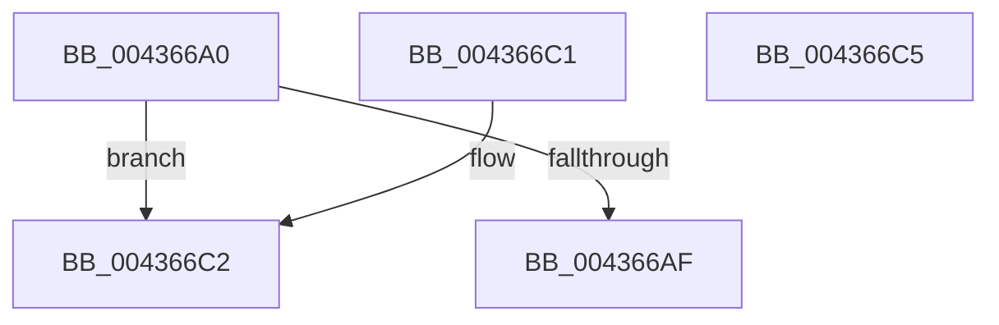

# KiCheckPrcbAffinityEx

- RVA: `0x004366A0`–`0x004366C6` (길이 `38` bytes)
- VA: `0x00000001404366A0`
- 실행 섹션: `.text`
- PDB 이름 있음: `예`; PDB Function 태그: `아니요`
- unwind 정보 RVA: `0x000DB714`
- 디코드: `13`개 명령, `38/38` bytes 표시
- 미해석 바이트: `0` (있으면 어셈블리에 `.byte`로 보존)

> 이 문서는 커널 이미지의 기계어와 PDB 기호를 분석해 생성했습니다. 4번과 5번은 함수 원형과 자료형을 바이너리 사용 방식에서 추정한 C 해석이며 원본 소스 복구 결과는 아닙니다.

## 1. Dependencies

- 직접 호출 지점: **0**; 고유 호출 대상: **0**
- 직접 호출자로 확인된 함수: **4**
- RIP 상대 이미지 참조: **0**

### Outgoing calls
- 직접 디코드된 call 명령이 없습니다.

### Direct callers
- [KiQueueReadyThread](../21/KiQueueReadyThread_function_0021C7B0.md) at `0x0021D175`
- [KiSetIdealProcessorThread](../2D/KiSetIdealProcessorThread_function_002DCFE0.md) at `0x002DD056`
- [KiForceIdleUpdateSchedulerParkState](../48/KiForceIdleUpdateSchedulerParkState_function_0048D874.md) at `0x0048DBC4`
- [KiCpuPartitionCheckDpcEnqueue](../4F/KiCpuPartitionCheckDpcEnqueue_function_004FCB88.md) at `0x004FCBB1`
- [KiCpuPartitionCheckDpcEnqueue](../4F/KiCpuPartitionCheckDpcEnqueue_function_004FCB88.md) at `0x004FCBC2`

### Static image references
- 디코드된 RIP-relative 메모리 참조가 없습니다.

## 2. Other-region calls and transfers

- 다른 실행 섹션으로 향하는 call: **0**
- 별도 외부 분기/꼬리 이동을 확인하지 못했습니다.

## 3. Assembly (complete function range)

```asm
004366A0  0F B6 82 D0 00 00 00            movzx eax, byte ptr [rdx + 0xd0]
004366A7  4C 8B C9                        mov r9, rcx
004366AA  66 3B 01                        cmp ax, word ptr [rcx]
004366AD  73 13                           jae 0x1404366c2
004366AF  49 8B 44 C1 08                  mov rax, qword ptr [r9 + rax*8 + 8]
004366B4  0F B6 8A D1 00 00 00            movzx ecx, byte ptr [rdx + 0xd1]
004366BB  48 D3 E8                        shr rax, cl
004366BE  24 01                           and al, 1
004366C0  C3                              ret
004366C1  CC                              int3
004366C2  32 C0                           xor al, al
004366C4  C3                              ret
004366C5  CC                              int3
```

## 4. C-style interpretation (structured pseudocode)

```c
__int64 __fastcall KiCheckPrcbAffinityEx(__int64 a1, __int64 a2)
{
    __int64 result;

    if (((unsigned __int16)(*(unsigned __int8 *)(a2 + 208))) >= (*(unsigned __int16 *)(a1))) goto loc_004366C2;
    result = (*(unsigned __int64 *)(a1 + *(unsigned __int8 *)(a2 + 208) * 8 + 8)) >> ((unsigned __int8)(*(unsigned __int8 *)(a2 + 209)));
    result = (unsigned __int8)((result) & (1));
    return result;
loc_004366C2:
    result = 0;
    return result;
}
```

## 5. (Beta) C Style

```c
int64_t KiCheckPrcbAffinityEx(void *Arg1, void *Arg2)
{
    uint8_t *arg1 = (uint8_t *)Arg1;
    uint8_t *arg2 = (uint8_t *)Arg2;

    int64_t result;

    if (((uint16_t)(*(uint8_t *)(arg2 + 0xD0))) >= (*(uint16_t *)(arg1))) goto loc_004366C2;
    result = (*(uint64_t *)(arg1 + *(uint8_t *)(arg2 + 0xD0) * 8 + 0x8)) >> ((uint8_t)(*(uint8_t *)(arg2 + 0xD1)));
    result = (uint8_t)((result) & (1));
    return result;
loc_004366C2:
    result = 0;
    return result;
}
```

### 관측된 메모리 오프셋

구조체 형식이 확인되지 않은 접근은 인자 기준의 오프셋으로만 기록했습니다.

| 기준 인자 | 오프셋 표현 | 폭 (bit) | 접근 |
|---|---:|---:|---|
| `Arg1` | `+ 0x0` | `16` | `R` |
| `Arg1` | `+ 0x8 + rax*8` | `64` | `R` |
| `Arg2` | `+ 0xD0` | `8` | `R` |
| `Arg2` | `+ 0xD1` | `8` | `R` |

## 6. Execution-region graph

[열기: 2D/3D 그래프와 함수 탐색 컨트롤 패널](../../../control-panel.html?section=text&rva=0x004366A0&view=graph)

- 2D 그래프는 위에서 아래로 흐르고, 3D 그래프는 빈 공간을 드래그해 회전합니다. Shift+드래그는 이동, 휠은 확대·축소, 함수 노드 선택은 대상 보고서 이동입니다.

### Static fallback


