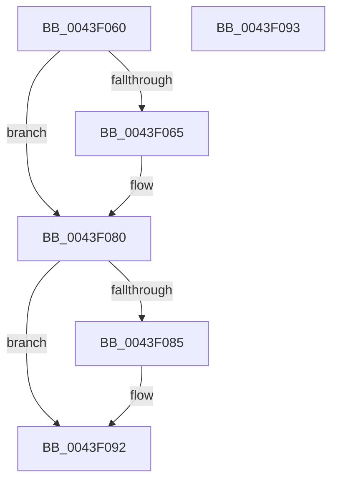

# KiQuerySubNodeActiveAffinity

- RVA: `0x0043F060`–`0x0043F094` (길이 `52` bytes)
- VA: `0x000000014043F060`
- 실행 섹션: `.text`
- PDB 이름 있음: `예`; PDB Function 태그: `아니요`
- unwind 정보 RVA: `0x000DB714`
- 디코드: `14`개 명령, `52/52` bytes 표시
- 미해석 바이트: `0` (있으면 어셈블리에 `.byte`로 보존)

> 이 문서는 커널 이미지의 기계어와 PDB 기호를 분석해 생성했습니다. 4번과 5번은 함수 원형과 자료형을 바이너리 사용 방식에서 추정한 C 해석이며 원본 소스 복구 결과는 아닙니다.

## 1. Dependencies

- 직접 호출 지점: **0**; 고유 호출 대상: **0**
- 직접 호출자로 확인된 함수: **6**
- RIP 상대 이미지 참조: **0**

### Outgoing calls
- 직접 디코드된 call 명령이 없습니다.

### Direct callers
- [MiGetClosestNodeWithProcessors](MiGetClosestNodeWithProcessors_function_0043EEE0.md) at `0x0043EF46`
- [KeQueryNodeActiveAffinity](KeQueryNodeActiveAffinity_function_0043EF80.md) at `0x0043EFE6`
- [KeQueryNodeActiveProcessorCount](../5B/KeQueryNodeActiveProcessorCount_function_005BBDF0.md) at `0x005BBE55`
- [KiSynchNumaCounterSetCallback](../../page/A7/KiSynchNumaCounterSetCallback_function_00A77BE0.md) at `0x00A77DD3`
- [KiConfigureSchedulingInformation](../../pagelk/B6/KiConfigureSchedulingInformation_function_00B66518.md) at `0x00B6653A`
- [KiComputeNumaCosts](../../init/C3/KiComputeNumaCosts_function_00C37AD4.md) at `0x00C37CBC`

### Static image references
- 디코드된 RIP-relative 메모리 참조가 없습니다.

## 2. Other-region calls and transfers

- 다른 실행 섹션으로 향하는 call: **0**
- 별도 외부 분기/꼬리 이동을 확인하지 못했습니다.

## 3. Assembly (complete function range)

```asm
0043F060  48 85 D2                        test rdx, rdx
0043F063  74 1B                           je 0x14043f080
0043F065  0F 57 C0                        xorps xmm0, xmm0
0043F068  0F 11 02                        movups xmmword ptr [rdx], xmm0
0043F06B  48 8B 81 80 00 00 00            mov rax, qword ptr [rcx + 0x80]
0043F072  48 89 02                        mov qword ptr [rdx], rax
0043F075  0F B7 81 88 00 00 00            movzx eax, word ptr [rcx + 0x88]
0043F07C  66 89 42 08                     mov word ptr [rdx + 8], ax
0043F080  4D 85 C0                        test r8, r8
0043F083  74 0D                           je 0x14043f092
0043F085  F3 48 0F B8 81 80 00 00 00      popcnt rax, qword ptr [rcx + 0x80]
0043F08E  66 41 89 00                     mov word ptr [r8], ax
0043F092  C3                              ret
0043F093  CC                              int3
```

## 4. C-style interpretation (structured pseudocode)

```c
__int64 __fastcall KiQuerySubNodeActiveAffinity(__int64 a1, __int64 a2, __int64 a3)
{
    __int64 result;

    if (a2 != 0) {
        *(unsigned __int64 *)(a2) = v_xmm0;
        result = *(unsigned __int64 *)(a1 + 128);
        *(unsigned __int64 *)(a2) = result;
        result = *(unsigned __int16 *)(a1 + 136);
        *(unsigned __int16 *)(a2 + 8) = (unsigned __int16)(result);
    }
    if (a3 != 0) {
        *(unsigned __int16 *)(a3) = (unsigned __int16)(result);
    }
    return result;
}
```

## 5. (Beta) C Style

```c
int64_t KiQuerySubNodeActiveAffinity(void *Arg1, int64_t Arg2, int64_t Arg3)
{
    uint8_t *arg1 = (uint8_t *)Arg1;

    int64_t result;

    if (Arg2 != 0) {
        *(uint64_t *)(Arg2) = v_xmm0;
        result = *(uint64_t *)(arg1 + 0x80);
        *(uint64_t *)(Arg2) = result;
        result = *(uint16_t *)(arg1 + 0x88);
        *(uint16_t *)(Arg2 + 0x8) = (uint16_t)(result);
    }
    if (Arg3 != 0) {
        *(uint16_t *)(Arg3) = (uint16_t)(result);
    }
    return result;
}
```

### 관측된 메모리 오프셋

구조체 형식이 확인되지 않은 접근은 인자 기준의 오프셋으로만 기록했습니다.

| 기준 인자 | 오프셋 표현 | 폭 (bit) | 접근 |
|---|---:|---:|---|
| `Arg1` | `+ 0x80` | `64` | `R` |
| `Arg1` | `+ 0x88` | `16` | `R` |

## 6. Execution-region graph

[열기: 2D/3D 그래프와 함수 탐색 컨트롤 패널](../../../control-panel.html?section=text&rva=0x0043F060&view=graph)

- 2D 그래프는 위에서 아래로 흐르고, 3D 그래프는 빈 공간을 드래그해 회전합니다. Shift+드래그는 이동, 휠은 확대·축소, 함수 노드 선택은 대상 보고서 이동입니다.

### Static fallback


