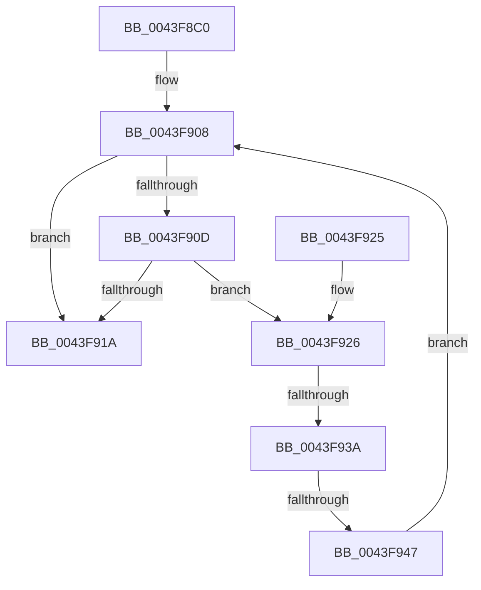

# KiRemoveAndFreeCpuPartitionAssignmentProcess

- RVA: `0x0043F8C0`–`0x0043F96C` (길이 `172` bytes)
- VA: `0x000000014043F8C0`
- 실행 섹션: `.text`
- PDB 이름 있음: `예`; PDB Function 태그: `예`
- unwind 정보 RVA: `0x000A4D68`
- 디코드: `47`개 명령, `172/172` bytes 표시
- 미해석 바이트: `0` (있으면 어셈블리에 `.byte`로 보존)

> 이 문서는 커널 이미지의 기계어와 PDB 기호를 분석해 생성했습니다. 4번과 5번은 함수 원형과 자료형을 바이너리 사용 방식에서 추정한 C 해석이며 원본 소스 복구 결과는 아닙니다.

## 1. Dependencies

- 직접 호출 지점: **5**; 고유 호출 대상: **5**
- 직접 호출자로 확인된 함수: **1**
- RIP 상대 이미지 참조: **0**

### Outgoing calls
- `0x0043F8E8` → [KiAcquireCpuPartitionAssignmentLock](KiAcquireCpuPartitionAssignmentLock_function_0043F974.md) (function, `0x0043F974`)
- `0x0043F8F5` → [KiRemoveCpuPartitionAssignmentProcess](KiRemoveCpuPartitionAssignmentProcess_function_0043F9FC.md) (function, `0x0043F9FC`)
- `0x0043F8FE` → [KiReleaseCpuPartitionAssignmentLock](KiReleaseCpuPartitionAssignmentLock_function_0043F9C0.md) (function, `0x0043F9C0`)
- `0x0043F95B` → [PsDereferenceCpuPartition](../../page/78/PsDereferenceCpuPartition_function_00783CBC.md) (function, `0x00783CBC`)
- `0x0043F965` → [ExFreePoolWithTag](../../poolcode/B8/ExFreePoolWithTag_function_00B82870.md) (function, `0x00B82870`)

### Direct callers
- [PspProcessDelete](../../page/90/PspProcessDelete_function_00907B90.md) at `0x00907FA9`

### Static image references
- 디코드된 RIP-relative 메모리 참조가 없습니다.

## 2. Other-region calls and transfers

- 다른 실행 섹션으로 향하는 call: **2**
  - `0x0043F95B` → [PsDereferenceCpuPartition](../../page/78/PsDereferenceCpuPartition_function_00783CBC.md) (`.text` → `PAGE`)
  - `0x0043F965` → [ExFreePoolWithTag](../../poolcode/B8/ExFreePoolWithTag_function_00B82870.md) (`.text` → `POOLCODE`)
- call이 아닌 외부 분기/꼬리 이동: **2**
  - `0x0043F934` → [sub_006EF7FE](../6E/Unknown_function_006EF7FE.md) (`tail-transfer`)
  - `0x0043F941` → [sub_006EF7FE](../6E/Unknown_function_006EF7FE.md) (`tail-transfer`)

## 3. Assembly (complete function range)

```asm
0043F8C0  4C 8B DC                        mov r11, rsp
0043F8C3  49 89 5B 08                     mov qword ptr [r11 + 8], rbx
0043F8C7  57                              push rdi
0043F8C8  48 83 EC 30                     sub rsp, 0x30
0043F8CC  49 8D 43 E8                     lea rax, [r11 - 0x18]
0043F8D0  C6 44 24 48 00                  mov byte ptr [rsp + 0x48], 0
0043F8D5  49 89 43 F0                     mov qword ptr [r11 - 0x10], rax
0043F8D9  48 8B D9                        mov rbx, rcx
0043F8DC  49 8D 43 E8                     lea rax, [r11 - 0x18]
0043F8E0  49 8D 4B 10                     lea rcx, [r11 + 0x10]
0043F8E4  49 89 43 E8                     mov qword ptr [r11 - 0x18], rax
0043F8E8  E8 87 00 00 00                  call 0x14043f974
0043F8ED  48 8D 54 24 20                  lea rdx, [rsp + 0x20]
0043F8F2  48 8B CB                        mov rcx, rbx
0043F8F5  E8 02 01 00 00                  call 0x14043f9fc
0043F8FA  8A 4C 24 48                     mov cl, byte ptr [rsp + 0x48]
0043F8FE  E8 BD 00 00 00                  call 0x14043f9c0
0043F903  48 8B 5C 24 20                  mov rbx, qword ptr [rsp + 0x20]
0043F908  48 85 DB                        test rbx, rbx
0043F90B  74 0D                           je 0x14043f91a
0043F90D  48 8D 4C 24 20                  lea rcx, [rsp + 0x20]
0043F912  48 8B C3                        mov rax, rbx
0043F915  48 3B D9                        cmp rbx, rcx
0043F918  75 0C                           jne 0x14043f926
0043F91A  48 8B 5C 24 40                  mov rbx, qword ptr [rsp + 0x40]
0043F91F  48 83 C4 30                     add rsp, 0x30
0043F923  5F                              pop rdi
0043F924  C3                              ret
0043F925  CC                              int3
0043F926  4C 8B 03                        mov r8, qword ptr [rbx]
0043F929  48 8D 7B F0                     lea rdi, [rbx - 0x10]
0043F92D  49 8B D8                        mov rbx, r8
0043F930  49 39 40 08                     cmp qword ptr [r8 + 8], rax
0043F934  0F 85 C4 FE 2A 00               jne 0x1406ef7fe
0043F93A  48 8B 50 08                     mov rdx, qword ptr [rax + 8]
0043F93E  48 39 02                        cmp qword ptr [rdx], rax
0043F941  0F 85 B7 FE 2A 00               jne 0x1406ef7fe
0043F947  4C 89 02                        mov qword ptr [rdx], r8
0043F94A  49 89 50 08                     mov qword ptr [r8 + 8], rdx
0043F94E  BA 4B 69 43 75                  mov edx, 0x7543694b
0043F953  48 8B 4F 08                     mov rcx, qword ptr [rdi + 8]
0043F957  48 8B 49 20                     mov rcx, qword ptr [rcx + 0x20]
0043F95B  E8 5C 43 34 00                  call 0x140783cbc
0043F960  33 D2                           xor edx, edx
0043F962  48 8B CF                        mov rcx, rdi
0043F965  E8 06 2F 74 00                  call 0x140b82870
0043F96A  EB 9C                           jmp 0x14043f908
```

## 4. C-style interpretation (structured pseudocode)

```c
__int64 __fastcall KiRemoveAndFreeCpuPartitionAssignmentProcess(__int64 a1)
{
    __int64 result;
    __int64 v_rsp;
    unsigned __int64 v_stack_m18;
    unsigned __int8 v_stack_p10;
    unsigned __int64 v_stack_p8;

    *(unsigned __int64 *)(v_rsp + 8) = v_rbx;
    v_rsp = (v_rsp) - (48);
    v_stack_p10 = 0;
    *(unsigned __int64 *)(v_rsp - 16) = v_rsp - 24;
    *(unsigned __int64 *)(v_rsp - 24) = v_rsp - 24;
    result = KiAcquireCpuPartitionAssignmentLock(v_rsp + 16, a2, a3, a4);
    result = KiRemoveCpuPartitionAssignmentProcess(a1, v_stack_m18, a3, a4);
    result = KiReleaseCpuPartitionAssignmentLock(v_stack_p10, v_stack_m18, a3, a4);
loc_0043F908:
    if (v_stack_m18 == 0) goto loc_0043F91A;
    if (v_stack_m18 != v_stack_m18) goto loc_0043F926;
loc_0043F91A:
    v_rsp = (v_rsp) + (48);
    return v_stack_m18;
loc_0043F926:
    *(unsigned __int64 *)(*(unsigned __int64 *)(v_stack_m18 + 8)) = *(unsigned __int64 *)(v_stack_p8);
    *(unsigned __int64 *)(*(unsigned __int64 *)(v_stack_p8) + 8) = *(unsigned __int64 *)(v_stack_m18 + 8);
    result = PsDereferenceCpuPartition(*(unsigned __int64 *)(*(unsigned __int64 *)(v_stack_p8 - 16 + 8) + 32), (unsigned int)(0x7543694BULL), *(unsigned __int64 *)(v_stack_p8), a4);
    a2 = 0;
    result = ExFreePoolWithTag(v_stack_p8 - 16, a2, *(unsigned __int64 *)(v_stack_p8), a4);
    goto loc_0043F908;
}
```

## 5. (Beta) C Style

```c
int64_t KiRemoveAndFreeCpuPartitionAssignmentProcess(int64_t Arg1)
{
    int64_t result;
    int64_t local_rsp;
    uint64_t v_stack_m18;
    uint8_t v_stack_p10;
    uint64_t v_stack_p8;

    *(uint64_t *)(local_rsp + 0x8) = local_rbx;
    local_rsp = (local_rsp) - (48);
    v_stack_p10 = 0;
    *(uint64_t *)(local_rsp - 0x10) = local_rsp - 24;
    *(uint64_t *)(local_rsp - 0x18) = local_rsp - 24;
    result = KiAcquireCpuPartitionAssignmentLock(local_rsp + 16, a2, a3, a4);
    result = KiRemoveCpuPartitionAssignmentProcess(Arg1, v_stack_m18, a3, a4);
    result = KiReleaseCpuPartitionAssignmentLock(v_stack_p10, v_stack_m18, a3, a4);
loc_0043F908:
    if (v_stack_m18 == 0) goto loc_0043F91A;
    if (v_stack_m18 != v_stack_m18) goto loc_0043F926;
loc_0043F91A:
    local_rsp = (local_rsp) + (48);
    return v_stack_m18;
loc_0043F926:
    *(uint64_t *)(*(uint64_t *)(v_stack_m18 + 0x8)) = *(uint64_t *)(v_stack_p8);
    *(uint64_t *)(*(uint64_t *)(v_stack_p8) + 0x8) = *(uint64_t *)(v_stack_m18 + 0x8);
    result = PsDereferenceCpuPartition(*(uint64_t *)(*(uint64_t *)(v_stack_p8 - 0x10 + 0x8) + 0x20), (uint32_t)(0x7543694BULL), *(uint64_t *)(v_stack_p8), a4);
    a2 = 0;
    result = ExFreePoolWithTag(v_stack_p8 - 16, a2, *(uint64_t *)(v_stack_p8), a4);
    goto loc_0043F908;
}
```

## 6. Execution-region graph

[열기: 2D/3D 그래프와 함수 탐색 컨트롤 패널](../../../control-panel.html?section=text&rva=0x0043F8C0&view=graph)

- 2D 그래프는 위에서 아래로 흐르고, 3D 그래프는 빈 공간을 드래그해 회전합니다. Shift+드래그는 이동, 휠은 확대·축소, 함수 노드 선택은 대상 보고서 이동입니다.

### Static fallback


