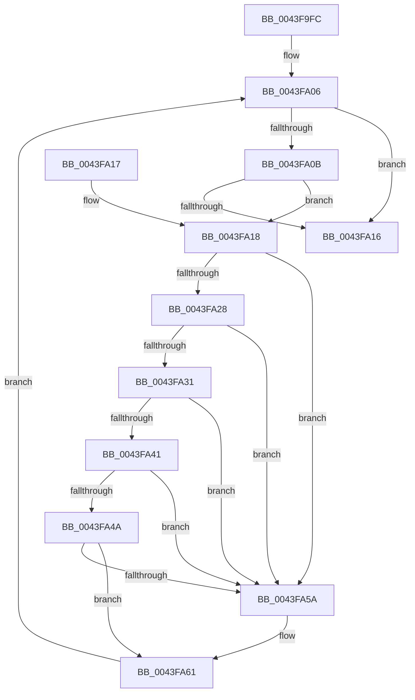

# KiRemoveCpuPartitionAssignmentProcess

- RVA: `0x0043F9FC`–`0x0043FA71` (길이 `117` bytes)
- VA: `0x000000014043F9FC`
- 실행 섹션: `.text`
- PDB 이름 있음: `예`; PDB Function 태그: `아니요`
- unwind 정보 RVA: `0x000DB714`
- 디코드: `38`개 명령, `117/117` bytes 표시
- 미해석 바이트: `0` (있으면 어셈블리에 `.byte`로 보존)

> 이 문서는 커널 이미지의 기계어와 PDB 기호를 분석해 생성했습니다. 4번과 5번은 함수 원형과 자료형을 바이너리 사용 방식에서 추정한 C 해석이며 원본 소스 복구 결과는 아닙니다.

## 1. Dependencies

- 직접 호출 지점: **0**; 고유 호출 대상: **0**
- 직접 호출자로 확인된 함수: **2**
- RIP 상대 이미지 참조: **0**

### Outgoing calls
- 직접 디코드된 call 명령이 없습니다.

### Direct callers
- [KiRemoveAndFreeCpuPartitionAssignmentProcess](KiRemoveAndFreeCpuPartitionAssignmentProcess_function_0043F8C0.md) at `0x0043F8F5`
- [KeAssignCpuPartitionsToProcess](../5C/KeAssignCpuPartitionsToProcess_function_005C08D0.md) at `0x005C09EE`

### Static image references
- 디코드된 RIP-relative 메모리 참조가 없습니다.

## 2. Other-region calls and transfers

- 다른 실행 섹션으로 향하는 call: **0**
- 별도 외부 분기/꼬리 이동을 확인하지 못했습니다.

## 3. Assembly (complete function range)

```asm
0043F9FC  4C 8D 91 B0 01 00 00            lea r10, [rcx + 0x1b0]
0043FA03  49 8B 02                        mov rax, qword ptr [r10]
0043FA06  48 85 C0                        test rax, rax
0043FA09  74 0B                           je 0x14043fa16
0043FA0B  4C 8B C0                        mov r8, rax
0043FA0E  48 8B C8                        mov rcx, rax
0043FA11  49 3B C2                        cmp rax, r10
0043FA14  75 02                           jne 0x14043fa18
0043FA16  C3                              ret
0043FA17  CC                              int3
0043FA18  48 8B 00                        mov rax, qword ptr [rax]
0043FA1B  48 83 C1 F0                     add rcx, -0x10
0043FA1F  4C 8B 09                        mov r9, qword ptr [rcx]
0043FA22  49 39 49 08                     cmp qword ptr [r9 + 8], rcx
0043FA26  75 32                           jne 0x14043fa5a
0043FA28  4C 8B 59 08                     mov r11, qword ptr [rcx + 8]
0043FA2C  49 39 0B                        cmp qword ptr [r11], rcx
0043FA2F  75 29                           jne 0x14043fa5a
0043FA31  4D 89 0B                        mov qword ptr [r11], r9
0043FA34  4D 89 59 08                     mov qword ptr [r9 + 8], r11
0043FA38  4D 8B 18                        mov r11, qword ptr [r8]
0043FA3B  4D 39 43 08                     cmp qword ptr [r11 + 8], r8
0043FA3F  75 19                           jne 0x14043fa5a
0043FA41  4D 8B 48 08                     mov r9, qword ptr [r8 + 8]
0043FA45  4D 39 01                        cmp qword ptr [r9], r8
0043FA48  75 10                           jne 0x14043fa5a
0043FA4A  4D 89 19                        mov qword ptr [r9], r11
0043FA4D  4D 89 4B 08                     mov qword ptr [r11 + 8], r9
0043FA51  4C 8B 42 08                     mov r8, qword ptr [rdx + 8]
0043FA55  49 39 10                        cmp qword ptr [r8], rdx
0043FA58  74 07                           je 0x14043fa61
0043FA5A  B9 03 00 00 00                  mov ecx, 3
0043FA5F  CD 29                           int 0x29
0043FA61  48 89 11                        mov qword ptr [rcx], rdx
0043FA64  4C 89 41 08                     mov qword ptr [rcx + 8], r8
0043FA68  49 89 08                        mov qword ptr [r8], rcx
0043FA6B  48 89 4A 08                     mov qword ptr [rdx + 8], rcx
0043FA6F  EB 95                           jmp 0x14043fa06
```

## 4. C-style interpretation (structured pseudocode)

```c
__int64 __fastcall KiRemoveCpuPartitionAssignmentProcess(__int64 a1, __int64 a2)
{
loc_0043FA06:
    if (*(unsigned __int64 *)(a1 + 432) == 0) goto loc_0043FA16;
    if ((*(unsigned __int64 *)(a1 + 432)) != (a1 + 432)) goto loc_0043FA18;
loc_0043FA16:
    return *(unsigned __int64 *)(a1 + 432);
loc_0043FA18:
    a1 = (*(unsigned __int64 *)(a1 + 432)) + (-16);
    if ((*(unsigned __int64 *)(*(unsigned __int64 *)(a1) + 8)) != a1) goto loc_0043FA5A;
    if ((*(unsigned __int64 *)(*(unsigned __int64 *)(a1 + 8))) != a1) goto loc_0043FA5A;
    *(unsigned __int64 *)(*(unsigned __int64 *)(a1 + 8)) = *(unsigned __int64 *)(a1);
    *(unsigned __int64 *)(*(unsigned __int64 *)(a1) + 8) = *(unsigned __int64 *)(a1 + 8);
    if ((*(unsigned __int64 *)(*(unsigned __int64 *)(*(unsigned __int64 *)(a1 + 432)) + 8)) != (*(unsigned __int64 *)(a1 + 432))) goto loc_0043FA5A;
    if ((*(unsigned __int64 *)(*(unsigned __int64 *)(*(unsigned __int64 *)(a1 + 432) + 8))) != (*(unsigned __int64 *)(a1 + 432))) goto loc_0043FA5A;
    *(unsigned __int64 *)(*(unsigned __int64 *)(*(unsigned __int64 *)(a1 + 432) + 8)) = *(unsigned __int64 *)(*(unsigned __int64 *)(a1 + 432));
    *(unsigned __int64 *)(*(unsigned __int64 *)(*(unsigned __int64 *)(a1 + 432)) + 8) = *(unsigned __int64 *)(*(unsigned __int64 *)(a1 + 432) + 8);
    if ((*(unsigned __int64 *)(*(unsigned __int64 *)(a2 + 8))) != a2) {
        a1 = 3;
    }
    *(unsigned __int64 *)(a1) = a2;
    *(unsigned __int64 *)(a1 + 8) = *(unsigned __int64 *)(a2 + 8);
    *(unsigned __int64 *)(*(unsigned __int64 *)(a2 + 8)) = a1;
    *(unsigned __int64 *)(a2 + 8) = a1;
    goto loc_0043FA06;
}
```

## 5. (Beta) C Style

```c
int64_t KiRemoveCpuPartitionAssignmentProcess(void *Arg1, void *Arg2)
{
    uint8_t *arg1 = (uint8_t *)Arg1;
    uint8_t *arg2 = (uint8_t *)Arg2;

loc_0043FA06:
    if (*(uint64_t *)(arg1 + 0x1B0) == 0) goto loc_0043FA16;
    if ((*(uint64_t *)(arg1 + 0x1B0)) != (Arg1 + 432)) goto loc_0043FA18;
loc_0043FA16:
    return *(uint64_t *)(arg1 + 0x1B0);
loc_0043FA18:
    Arg1 = (*(uint64_t *)(arg1 + 0x1B0)) + (-16);
    if ((*(uint64_t *)(*(uint64_t *)(arg1) + 0x8)) != Arg1) goto loc_0043FA5A;
    if ((*(uint64_t *)(*(uint64_t *)(arg1 + 0x8))) != Arg1) goto loc_0043FA5A;
    *(uint64_t *)(*(uint64_t *)(arg1 + 0x8)) = *(uint64_t *)(arg1);
    *(uint64_t *)(*(uint64_t *)(arg1) + 0x8) = *(uint64_t *)(arg1 + 0x8);
    if ((*(uint64_t *)(*(uint64_t *)(*(uint64_t *)(arg1 + 0x1B0)) + 0x8)) != (*(uint64_t *)(arg1 + 0x1B0))) goto loc_0043FA5A;
    if ((*(uint64_t *)(*(uint64_t *)(*(uint64_t *)(arg1 + 0x1B0) + 0x8))) != (*(uint64_t *)(arg1 + 0x1B0))) goto loc_0043FA5A;
    *(uint64_t *)(*(uint64_t *)(*(uint64_t *)(arg1 + 0x1B0) + 0x8)) = *(uint64_t *)(*(uint64_t *)(arg1 + 0x1B0));
    *(uint64_t *)(*(uint64_t *)(*(uint64_t *)(arg1 + 0x1B0)) + 0x8) = *(uint64_t *)(*(uint64_t *)(arg1 + 0x1B0) + 0x8);
    if ((*(uint64_t *)(*(uint64_t *)(arg2 + 0x8))) != Arg2) {
        Arg1 = 3;
    }
    *(void **)(arg1) = Arg2;
    *(uint64_t *)(arg1 + 0x8) = *(uint64_t *)(arg2 + 0x8);
    *(void **)(*(uint64_t *)(arg2 + 0x8)) = Arg1;
    *(void **)(arg2 + 0x8) = Arg1;
    goto loc_0043FA06;
}
```

### 관측된 메모리 오프셋

구조체 형식이 확인되지 않은 접근은 인자 기준의 오프셋으로만 기록했습니다.

| 기준 인자 | 오프셋 표현 | 폭 (bit) | 접근 |
|---|---:|---:|---|
| `Arg1` | `+ 0x0` | `64` | `R` |
| `Arg1` | `+ 0x1B0` | `64` | `R` |
| `Arg2` | `+ 0x8` | `64` | `R` |
| `Arg2` | `+ 0x8` | `64` | `W` |

## 6. Execution-region graph

[열기: 2D/3D 그래프와 함수 탐색 컨트롤 패널](../../../control-panel.html?section=text&rva=0x0043F9FC&view=graph)

- 2D 그래프는 위에서 아래로 흐르고, 3D 그래프는 빈 공간을 드래그해 회전합니다. Shift+드래그는 이동, 휠은 확대·축소, 함수 노드 선택은 대상 보고서 이동입니다.

### Static fallback


