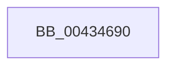

# KiSelectCandidateProcessor

- RVA: `0x00434690`–`0x004346AE` (길이 `30` bytes)
- VA: `0x0000000140434690`
- 실행 섹션: `.text`
- PDB 이름 있음: `예`; PDB Function 태그: `아니요`
- unwind 정보 RVA: `0x000A2960`
- 디코드: `7`개 명령, `30/30` bytes 표시
- 미해석 바이트: `0` (있으면 어셈블리에 `.byte`로 보존)

> 이 문서는 커널 이미지의 기계어와 PDB 기호를 분석해 생성했습니다. 4번과 5번은 함수 원형과 자료형을 바이너리 사용 방식에서 추정한 C 해석이며 원본 소스 복구 결과는 아닙니다.

## 1. Dependencies

- 직접 호출 지점: **0**; 고유 호출 대상: **0**
- 직접 호출자로 확인된 함수: **2**
- RIP 상대 이미지 참조: **0**

### Outgoing calls
- 직접 디코드된 call 명령이 없습니다.

### Direct callers
- [KiChooseTargetProcessor](../25/KiChooseTargetProcessor_function_002556D8.md) at `0x0025609F`
- [KiHeteroSelectProcessorToPreempt](../25/KiHeteroSelectProcessorToPreempt_function_002560D0.md) at `0x00256580`

### Static image references
- 디코드된 RIP-relative 메모리 참조가 없습니다.

## 2. Other-region calls and transfers

- 다른 실행 섹션으로 향하는 call: **0**
- 별도 외부 분기/꼬리 이동을 확인하지 못했습니다.

## 3. Assembly (complete function range)

```asm
00434690  44 89 4C 24 20                  mov dword ptr [rsp + 0x20], r9d
00434695  41 55                           push r13
00434697  41 57                           push r15
00434699  48 83 EC 48                     sub rsp, 0x48
0043469D  4C 8B 92 40 02 00 00            mov r10, qword ptr [rdx + 0x240]
004346A4  4C 8B E9                        mov r13, rcx
004346A7  0F B6 81 D0 00 00 00            movzx eax, byte ptr [rcx + 0xd0]
```

## 4. C-style interpretation (structured pseudocode)

```c
__int64 __fastcall KiSelectCandidateProcessor(__int64 a1, __int64 a2, __int64 a3, int a4)
{
    __int64 v_rsp;
    unsigned int v_stack_p20;

    v_stack_p20 = a4;
    v_rsp = (v_rsp) - (72);
    return *(unsigned __int8 *)(a1 + 208);
}
```

## 5. (Beta) C Style

```c
int64_t KiSelectCandidateProcessor(void *Arg1, void *Arg2, int64_t Arg3, int32_t Arg4)
{
    uint8_t *arg1 = (uint8_t *)Arg1;
    uint8_t *arg2 = (uint8_t *)Arg2;

    int64_t local_rsp;
    uint32_t v_stack_p20;

    v_stack_p20 = Arg4;
    local_rsp = (local_rsp) - (72);
    return *(uint8_t *)(arg1 + 0xD0);
}
```

### 관측된 메모리 오프셋

구조체 형식이 확인되지 않은 접근은 인자 기준의 오프셋으로만 기록했습니다.

| 기준 인자 | 오프셋 표현 | 폭 (bit) | 접근 |
|---|---:|---:|---|
| `Arg1` | `+ 0xD0` | `8` | `R` |
| `Arg2` | `+ 0x240` | `64` | `R` |

## 6. Execution-region graph

[열기: 2D/3D 그래프와 함수 탐색 컨트롤 패널](../../../control-panel.html?section=text&rva=0x00434690&view=graph)

- 2D 그래프는 위에서 아래로 흐르고, 3D 그래프는 빈 공간을 드래그해 회전합니다. Shift+드래그는 이동, 휠은 확대·축소, 함수 노드 선택은 대상 보고서 이동입니다.

### Static fallback


