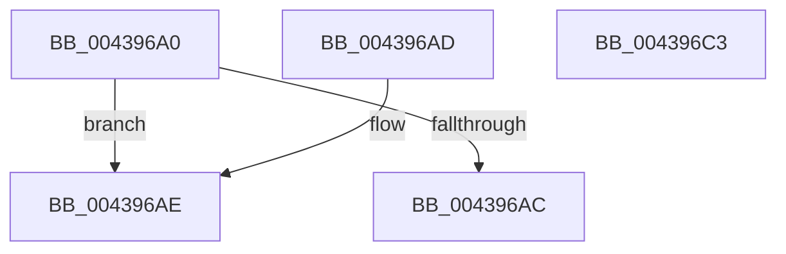

# KiSelectDpcData

- RVA: `0x004396A0`–`0x004396C4` (길이 `36` bytes)
- VA: `0x00000001404396A0`
- 실행 섹션: `.text`
- PDB 이름 있음: `예`; PDB Function 태그: `아니요`
- unwind 정보 RVA: `0x000DB714`
- 디코드: `11`개 명령, `36/36` bytes 표시
- 미해석 바이트: `0` (있으면 어셈블리에 `.byte`로 보존)

> 이 문서는 커널 이미지의 기계어와 PDB 기호를 분석해 생성했습니다. 4번과 5번은 함수 원형과 자료형을 바이너리 사용 방식에서 추정한 C 해석이며 원본 소스 복구 결과는 아닙니다.

## 1. Dependencies

- 직접 호출 지점: **0**; 고유 호출 대상: **0**
- 직접 호출자로 확인된 함수: **1**
- RIP 상대 이미지 참조: **0**

### Outgoing calls
- 직접 디코드된 call 명령이 없습니다.

### Direct callers
- [sub_006F322E](../6F/Unknown_function_006F322E.md) at `0x006F3390`

### Static image references
- 디코드된 RIP-relative 메모리 참조가 없습니다.

## 2. Other-region calls and transfers

- 다른 실행 섹션으로 향하는 call: **0**
- 별도 외부 분기/꼬리 이동을 확인하지 못했습니다.

## 3. Assembly (complete function range)

```asm
004396A0  80 3A 1A                        cmp byte ptr [rdx], 0x1a
004396A3  48 8D 81 40 38 00 00            lea rax, [rcx + 0x3840]
004396AA  74 02                           je 0x1404396ae
004396AC  C3                              ret
004396AD  CC                              int3
004396AE  0F B6 91 B8 38 00 00            movzx edx, byte ptr [rcx + 0x38b8]
004396B5  48 81 C1 70 38 00 00            add rcx, 0x3870
004396BC  84 D2                           test dl, dl
004396BE  48 0F 45 C1                     cmovne rax, rcx
004396C2  C3                              ret
004396C3  CC                              int3
```

## 4. C-style interpretation (structured pseudocode)

```c
__int64 __fastcall KiSelectDpcData(__int64 a1, __int64 a2)
{
    __int64 result;

    if ((*(unsigned __int8 *)(a2)) == 26) goto loc_004396AE;
    return a1 + 14400;
loc_004396AE:
    a1 = (a1) + (0x3870ULL);
    result = a1 + 14400;
    if ((unsigned __int8)(*(unsigned __int8 *)(a1 + 14520)) != 0) { result = a1; }
    return result;
}
```

## 5. (Beta) C Style

```c
void *KiSelectDpcData(void *Arg1, void *Arg2)
{
    uint8_t *arg1 = (uint8_t *)Arg1;
    uint8_t *arg2 = (uint8_t *)Arg2;

    int64_t result;

    if ((*(uint8_t *)(arg2)) == 26) goto loc_004396AE;
    return Arg1 + 14400;
loc_004396AE:
    Arg1 = (Arg1) + (0x3870ULL);
    result = Arg1 + 14400;
    if ((uint8_t)(*(uint8_t *)(arg1 + 0x38B8)) != 0) { result = Arg1; }
    return result;
}
```

### 관측된 메모리 오프셋

구조체 형식이 확인되지 않은 접근은 인자 기준의 오프셋으로만 기록했습니다.

| 기준 인자 | 오프셋 표현 | 폭 (bit) | 접근 |
|---|---:|---:|---|
| `Arg1` | `+ 0x3840` | `64` | `R` |
| `Arg1` | `+ 0x38B8` | `8` | `R` |
| `Arg2` | `+ 0x0` | `8` | `R` |

## 6. Execution-region graph

[열기: 2D/3D 그래프와 함수 탐색 컨트롤 패널](../../../control-panel.html?section=text&rva=0x004396A0&view=graph)

- 2D 그래프는 위에서 아래로 흐르고, 3D 그래프는 빈 공간을 드래그해 회전합니다. Shift+드래그는 이동, 휠은 확대·축소, 함수 노드 선택은 대상 보고서 이동입니다.

### Static fallback


