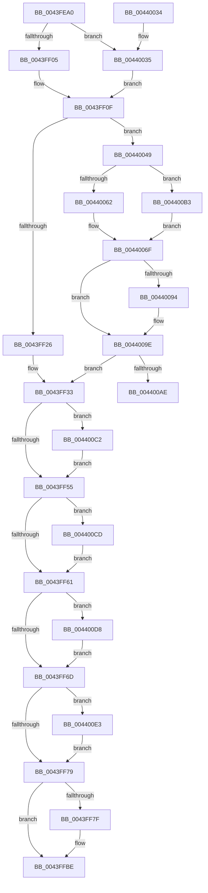

# KiSetClockTickRate

- RVA: `0x0043FEA0`–`0x004400EE` (길이 `590` bytes)
- VA: `0x000000014043FEA0`
- 실행 섹션: `.text`
- PDB 이름 있음: `예`; PDB Function 태그: `예`
- unwind 정보 RVA: `0x000A4E48`
- 디코드: `133`개 명령, `590/590` bytes 표시
- 미해석 바이트: `0` (있으면 어셈블리에 `.byte`로 보존)

> 이 문서는 커널 이미지의 기계어와 PDB 기호를 분석해 생성했습니다. 4번과 5번은 함수 원형과 자료형을 바이너리 사용 방식에서 추정한 C 해석이며 원본 소스 복구 결과는 아닙니다.

## 1. Dependencies

- 직접 호출 지점: **8**; 고유 호출 대상: **5**
- 직접 호출자로 확인된 함수: **2**
- RIP 상대 이미지 참조: **23**

### Outgoing calls
- `0x0043FF07` → [guard_dispatch_icall](../6B/guard_dispatch_icall_function_006BAAD0.md) (function, `0x006BAAD0`)
- `0x0043FF17` → [KiSetPendingTick](../44/KiSetPendingTick_function_004400F4.md) (function, `0x004400F4`)
- `0x0043FF2B` → [RtlGetInterruptTimePrecise](../20/RtlGetInterruptTimePrecise_function_0020A4C0.md) (function, `0x0020A4C0`)
- `0x0043FFB1` → [KeQueryPerformanceCounter](../37/KeQueryPerformanceCounter_function_0037E7E0.md) (function, `0x0037E7E0`)
- `0x0043FFF2` → [KeQueryPerformanceCounter](../37/KeQueryPerformanceCounter_function_0037E7E0.md) (function, `0x0037E7E0`)
- `0x00440011` → [_security_check_cookie](../6A/_security_check_cookie_function_006AC640.md) (function, `0x006AC640`)
- `0x0044003A` → [guard_dispatch_icall](../6B/guard_dispatch_icall_function_006BAAD0.md) (function, `0x006BAAD0`)
- `0x00440067` → [RtlGetInterruptTimePrecise](../20/RtlGetInterruptTimePrecise_function_0020A4C0.md) (function, `0x0020A4C0`)

### Direct callers
- [KiSetNextClockTickDueTime](../23/KiSetNextClockTickDueTime_function_002363F0.md) at `0x002364F5`
- [KiSetClockIntervalToMinimumRequested](../39/KiSetClockIntervalToMinimumRequested_function_0039DF1C.md) at `0x0039E066`

### Static image references
- `0x0043FEBC` → RVA `0x00E0A740` (`.data`; read)
- `0x0043FEE6` → RVA `0x00FCF000` (`CACHEALI`; read)
- `0x0043FEEF` → RVA `0x00E00AF0` (`.data`; read)
- `0x0043FF43` → RVA `0x00FC6B7C` (`ALMOSTRO`; read)
- `0x0043FF49` → RVA `0x00F21F54` (`.data`; read)
- `0x0043FF55` → RVA `0x00F21F50` (`.data`; read)
- `0x0043FF61` → RVA `0x00F21F5C` (`.data`; read)
- `0x0043FF6D` → RVA `0x00F21F58` (`.data`; read)
- `0x0043FF7F` → RVA `0x00F22380` (`.data`; read)
- `0x0043FF85` → RVA `0x00F223E0` (`.data`; read)
- `0x0043FF9A` → RVA `0x00F22380` (`.data`; write)
- `0x0043FFA0` → RVA `0x00F21FC0` (`.data`; read)
- `0x00440049` → RVA `0x00FC6A85` (`ALMOSTRO`; read)
- `0x00440054` → RVA `0x00FC6B7C` (`ALMOSTRO`; write)
- `0x0044005A` → RVA `0x00F21FC0` (`.data`; write)
- `0x00440078` → RVA `0x00F21F88` (`.data`; write)
- `0x00440088` → RVA `0x00F21FA8` (`.data`; write)
- `0x00440097` → RVA `0x00FCF000` (`CACHEALI`; read/write)
- `0x0044009E` → RVA `0x00FC6B08` (`ALMOSTRO`; read)
- `0x004400C2` → RVA `0x00F21F54` (`.data`; write)
- `0x004400CD` → RVA `0x00F21F50` (`.data`; write)
- `0x004400D8` → RVA `0x00F21F5C` (`.data`; write)
- `0x004400E3` → RVA `0x00F21F58` (`.data`; write)

## 2. Other-region calls and transfers

- 다른 실행 섹션으로 향하는 call: **0**
- call이 아닌 외부 분기/꼬리 이동: **1**
  - `0x004400AE` → [sub_006EF87E](../6E/Unknown_function_006EF87E.md) (`tail-transfer`)

## 3. Assembly (complete function range)

```asm
0043FEA0  48 89 5C 24 10                  mov qword ptr [rsp + 0x10], rbx
0043FEA5  48 89 6C 24 18                  mov qword ptr [rsp + 0x18], rbp
0043FEAA  48 89 74 24 20                  mov qword ptr [rsp + 0x20], rsi
0043FEAF  57                              push rdi
0043FEB0  41 54                           push r12
0043FEB2  41 55                           push r13
0043FEB4  41 56                           push r14
0043FEB6  41 57                           push r15
0043FEB8  48 83 EC 70                     sub rsp, 0x70
0043FEBC  48 8B 05 7D A8 9C 00            mov rax, qword ptr [rip + 0x9ca87d]
0043FEC3  48 33 C4                        xor rax, rsp
0043FEC6  48 89 44 24 68                  mov qword ptr [rsp + 0x68], rax
0043FECB  45 33 ED                        xor r13d, r13d
0043FECE  8B F9                           mov edi, ecx
0043FED0  4C 89 6C 24 30                  mov qword ptr [rsp + 0x30], r13
0043FED5  4C 8D 44 24 30                  lea r8, [rsp + 0x30]
0043FEDA  65 48 8B 1C 25 20 00 00 00      mov rbx, qword ptr gs:[0x20]
0043FEE3  0F B6 F2                        movzx esi, dl
0043FEE6  44 8B 3D 13 F1 B8 00            mov r15d, dword ptr [rip + 0xb8f113]
0043FEED  84 D2                           test dl, dl
0043FEEF  48 8B 05 FA 0B 9C 00            mov rax, qword ptr [rip + 0x9c0bfa]
0043FEF6  8B D7                           mov edx, edi
0043FEF8  48 8D AB 80 95 00 00            lea rbp, [rbx + 0x9580]
0043FEFF  0F 85 30 01 00 00               jne 0x140440035
0043FF05  33 C9                           xor ecx, ecx
0043FF07  E8 C4 AB 27 00                  call 0x1406baad0
0043FF0C  41 8B C5                        mov eax, r13d
0043FF0F  B1 01                           mov cl, 1
0043FF11  89 83 90 95 00 00               mov dword ptr [rbx + 0x9590], eax
0043FF17  E8 D8 01 00 00                  call 0x1404400f4
0043FF1C  44 38 6B 21                     cmp byte ptr [rbx + 0x21], r13b
0043FF20  0F 85 23 01 00 00               jne 0x140440049
0043FF26  48 8D 4C 24 38                  lea rcx, [rsp + 0x38]
0043FF2B  E8 90 A5 DC FF                  call 0x14020a4c0
0043FF30  4C 8B F0                        mov r14, rax
0043FF33  8B 44 24 30                     mov eax, dword ptr [rsp + 0x30]
0043FF37  89 83 88 95 00 00               mov dword ptr [rbx + 0x9588], eax
0043FF3D  89 BB 8C 95 00 00               mov dword ptr [rbx + 0x958c], edi
0043FF43  8B 0D 33 6C B8 00               mov ecx, dword ptr [rip + 0xb86c33]
0043FF49  3B 0D 05 20 AE 00               cmp ecx, dword ptr [rip + 0xae2005]
0043FF4F  0F 82 6D 01 00 00               jb 0x1404400c2
0043FF55  3B 0D F5 1F AE 00               cmp ecx, dword ptr [rip + 0xae1ff5]
0043FF5B  0F 87 6C 01 00 00               ja 0x1404400cd
0043FF61  3B 3D F5 1F AE 00               cmp edi, dword ptr [rip + 0xae1ff5]
0043FF67  0F 82 6B 01 00 00               jb 0x1404400d8
0043FF6D  3B 3D E5 1F AE 00               cmp edi, dword ptr [rip + 0xae1fe5]
0043FF73  0F 87 6A 01 00 00               ja 0x1404400e3
0043FF79  44 38 6B 21                     cmp byte ptr [rbx + 0x21], r13b
0043FF7D  74 3F                           je 0x14043ffbe
0043FF7F  8B 05 FB 23 AE 00               mov eax, dword ptr [rip + 0xae23fb]
0043FF85  48 8D 15 54 24 AE 00            lea rdx, [rip + 0xae2454]
0043FF8C  8B D8                           mov ebx, eax
0043FF8E  48 C1 E3 05                     shl rbx, 5
0043FF92  48 03 DA                        add rbx, rdx
0043FF95  FF C0                           inc eax
0043FF97  83 E0 0F                        and eax, 0xf
0043FF9A  89 05 E0 23 AE 00               mov dword ptr [rip + 0xae23e0], eax
0043FFA0  8B 05 1A 20 AE 00               mov eax, dword ptr [rip + 0xae201a]
0043FFA6  89 0B                           mov dword ptr [rbx], ecx
0043FFA8  33 C9                           xor ecx, ecx
0043FFAA  89 43 04                        mov dword ptr [rbx + 4], eax
0043FFAD  4C 89 73 08                     mov qword ptr [rbx + 8], r14
0043FFB1  E8 2A E8 F3 FF                  call 0x14037e7e0
0043FFB6  48 89 43 10                     mov qword ptr [rbx + 0x10], rax
0043FFBA  40 88 73 18                     mov byte ptr [rbx + 0x18], sil
0043FFBE  8B 8D 90 00 00 00               mov ecx, dword ptr [rbp + 0x90]
0043FFC4  8B 54 24 30                     mov edx, dword ptr [rsp + 0x30]
0043FFC8  8B D9                           mov ebx, ecx
0043FFCA  48 C1 E3 05                     shl rbx, 5
0043FFCE  48 03 DD                        add rbx, rbp
0043FFD1  8D 41 01                        lea eax, [rcx + 1]
0043FFD4  33 C9                           xor ecx, ecx
0043FFD6  83 E0 0F                        and eax, 0xf
0043FFD9  89 85 90 00 00 00               mov dword ptr [rbp + 0x90], eax
0043FFDF  89 93 18 03 00 00               mov dword ptr [rbx + 0x318], edx
0043FFE5  89 BB 1C 03 00 00               mov dword ptr [rbx + 0x31c], edi
0043FFEB  4C 89 B3 20 03 00 00            mov qword ptr [rbx + 0x320], r14
0043FFF2  E8 E9 E7 F3 FF                  call 0x14037e7e0
0043FFF7  48 89 83 28 03 00 00            mov qword ptr [rbx + 0x328], rax
0043FFFE  40 88 B3 30 03 00 00            mov byte ptr [rbx + 0x330], sil
00440005  8B 44 24 30                     mov eax, dword ptr [rsp + 0x30]
00440009  48 8B 4C 24 68                  mov rcx, qword ptr [rsp + 0x68]
0044000E  48 33 CC                        xor rcx, rsp
00440011  E8 2A C6 26 00                  call 0x1406ac640
00440016  4C 8D 5C 24 70                  lea r11, [rsp + 0x70]
0044001B  49 8B 5B 38                     mov rbx, qword ptr [r11 + 0x38]
0044001F  49 8B 6B 40                     mov rbp, qword ptr [r11 + 0x40]
00440023  49 8B 73 48                     mov rsi, qword ptr [r11 + 0x48]
00440027  49 8B E3                        mov rsp, r11
0044002A  41 5F                           pop r15
0044002C  41 5E                           pop r14
0044002E  41 5D                           pop r13
00440030  41 5C                           pop r12
00440032  5F                              pop rdi
00440033  C3                              ret
00440034  CC                              int3
00440035  B9 01 00 00 00                  mov ecx, 1
0044003A  E8 91 AA 27 00                  call 0x1406baad0
0044003F  B8 01 00 00 00                  mov eax, 1
00440044  E9 C6 FE FF FF                  jmp 0x14043ff0f
00440049  44 38 2D 35 6A B8 00            cmp byte ptr [rip + 0xb86a35], r13b
00440050  8B 44 24 30                     mov eax, dword ptr [rsp + 0x30]
00440054  89 05 22 6B B8 00               mov dword ptr [rip + 0xb86b22], eax
0044005A  89 3D 60 1F AE 00               mov dword ptr [rip + 0xae1f60], edi
00440060  74 51                           je 0x1404400b3
00440062  48 8D 4C 24 38                  lea rcx, [rsp + 0x38]
00440067  E8 54 A4 DC FF                  call 0x14020a4c0
0044006C  4C 8B F0                        mov r14, rax
0044006F  8B 05 07 6B B8 00               mov eax, dword ptr [rip + 0xb86b07]
00440075  49 03 C6                        add rax, r14
00440078  48 89 05 09 1F AE 00            mov qword ptr [rip + 0xae1f09], rax
0044007F  40 84 F6                        test sil, sil
00440082  41 8B C5                        mov eax, r13d
00440085  0F 95 C0                        setne al
00440088  89 05 1A 1F AE 00               mov dword ptr [rip + 0xae1f1a], eax
0044008E  41 83 FF 02                     cmp r15d, 2
00440092  75 0A                           jne 0x14044009e
00440094  45 8B FD                        mov r15d, r13d
00440097  44 87 3D 62 EF B8 00            xchg dword ptr [rip + 0xb8ef62], r15d
0044009E  F7 05 60 6A B8 00 00 00 10 00   test dword ptr [rip + 0xb86a60], 0x100000
004400A8  0F 84 85 FE FF FF               je 0x14043ff33
004400AE  E9 CB F7 2A 00                  jmp 0x1406ef87e
004400B3  49 BE 08 00 00 00 80 F7 FF FF   movabs r14, 0xfffff78000000008
004400BD  4D 8B 36                        mov r14, qword ptr [r14]
004400C0  EB AD                           jmp 0x14044006f
004400C2  89 0D 8C 1E AE 00               mov dword ptr [rip + 0xae1e8c], ecx
004400C8  E9 88 FE FF FF                  jmp 0x14043ff55
004400CD  89 0D 7D 1E AE 00               mov dword ptr [rip + 0xae1e7d], ecx
004400D3  E9 89 FE FF FF                  jmp 0x14043ff61
004400D8  89 3D 7E 1E AE 00               mov dword ptr [rip + 0xae1e7e], edi
004400DE  E9 8A FE FF FF                  jmp 0x14043ff6d
004400E3  89 3D 6F 1E AE 00               mov dword ptr [rip + 0xae1e6f], edi
004400E9  E9 8B FE FF FF                  jmp 0x14043ff79
```

## 4. C-style interpretation (structured pseudocode)

```c
__int64 __fastcall KiSetClockTickRate(int a1, unsigned __int8 a2)
{
    __int64 result;
    __int64 v_r13;
    __int64 v_r15;
    __int64 v_rbx;
    __int64 v_rsp;
    unsigned __int64 v_stack_m28;
    unsigned __int64 v_stack_m30;
    unsigned __int64 v_stack_m38;
    unsigned int v_stack_m40;
    unsigned __int64 v_stack_m60;
    unsigned __int64 v_stack_m68;
    unsigned __int64 v_stack_p10;
    unsigned __int64 v_stack_p18;
    unsigned __int64 v_stack_p20;

    v_stack_p10 = v_rbx;
    v_stack_p18 = v_rbp;
    v_stack_p20 = v_rsi;
    v_rsp = (v_rsp) - (112);
    result = (*(unsigned __int64 *)(v_rip + 10266749)) ^ (v_rsp);
    v_stack_m30 = result;
    v_r13 = 0;
    v_stack_m68 = 0;
    if (a2 != 0) goto loc_00440035;
    a1 = 0;
    result = guard_dispatch_icall(a1, (unsigned int)((unsigned int)((unsigned int)(a1))), v_stack_m68, a4);
loc_0043FF0F:
    *(unsigned int *)(*(unsigned __int64 *)(gs_base + (0 + 32)) + 38288) = 0;
    result = KiSetPendingTick(1, (unsigned int)((unsigned int)((unsigned int)(a1))), v_stack_m68, a4);
    if ((*(unsigned __int8 *)(*(unsigned __int64 *)(gs_base + (0 + 32)) + 33)) != 0) goto loc_00440049;
    result = RtlGetInterruptTimePrecise(v_stack_m60, (unsigned int)((unsigned int)((unsigned int)(a1))), v_stack_m68, a4);
loc_0043FF33:
    *(unsigned int *)(*(unsigned __int64 *)(gs_base + (0 + 32)) + 38280) = (unsigned int)((unsigned int)(v_stack_m68));
    *(unsigned int *)(*(unsigned __int64 *)(gs_base + (0 + 32)) + 38284) = (unsigned int)((unsigned int)(a1));
    if (((unsigned int)((unsigned int)(*(unsigned int *)(v_rip + 12086323)))) < (*(unsigned int *)(v_rip + 11411461))) goto loc_004400C2;
loc_0043FF55:
    if (((unsigned int)((unsigned int)(*(unsigned int *)(v_rip + 12086323)))) > (*(unsigned int *)(v_rip + 11411445))) goto loc_004400CD;
loc_0043FF61:
    if (((unsigned int)((unsigned int)(a1))) < (*(unsigned int *)(v_rip + 11411445))) goto loc_004400D8;
loc_0043FF6D:
    if (((unsigned int)((unsigned int)(a1))) > (*(unsigned int *)(v_rip + 11411429))) goto loc_004400E3;
loc_0043FF79:
    result = (unsigned int)(v_stack_m68);
    v_rbx = *(unsigned __int64 *)(gs_base + (0 + 32));
    if ((*(unsigned __int8 *)(*(unsigned __int64 *)(gs_base + (0 + 32)) + 33)) != 0) {
        result = *(unsigned int *)(v_rip + 11412475);
        a2 = v_rip + 11412564;
        v_rbx = (unsigned int)(result);
        v_rbx = (v_rbx) << (5);
        v_rbx = (v_rbx) + (a2);
        result = (unsigned int)((result) + 1);
        result = (unsigned int)((result) & (15));
        *(unsigned int *)(v_rip + 11412448) = (unsigned int)(result);
        result = *(unsigned int *)(v_rip + 11411482);
        *(unsigned int *)(v_rbx) = (unsigned int)((unsigned int)(*(unsigned int *)(v_rip + 12086323)));
        a1 = 0;
        *(unsigned int *)(v_rbx + 4) = (unsigned int)(result);
        *(unsigned __int64 *)(v_rbx + 8) = result;
        result = KeQueryPerformanceCounter(a1, a2, v_stack_m68, a4);
        *(unsigned __int64 *)(v_rbx + 16) = result;
        *(unsigned __int8 *)(v_rbx + 24) = a2;
    }
    v_rbx = ((unsigned int)((unsigned int)((unsigned int)(*(unsigned int *)(*(unsigned __int64 *)(gs_base + (0 + 32)) + 38272 + 144))))) << (5);
    v_rbx = (v_rbx) + (*(unsigned __int64 *)(gs_base + (0 + 32)) + 38272);
    a1 = 0;
    result = (unsigned int)(((unsigned int)(*(unsigned int *)(*(unsigned __int64 *)(gs_base + (0 + 32)) + 38272 + 144)) + 1) & (15));
    *(unsigned int *)(*(unsigned __int64 *)(gs_base + (0 + 32)) + 38272 + 144) = (unsigned int)(result);
    *(unsigned int *)(v_rbx + 792) = (unsigned int)((unsigned int)(v_stack_m68));
    *(unsigned int *)(v_rbx + 796) = (unsigned int)((unsigned int)(a1));
    *(unsigned __int64 *)(v_rbx + 800) = result;
    result = KeQueryPerformanceCounter(a1, (unsigned int)(v_stack_m68), v_stack_m68, a4);
    *(unsigned __int64 *)(v_rbx + 808) = result;
    *(unsigned __int8 *)(v_rbx + 816) = a2;
    a1 = (v_stack_m30) ^ (v_rsp);
    result = _security_check_cookie(a1, (unsigned int)(v_stack_m68), v_stack_m68, a4);
    return result;
loc_00440035:
    result = guard_dispatch_icall(1, (unsigned int)(v_stack_m68), v_stack_m68, a4);
    goto loc_0043FF0F;
loc_00440049:
    *(unsigned int *)(v_rip + 12086050) = (unsigned int)((unsigned int)(v_stack_m40));
    *(unsigned int *)(v_rip + 11411296) = (unsigned int)((unsigned int)(a1));
    if ((*(unsigned __int8 *)(v_rip + 12085813)) == 0) goto loc_004400B3;
    result = RtlGetInterruptTimePrecise(v_stack_m38, (unsigned int)(v_stack_m68), v_stack_m68, a4);
loc_0044006F:
    result = ((unsigned int)(*(unsigned int *)(v_rip + 12086023))) + (result);
    *(unsigned __int64 *)(v_rip + 11411209) = result;
    result = ((unsigned __int8)(*(unsigned __int64 *)(v_stack_m28 + 72)) != 0) ? 1 : 0;
    *(unsigned int *)(v_rip + 11411226) = (unsigned int)(result);
    v_r15 = (unsigned int)(*(unsigned int *)(v_rip + 12120339));
    if (((unsigned int)((unsigned int)(*(unsigned int *)(v_rip + 12120339)))) == 2) {
        v_r15 = 0;
    }
    if (((*(unsigned int *)(v_rip + 12085856)) & (0x100000ULL)) == 0) goto loc_0043FF33;
loc_004400B3:
    goto loc_0044006F;
loc_004400C2:
    *(unsigned int *)(v_rip + 11411084) = (unsigned int)(v_stack_m38);
    goto loc_0043FF55;
loc_004400CD:
    *(unsigned int *)(v_rip + 11411069) = (unsigned int)(v_stack_m38);
    goto loc_0043FF61;
loc_004400D8:
    *(unsigned int *)(v_rip + 11411070) = (unsigned int)((unsigned int)(a1));
    goto loc_0043FF6D;
loc_004400E3:
    *(unsigned int *)(v_rip + 11411055) = (unsigned int)((unsigned int)(a1));
    goto loc_0043FF79;
}
```

## 5. (Beta) C Style

```c
int64_t KiSetClockTickRate(int32_t Arg1, uint8_t Arg2)
{
    int64_t result;
    int64_t local_r13;
    int64_t local_r15;
    int64_t local_rbx;
    int64_t local_rsp;
    uint64_t v_stack_m28;
    uint64_t v_stack_m30;
    uint64_t v_stack_m38;
    uint32_t v_stack_m40;
    uint64_t v_stack_m60;
    uint64_t v_stack_m68;
    uint64_t v_stack_p10;
    uint64_t v_stack_p18;
    uint64_t v_stack_p20;

    v_stack_p10 = local_rbx;
    v_stack_p18 = local_rbp;
    v_stack_p20 = local_rsi;
    local_rsp = (local_rsp) - (112);
    result = (*(uint64_t *)(v_rip + 0x9CA87D)) ^ (local_rsp);
    v_stack_m30 = result;
    local_r13 = 0;
    v_stack_m68 = 0;
    if (Arg2 != 0) goto loc_00440035;
    Arg1 = 0;
    result = guard_dispatch_icall(Arg1, (uint32_t)((uint32_t)((uint32_t)(Arg1))), v_stack_m68, a4);
loc_0043FF0F:
    *(uint32_t *)(*(uint64_t *)(gs_base + (0 + 0x20)) + 0x9590) = 0;
    result = KiSetPendingTick(1, (uint32_t)((uint32_t)((uint32_t)(Arg1))), v_stack_m68, a4);
    if ((*(uint8_t *)(*(uint64_t *)(gs_base + (0 + 0x20)) + 0x21)) != 0) goto loc_00440049;
    result = RtlGetInterruptTimePrecise(v_stack_m60, (uint32_t)((uint32_t)((uint32_t)(Arg1))), v_stack_m68, a4);
loc_0043FF33:
    *(uint32_t *)(*(uint64_t *)(gs_base + (0 + 0x20)) + 0x9588) = (uint32_t)((uint32_t)(v_stack_m68));
    *(uint32_t *)(*(uint64_t *)(gs_base + (0 + 0x20)) + 0x958C) = (uint32_t)((uint32_t)(Arg1));
    if (((uint32_t)((uint32_t)(*(uint32_t *)(v_rip + 0xB86C33)))) < (*(uint32_t *)(v_rip + 0xAE2005))) goto loc_004400C2;
loc_0043FF55:
    if (((uint32_t)((uint32_t)(*(uint32_t *)(v_rip + 0xB86C33)))) > (*(uint32_t *)(v_rip + 0xAE1FF5))) goto loc_004400CD;
loc_0043FF61:
    if (((uint32_t)((uint32_t)(Arg1))) < (*(uint32_t *)(v_rip + 0xAE1FF5))) goto loc_004400D8;
loc_0043FF6D:
    if (((uint32_t)((uint32_t)(Arg1))) > (*(uint32_t *)(v_rip + 0xAE1FE5))) goto loc_004400E3;
loc_0043FF79:
    result = (uint32_t)(v_stack_m68);
    local_rbx = *(uint64_t *)(gs_base + (0 + 0x20));
    if ((*(uint8_t *)(*(uint64_t *)(gs_base + (0 + 0x20)) + 0x21)) != 0) {
        result = *(uint32_t *)(v_rip + 0xAE23FB);
        Arg2 = v_rip + 11412564;
        local_rbx = (uint32_t)(result);
        local_rbx = (local_rbx) << (5);
        local_rbx = (local_rbx) + (Arg2);
        result = (uint32_t)((result) + 1);
        result = (uint32_t)((result) & (15));
        *(uint32_t *)(v_rip + 0xAE23E0) = (uint32_t)(result);
        result = *(uint32_t *)(v_rip + 0xAE201A);
        *(uint32_t *)(local_rbx) = (uint32_t)((uint32_t)(*(uint32_t *)(v_rip + 0xB86C33)));
        Arg1 = 0;
        *(uint32_t *)(local_rbx + 0x4) = (uint32_t)(result);
        *(uint64_t *)(local_rbx + 0x8) = result;
        result = KeQueryPerformanceCounter(Arg1, Arg2, v_stack_m68, a4);
        *(uint64_t *)(local_rbx + 0x10) = result;
        *(uint8_t *)(local_rbx + 0x18) = Arg2;
    }
    local_rbx = ((uint32_t)((uint32_t)((uint32_t)(*(uint32_t *)(*(uint64_t *)(gs_base + (0 + 0x20)) + 0x9580 + 0x90))))) << (5);
    local_rbx = (local_rbx) + (*(uint64_t *)(gs_base + (0 + 0x20)) + 38272);
    Arg1 = 0;
    result = (uint32_t)(((uint32_t)(*(uint32_t *)(*(uint64_t *)(gs_base + (0 + 0x20)) + 0x9580 + 0x90)) + 1) & (15));
    *(uint32_t *)(*(uint64_t *)(gs_base + (0 + 0x20)) + 0x9580 + 0x90) = (uint32_t)(result);
    *(uint32_t *)(local_rbx + 0x318) = (uint32_t)((uint32_t)(v_stack_m68));
    *(uint32_t *)(local_rbx + 0x31C) = (uint32_t)((uint32_t)(Arg1));
    *(uint64_t *)(local_rbx + 0x320) = result;
    result = KeQueryPerformanceCounter(Arg1, (uint32_t)(v_stack_m68), v_stack_m68, a4);
    *(uint64_t *)(local_rbx + 0x328) = result;
    *(uint8_t *)(local_rbx + 0x330) = Arg2;
    Arg1 = (v_stack_m30) ^ (local_rsp);
    result = _security_check_cookie(Arg1, (uint32_t)(v_stack_m68), v_stack_m68, a4);
    return result;
loc_00440035:
    result = guard_dispatch_icall(1, (uint32_t)(v_stack_m68), v_stack_m68, a4);
    goto loc_0043FF0F;
loc_00440049:
    *(uint32_t *)(v_rip + 0xB86B22) = (uint32_t)((uint32_t)(v_stack_m40));
    *(uint32_t *)(v_rip + 0xAE1F60) = (uint32_t)((uint32_t)(Arg1));
    if ((*(uint8_t *)(v_rip + 0xB86A35)) == 0) goto loc_004400B3;
    result = RtlGetInterruptTimePrecise(v_stack_m38, (uint32_t)(v_stack_m68), v_stack_m68, a4);
loc_0044006F:
    result = ((uint32_t)(*(uint32_t *)(v_rip + 0xB86B07))) + (result);
    *(uint64_t *)(v_rip + 0xAE1F09) = result;
    result = ((uint8_t)(*(uint64_t *)(v_stack_m28 + 0x48)) != 0) ? 1 : 0;
    *(uint32_t *)(v_rip + 0xAE1F1A) = (uint32_t)(result);
    local_r15 = (uint32_t)(*(uint32_t *)(v_rip + 0xB8F113));
    if (((uint32_t)((uint32_t)(*(uint32_t *)(v_rip + 0xB8F113)))) == 2) {
        local_r15 = 0;
    }
    if (((*(uint32_t *)(v_rip + 0xB86A60)) & (0x100000ULL)) == 0) goto loc_0043FF33;
loc_004400B3:
    goto loc_0044006F;
loc_004400C2:
    *(uint32_t *)(v_rip + 0xAE1E8C) = (uint32_t)(v_stack_m38);
    goto loc_0043FF55;
loc_004400CD:
    *(uint32_t *)(v_rip + 0xAE1E7D) = (uint32_t)(v_stack_m38);
    goto loc_0043FF61;
loc_004400D8:
    *(uint32_t *)(v_rip + 0xAE1E7E) = (uint32_t)((uint32_t)(Arg1));
    goto loc_0043FF6D;
loc_004400E3:
    *(uint32_t *)(v_rip + 0xAE1E6F) = (uint32_t)((uint32_t)(Arg1));
    goto loc_0043FF79;
}
```

## 6. Execution-region graph

[열기: 2D/3D 그래프와 함수 탐색 컨트롤 패널](../../../control-panel.html?section=text&rva=0x0043FEA0&view=graph)

- 2D 그래프는 위에서 아래로 흐르고, 3D 그래프는 빈 공간을 드래그해 회전합니다. Shift+드래그는 이동, 휠은 확대·축소, 함수 노드 선택은 대상 보고서 이동입니다.

### Static fallback


