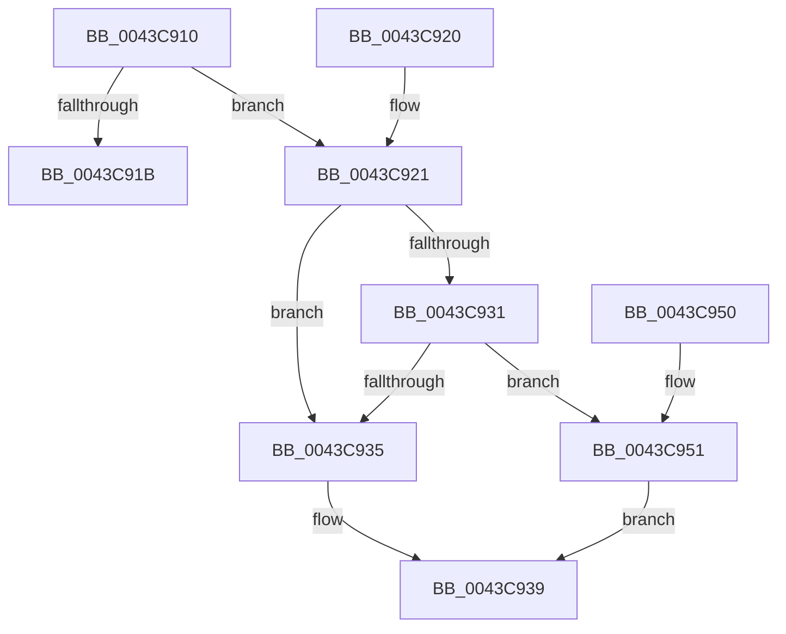

# KiShouldSearchSharedReadyQueue

- RVA: `0x0043C910`–`0x0043C95A` (길이 `74` bytes)
- VA: `0x000000014043C910`
- 실행 섹션: `.text`
- PDB 이름 있음: `예`; PDB Function 태그: `아니요`
- unwind 정보 RVA: `0x000DB714`
- 디코드: `24`개 명령, `74/74` bytes 표시
- 미해석 바이트: `0` (있으면 어셈블리에 `.byte`로 보존)

> 이 문서는 커널 이미지의 기계어와 PDB 기호를 분석해 생성했습니다. 4번과 5번은 함수 원형과 자료형을 바이너리 사용 방식에서 추정한 C 해석이며 원본 소스 복구 결과는 아닙니다.

## 1. Dependencies

- 직접 호출 지점: **0**; 고유 호출 대상: **0**
- 직접 호출자로 확인된 함수: **2**
- RIP 상대 이미지 참조: **1**

### Outgoing calls
- 직접 디코드된 call 명령이 없습니다.

### Direct callers
- [KiDisarmForceParkDutyCyclingIfNecessary](../4F/KiDisarmForceParkDutyCyclingIfNecessary_function_004FA9E4.md) at `0x004FAA33`
- [KiArmForceParkDutyCyclingForSharedReadyQueue](../4F/KiArmForceParkDutyCyclingForSharedReadyQueue_function_004FB604.md) at `0x004FB60E`

### Static image references
- `0x0043C921` → RVA `0x00FC52E0` (`ALMOSTRO`; read)

## 2. Other-region calls and transfers

- 다른 실행 섹션으로 향하는 call: **0**
- 별도 외부 분기/꼬리 이동을 확인하지 못했습니다.

## 3. Assembly (complete function range)

```asm
0043C910  0F B6 41 23                     movzx eax, byte ptr [rcx + 0x23]
0043C914  41 B1 01                        mov r9b, 1
0043C917  A8 10                           test al, 0x10
0043C919  75 06                           jne 0x14043c921
0043C91B  41 0F B6 C1                     movzx eax, r9b
0043C91F  C3                              ret
0043C920  CC                              int3
0043C921  83 3D B8 89 B8 00 00            cmp dword ptr [rip + 0xb889b8], 0
0043C928  4C 8B 81 C0 00 00 00            mov r8, qword ptr [rcx + 0xc0]
0043C92F  74 04                           je 0x14043c935
0043C931  A8 20                           test al, 0x20
0043C933  75 1C                           jne 0x14043c951
0043C935  49 8B 40 50                     mov rax, qword ptr [r8 + 0x50]
0043C939  48 8B 8A C8 02 00 00            mov rcx, qword ptr [rdx + 0x2c8]
0043C940  33 D2                           xor edx, edx
0043C942  48 23 C8                        and rcx, rax
0043C945  41 0F B6 C1                     movzx eax, r9b
0043C949  48 85 C9                        test rcx, rcx
0043C94C  0F 45 C2                        cmovne eax, edx
0043C94F  C3                              ret
0043C950  CC                              int3
0043C951  49 8B 40 68                     mov rax, qword ptr [r8 + 0x68]
0043C955  48 F7 D0                        not rax
0043C958  EB DF                           jmp 0x14043c939
```

## 4. C-style interpretation (structured pseudocode)

```c
__int64 __fastcall KiShouldSearchSharedReadyQueue(__int64 a1, __int64 a2)
{
    __int64 result;

    if ((((unsigned __int8)(*(unsigned __int8 *)(a1 + 35))) & (16)) != 0) goto loc_0043C921;
    return 1;
loc_0043C921:
    if ((*(unsigned int *)(v_rip + 12093880)) == 0) goto loc_0043C935;
    if (((1) & (32)) != 0) goto loc_0043C951;
loc_0043C935:
loc_0043C939:
    a2 = 0;
    a1 = (*(unsigned __int64 *)(a2 + 712)) & (*(unsigned __int64 *)(*(unsigned __int64 *)(a1 + 192) + 80));
    result = 1;
    if (a1 != 0) { result = 0; }
    return result;
loc_0043C951:
    result = ~(*(unsigned __int64 *)(*(unsigned __int64 *)(a1 + 192) + 104));
    goto loc_0043C939;
}
```

## 5. (Beta) C Style

```c
int64_t KiShouldSearchSharedReadyQueue(void *Arg1, void *Arg2)
{
    uint8_t *arg1 = (uint8_t *)Arg1;
    uint8_t *arg2 = (uint8_t *)Arg2;

    int64_t result;

    if ((((uint8_t)(*(uint8_t *)(arg1 + 0x23))) & (16)) != 0) goto loc_0043C921;
    return 1;
loc_0043C921:
    if ((*(uint32_t *)(v_rip + 0xB889B8)) == 0) goto loc_0043C935;
    if (((1) & (32)) != 0) goto loc_0043C951;
loc_0043C935:
loc_0043C939:
    Arg2 = 0;
    Arg1 = (*(uint64_t *)(arg2 + 0x2C8)) & (*(uint64_t *)(*(uint64_t *)(arg1 + 0xC0) + 0x50));
    result = 1;
    if (Arg1 != NULL) { result = 0; }
    return result;
loc_0043C951:
    result = ~(*(uint64_t *)(*(uint64_t *)(arg1 + 0xC0) + 0x68));
    goto loc_0043C939;
}
```

### 관측된 메모리 오프셋

구조체 형식이 확인되지 않은 접근은 인자 기준의 오프셋으로만 기록했습니다.

| 기준 인자 | 오프셋 표현 | 폭 (bit) | 접근 |
|---|---:|---:|---|
| `Arg1` | `+ 0x23` | `8` | `R` |
| `Arg1` | `+ 0xC0` | `64` | `R` |
| `Arg2` | `+ 0x2C8` | `64` | `R` |

## 6. Execution-region graph

[열기: 2D/3D 그래프와 함수 탐색 컨트롤 패널](../../../control-panel.html?section=text&rva=0x0043C910&view=graph)

- 2D 그래프는 위에서 아래로 흐르고, 3D 그래프는 빈 공간을 드래그해 회전합니다. Shift+드래그는 이동, 휠은 확대·축소, 함수 노드 선택은 대상 보고서 이동입니다.

### Static fallback


