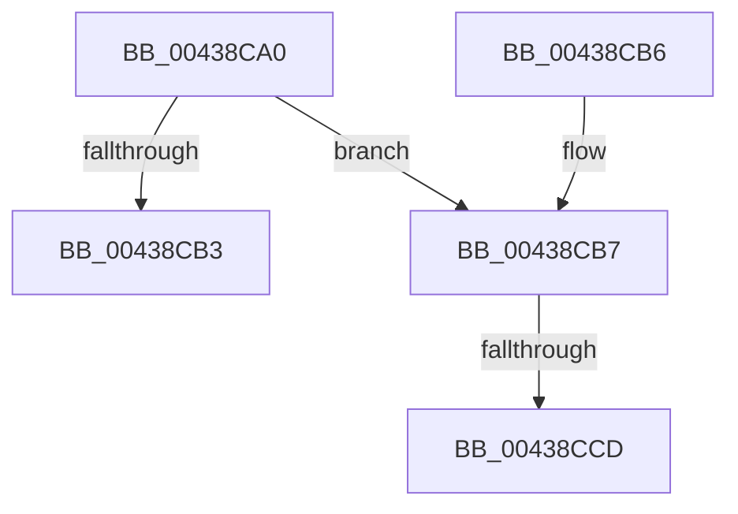

# MI_GET_GRAPHICS_PROTECTION_FROM_VAD

- RVA: `0x00438CA0`–`0x00438CD6` (길이 `54` bytes)
- VA: `0x0000000140438CA0`
- 실행 섹션: `.text`
- PDB 이름 있음: `예`; PDB Function 태그: `예`
- unwind 정보 RVA: `0x000DB714`
- 디코드: `16`개 명령, `54/54` bytes 표시
- 미해석 바이트: `0` (있으면 어셈블리에 `.byte`로 보존)

> 이 문서는 커널 이미지의 기계어와 PDB 기호를 분석해 생성했습니다. 4번과 5번은 함수 원형과 자료형을 바이너리 사용 방식에서 추정한 C 해석이며 원본 소스 복구 결과는 아닙니다.

## 1. Dependencies

- 직접 호출 지점: **0**; 고유 호출 대상: **0**
- 직접 호출자로 확인된 함수: **5**
- RIP 상대 이미지 참조: **0**

### Outgoing calls
- 직접 디코드된 call 명령이 없습니다.

### Direct callers
- [MiProtectPrivateMemory](../2C/MiProtectPrivateMemory_function_002C45B0.md) at `0x002C4FC0`
- [MiQueryAddressState](../32/MiQueryAddressState_function_0032C380.md) at `0x0032CAA4`
- [MiWriteAwePtes](../4C/MiWriteAwePtes_function_004C51E0.md) at `0x004C5349`
- [MiProtectAweRegion](../4C/MiProtectAweRegion_function_004CE62C.md) at `0x004CE797`
- [MmQueryVirtualMemory](../../page/9D/MmQueryVirtualMemory_function_009D9280.md) at `0x009D9A54`

### Static image references
- 디코드된 RIP-relative 메모리 참조가 없습니다.

## 2. Other-region calls and transfers

- 다른 실행 섹션으로 향하는 call: **0**
- call이 아닌 외부 분기/꼬리 이동: **2**
  - `0x00438CC7` → `0x006EF4EC` (`tail-transfer`)
  - `0x00438CD1` → `0x006EF4EC` (`tail-transfer`)

## 3. Assembly (complete function range)

```asm
00438CA0  8B 41 30                        mov eax, dword ptr [rcx + 0x30]
00438CA3  8B C8                           mov ecx, eax
00438CA5  81 E1 00 00 20 04               and ecx, 0x4200000
00438CAB  81 F9 00 00 20 04               cmp ecx, 0x4200000
00438CB1  74 04                           je 0x140438cb7
00438CB3  33 C0                           xor eax, eax
00438CB5  C3                              ret
00438CB6  CC                              int3
00438CB7  8B C8                           mov ecx, eax
00438CB9  BA 00 08 00 00                  mov edx, 0x800
00438CBE  C1 E9 1D                        shr ecx, 0x1d
00438CC1  D3 E2                           shl edx, cl
00438CC3  0F BA E0 1B                     bt eax, 0x1b
00438CC7  0F 83 1F 68 2B 00               jae 0x1406ef4ec
00438CCD  0F BA EA 11                     bts edx, 0x11
00438CD1  E9 16 68 2B 00                  jmp 0x1406ef4ec
```

## 4. C-style interpretation (structured pseudocode)

```c
__int64 __fastcall MI_GET_GRAPHICS_PROTECTION_FROM_VAD(__int64 a1)
{
    __int64 result;

    a1 = (unsigned int)(((unsigned int)((unsigned int)((unsigned int)(*(unsigned int *)(a1 + 48))))) & (0x4200000ULL));
    if (((unsigned int)(a1)) == 0x4200000ULL) goto loc_00438CB7;
    result = 0;
    return result;
loc_00438CB7:
    a1 = (unsigned int)((0) >> (29));
    a2 = (unsigned int)(((unsigned int)(0x800ULL)) << ((unsigned __int8)(a1)));
}
```

## 5. (Beta) C Style

```c
int64_t MI_GET_GRAPHICS_PROTECTION_FROM_VAD(void *Arg1)
{
    uint8_t *arg1 = (uint8_t *)Arg1;

    int64_t result;

    Arg1 = (uint32_t)(((uint32_t)((uint32_t)((uint32_t)(*(uint32_t *)(arg1 + 0x30))))) & (0x4200000ULL));
    if (((uint32_t)(Arg1)) == 0x4200000ULL) goto loc_00438CB7;
    result = 0;
    return result;
loc_00438CB7:
    Arg1 = (uint32_t)((0) >> (29));
    a2 = (uint32_t)(((uint32_t)(0x800ULL)) << ((uint8_t)(Arg1)));
}
```

### 관측된 메모리 오프셋

구조체 형식이 확인되지 않은 접근은 인자 기준의 오프셋으로만 기록했습니다.

| 기준 인자 | 오프셋 표현 | 폭 (bit) | 접근 |
|---|---:|---:|---|
| `Arg1` | `+ 0x30` | `32` | `R` |

## 6. Execution-region graph

[열기: 2D/3D 그래프와 함수 탐색 컨트롤 패널](../../../control-panel.html?section=text&rva=0x00438CA0&view=graph)

- 2D 그래프는 위에서 아래로 흐르고, 3D 그래프는 빈 공간을 드래그해 회전합니다. Shift+드래그는 이동, 휠은 확대·축소, 함수 노드 선택은 대상 보고서 이동입니다.

### Static fallback


