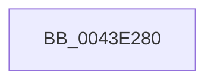

# MiApplyStraddleFixups

- RVA: `0x0043E280`–`0x0043E2AF` (길이 `47` bytes)
- VA: `0x000000014043E280`
- 실행 섹션: `.text`
- PDB 이름 있음: `예`; PDB Function 태그: `아니요`
- unwind 정보 RVA: `0x000A4AD8`
- 디코드: `16`개 명령, `47/47` bytes 표시
- 미해석 바이트: `0` (있으면 어셈블리에 `.byte`로 보존)

> 이 문서는 커널 이미지의 기계어와 PDB 기호를 분석해 생성했습니다. 4번과 5번은 함수 원형과 자료형을 바이너리 사용 방식에서 추정한 C 해석이며 원본 소스 복구 결과는 아닙니다.

## 1. Dependencies

- 직접 호출 지점: **0**; 고유 호출 대상: **0**
- 직접 호출자로 확인된 함수: **1**
- RIP 상대 이미지 참조: **1**

### Outgoing calls
- 직접 디코드된 call 명령이 없습니다.

### Direct callers
- [MiPerformFixups](../../page/93/MiPerformFixups_function_0093F5F4.md) at `0x0093F753`

### Static image references
- `0x0043E28B` → RVA `0x00E0A740` (`.data`; read)

## 2. Other-region calls and transfers

- 다른 실행 섹션으로 향하는 call: **0**
- call이 아닌 외부 분기/꼬리 이동: **1**
  - `0x0043E2AD` → [sub_0043E30D](Unknown_function_0043E30D.md) (`tail-transfer`)

## 3. Assembly (complete function range)

```asm
0043E280  40 53                           push rbx
0043E282  55                              push rbp
0043E283  56                              push rsi
0043E284  57                              push rdi
0043E285  41 57                           push r15
0043E287  48 83 EC 30                     sub rsp, 0x30
0043E28B  48 8B 05 AE C4 9C 00            mov rax, qword ptr [rip + 0x9cc4ae]
0043E292  48 33 C4                        xor rax, rsp
0043E295  48 89 44 24 28                  mov qword ptr [rsp + 0x28], rax
0043E29A  48 8B 59 10                     mov rbx, qword ptr [rcx + 0x10]
0043E29E  4D 8B F9                        mov r15, r9
0043E2A1  41 8B F8                        mov edi, r8d
0043E2A4  48 8B F2                        mov rsi, rdx
0043E2A7  48 8B E9                        mov rbp, rcx
0043E2AA  48 85 DB                        test rbx, rbx
0043E2AD  74 5E                           je 0x14043e30d
```

## 4. C-style interpretation (structured pseudocode)

```c
__int64 __fastcall MiApplyStraddleFixups(__int64 a1, __int64 a2, int a3, __int64 a4)
{
    __int64 result;
    __int64 v_rsp;
    unsigned __int64 v_stack_m30;

    v_rsp = (v_rsp) - (48);
    result = (*(unsigned __int64 *)(v_rip + 10273966)) ^ (v_rsp);
    v_stack_m30 = result;
}
```

## 5. (Beta) C Style

```c
int64_t MiApplyStraddleFixups(void *Arg1, int64_t Arg2, int32_t Arg3, int64_t Arg4)
{
    uint8_t *arg1 = (uint8_t *)Arg1;

    int64_t result;
    int64_t local_rsp;
    uint64_t v_stack_m30;

    local_rsp = (local_rsp) - (48);
    result = (*(uint64_t *)(v_rip + 0x9CC4AE)) ^ (local_rsp);
    v_stack_m30 = result;
}
```

### 관측된 메모리 오프셋

구조체 형식이 확인되지 않은 접근은 인자 기준의 오프셋으로만 기록했습니다.

| 기준 인자 | 오프셋 표현 | 폭 (bit) | 접근 |
|---|---:|---:|---|
| `Arg1` | `+ 0x10` | `64` | `R` |

## 6. Execution-region graph

[열기: 2D/3D 그래프와 함수 탐색 컨트롤 패널](../../../control-panel.html?section=text&rva=0x0043E280&view=graph)

- 2D 그래프는 위에서 아래로 흐르고, 3D 그래프는 빈 공간을 드래그해 회전합니다. Shift+드래그는 이동, 휠은 확대·축소, 함수 노드 선택은 대상 보고서 이동입니다.

### Static fallback


