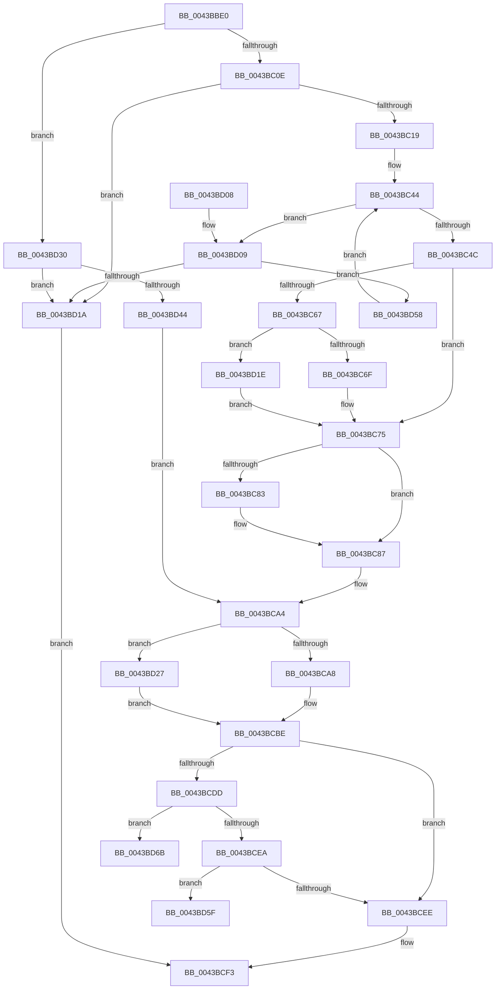

# MiBeginPageAccessor

- RVA: `0x0043BBE0`–`0x0043BD77` (길이 `407` bytes)
- VA: `0x000000014043BBE0`
- 실행 섹션: `.text`
- PDB 이름 있음: `예`; PDB Function 태그: `예`
- unwind 정보 RVA: `0x000A4498`
- 디코드: `95`개 명령, `407/407` bytes 표시
- 미해석 바이트: `0` (있으면 어셈블리에 `.byte`로 보존)

> 이 문서는 커널 이미지의 기계어와 PDB 기호를 분석해 생성했습니다. 4번과 5번은 함수 원형과 자료형을 바이너리 사용 방식에서 추정한 C 해석이며 원본 소스 복구 결과는 아닙니다.

## 1. Dependencies

- 직접 호출 지점: **1**; 고유 호출 대상: **1**
- 직접 호출자로 확인된 함수: **3**
- RIP 상대 이미지 참조: **3**

### Outgoing calls
- `0x0043BD33` → [MiCanBeginHugeIoPageAccessor](../67/MiCanBeginHugeIoPageAccessor_function_00675370.md) (function, `0x00675370`)

### Direct callers
- [MiSetPageZeroInProgress](MiSetPageZeroInProgress_function_0043B980.md) at `0x0043BB40`
- [MiGetSingleHugeRangeToZero](../4D/MiGetSingleHugeRangeToZero_function_004DD034.md) at `0x004DD222`
- [MiScrubLargePage](../69/MiScrubLargePage_function_006942E8.md) at `0x006944E2`

### Static image references
- `0x0043BC53` → RVA `0x00E2DC80` (`.data`; read)
- `0x0043BD5F` → RVA `0x00E2FF30` (`.data`; read)
- `0x0043BD6B` → RVA `0x00E2FF20` (`.data`; read)

## 2. Other-region calls and transfers

- 다른 실행 섹션으로 향하는 call: **0**
- call이 아닌 외부 분기/꼬리 이동: **2**
  - `0x0043BD66` → [sub_006EF650](../6E/Unknown_function_006EF650.md) (`tail-transfer`)
  - `0x0043BD72` → [sub_006EF650](../6E/Unknown_function_006EF650.md) (`tail-transfer`)

## 3. Assembly (complete function range)

```asm
0043BBE0  48 89 5C 24 08                  mov qword ptr [rsp + 8], rbx
0043BBE5  48 89 6C 24 10                  mov qword ptr [rsp + 0x10], rbp
0043BBEA  48 89 74 24 18                  mov qword ptr [rsp + 0x18], rsi
0043BBEF  57                              push rdi
0043BBF0  48 83 EC 20                     sub rsp, 0x20
0043BBF4  8B B1 18 01 00 00               mov esi, dword ptr [rcx + 0x118]
0043BBFA  41 8B F9                        mov edi, r9d
0043BBFD  4D 8B D0                        mov r10, r8
0043BC00  8B EA                           mov ebp, edx
0043BC02  48 8B D9                        mov rbx, rcx
0043BC05  45 85 C9                        test r9d, r9d
0043BC08  0F 85 22 01 00 00               jne 0x14043bd30
0043BC0E  41 F6 40 22 08                  test byte ptr [r8 + 0x22], 8
0043BC13  0F 85 01 01 00 00               jne 0x14043bd1a
0043BC19  48 B8 00 00 00 00 00 DE FF FF   movabs rax, 0xffffde0000000000
0043BC23  4C 2B C0                        sub r8, rax
0043BC26  48 BA FF FF FF FF 3F 00 00 00   movabs rdx, 0x3fffffffff
0043BC30  49 C1 F8 04                     sar r8, 4
0043BC34  48 B8 AB AA AA AA AA AA AA AA   movabs rax, 0xaaaaaaaaaaaaaaab
0043BC3E  4C 0F AF C0                     imul r8, rax
0043BC42  33 C9                           xor ecx, ecx
0043BC44  3B CE                           cmp ecx, esi
0043BC46  0F 82 BD 00 00 00               jb 0x14043bd09
0043BC4C  49 8B 42 10                     mov rax, qword ptr [r10 + 0x10]
0043BC50  4C 23 C2                        and r8, rdx
0043BC53  48 8B 0D 26 20 9F 00            mov rcx, qword ptr [rip + 0x9f2026]
0043BC5A  49 C1 E0 0C                     shl r8, 0xc
0043BC5E  49 83 C8 18                     or r8, 0x18
0043BC62  48 85 C9                        test rcx, rcx
0043BC65  74 0E                           je 0x14043bc75
0043BC67  A8 10                           test al, 0x10
0043BC69  0F 85 AF 00 00 00               jne 0x14043bd1e
0043BC6F  48 F7 D1                        not rcx
0043BC72  48 23 C1                        and rax, rcx
0043BC75  48 C1 E8 20                     shr rax, 0x20
0043BC79  B9 FD FF FF FF                  mov ecx, 0xfffffffd
0043BC7E  48 3B C1                        cmp rax, rcx
0043BC81  75 04                           jne 0x14043bc87
0043BC83  49 83 C8 04                     or r8, 4
0043BC87  41 8B 42 20                     mov eax, dword ptr [r10 + 0x20]
0043BC8B  89 44 24 48                     mov dword ptr [rsp + 0x48], eax
0043BC8F  C1 E8 10                        shr eax, 0x10
0043BC92  0C 08                           or al, 8
0043BC94  88 44 24 4A                     mov byte ptr [rsp + 0x4a], al
0043BC98  8B 44 24 48                     mov eax, dword ptr [rsp + 0x48]
0043BC9C  41 89 42 20                     mov dword ptr [r10 + 0x20], eax
0043BCA0  49 89 5A 10                     mov qword ptr [r10 + 0x10], rbx
0043BCA4  85 F6                           test esi, esi
0043BCA6  75 7F                           jne 0x14043bd27
0043BCA8  89 AB 40 01 00 00               mov dword ptr [rbx + 0x140], ebp
0043BCAE  65 48 8B 2C 25 88 01 00 00      mov rbp, qword ptr gs:[0x188]
0043BCB7  48 89 AB 38 01 00 00            mov qword ptr [rbx + 0x138], rbp
0043BCBE  4C 89 44 F3 18                  mov qword ptr [rbx + rsi*8 + 0x18], r8
0043BCC3  FF 83 18 01 00 00               inc dword ptr [rbx + 0x118]
0043BCC9  80 BB 45 01 00 00 00            cmp byte ptr [rbx + 0x145], 0
0043BCD0  48 C7 83 20 01 00 00 00 00 00 00  mov qword ptr [rbx + 0x120], 0
0043BCDB  75 11                           jne 0x14043bcee
0043BCDD  80 BB 46 01 00 00 00            cmp byte ptr [rbx + 0x146], 0
0043BCE4  0F 85 81 00 00 00               jne 0x14043bd6b
0043BCEA  85 FF                           test edi, edi
0043BCEC  75 71                           jne 0x14043bd5f
0043BCEE  B8 01 00 00 00                  mov eax, 1
0043BCF3  48 8B 5C 24 30                  mov rbx, qword ptr [rsp + 0x30]
0043BCF8  48 8B 6C 24 38                  mov rbp, qword ptr [rsp + 0x38]
0043BCFD  48 8B 74 24 40                  mov rsi, qword ptr [rsp + 0x40]
0043BD02  48 83 C4 20                     add rsp, 0x20
0043BD06  5F                              pop rdi
0043BD07  C3                              ret
0043BD08  CC                              int3
0043BD09  48 8B 44 CB 18                  mov rax, qword ptr [rbx + rcx*8 + 0x18]
0043BD0E  48 C1 E8 0C                     shr rax, 0xc
0043BD12  48 23 C2                        and rax, rdx
0043BD15  4C 3B C0                        cmp r8, rax
0043BD18  75 3E                           jne 0x14043bd58
0043BD1A  33 C0                           xor eax, eax
0043BD1C  EB D5                           jmp 0x14043bcf3
0043BD1E  48 83 E0 EF                     and rax, 0xffffffffffffffef
0043BD22  E9 4E FF FF FF                  jmp 0x14043bc75
0043BD27  48 8B AB 38 01 00 00            mov rbp, qword ptr [rbx + 0x138]
0043BD2E  EB 8E                           jmp 0x14043bcbe
0043BD30  49 8B CA                        mov rcx, r10
0043BD33  E8 38 96 23 00                  call 0x140675370
0043BD38  4C 8B C0                        mov r8, rax
0043BD3B  41 81 E0 FF FF 3F 00            and r8d, 0x3fffff
0043BD42  74 D6                           je 0x14043bd1a
0043BD44  49 C1 E0 0C                     shl r8, 0xc
0043BD48  49 83 C8 18                     or r8, 0x18
0043BD4C  C6 83 44 01 00 00 01            mov byte ptr [rbx + 0x144], 1
0043BD53  E9 4C FF FF FF                  jmp 0x14043bca4
0043BD58  FF C1                           inc ecx
0043BD5A  E9 E5 FE FF FF                  jmp 0x14043bc44
0043BD5F  48 8D 3D CA 41 9F 00            lea rdi, [rip + 0x9f41ca]
0043BD66  E9 E5 38 2B 00                  jmp 0x1406ef650
0043BD6B  48 8D 3D AE 41 9F 00            lea rdi, [rip + 0x9f41ae]
0043BD72  E9 D9 38 2B 00                  jmp 0x1406ef650
```

## 4. C-style interpretation (structured pseudocode)

```c
__int64 __fastcall MiBeginPageAccessor(__int64 a1, int a2, __int64 a3, int a4)
{
    __int64 result;
    __int64 v_rsp;
    unsigned __int64 v_stack_p10;
    unsigned __int64 v_stack_p18;
    unsigned int v_stack_p20;
    unsigned __int8 v_stack_p22;
    unsigned __int64 v_stack_p8;

    v_stack_p8 = v_rbx;
    v_stack_p10 = v_rbp;
    v_stack_p18 = v_rsi;
    v_rsp = (v_rsp) - (32);
    if (a4 != 0) goto loc_0043BD30;
    if (((*(unsigned __int8 *)(a3 + 34)) & (8)) != 0) goto loc_0043BD1A;
    a3 = (a3) - (result);
    a3 = (a3) >> (4);
    a3 = (a3) * (result);
    a1 = 0;
loc_0043BC44:
    if (0 < ((unsigned int)((unsigned int)(*(unsigned int *)(a1 + 280))))) goto loc_0043BD09;
    a3 = (a3) & (a2);
    a3 = (a3) << (12);
    a3 = (a3) | (24);
    if (*(unsigned __int64 *)(v_rip + 10428454) == 0) goto loc_0043BC75;
    if ((((unsigned __int8)(*(unsigned __int64 *)(a3 + 16))) & (16)) != 0) goto loc_0043BD1E;
    a1 = ~(*(unsigned __int64 *)(v_rip + 10428454));
    result = (*(unsigned __int64 *)(a3 + 16)) & (a1);
loc_0043BC75:
    result = (result) >> (32);
    if (result == ((unsigned int)(0xFFFFFFFDULL))) {
        a3 = (a3) | (4);
    }
    v_stack_p20 = (unsigned int)((unsigned int)(*(unsigned int *)(a3 + 32)));
    result = (unsigned int)(((unsigned int)(*(unsigned int *)(a3 + 32))) >> (16));
    result = (unsigned __int8)((result) | (8));
    v_stack_p22 = (unsigned __int8)(result);
    *(unsigned int *)(a3 + 32) = (unsigned int)((unsigned int)(v_stack_p20));
    *(unsigned __int64 *)(a3 + 16) = a1;
loc_0043BCA4:
    if ((unsigned int)((unsigned int)(*(unsigned int *)(a1 + 280))) != 0) goto loc_0043BD27;
    *(unsigned int *)(a1 + 320) = (unsigned int)((unsigned int)(a2));
    *(unsigned __int64 *)(a1 + 312) = *(unsigned __int64 *)(gs_base + (0 + 392));
loc_0043BCBE:
    *(unsigned __int64 *)(a1 + (unsigned int)(*(unsigned int *)(a1 + 280)) * 8 + 24) = a3;
    *(unsigned __int64 *)(a1 + 288) = 0;
    if ((*(unsigned __int8 *)(a1 + 325)) != 0) goto loc_0043BCEE;
    if ((*(unsigned __int8 *)(a1 + 326)) != 0) goto loc_0043BD6B;
    if ((unsigned int)((unsigned int)(a4)) != 0) goto loc_0043BD5F;
loc_0043BCEE:
loc_0043BCF3:
    v_rsp = (v_rsp) + (32);
    return 1;
loc_0043BD09:
    result = (*(unsigned __int64 *)(v_stack_p8 + (unsigned int)(0xFFFFFFFDULL) * 8 + 24)) >> (12);
    result = (result) & (a2);
    if (a3 != result) goto loc_0043BD58;
loc_0043BD1A:
    result = 0;
    goto loc_0043BCF3;
loc_0043BD1E:
    result = (result) & (-17);
    goto loc_0043BC75;
loc_0043BD27:
    goto loc_0043BCBE;
loc_0043BD30:
    result = MiCanBeginHugeIoPageAccessor(a3, a2, a3, a4);
    a3 = (unsigned int)((result) & (0x3FFFFFULL));
    if (condition_is_equal) goto loc_0043BD1A;
    a3 = (a3) << (12);
    a3 = (a3) | (24);
    *(unsigned __int8 *)(v_stack_p8 + 324) = 1;
    goto loc_0043BCA4;
loc_0043BD58:
    a1 = (unsigned int)((a3) + 1);
    goto loc_0043BC44;
loc_0043BD5F:
loc_0043BD6B:
}
```

## 5. (Beta) C Style

```c
int64_t MiBeginPageAccessor(void *Arg1, int32_t Arg2, void *Arg3, int32_t Arg4)
{
    uint8_t *arg1 = (uint8_t *)Arg1;
    uint8_t *arg3 = (uint8_t *)Arg3;

    int64_t result;
    int64_t local_rsp;
    uint64_t v_stack_p10;
    uint64_t v_stack_p18;
    uint32_t v_stack_p20;
    uint8_t v_stack_p22;
    uint64_t v_stack_p8;

    v_stack_p8 = local_rbx;
    v_stack_p10 = local_rbp;
    v_stack_p18 = local_rsi;
    local_rsp = (local_rsp) - (32);
    if (Arg4 != 0) goto loc_0043BD30;
    if (((*(uint8_t *)(arg3 + 0x22)) & (8)) != 0) goto loc_0043BD1A;
    Arg3 = (Arg3) - (result);
    Arg3 = (Arg3) >> (4);
    Arg3 = (Arg3) * (result);
    Arg1 = 0;
loc_0043BC44:
    if (0 < ((uint32_t)((uint32_t)(*(uint32_t *)(arg1 + 0x118))))) goto loc_0043BD09;
    Arg3 = (Arg3) & (Arg2);
    Arg3 = (Arg3) << (12);
    Arg3 = (Arg3) | (24);
    if (*(uint64_t *)(v_rip + 0x9F2026) == 0) goto loc_0043BC75;
    if ((((uint8_t)(*(uint64_t *)(arg3 + 0x10))) & (16)) != 0) goto loc_0043BD1E;
    Arg1 = ~(*(uint64_t *)(v_rip + 0x9F2026));
    result = (*(uint64_t *)(arg3 + 0x10)) & (Arg1);
loc_0043BC75:
    result = (result) >> (32);
    if (result == ((uint32_t)(0xFFFFFFFDULL))) {
        Arg3 = (Arg3) | (4);
    }
    v_stack_p20 = (uint32_t)((uint32_t)(*(uint32_t *)(arg3 + 0x20)));
    result = (uint32_t)(((uint32_t)(*(uint32_t *)(arg3 + 0x20))) >> (16));
    result = (uint8_t)((result) | (8));
    v_stack_p22 = (uint8_t)(result);
    *(uint32_t *)(arg3 + 0x20) = (uint32_t)((uint32_t)(v_stack_p20));
    *(void **)(arg3 + 0x10) = Arg1;
loc_0043BCA4:
    if ((uint32_t)((uint32_t)(*(uint32_t *)(arg1 + 0x118))) != 0) goto loc_0043BD27;
    *(uint32_t *)(arg1 + 0x140) = (uint32_t)((uint32_t)(Arg2));
    *(uint64_t *)(arg1 + 0x138) = *(uint64_t *)(gs_base + (0 + 0x188));
loc_0043BCBE:
    *(void **)(arg1 + (uint32_t)(*(uint32_t *)(arg1 + 0x118)) * 8 + 0x18) = Arg3;
    *(uint64_t *)(arg1 + 0x120) = 0;
    if ((*(uint8_t *)(arg1 + 0x145)) != 0) goto loc_0043BCEE;
    if ((*(uint8_t *)(arg1 + 0x146)) != 0) goto loc_0043BD6B;
    if ((uint32_t)((uint32_t)(Arg4)) != 0) goto loc_0043BD5F;
loc_0043BCEE:
loc_0043BCF3:
    local_rsp = (local_rsp) + (32);
    return 1;
loc_0043BD09:
    result = (*(uint64_t *)(v_stack_p8 + (uint32_t)(0xFFFFFFFDULL) * 8 + 0x18)) >> (12);
    result = (result) & (Arg2);
    if (Arg3 != result) goto loc_0043BD58;
loc_0043BD1A:
    result = 0;
    goto loc_0043BCF3;
loc_0043BD1E:
    result = (result) & (-17);
    goto loc_0043BC75;
loc_0043BD27:
    goto loc_0043BCBE;
loc_0043BD30:
    result = MiCanBeginHugeIoPageAccessor(Arg3, Arg2, Arg3, Arg4);
    Arg3 = (uint32_t)((result) & (0x3FFFFFULL));
    if (condition_is_equal) goto loc_0043BD1A;
    Arg3 = (Arg3) << (12);
    Arg3 = (Arg3) | (24);
    *(uint8_t *)(v_stack_p8 + 0x144) = 1;
    goto loc_0043BCA4;
loc_0043BD58:
    Arg1 = (uint32_t)((Arg3) + 1);
    goto loc_0043BC44;
loc_0043BD5F:
loc_0043BD6B:
}
```

### 관측된 메모리 오프셋

구조체 형식이 확인되지 않은 접근은 인자 기준의 오프셋으로만 기록했습니다.

| 기준 인자 | 오프셋 표현 | 폭 (bit) | 접근 |
|---|---:|---:|---|
| `Arg1` | `+ 0x18 + rcx*8` | `64` | `R` |
| `Arg1` | `+ 0x18 + rsi*8` | `64` | `W` |
| `Arg1` | `+ 0x118` | `32` | `R` |
| `Arg1` | `+ 0x118` | `32` | `R/W` |
| `Arg1` | `+ 0x120` | `64` | `W` |
| `Arg1` | `+ 0x138` | `64` | `R` |
| `Arg1` | `+ 0x138` | `64` | `W` |
| `Arg1` | `+ 0x140` | `32` | `W` |
| `Arg1` | `+ 0x144` | `8` | `W` |
| `Arg1` | `+ 0x145` | `8` | `R` |
| `Arg1` | `+ 0x146` | `8` | `R` |
| `Arg3` | `+ 0x10` | `64` | `R` |
| `Arg3` | `+ 0x10` | `64` | `W` |
| `Arg3` | `+ 0x20` | `32` | `R` |
| `Arg3` | `+ 0x20` | `32` | `W` |
| `Arg3` | `+ 0x22` | `8` | `R` |

## 6. Execution-region graph

[열기: 2D/3D 그래프와 함수 탐색 컨트롤 패널](../../../control-panel.html?section=text&rva=0x0043BBE0&view=graph)

- 2D 그래프는 위에서 아래로 흐르고, 3D 그래프는 빈 공간을 드래그해 회전합니다. Shift+드래그는 이동, 휠은 확대·축소, 함수 노드 선택은 대상 보고서 이동입니다.

### Static fallback


