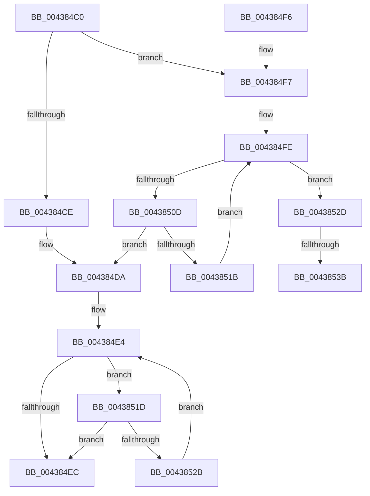

# MiChargeProcessCommitment

- RVA: `0x004384C0`–`0x00438546` (길이 `134` bytes)
- VA: `0x00000001404384C0`
- 실행 섹션: `.text`
- PDB 이름 있음: `예`; PDB Function 태그: `예`
- unwind 정보 RVA: `0x000A3490`
- 디코드: `32`개 명령, `134/134` bytes 표시
- 미해석 바이트: `0` (있으면 어셈블리에 `.byte`로 보존)

> 이 문서는 커널 이미지의 기계어와 PDB 기호를 분석해 생성했습니다. 4번과 5번은 함수 원형과 자료형을 바이너리 사용 방식에서 추정한 C 해석이며 원본 소스 복구 결과는 아닙니다.

## 1. Dependencies

- 직접 호출 지점: **1**; 고유 호출 대상: **1**
- 직접 호출자로 확인된 함수: **2**
- RIP 상대 이미지 참조: **0**

### Outgoing calls
- `0x0043853B` → [PsReportProcessMemoryLimitViolation](../../page/78/PsReportProcessMemoryLimitViolation_function_00784A5C.md) (function, `0x00784A5C`)

### Direct callers
- [MiAllocateUserPhysicalPages](../../page/80/MiAllocateUserPhysicalPages_function_00809828.md) at `0x00809C6C`
- [MiChargeFullProcessCommitment](../../page/88/MiChargeFullProcessCommitment_function_00887630.md) at `0x00887681`

### Static image references
- 디코드된 RIP-relative 메모리 참조가 없습니다.

## 2. Other-region calls and transfers

- 다른 실행 섹션으로 향하는 call: **1**
  - `0x0043853B` → [PsReportProcessMemoryLimitViolation](../../page/78/PsReportProcessMemoryLimitViolation_function_00784A5C.md) (`.text` → `PAGE`)
- call이 아닌 외부 분기/꼬리 이동: **2**
  - `0x00438535` → [sub_006EF36E](../6E/Unknown_function_006EF36E.md) (`tail-transfer`)
  - `0x00438541` → [sub_006EF36E](../6E/Unknown_function_006EF36E.md) (`tail-transfer`)

## 3. Assembly (complete function range)

```asm
004384C0  48 83 EC 28                     sub rsp, 0x28
004384C4  48 83 B9 D0 03 00 00 00         cmp qword ptr [rcx + 0x3d0], 0
004384CC  75 29                           jne 0x1404384f7
004384CE  4C 8B C2                        mov r8, rdx
004384D1  F0 4C 0F C1 81 D8 03 00 00      lock xadd qword ptr [rcx + 0x3d8], r8
004384DA  48 8B 81 E0 03 00 00            mov rax, qword ptr [rcx + 0x3e0]
004384E1  4C 03 C2                        add r8, rdx
004384E4  48 8B D0                        mov rdx, rax
004384E7  4C 3B C0                        cmp r8, rax
004384EA  77 31                           ja 0x14043851d
004384EC  B8 01 00 00 00                  mov eax, 1
004384F1  48 83 C4 28                     add rsp, 0x28
004384F5  C3                              ret
004384F6  CC                              int3
004384F7  4C 8B 81 D8 03 00 00            mov r8, qword ptr [rcx + 0x3d8]
004384FE  49 8B C0                        mov rax, r8
00438501  4C 03 C2                        add r8, rdx
00438504  4C 3B 81 D0 03 00 00            cmp r8, qword ptr [rcx + 0x3d0]
0043850B  77 20                           ja 0x14043852d
0043850D  F0 4C 0F B1 81 D8 03 00 00      lock cmpxchg qword ptr [rcx + 0x3d8], r8
00438516  4C 8B C0                        mov r8, rax
00438519  74 BF                           je 0x1404384da
0043851B  EB E1                           jmp 0x1404384fe
0043851D  F0 4C 0F B1 81 E0 03 00 00      lock cmpxchg qword ptr [rcx + 0x3e0], r8
00438526  48 3B C2                        cmp rax, rdx
00438529  74 C1                           je 0x1404384ec
0043852B  EB B7                           jmp 0x1404384e4
0043852D  48 83 B9 A0 02 00 00 00         cmp qword ptr [rcx + 0x2a0], 0
00438535  0F 84 33 6E 2B 00               je 0x1406ef36e
0043853B  E8 1C C5 34 00                  call 0x140784a5c
00438540  90                              nop
00438541  E9 28 6E 2B 00                  jmp 0x1406ef36e
```

## 4. C-style interpretation (structured pseudocode)

```c
__int64 __fastcall MiChargeProcessCommitment(__int64 a1, __int64 a2)
{
    __int64 result;
    __int64 v_rsp;

    v_rsp = (v_rsp) - (40);
    if ((*(unsigned __int64 *)(a1 + 976)) != 0) goto loc_004384F7;
loc_004384DA:
    a3 = (a2) + (a2);
loc_004384E4:
    if (a3 > (*(unsigned __int64 *)(a1 + 992))) goto loc_0043851D;
loc_004384EC:
    v_rsp = (v_rsp) + (40);
    return 1;
loc_004384F7:
loc_004384FE:
    a3 = (*(unsigned __int64 *)(a1 + 984)) + (*(unsigned __int64 *)(a1 + 992));
    if (a3 > (*(unsigned __int64 *)(a1 + 976))) goto loc_0043852D;
    if (a3 == (*(unsigned __int64 *)(a1 + 976))) goto loc_004384DA;
    goto loc_004384FE;
loc_0043851D:
    if ((*(unsigned __int64 *)(a1 + 984)) == (*(unsigned __int64 *)(a1 + 992))) goto loc_004384EC;
    goto loc_004384E4;
loc_0043852D:
    result = PsReportProcessMemoryLimitViolation(a1, *(unsigned __int64 *)(a1 + 992), *(unsigned __int64 *)(a1 + 984), a4);
}
```

## 5. (Beta) C Style

```c
int64_t MiChargeProcessCommitment(void *Arg1, int64_t Arg2)
{
    uint8_t *arg1 = (uint8_t *)Arg1;

    int64_t result;
    int64_t local_rsp;

    local_rsp = (local_rsp) - (40);
    if ((*(uint64_t *)(arg1 + 0x3D0)) != 0) goto loc_004384F7;
loc_004384DA:
    a3 = (Arg2) + (Arg2);
loc_004384E4:
    if (a3 > (*(uint64_t *)(arg1 + 0x3E0))) goto loc_0043851D;
loc_004384EC:
    local_rsp = (local_rsp) + (40);
    return 1;
loc_004384F7:
loc_004384FE:
    a3 = (*(uint64_t *)(arg1 + 0x3D8)) + (*(uint64_t *)(arg1 + 0x3E0));
    if (a3 > (*(uint64_t *)(arg1 + 0x3D0))) goto loc_0043852D;
    if (a3 == (*(uint64_t *)(arg1 + 0x3D0))) goto loc_004384DA;
    goto loc_004384FE;
loc_0043851D:
    if ((*(uint64_t *)(arg1 + 0x3D8)) == (*(uint64_t *)(arg1 + 0x3E0))) goto loc_004384EC;
    goto loc_004384E4;
loc_0043852D:
    result = PsReportProcessMemoryLimitViolation(Arg1, *(uint64_t *)(arg1 + 0x3E0), *(uint64_t *)(arg1 + 0x3D8), a4);
}
```

### 관측된 메모리 오프셋

구조체 형식이 확인되지 않은 접근은 인자 기준의 오프셋으로만 기록했습니다.

| 기준 인자 | 오프셋 표현 | 폭 (bit) | 접근 |
|---|---:|---:|---|
| `Arg1` | `+ 0x2A0` | `64` | `R` |
| `Arg1` | `+ 0x3D0` | `64` | `R` |
| `Arg1` | `+ 0x3D8` | `64` | `R` |
| `Arg1` | `+ 0x3D8` | `64` | `R/W` |
| `Arg1` | `+ 0x3E0` | `64` | `R` |

## 6. Execution-region graph

[열기: 2D/3D 그래프와 함수 탐색 컨트롤 패널](../../../control-panel.html?section=text&rva=0x004384C0&view=graph)

- 2D 그래프는 위에서 아래로 흐르고, 3D 그래프는 빈 공간을 드래그해 회전합니다. Shift+드래그는 이동, 휠은 확대·축소, 함수 노드 선택은 대상 보고서 이동입니다.

### Static fallback


