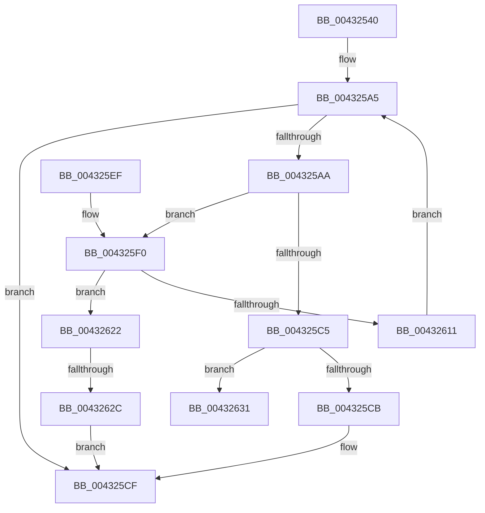

# MiCheckKernelShadow

- RVA: `0x00432540`–`0x0043264C` (길이 `268` bytes)
- VA: `0x0000000140432540`
- 실행 섹션: `.text`
- PDB 이름 있음: `예`; PDB Function 태그: `예`
- unwind 정보 RVA: `0x000A22C0`
- 디코드: `76`개 명령, `268/268` bytes 표시
- 미해석 바이트: `0` (있으면 어셈블리에 `.byte`로 보존)

> 이 문서는 커널 이미지의 기계어와 PDB 기호를 분석해 생성했습니다. 4번과 5번은 함수 원형과 자료형을 바이너리 사용 방식에서 추정한 C 해석이며 원본 소스 복구 결과는 아닙니다.

## 1. Dependencies

- 직접 호출 지점: **3**; 고유 호출 대상: **3**
- 직접 호출자로 확인된 함수: **1**
- RIP 상대 이미지 참조: **1**

### Outgoing calls
- `0x004325B9` → [MiReadWriteAnyLevelShadowPte](MiReadWriteAnyLevelShadowPte_function_00432654.md) (function, `0x00432654`)
- `0x004325F3` → [MiVaToPfnEx](../23/MiVaToPfnEx_function_0023A1A0.md) (function, `0x0023A1A0`)
- `0x00432646` → [KeBugCheckEx](../4F/KeBugCheckEx_function_004FD660.md) (function, `0x004FD660`)

### Direct callers
- [MiCheckRelevantKernelShadows](MiCheckRelevantKernelShadows_function_004323B4.md) at `0x004323E7`

### Static image references
- `0x004325AA` → RVA `0x00010880` (`.rdata`; read)

## 2. Other-region calls and transfers

- 다른 실행 섹션으로 향하는 call: **0**
- call이 아닌 외부 분기/꼬리 이동: **1**
  - `0x00432626` → [sub_006EE99A](../6E/Unknown_function_006EE99A.md) (`tail-transfer`)

## 3. Assembly (complete function range)

```asm
00432540  48 89 5C 24 08                  mov qword ptr [rsp + 8], rbx
00432545  48 89 6C 24 10                  mov qword ptr [rsp + 0x10], rbp
0043254A  48 89 74 24 18                  mov qword ptr [rsp + 0x18], rsi
0043254F  57                              push rdi
00432550  41 54                           push r12
00432552  41 55                           push r13
00432554  41 56                           push r14
00432556  41 57                           push r15
00432558  48 83 EC 30                     sub rsp, 0x30
0043255C  48 8B FA                        mov rdi, rdx
0043255F  4C 8B EA                        mov r13, rdx
00432562  48 C1 EF 09                     shr rdi, 9
00432566  48 BA F8 FF FF FF 7F 00 00 00   movabs rdx, 0x7ffffffff8
00432570  44 8B E1                        mov r12d, ecx
00432573  48 23 FA                        and rdi, rdx
00432576  48 B9 00 00 00 00 80 F6 FF FF   movabs rcx, 0xfffff68000000000
00432580  48 8B C1                        mov rax, rcx
00432583  4D 8D 78 FF                     lea r15, [r8 - 1]
00432587  48 03 F8                        add rdi, rax
0043258A  4D 03 FD                        add r15, r13
0043258D  49 C1 EF 09                     shr r15, 9
00432591  4C 23 FA                        and r15, rdx
00432594  48 8B C1                        mov rax, rcx
00432597  4C 03 F8                        add r15, rax
0043259A  BD FF FF FF FF                  mov ebp, 0xffffffff
0043259F  45 33 F6                        xor r14d, r14d
004325A2  49 8B F5                        mov rsi, r13
004325A5  49 3B FF                        cmp rdi, r15
004325A8  77 25                           ja 0x1404325cf
004325AA  4C 8B 0D CF E2 BD FF            mov r9, qword ptr [rip - 0x421d31]
004325B1  45 33 C0                        xor r8d, r8d
004325B4  33 D2                           xor edx, edx
004325B6  48 8B CF                        mov rcx, rdi
004325B9  E8 96 00 00 00                  call 0x140432654
004325BE  48 8B D8                        mov rbx, rax
004325C1  A8 01                           test al, 1
004325C3  75 2B                           jne 0x1404325f0
004325C5  41 F6 C4 08                     test r12b, 8
004325C9  74 66                           je 0x140432631
004325CB  4B 8D 2C 2E                     lea rbp, [r14 + r13]
004325CF  48 8B 5C 24 60                  mov rbx, qword ptr [rsp + 0x60]
004325D4  48 8B C5                        mov rax, rbp
004325D7  48 8B 6C 24 68                  mov rbp, qword ptr [rsp + 0x68]
004325DC  48 8B 74 24 70                  mov rsi, qword ptr [rsp + 0x70]
004325E1  48 83 C4 30                     add rsp, 0x30
004325E5  41 5F                           pop r15
004325E7  41 5E                           pop r14
004325E9  41 5D                           pop r13
004325EB  41 5C                           pop r12
004325ED  5F                              pop rdi
004325EE  C3                              ret
004325EF  CC                              int3
004325F0  48 8B CE                        mov rcx, rsi
004325F3  E8 A8 7B E0 FF                  call 0x14023a1a0
004325F8  48 8B CB                        mov rcx, rbx
004325FB  48 BA FF FF FF FF FF 00 00 00   movabs rdx, 0xffffffffff
00432605  48 C1 E9 0C                     shr rcx, 0xc
00432609  48 23 CA                        and rcx, rdx
0043260C  48 3B C1                        cmp rax, rcx
0043260F  75 11                           jne 0x140432622
00432611  B8 00 10 00 00                  mov eax, 0x1000
00432616  48 83 C7 08                     add rdi, 8
0043261A  4C 03 F0                        add r14, rax
0043261D  48 03 F0                        add rsi, rax
00432620  EB 83                           jmp 0x1404325a5
00432622  41 F6 C4 08                     test r12b, 8
00432626  0F 84 6E C3 2B 00               je 0x1406ee99a
0043262C  48 8B EE                        mov rbp, rsi
0043262F  EB 9E                           jmp 0x1404325cf
00432631  4C 8B CB                        mov r9, rbx
00432634  48 89 5C 24 20                  mov qword ptr [rsp + 0x20], rbx
00432639  4C 8B C7                        mov r8, rdi
0043263C  BA 02 13 00 00                  mov edx, 0x1302
00432641  B9 1A 00 00 00                  mov ecx, 0x1a
00432646  E8 15 B0 0C 00                  call 0x1404fd660
0043264B  CC                              int3
```

## 4. C-style interpretation (structured pseudocode)

```c
__int64 __fastcall MiCheckKernelShadow(int a1, __int64 a2, __int64 a3)
{
    __int64 result;
    __int64 v_r14;
    __int64 v_r15;
    __int64 v_rdi;
    __int64 v_rsi;
    __int64 v_rsp;
    unsigned __int64 v_stack_p10;
    unsigned __int64 v_stack_p18;
    unsigned __int64 v_stack_p20;
    unsigned __int64 v_stack_p8;

    v_stack_p8 = v_rbx;
    v_stack_p10 = v_rbp;
    v_stack_p18 = v_rsi;
    v_rsp = (v_rsp) - (48);
    v_rdi = (a2) >> (9);
    v_rdi = (v_rdi) & (a2);
    v_rdi = (v_rdi) + (a1);
    v_r15 = (a3 - 1) + (a2);
    v_r15 = (v_r15) >> (9);
    v_r15 = (v_r15) & (a2);
    v_r15 = (v_r15) + (a1);
    v_r14 = 0;
loc_004325A5:
    if (v_rdi > v_r15) goto loc_004325CF;
    a3 = 0;
    a2 = 0;
    result = MiReadWriteAnyLevelShadowPte(v_rdi, a2, a3, *(unsigned __int64 *)(v_rip - 4332849));
    if ((((unsigned __int8)(result)) & (1)) != 0) goto loc_004325F0;
    if ((((unsigned __int8)((unsigned int)(a1))) & (8)) == 0) goto loc_00432631;
loc_004325CF:
    v_rsp = (v_rsp) + (48);
    return v_r14 + a2 * 1;
loc_004325F0:
    result = MiVaToPfnEx(v_stack_p18, a2, a3, *(unsigned __int64 *)(v_rip - 4332849));
    a1 = (v_stack_p8) >> (12);
    a1 = (a1) & (0);
    if (result != a1) goto loc_00432622;
    v_rdi = (v_rdi) + (8);
    v_r14 = (v_r14) + ((unsigned int)(0x1000ULL));
    v_rsi = (v_stack_p18) + ((unsigned int)(0x1000ULL));
    goto loc_004325A5;
loc_00432622:
    goto loc_004325CF;
loc_00432631:
    v_stack_p20 = v_stack_p8;
    result = KeBugCheckEx(26, (unsigned int)(0x1302ULL), v_rdi, v_stack_p8);
    return result;
}
```

## 5. (Beta) C Style

```c
int64_t MiCheckKernelShadow(int32_t Arg1, int64_t Arg2, void *Arg3)
{
    uint8_t *arg3 = (uint8_t *)Arg3;

    int64_t result;
    int64_t local_r14;
    int64_t local_r15;
    int64_t local_rdi;
    int64_t local_rsi;
    int64_t local_rsp;
    uint64_t v_stack_p10;
    uint64_t v_stack_p18;
    uint64_t v_stack_p20;
    uint64_t v_stack_p8;

    v_stack_p8 = local_rbx;
    v_stack_p10 = local_rbp;
    v_stack_p18 = local_rsi;
    local_rsp = (local_rsp) - (48);
    local_rdi = (Arg2) >> (9);
    local_rdi = (local_rdi) & (Arg2);
    local_rdi = (local_rdi) + (Arg1);
    local_r15 = (Arg3 - 1) + (Arg2);
    local_r15 = (local_r15) >> (9);
    local_r15 = (local_r15) & (Arg2);
    local_r15 = (local_r15) + (Arg1);
    local_r14 = 0;
loc_004325A5:
    if (local_rdi > local_r15) goto loc_004325CF;
    Arg3 = 0;
    Arg2 = 0;
    result = MiReadWriteAnyLevelShadowPte(local_rdi, Arg2, Arg3, *(uint64_t *)(v_rip - 0x421D31));
    if ((((uint8_t)(result)) & (1)) != 0) goto loc_004325F0;
    if ((((uint8_t)((uint32_t)(Arg1))) & (8)) == 0) goto loc_00432631;
loc_004325CF:
    local_rsp = (local_rsp) + (48);
    return local_r14 + Arg2 * 1;
loc_004325F0:
    result = MiVaToPfnEx(v_stack_p18, Arg2, Arg3, *(uint64_t *)(v_rip - 0x421D31));
    Arg1 = (v_stack_p8) >> (12);
    Arg1 = (Arg1) & (0);
    if (result != Arg1) goto loc_00432622;
    local_rdi = (local_rdi) + (8);
    local_r14 = (local_r14) + ((uint32_t)(0x1000ULL));
    local_rsi = (v_stack_p18) + ((uint32_t)(0x1000ULL));
    goto loc_004325A5;
loc_00432622:
    goto loc_004325CF;
loc_00432631:
    v_stack_p20 = v_stack_p8;
    result = KeBugCheckEx(26, (uint32_t)(0x1302ULL), local_rdi, v_stack_p8);
    return result;
}
```

### 관측된 메모리 오프셋

구조체 형식이 확인되지 않은 접근은 인자 기준의 오프셋으로만 기록했습니다.

| 기준 인자 | 오프셋 표현 | 폭 (bit) | 접근 |
|---|---:|---:|---|
| `Arg3` | `- 0x1` | `64` | `R` |

## 6. Execution-region graph

[열기: 2D/3D 그래프와 함수 탐색 컨트롤 패널](../../../control-panel.html?section=text&rva=0x00432540&view=graph)

- 2D 그래프는 위에서 아래로 흐르고, 3D 그래프는 빈 공간을 드래그해 회전합니다. Shift+드래그는 이동, 휠은 확대·축소, 함수 노드 선택은 대상 보고서 이동입니다.

### Static fallback


