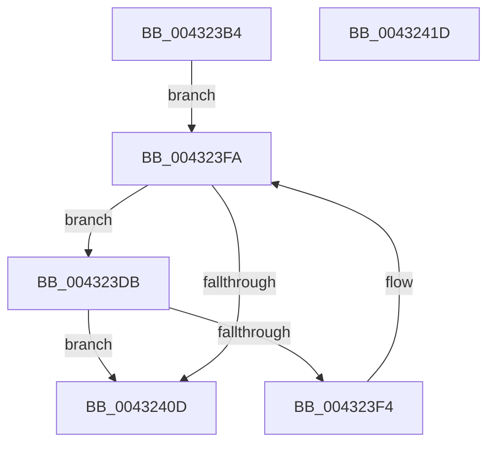

# MiCheckRelevantKernelShadows

- RVA: `0x004323B4`–`0x0043241E` (길이 `106` bytes)
- VA: `0x00000001404323B4`
- 실행 섹션: `.text`
- PDB 이름 있음: `예`; PDB Function 태그: `아니요`
- unwind 정보 RVA: `0x000A2298`
- 디코드: `35`개 명령, `106/106` bytes 표시
- 미해석 바이트: `0` (있으면 어셈블리에 `.byte`로 보존)

> 이 문서는 커널 이미지의 기계어와 PDB 기호를 분석해 생성했습니다. 4번과 5번은 함수 원형과 자료형을 바이너리 사용 방식에서 추정한 C 해석이며 원본 소스 복구 결과는 아닙니다.

## 1. Dependencies

- 직접 호출 지점: **2**; 고유 호출 대상: **2**
- 직접 호출자로 확인된 함수: **1**
- RIP 상대 이미지 참조: **0**

### Outgoing calls
- `0x004323E7` → [MiCheckKernelShadow](MiCheckKernelShadow_function_00432540.md) (function, `0x00432540`)
- `0x00432404` → [KeQueryKvaShadowRegion](KeQueryKvaShadowRegion_function_00432424.md) (function, `0x00432424`)

### Direct callers
- [sub_0027E83C](../27/Unknown_function_0027E83C.md) at `0x0027E85F`

### Static image references
- 디코드된 RIP-relative 메모리 참조가 없습니다.

## 2. Other-region calls and transfers

- 다른 실행 섹션으로 향하는 call: **0**
- 별도 외부 분기/꼬리 이동을 확인하지 못했습니다.

## 3. Assembly (complete function range)

```asm
004323B4  48 89 5C 24 08                  mov qword ptr [rsp + 8], rbx
004323B9  55                              push rbp
004323BA  56                              push rsi
004323BB  57                              push rdi
004323BC  48 83 EC 20                     sub rsp, 0x20
004323C0  48 83 64 24 50 00               and qword ptr [rsp + 0x50], 0
004323C6  BD FF FF FF FF                  mov ebp, 0xffffffff
004323CB  48 83 64 24 48 00               and qword ptr [rsp + 0x48], 0
004323D1  33 FF                           xor edi, edi
004323D3  8B F1                           mov esi, ecx
004323D5  8B DD                           mov ebx, ebp
004323D7  33 C9                           xor ecx, ecx
004323D9  EB 1F                           jmp 0x1404323fa
004323DB  4C 8B 44 24 48                  mov r8, qword ptr [rsp + 0x48]
004323E0  8B CE                           mov ecx, esi
004323E2  48 8B 54 24 50                  mov rdx, qword ptr [rsp + 0x50]
004323E7  E8 54 01 00 00                  call 0x140432540
004323EC  48 8B D8                        mov rbx, rax
004323EF  48 3B C5                        cmp rax, rbp
004323F2  75 19                           jne 0x14043240d
004323F4  48 FF C7                        inc rdi
004323F7  48 8B CF                        mov rcx, rdi
004323FA  4C 8D 44 24 48                  lea r8, [rsp + 0x48]
004323FF  48 8D 54 24 50                  lea rdx, [rsp + 0x50]
00432404  E8 1B 00 00 00                  call 0x140432424
00432409  85 C0                           test eax, eax
0043240B  75 CE                           jne 0x1404323db
0043240D  48 8B C3                        mov rax, rbx
00432410  48 8B 5C 24 40                  mov rbx, qword ptr [rsp + 0x40]
00432415  48 83 C4 20                     add rsp, 0x20
00432419  5F                              pop rdi
0043241A  5E                              pop rsi
0043241B  5D                              pop rbp
0043241C  C3                              ret
0043241D  CC                              int3
```

## 4. C-style interpretation (structured pseudocode)

```c
__int64 __fastcall MiCheckRelevantKernelShadows(int a1)
{
    __int64 result;
    __int64 v_rdi;
    __int64 v_rsp;
    unsigned __int64 v_stack_p10;
    unsigned __int64 v_stack_p18;
    unsigned __int64 v_stack_p8;

    v_stack_p8 = v_rbx;
    v_rsp = (v_rsp) - (32);
    v_rdi = 0;
    a1 = 0;
    goto loc_004323FA;
loc_004323DB:
    result = MiCheckKernelShadow((unsigned int)((unsigned int)((unsigned int)(a1))), v_stack_p18, v_stack_p10, a4);
    if (result != ((unsigned int)(0xFFFFFFFFULL))) goto loc_0043240D;
    v_rdi = (v_rdi) + 1;
loc_004323FA:
    result = KeQueryKvaShadowRegion(v_rdi, v_stack_p18, v_stack_p10, a4);
    if ((unsigned int)(result) != 0) goto loc_004323DB;
loc_0043240D:
    v_rsp = (v_rsp) + (32);
    return result;
}
```

## 5. (Beta) C Style

```c
int64_t MiCheckRelevantKernelShadows(int32_t Arg1)
{
    int64_t result;
    int64_t local_rdi;
    int64_t local_rsp;
    uint64_t v_stack_p10;
    uint64_t v_stack_p18;
    uint64_t v_stack_p8;

    v_stack_p8 = local_rbx;
    local_rsp = (local_rsp) - (32);
    local_rdi = 0;
    Arg1 = 0;
    goto loc_004323FA;
loc_004323DB:
    result = MiCheckKernelShadow((uint32_t)((uint32_t)((uint32_t)(Arg1))), v_stack_p18, v_stack_p10, a4);
    if (result != ((uint32_t)(0xFFFFFFFFULL))) goto loc_0043240D;
    local_rdi = (local_rdi) + 1;
loc_004323FA:
    result = KeQueryKvaShadowRegion(local_rdi, v_stack_p18, v_stack_p10, a4);
    if ((uint32_t)(result) != 0) goto loc_004323DB;
loc_0043240D:
    local_rsp = (local_rsp) + (32);
    return result;
}
```

## 6. Execution-region graph

[열기: 2D/3D 그래프와 함수 탐색 컨트롤 패널](../../../control-panel.html?section=text&rva=0x004323B4&view=graph)

- 2D 그래프는 위에서 아래로 흐르고, 3D 그래프는 빈 공간을 드래그해 회전합니다. Shift+드래그는 이동, 휠은 확대·축소, 함수 노드 선택은 대상 보고서 이동입니다.

### Static fallback


