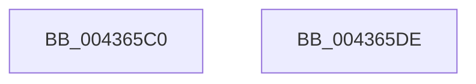

# MiCommitmentAvailable

- RVA: `0x004365C0`–`0x004365DF` (길이 `31` bytes)
- VA: `0x00000001404365C0`
- 실행 섹션: `.text`
- PDB 이름 있음: `예`; PDB Function 태그: `아니요`
- unwind 정보 RVA: `0x000DB714`
- 디코드: `9`개 명령, `31/31` bytes 표시
- 미해석 바이트: `0` (있으면 어셈블리에 `.byte`로 보존)

> 이 문서는 커널 이미지의 기계어와 PDB 기호를 분석해 생성했습니다. 4번과 5번은 함수 원형과 자료형을 바이너리 사용 방식에서 추정한 C 해석이며 원본 소스 복구 결과는 아닙니다.

## 1. Dependencies

- 직접 호출 지점: **0**; 고유 호출 대상: **0**
- 직접 호출자로 확인된 함수: **1**
- RIP 상대 이미지 참조: **0**

### Outgoing calls
- 직접 디코드된 call 명령이 없습니다.

### Direct callers
- [MiAllocateCrcList](../../page/9F/MiAllocateCrcList_function_009F7564.md) at `0x009F7615`

### Static image references
- 디코드된 RIP-relative 메모리 참조가 없습니다.

## 2. Other-region calls and transfers

- 다른 실행 섹션으로 향하는 call: **0**
- 별도 외부 분기/꼬리 이동을 확인하지 못했습니다.

## 3. Assembly (complete function range)

```asm
004365C0  4C 8B 81 98 4C 00 00            mov r8, qword ptr [rcx + 0x4c98]
004365C7  48 8B 91 40 4B 00 00            mov rdx, qword ptr [rcx + 0x4b40]
004365CE  49 8B C0                        mov rax, r8
004365D1  48 2B C2                        sub rax, rdx
004365D4  33 C9                           xor ecx, ecx
004365D6  49 3B D0                        cmp rdx, r8
004365D9  48 0F 43 C1                     cmovae rax, rcx
004365DD  C3                              ret
004365DE  CC                              int3
```

## 4. C-style interpretation (structured pseudocode)

```c
__int64 __fastcall MiCommitmentAvailable(__int64 a1)
{
    __int64 result;

    result = (*(unsigned __int64 *)(a1 + 19608)) - (*(unsigned __int64 *)(a1 + 19264));
    a1 = 0;
    if ((*(unsigned __int64 *)(a1 + 19264)) >= (*(unsigned __int64 *)(a1 + 19608))) { result = 0; }
    return result;
}
```

## 5. (Beta) C Style

```c
int64_t MiCommitmentAvailable(void *Arg1)
{
    uint8_t *arg1 = (uint8_t *)Arg1;

    int64_t result;

    result = (*(uint64_t *)(arg1 + 0x4C98)) - (*(uint64_t *)(arg1 + 0x4B40));
    Arg1 = 0;
    if ((*(uint64_t *)(arg1 + 0x4B40)) >= (*(uint64_t *)(arg1 + 0x4C98))) { result = 0; }
    return result;
}
```

### 관측된 메모리 오프셋

구조체 형식이 확인되지 않은 접근은 인자 기준의 오프셋으로만 기록했습니다.

| 기준 인자 | 오프셋 표현 | 폭 (bit) | 접근 |
|---|---:|---:|---|
| `Arg1` | `+ 0x4B40` | `64` | `R` |
| `Arg1` | `+ 0x4C98` | `64` | `R` |

## 6. Execution-region graph

[열기: 2D/3D 그래프와 함수 탐색 컨트롤 패널](../../../control-panel.html?section=text&rva=0x004365C0&view=graph)

- 2D 그래프는 위에서 아래로 흐르고, 3D 그래프는 빈 공간을 드래그해 회전합니다. Shift+드래그는 이동, 휠은 확대·축소, 함수 노드 선택은 대상 보고서 이동입니다.

### Static fallback


