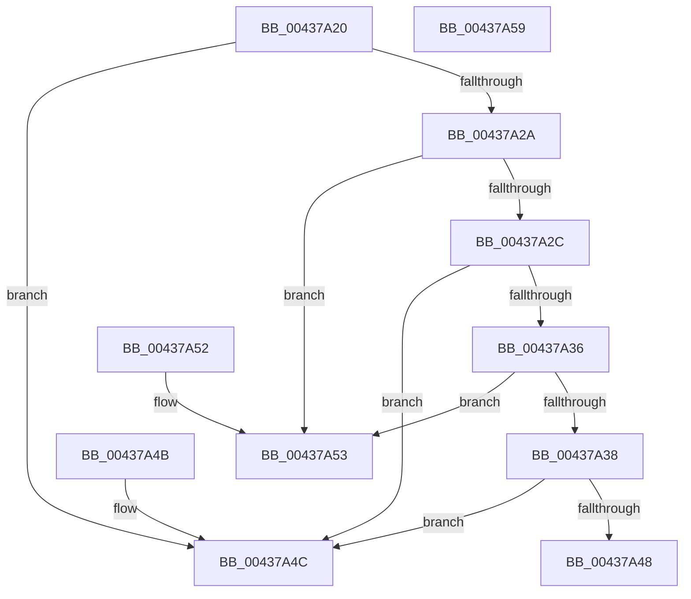

# MiCompareActiveCrcEntries

- RVA: `0x00437A20`–`0x00437A5A` (길이 `58` bytes)
- VA: `0x0000000140437A20`
- 실행 섹션: `.text`
- PDB 이름 있음: `예`; PDB Function 태그: `아니요`
- unwind 정보 RVA: `0x000DB714`
- 디코드: `23`개 명령, `58/58` bytes 표시
- 미해석 바이트: `0` (있으면 어셈블리에 `.byte`로 보존)

> 이 문서는 커널 이미지의 기계어와 PDB 기호를 분석해 생성했습니다. 4번과 5번은 함수 원형과 자료형을 바이너리 사용 방식에서 추정한 C 해석이며 원본 소스 복구 결과는 아닙니다.

## 1. Dependencies

- 직접 호출 지점: **0**; 고유 호출 대상: **0**
- 직접 호출자로 확인된 함수: **1**
- RIP 상대 이미지 참조: **0**

### Outgoing calls
- 직접 디코드된 call 명령이 없습니다.

### Direct callers
- [MiProcessCrcList](../../page/9F/MiProcessCrcList_function_009F6F94.md) at `0x009F73EB`
- [MiProcessCrcList](../../page/9F/MiProcessCrcList_function_009F6F94.md) at `0x009F741E`

### Static image references
- 디코드된 RIP-relative 메모리 참조가 없습니다.

## 2. Other-region calls and transfers

- 다른 실행 섹션으로 향하는 call: **0**
- 별도 외부 분기/꼬리 이동을 확인하지 못했습니다.

## 3. Assembly (complete function range)

```asm
00437A20  48 8B 41 08                     mov rax, qword ptr [rcx + 8]
00437A24  48 3B 42 08                     cmp rax, qword ptr [rdx + 8]
00437A28  77 22                           ja 0x140437a4c
00437A2A  72 27                           jb 0x140437a53
00437A2C  48 8B 41 18                     mov rax, qword ptr [rcx + 0x18]
00437A30  48 3B 42 18                     cmp rax, qword ptr [rdx + 0x18]
00437A34  77 16                           ja 0x140437a4c
00437A36  72 1B                           jb 0x140437a53
00437A38  8B 49 20                        mov ecx, dword ptr [rcx + 0x20]
00437A3B  8B 42 20                        mov eax, dword ptr [rdx + 0x20]
00437A3E  83 E1 1F                        and ecx, 0x1f
00437A41  83 E0 1F                        and eax, 0x1f
00437A44  3B C8                           cmp ecx, eax
00437A46  77 04                           ja 0x140437a4c
00437A48  1B C0                           sbb eax, eax
00437A4A  C3                              ret
00437A4B  CC                              int3
00437A4C  B8 01 00 00 00                  mov eax, 1
00437A51  C3                              ret
00437A52  CC                              int3
00437A53  B8 FF FF FF FF                  mov eax, 0xffffffff
00437A58  C3                              ret
00437A59  CC                              int3
```

## 4. C-style interpretation (structured pseudocode)

```c
__int64 __fastcall MiCompareActiveCrcEntries(__int64 a1, __int64 a2)
{
    __int64 result;

    if ((*(unsigned __int64 *)(a1 + 8)) > (*(unsigned __int64 *)(a2 + 8))) goto loc_00437A4C;
    if ((*(unsigned __int64 *)(a1 + 8)) < (*(unsigned __int64 *)(a2 + 8))) goto loc_00437A53;
    if ((*(unsigned __int64 *)(a1 + 24)) > (*(unsigned __int64 *)(a2 + 24))) goto loc_00437A4C;
    if ((*(unsigned __int64 *)(a1 + 24)) < (*(unsigned __int64 *)(a2 + 24))) goto loc_00437A53;
    a1 = (unsigned int)(((unsigned int)(*(unsigned int *)(a1 + 32))) & (31));
    result = (unsigned int)(((unsigned int)(*(unsigned int *)(a2 + 32))) & (31));
    if (((unsigned int)(a1)) > ((unsigned int)(result))) goto loc_00437A4C;
    return result;
loc_00437A4C:
    return 1;
loc_00437A53:
    return (unsigned int)(0xFFFFFFFFULL);
}
```

## 5. (Beta) C Style

```c
int64_t MiCompareActiveCrcEntries(void *Arg1, void *Arg2)
{
    uint8_t *arg1 = (uint8_t *)Arg1;
    uint8_t *arg2 = (uint8_t *)Arg2;

    int64_t result;

    if ((*(uint64_t *)(arg1 + 0x8)) > (*(uint64_t *)(arg2 + 0x8))) goto loc_00437A4C;
    if ((*(uint64_t *)(arg1 + 0x8)) < (*(uint64_t *)(arg2 + 0x8))) goto loc_00437A53;
    if ((*(uint64_t *)(arg1 + 0x18)) > (*(uint64_t *)(arg2 + 0x18))) goto loc_00437A4C;
    if ((*(uint64_t *)(arg1 + 0x18)) < (*(uint64_t *)(arg2 + 0x18))) goto loc_00437A53;
    Arg1 = (uint32_t)(((uint32_t)(*(uint32_t *)(arg1 + 0x20))) & (31));
    result = (uint32_t)(((uint32_t)(*(uint32_t *)(arg2 + 0x20))) & (31));
    if (((uint32_t)(Arg1)) > ((uint32_t)(result))) goto loc_00437A4C;
    return result;
loc_00437A4C:
    return 1;
loc_00437A53:
    return (uint32_t)(0xFFFFFFFFULL);
}
```

### 관측된 메모리 오프셋

구조체 형식이 확인되지 않은 접근은 인자 기준의 오프셋으로만 기록했습니다.

| 기준 인자 | 오프셋 표현 | 폭 (bit) | 접근 |
|---|---:|---:|---|
| `Arg1` | `+ 0x8` | `64` | `R` |
| `Arg1` | `+ 0x18` | `64` | `R` |
| `Arg1` | `+ 0x20` | `32` | `R` |
| `Arg2` | `+ 0x8` | `64` | `R` |
| `Arg2` | `+ 0x18` | `64` | `R` |
| `Arg2` | `+ 0x20` | `32` | `R` |

## 6. Execution-region graph

[열기: 2D/3D 그래프와 함수 탐색 컨트롤 패널](../../../control-panel.html?section=text&rva=0x00437A20&view=graph)

- 2D 그래프는 위에서 아래로 흐르고, 3D 그래프는 빈 공간을 드래그해 회전합니다. Shift+드래그는 이동, 휠은 확대·축소, 함수 노드 선택은 대상 보고서 이동입니다.

### Static fallback


