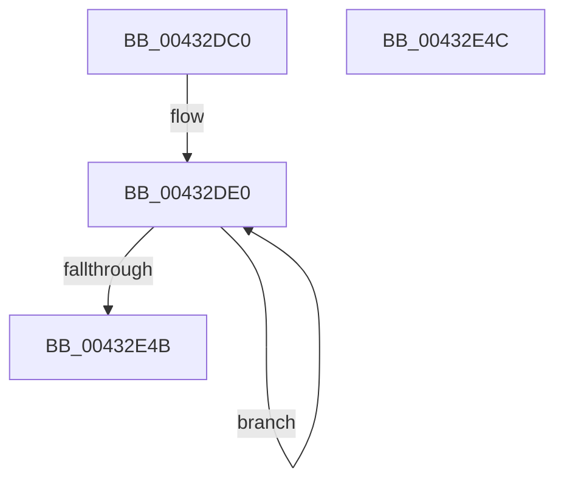

# MiComputeHash64

- RVA: `0x00432DC0`–`0x00432E4D` (길이 `141` bytes)
- VA: `0x0000000140432DC0`
- 실행 섹션: `.text`
- PDB 이름 있음: `예`; PDB Function 태그: `아니요`
- unwind 정보 RVA: `0x000DB714`
- 디코드: `35`개 명령, `141/141` bytes 표시
- 미해석 바이트: `0` (있으면 어셈블리에 `.byte`로 보존)

> 이 문서는 커널 이미지의 기계어와 PDB 기호를 분석해 생성했습니다. 4번과 5번은 함수 원형과 자료형을 바이너리 사용 방식에서 추정한 C 해석이며 원본 소스 복구 결과는 아닙니다.

## 1. Dependencies

- 직접 호출 지점: **0**; 고유 호출 대상: **0**
- 직접 호출자로 확인된 함수: **3**
- RIP 상대 이미지 참조: **0**

### Outgoing calls
- 직접 디코드된 call 명령이 없습니다.

### Direct callers
- [MiCombineInitialInstance](../22/MiCombineInitialInstance_function_0022BC0C.md) at `0x0022C3B8`
- [MiCombinePte](../68/MiCombinePte_function_0068B9A0.md) at `0x0068BAB7`
- [MiMapDummyPages](../../init/C6/MiMapDummyPages_function_00C60A58.md) at `0x00C60B8E`

### Static image references
- 디코드된 RIP-relative 메모리 참조가 없습니다.

## 2. Other-region calls and transfers

- 다른 실행 섹션으로 향하는 call: **0**
- 별도 외부 분기/꼬리 이동을 확인하지 못했습니다.

## 3. Assembly (complete function range)

```asm
00432DC0  4C 8B D1                        mov r10, rcx
00432DC3  48 B8 F5 08 86 87 3F F1 5D DE   movabs rax, 0xde5df13f878608f5
00432DCD  41 B9 FE 01 00 00               mov r9d, 0x1fe
00432DD3  0F 1F 40 00                     nop dword ptr [rax]
00432DD7  66 0F 1F 84 00 00 00 00 00      nop word ptr [rax + rax]
00432DE0  48 C1 C8 02                     ror rax, 2
00432DE4  41 8D 51 01                     lea edx, [r9 + 1]
00432DE8  49 03 04 D2                     add rax, qword ptr [r10 + rdx*8]
00432DEC  48 C1 C8 03                     ror rax, 3
00432DF0  41 8B C9                        mov ecx, r9d
00432DF3  49 03 04 CA                     add rax, qword ptr [r10 + rcx*8]
00432DF7  41 8D 49 FF                     lea ecx, [r9 - 1]
00432DFB  48 C1 C8 05                     ror rax, 5
00432DFF  49 03 04 CA                     add rax, qword ptr [r10 + rcx*8]
00432E03  41 8D 49 FE                     lea ecx, [r9 - 2]
00432E07  48 C1 C8 07                     ror rax, 7
00432E0B  49 03 04 CA                     add rax, qword ptr [r10 + rcx*8]
00432E0F  41 8D 49 FD                     lea ecx, [r9 - 3]
00432E13  48 C1 C8 0B                     ror rax, 0xb
00432E17  49 33 04 CA                     xor rax, qword ptr [r10 + rcx*8]
00432E1B  41 8D 49 FC                     lea ecx, [r9 - 4]
00432E1F  48 C1 C8 0D                     ror rax, 0xd
00432E23  49 03 04 CA                     add rax, qword ptr [r10 + rcx*8]
00432E27  41 8D 49 FB                     lea ecx, [r9 - 5]
00432E2B  48 C1 C8 11                     ror rax, 0x11
00432E2F  49 03 04 CA                     add rax, qword ptr [r10 + rcx*8]
00432E33  41 8D 49 FA                     lea ecx, [r9 - 6]
00432E37  41 83 C1 F8                     add r9d, -8
00432E3B  48 C1 C8 13                     ror rax, 0x13
00432E3F  49 03 04 CA                     add rax, qword ptr [r10 + rcx*8]
00432E43  41 8D 49 02                     lea ecx, [r9 + 2]
00432E47  85 C9                           test ecx, ecx
00432E49  75 95                           jne 0x140432de0
00432E4B  C3                              ret
00432E4C  CC                              int3
```

## 4. C-style interpretation (structured pseudocode)

```c
__int64 __fastcall MiComputeHash64(__int64 a1)
{
    __int64 result;

loc_00432DE0:
    result = (result) + (*(unsigned __int64 *)(a1 + 510 + 1 * 8));
    result = (result) + (*(unsigned __int64 *)(a1 + 510 * 8));
    result = (result) + (*(unsigned __int64 *)(a1 + 510 - 1 * 8));
    result = (result) + (*(unsigned __int64 *)(a1 + 510 - 2 * 8));
    result = (result) ^ (*(unsigned __int64 *)(a1 + 510 - 3 * 8));
    result = (result) + (*(unsigned __int64 *)(a1 + 510 - 4 * 8));
    result = (result) + (*(unsigned __int64 *)(a1 + 510 - 5 * 8));
    a4 = (unsigned int)((510) + (-8));
    result = (result) + (*(unsigned __int64 *)(a1 + 510 - 6 * 8));
    if ((unsigned int)(a4 + 2) != 0) goto loc_00432DE0;
    return result;
}
```

## 5. (Beta) C Style

```c
int64_t MiComputeHash64(void *Arg1)
{
    uint8_t *arg1 = (uint8_t *)Arg1;

    int64_t result;

loc_00432DE0:
    result = (result) + (*(uint64_t *)(arg1 + 0x1FE + 0x1 * 8));
    result = (result) + (*(uint64_t *)(arg1 + 0x1FE * 8));
    result = (result) + (*(uint64_t *)(arg1 + 0x1FE - 0x1 * 8));
    result = (result) + (*(uint64_t *)(arg1 + 0x1FE - 0x2 * 8));
    result = (result) ^ (*(uint64_t *)(arg1 + 0x1FE - 0x3 * 8));
    result = (result) + (*(uint64_t *)(arg1 + 0x1FE - 0x4 * 8));
    result = (result) + (*(uint64_t *)(arg1 + 0x1FE - 0x5 * 8));
    a4 = (uint32_t)((510) + (-8));
    result = (result) + (*(uint64_t *)(arg1 + 0x1FE - 0x6 * 8));
    if ((uint32_t)(a4 + 2) != 0) goto loc_00432DE0;
    return result;
}
```

### 관측된 메모리 오프셋

구조체 형식이 확인되지 않은 접근은 인자 기준의 오프셋으로만 기록했습니다.

| 기준 인자 | 오프셋 표현 | 폭 (bit) | 접근 |
|---|---:|---:|---|
| `Arg1` | `+ 0x0 + rcx*8` | `64` | `R` |
| `Arg1` | `+ 0x0 + rdx*8` | `64` | `R` |

## 6. Execution-region graph

[열기: 2D/3D 그래프와 함수 탐색 컨트롤 패널](../../../control-panel.html?section=text&rva=0x00432DC0&view=graph)

- 2D 그래프는 위에서 아래로 흐르고, 3D 그래프는 빈 공간을 드래그해 회전합니다. Shift+드래그는 이동, 휠은 확대·축소, 함수 노드 선택은 대상 보고서 이동입니다.

### Static fallback


