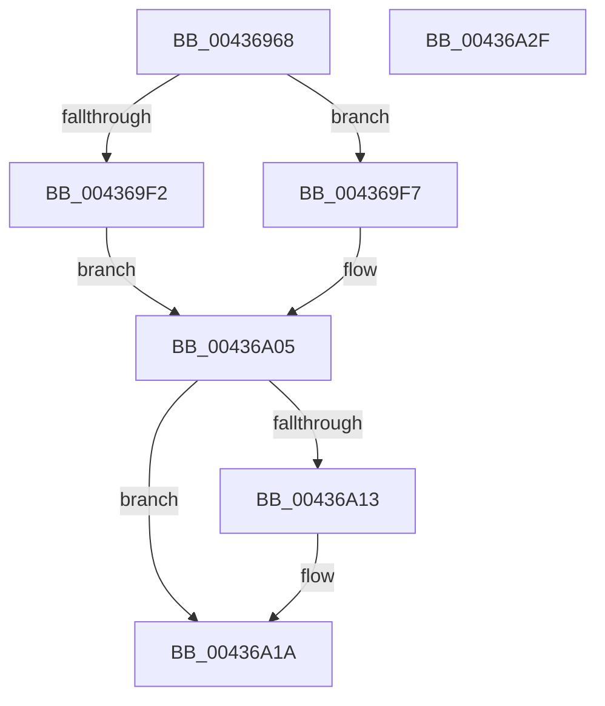

# MiComputeHugeRangeColorHeadAtDpc

- RVA: `0x00436968`–`0x00436A30` (길이 `200` bytes)
- VA: `0x0000000140436968`
- 실행 섹션: `.text`
- PDB 이름 있음: `예`; PDB Function 태그: `아니요`
- unwind 정보 RVA: `0x0005C954`
- 디코드: `56`개 명령, `200/200` bytes 표시
- 미해석 바이트: `0` (있으면 어셈블리에 `.byte`로 보존)

> 이 문서는 커널 이미지의 기계어와 PDB 기호를 분석해 생성했습니다. 4번과 5번은 함수 원형과 자료형을 바이너리 사용 방식에서 추정한 C 해석이며 원본 소스 복구 결과는 아닙니다.

## 1. Dependencies

- 직접 호출 지점: **4**; 고유 호출 대상: **4**
- 직접 호출자로 확인된 함수: **1**
- RIP 상대 이미지 참조: **2**

### Outgoing calls
- `0x0043699D` → [MiPageToNode](../33/MiPageToNode_function_00338CD0.md) (function, `0x00338CD0`)
- `0x004369A7` → [MiHugePfnPartition](MiHugePfnPartition_function_004371B4.md) (function, `0x004371B4`)
- `0x004369BA` → [MiPageToChannel](../2B/MiPageToChannel_function_002B9B48.md) (function, `0x002B9B48`)
- `0x00436A08` → [MiGetColorHeadHugeRangeBase](MiGetColorHeadHugeRangeBase_function_00437160.md) (function, `0x00437160`)

### Direct callers
- [MiLockHugeRangeColorHeadAtDpc](../4F/MiLockHugeRangeColorHeadAtDpc_function_004FAD14.md) at `0x004FAD1A`

### Static image references
- `0x00436982` → RVA `0x00E300C0` (`.data`; read)
- `0x004369E2` → RVA `0x00E2DCC0` (`.data`; read)

## 2. Other-region calls and transfers

- 다른 실행 섹션으로 향하는 call: **0**
- 별도 외부 분기/꼬리 이동을 확인하지 못했습니다.

## 3. Assembly (complete function range)

```asm
00436968  48 89 5C 24 08                  mov qword ptr [rsp + 8], rbx
0043696D  48 89 6C 24 10                  mov qword ptr [rsp + 0x10], rbp
00436972  48 89 74 24 18                  mov qword ptr [rsp + 0x18], rsi
00436977  57                              push rdi
00436978  48 83 EC 20                     sub rsp, 0x20
0043697C  48 8B 39                        mov rdi, qword ptr [rcx]
0043697F  48 8B E9                        mov rbp, rcx
00436982  48 2B 2D 37 97 9F 00            sub rbp, qword ptr [rip + 0x9f9737]
00436989  48 8B F1                        mov rsi, rcx
0043698C  48 C1 FD 03                     sar rbp, 3
00436990  81 E5 FF FF 3F 00               and ebp, 0x3fffff
00436996  48 C1 E5 12                     shl rbp, 0x12
0043699A  48 8B CD                        mov rcx, rbp
0043699D  E8 2E 23 F0 FF                  call 0x140338cd0
004369A2  48 8B CE                        mov rcx, rsi
004369A5  8B D8                           mov ebx, eax
004369A7  E8 08 08 00 00                  call 0x1404371b4
004369AC  48 69 F3 80 DF 00 00            imul rsi, rbx, 0xdf80
004369B3  48 8B CD                        mov rcx, rbp
004369B6  48 03 70 10                     add rsi, qword ptr [rax + 0x10]
004369BA  E8 89 31 E8 FF                  call 0x1402b9b48
004369BF  83 E3 3F                        and ebx, 0x3f
004369C2  0F B6 C0                        movzx eax, al
004369C5  0F BA EB 09                     bts ebx, 9
004369C9  48 C1 ED 12                     shr rbp, 0x12
004369CD  03 DB                           add ebx, ebx
004369CF  B9 01 00 00 00                  mov ecx, 1
004369D4  23 C1                           and eax, ecx
004369D6  33 D2                           xor edx, edx
004369D8  0B D8                           or ebx, eax
004369DA  83 E7 07                        and edi, 7
004369DD  8B C5                           mov eax, ebp
004369DF  C1 E3 08                        shl ebx, 8
004369E2  F7 35 D8 72 9F 00               div dword ptr [rip + 0x9f72d8]
004369E8  0F B6 C2                        movzx eax, dl
004369EB  0B D8                           or ebx, eax
004369ED  48 3B F9                        cmp rdi, rcx
004369F0  75 05                           jne 0x1404369f7
004369F2  45 33 C0                        xor r8d, r8d
004369F5  EB 0E                           jmp 0x140436a05
004369F7  48 83 FF 02                     cmp rdi, 2
004369FB  41 B8 05 00 00 00               mov r8d, 5
00436A01  44 0F 44 C1                     cmove r8d, ecx
00436A05  48 8B CE                        mov rcx, rsi
00436A08  E8 53 07 00 00                  call 0x140437160
00436A0D  41 83 F8 05                     cmp r8d, 5
00436A11  74 07                           je 0x140436a1a
00436A13  0F B6 CB                        movzx ecx, bl
00436A16  48 8D 04 C8                     lea rax, [rax + rcx*8]
00436A1A  48 8B 5C 24 30                  mov rbx, qword ptr [rsp + 0x30]
00436A1F  48 8B 6C 24 38                  mov rbp, qword ptr [rsp + 0x38]
00436A24  48 8B 74 24 40                  mov rsi, qword ptr [rsp + 0x40]
00436A29  48 83 C4 20                     add rsp, 0x20
00436A2D  5F                              pop rdi
00436A2E  C3                              ret
00436A2F  CC                              int3
```

## 4. C-style interpretation (structured pseudocode)

```c
__int64 __fastcall MiComputeHugeRangeColorHeadAtDpc(__int64 a1, int a2, int a3)
{
    __int64 result;
    __int64 v_rbp;
    __int64 v_rbx;
    __int64 v_rdi;
    __int64 v_rsi;
    __int64 v_rsp;
    unsigned __int64 v_stack_p10;
    unsigned __int64 v_stack_p18;
    unsigned __int64 v_stack_p8;

    v_stack_p8 = v_rbx;
    v_stack_p10 = v_rbp;
    v_stack_p18 = v_rsi;
    v_rsp = (v_rsp) - (32);
    v_rbp = (a1) - (*(unsigned __int64 *)(v_rip + 10458935));
    v_rbp = (v_rbp) >> (3);
    v_rbp = (unsigned int)((v_rbp) & (0x3FFFFFULL));
    v_rbp = (v_rbp) << (18);
    result = MiPageToNode(v_rbp, a2, a3, a4);
    result = MiHugePfnPartition(a1, a2, a3, a4);
    v_rsi = (a1) * ((unsigned int)((unsigned int)(result)));
    v_rsi = (v_rsi) + (*(unsigned __int64 *)(result + 16));
    result = MiPageToChannel(v_rbp, a2, a3, a4);
    v_rbx = (unsigned int)(((unsigned int)((unsigned int)(result))) & (63));
    v_rbp = (v_rbp) >> (18);
    v_rbx = (unsigned int)((v_rbx) + ((unsigned int)(v_rbx)));
    result = (unsigned int)(((unsigned __int8)(result)) & (1));
    a2 = 0;
    v_rbx = (unsigned int)((v_rbx) | ((unsigned int)(result)));
    v_rdi = (unsigned int)((*(unsigned __int64 *)(a1)) & (7));
    v_rbx = (unsigned int)((v_rbx) << (8));
    v_rbx = (unsigned int)((v_rbx) | (0));
    if (v_rdi != 1) goto loc_004369F7;
    a3 = 0;
    goto loc_00436A05;
loc_004369F7:
    a3 = 5;
    if (v_rdi == 2) { a3 = 1; }
loc_00436A05:
    result = MiGetColorHeadHugeRangeBase(v_rsi, a2, a3, a4);
    if (a3 != 5) {
        a1 = (unsigned __int8)(v_rbx);
        result = result + a1 * 8;
    }
    v_rsp = (v_rsp) + (32);
    return result;
}
```

## 5. (Beta) C Style

```c
int64_t MiComputeHugeRangeColorHeadAtDpc(void *Arg1, int32_t Arg2, int32_t Arg3)
{
    uint8_t *arg1 = (uint8_t *)Arg1;

    int64_t result;
    int64_t local_rbp;
    int64_t local_rbx;
    int64_t local_rdi;
    int64_t local_rsi;
    int64_t local_rsp;
    uint64_t v_stack_p10;
    uint64_t v_stack_p18;
    uint64_t v_stack_p8;

    v_stack_p8 = local_rbx;
    v_stack_p10 = local_rbp;
    v_stack_p18 = local_rsi;
    local_rsp = (local_rsp) - (32);
    local_rbp = (Arg1) - (*(uint64_t *)(v_rip + 0x9F9737));
    local_rbp = (local_rbp) >> (3);
    local_rbp = (uint32_t)((local_rbp) & (0x3FFFFFULL));
    local_rbp = (local_rbp) << (18);
    result = MiPageToNode(local_rbp, Arg2, Arg3, a4);
    result = MiHugePfnPartition(Arg1, Arg2, Arg3, a4);
    local_rsi = (Arg1) * ((uint32_t)((uint32_t)(result)));
    local_rsi = (local_rsi) + (*(uint64_t *)(result + 0x10));
    result = MiPageToChannel(local_rbp, Arg2, Arg3, a4);
    local_rbx = (uint32_t)(((uint32_t)((uint32_t)(result))) & (63));
    local_rbp = (local_rbp) >> (18);
    local_rbx = (uint32_t)((local_rbx) + ((uint32_t)(local_rbx)));
    result = (uint32_t)(((uint8_t)(result)) & (1));
    Arg2 = 0;
    local_rbx = (uint32_t)((local_rbx) | ((uint32_t)(result)));
    local_rdi = (uint32_t)((*(uint64_t *)(arg1)) & (7));
    local_rbx = (uint32_t)((local_rbx) << (8));
    local_rbx = (uint32_t)((local_rbx) | (0));
    if (local_rdi != 1) goto loc_004369F7;
    Arg3 = 0;
    goto loc_00436A05;
loc_004369F7:
    Arg3 = 5;
    if (local_rdi == 2) { Arg3 = 1; }
loc_00436A05:
    result = MiGetColorHeadHugeRangeBase(local_rsi, Arg2, Arg3, a4);
    if (Arg3 != 5) {
        Arg1 = (uint8_t)(local_rbx);
        result = result + Arg1 * 8;
    }
    local_rsp = (local_rsp) + (32);
    return result;
}
```

### 관측된 메모리 오프셋

구조체 형식이 확인되지 않은 접근은 인자 기준의 오프셋으로만 기록했습니다.

| 기준 인자 | 오프셋 표현 | 폭 (bit) | 접근 |
|---|---:|---:|---|
| `Arg1` | `+ 0x0` | `64` | `R` |

## 6. Execution-region graph

[열기: 2D/3D 그래프와 함수 탐색 컨트롤 패널](../../../control-panel.html?section=text&rva=0x00436968&view=graph)

- 2D 그래프는 위에서 아래로 흐르고, 3D 그래프는 빈 공간을 드래그해 회전합니다. Shift+드래그는 이동, 휠은 확대·축소, 함수 노드 선택은 대상 보고서 이동입니다.

### Static fallback


