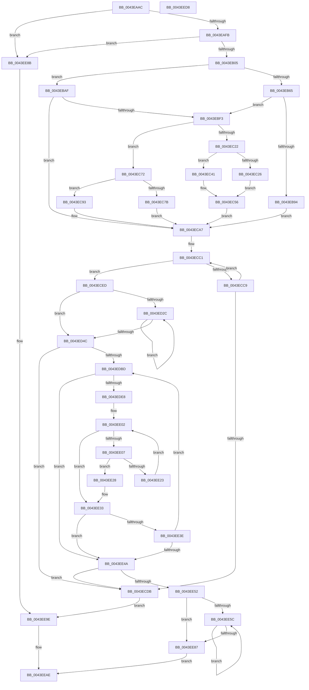

# MiComputeIdealDpcGang

- RVA: `0x0043EAAC`–`0x0043EED9` (길이 `1,069` bytes)
- VA: `0x000000014043EAAC`
- 실행 섹션: `.text`
- PDB 이름 있음: `예`; PDB Function 태그: `아니요`
- unwind 정보 RVA: `0x000A4B8C`
- 디코드: `248`개 명령, `1,069/1,069` bytes 표시
- 미해석 바이트: `0` (있으면 어셈블리에 `.byte`로 보존)

> 이 문서는 커널 이미지의 기계어와 PDB 기호를 분석해 생성했습니다. 4번과 5번은 함수 원형과 자료형을 바이너리 사용 방식에서 추정한 C 해석이며 원본 소스 복구 결과는 아닙니다.

## 1. Dependencies

- 직접 호출 지점: **13**; 고유 호출 대상: **10**
- 직접 호출자로 확인된 함수: **1**
- RIP 상대 이미지 참조: **5**

### Outgoing calls
- `0x0043EB07` → [MiGetClosestNodeWithProcessors](MiGetClosestNodeWithProcessors_function_0043EEE0.md) (function, `0x0043EEE0`)
- `0x0043EBA5` → [memcpy](../6C/memcpy_function_006C6840.md) (function, `0x006C6840`)
- `0x0043EBE6` → [KeQueryNodeActiveAffinity2](../41/KeQueryNodeActiveAffinity2_function_004189C0.md) (function, `0x004189C0`)
- `0x0043EC0F` → [ExAllocatePoolMm](../35/ExAllocatePoolMm_function_0035B690.md) (function, `0x0035B690`)
- `0x0043EC3A` → [memcpy](../6C/memcpy_function_006C6840.md) (function, `0x006C6840`)
- `0x0043EC51` → [KeQueryNodeActiveAffinity2](../41/KeQueryNodeActiveAffinity2_function_004189C0.md) (function, `0x004189C0`)
- `0x0043ECA2` → [KeQueryNodeActiveAffinity](KeQueryNodeActiveAffinity_function_0043EF80.md) (function, `0x0043EF80`)
- `0x0043ECF9` → [memset](../6C/memset_function_006C6C40.md) (function, `0x006C6C40`)
- `0x0043ED17` → [MiInitializeDpcGroupAffinity](../2C/MiInitializeDpcGroupAffinity_function_002CA6D0.md) (function, `0x002CA6D0`)
- `0x0043EDAC` → [MiObtainParkedCoreMasks](../34/MiObtainParkedCoreMasks_function_00348DE0.md) (function, `0x00348DE0`)
- `0x0043EDDF` → [MiGetNextAffinityWalker](../2C/MiGetNextAffinityWalker_function_002CCC28.md) (function, `0x002CCC28`)
- `0x0043EEA0` → [MiGetClosestNodeWithProcessors](MiGetClosestNodeWithProcessors_function_0043EEE0.md) (function, `0x0043EEE0`)
- `0x0043EEB8` → [_security_check_cookie](../6A/_security_check_cookie_function_006AC640.md) (function, `0x006AC640`)

### Direct callers
- [MiInitializeDpcGang](MiInitializeDpcGang_function_0043E9DC.md) at `0x0043EA0E`

### Static image references
- `0x0043EACB` → RVA `0x00E0A740` (`.data`; read)
- `0x0043EB45` → RVA `0x00E2DBF8` (`.data`; read)
- `0x0043EB70` → RVA `0x00E2DBE8` (`.data`; read)
- `0x0043EB77` → RVA `0x00E2DBD8` (`.data`; read)
- `0x0043EDEC` → RVA `0x00FC8C40` (`ALMOSTRO`; read)

## 2. Other-region calls and transfers

- 다른 실행 섹션으로 향하는 call: **0**
- 별도 외부 분기/꼬리 이동을 확인하지 못했습니다.

## 3. Assembly (complete function range)

```asm
0043EAAC  48 89 5C 24 18                  mov qword ptr [rsp + 0x18], rbx
0043EAB1  55                              push rbp
0043EAB2  56                              push rsi
0043EAB3  57                              push rdi
0043EAB4  41 54                           push r12
0043EAB6  41 55                           push r13
0043EAB8  41 56                           push r14
0043EABA  41 57                           push r15
0043EABC  48 8D AC 24 F0 FE FF FF         lea rbp, [rsp - 0x110]
0043EAC4  48 81 EC 10 02 00 00            sub rsp, 0x210
0043EACB  48 8B 05 6E BC 9C 00            mov rax, qword ptr [rip + 0x9cbc6e]
0043EAD2  48 33 C4                        xor rax, rsp
0043EAD5  48 89 85 00 01 00 00            mov qword ptr [rbp + 0x100], rax
0043EADC  45 33 F6                        xor r14d, r14d
0043EADF  44 89 44 24 30                  mov dword ptr [rsp + 0x30], r8d
0043EAE4  66 44 89 74 24 20               mov word ptr [rsp + 0x20], r14w
0043EAEA  48 8B F1                        mov rsi, rcx
0043EAED  8B DA                           mov ebx, edx
0043EAEF  44 0F 20 C0                     mov rax, cr8
0043EAF3  3C 02                           cmp al, 2
0043EAF5  0F 83 90 03 00 00               jae 0x14043ee8b
0043EAFB  41 F6 C0 02                     test r8b, 2
0043EAFF  0F 85 86 03 00 00               jne 0x14043ee8b
0043EB05  8B CB                           mov ecx, ebx
0043EB07  E8 D4 03 00 00                  call 0x14043eee0
0043EB0C  8B F8                           mov edi, eax
0043EB0E  4C 8D 96 E8 00 00 00            lea r10, [rsi + 0xe8]
0043EB15  89 BE C0 00 00 00               mov dword ptr [rsi + 0xc0], edi
0043EB1B  48 8D 86 28 01 00 00            lea rax, [rsi + 0x128]
0043EB22  89 9E C4 00 00 00               mov dword ptr [rsi + 0xc4], ebx
0043EB28  48 8D 0C 5B                     lea rcx, [rbx + rbx*2]
0043EB2C  4C 89 96 D8 00 00 00            mov qword ptr [rsi + 0xd8], r10
0043EB33  45 8D 7E 01                     lea r15d, [r14 + 1]
0043EB37  48 89 86 E0 00 00 00            mov qword ptr [rsi + 0xe0], rax
0043EB3E  4C 8D A6 D6 00 00 00            lea r12, [rsi + 0xd6]
0043EB45  48 8B 05 AC F0 9E 00            mov rax, qword ptr [rip + 0x9ef0ac]
0043EB4C  48 C1 E1 07                     shl rcx, 7
0043EB50  48 8B 84 01 78 01 00 00         mov rax, qword ptr [rcx + rax + 0x178]
0043EB58  48 89 44 24 38                  mov qword ptr [rsp + 0x38], rax
0043EB5D  8B 40 24                        mov eax, dword ptr [rax + 0x24]
0043EB60  41 84 C7                        test r15b, al
0043EB63  74 4A                           je 0x14043ebaf
0043EB65  44 88 BE D4 00 00 00            mov byte ptr [rsi + 0xd4], r15b
0043EB6C  41 8D 4E 04                     lea ecx, [r14 + 4]
0043EB70  0F B7 05 71 F0 9E 00            movzx eax, word ptr [rip + 0x9ef071]
0043EB77  4C 8D 2D 5A F0 9E 00            lea r13, [rip + 0x9ef05a]
0043EB7E  66 41 89 04 24                  mov word ptr [r12], ax
0043EB83  0F B7 05 5E F0 9E 00            movzx eax, word ptr [rip + 0x9ef05e]
0043EB8A  4C 89 6C 24 28                  mov qword ptr [rsp + 0x28], r13
0043EB8F  66 3B C1                        cmp ax, cx
0043EB92  77 5F                           ja 0x14043ebf3
0043EB94  48 8B 15 3D F0 9E 00            mov rdx, qword ptr [rip + 0x9ef03d]
0043EB9B  44 8B C0                        mov r8d, eax
0043EB9E  49 C1 E0 04                     shl r8, 4
0043EBA2  49 8B CA                        mov rcx, r10
0043EBA5  E8 96 7C 28 00                  call 0x1406c6840
0043EBAA  E9 F8 00 00 00                  jmp 0x14043eca7
0043EBAF  44 88 B6 D4 00 00 00            mov byte ptr [rsi + 0xd4], r14b
0043EBB6  48 8D 0C 7F                     lea rcx, [rdi + rdi*2]
0043EBBA  48 8B 05 37 F0 9E 00            mov rax, qword ptr [rip + 0x9ef037]
0043EBC1  41 B8 04 00 00 00               mov r8d, 4
0043EBC7  48 C1 E1 07                     shl rcx, 7
0043EBCB  4D 8B CC                        mov r9, r12
0043EBCE  49 8B D2                        mov rdx, r10
0043EBD1  48 8B 84 01 78 01 00 00         mov rax, qword ptr [rcx + rax + 0x178]
0043EBD9  0F B7 CF                        movzx ecx, di
0043EBDC  48 89 44 24 38                  mov qword ptr [rsp + 0x38], rax
0043EBE1  48 89 44 24 28                  mov qword ptr [rsp + 0x28], rax
0043EBE6  E8 D5 9D FD FF                  call 0x1404189c0
0043EBEB  85 C0                           test eax, eax
0043EBED  0F 89 B4 00 00 00               jns 0x14043eca7
0043EBF3  41 0F B7 14 24                  movzx edx, word ptr [r12]
0043EBF8  44 8B CF                        mov r9d, edi
0043EBFB  48 C1 E2 05                     shl rdx, 5
0043EBFF  41 0F BA E9 1F                  bts r9d, 0x1f
0043EC04  B9 40 00 00 00                  mov ecx, 0x40
0043EC09  41 B8 4D 69 47 61               mov r8d, 0x6147694d
0043EC0F  E8 7C CA F1 FF                  call 0x14035b690
0043EC14  4C 8B E8                        mov r13, rax
0043EC17  8A 86 D4 00 00 00               mov al, byte ptr [rsi + 0xd4]
0043EC1D  4D 85 ED                        test r13, r13
0043EC20  74 50                           je 0x14043ec72
0043EC22  84 C0                           test al, al
0043EC24  74 1B                           je 0x14043ec41
0043EC26  48 8B 44 24 28                  mov rax, qword ptr [rsp + 0x28]
0043EC2B  49 8B CD                        mov rcx, r13
0043EC2E  44 0F B7 40 10                  movzx r8d, word ptr [rax + 0x10]
0043EC33  48 8B 10                        mov rdx, qword ptr [rax]
0043EC36  49 C1 E0 04                     shl r8, 4
0043EC3A  E8 01 7C 28 00                  call 0x1406c6840
0043EC3F  EB 15                           jmp 0x14043ec56
0043EC41  45 0F B7 04 24                  movzx r8d, word ptr [r12]
0043EC46  4C 8D 4C 24 20                  lea r9, [rsp + 0x20]
0043EC4B  49 8B D5                        mov rdx, r13
0043EC4E  0F B7 CF                        movzx ecx, di
0043EC51  E8 6A 9D FD FF                  call 0x1404189c0
0043EC56  4C 89 AE D8 00 00 00            mov qword ptr [rsi + 0xd8], r13
0043EC5D  41 0F B7 04 24                  movzx eax, word ptr [r12]
0043EC62  48 C1 E0 04                     shl rax, 4
0043EC66  49 03 C5                        add rax, r13
0043EC69  48 89 86 E0 00 00 00            mov qword ptr [rsi + 0xe0], rax
0043EC70  EB 35                           jmp 0x14043eca7
0043EC72  66 45 89 3C 24                  mov word ptr [r12], r15w
0043EC77  84 C0                           test al, al
0043EC79  74 18                           je 0x14043ec93
0043EC7B  48 8B 44 24 28                  mov rax, qword ptr [rsp + 0x28]
0043EC80  48 8B 8E D8 00 00 00            mov rcx, qword ptr [rsi + 0xd8]
0043EC87  48 8B 00                        mov rax, qword ptr [rax]
0043EC8A  0F 10 00                        movups xmm0, xmmword ptr [rax]
0043EC8D  F3 0F 7F 01                     movdqu xmmword ptr [rcx], xmm0
0043EC91  EB 14                           jmp 0x14043eca7
0043EC93  48 8B 96 D8 00 00 00            mov rdx, qword ptr [rsi + 0xd8]
0043EC9A  4C 8D 44 24 20                  lea r8, [rsp + 0x20]
0043EC9F  0F B7 CF                        movzx ecx, di
0043ECA2  E8 D9 02 00 00                  call 0x14043ef80
0043ECA7  8B 44 24 30                     mov eax, dword ptr [rsp + 0x30]
0043ECAB  45 8B E7                        mov r12d, r15d
0043ECAE  F7 D0                           not eax
0043ECB0  49 8B CF                        mov rcx, r15
0043ECB3  83 E0 04                        and eax, 4
0043ECB6  48 0D 50 01 00 00               or rax, 0x150
0043ECBC  48 03 44 24 38                  add rax, qword ptr [rsp + 0x38]
0043ECC1  44 8B 28                        mov r13d, dword ptr [rax]
0043ECC4  45 85 ED                        test r13d, r13d
0043ECC7  75 24                           jne 0x14043eced
0043ECC9  45 03 E7                        add r12d, r15d
0043ECCC  49 03 CF                        add rcx, r15
0043ECCF  48 05 A8 00 00 00               add rax, 0xa8
0043ECD5  48 83 F9 03                     cmp rcx, 3
0043ECD9  7C E6                           jl 0x14043ecc1
0043ECDB  44 89 BE BC 00 00 00            mov dword ptr [rsi + 0xbc], r15d
0043ECE2  89 9E C4 00 00 00               mov dword ptr [rsi + 0xc4], ebx
0043ECE8  E9 B1 01 00 00                  jmp 0x14043ee9e
0043ECED  33 D2                           xor edx, edx
0043ECEF  48 8D 4D 80                     lea rcx, [rbp - 0x80]
0043ECF3  41 B8 78 01 00 00               mov r8d, 0x178
0043ECF9  E8 42 7F 28 00                  call 0x1406c6c40
0043ECFE  44 0F B7 86 D6 00 00 00         movzx r8d, word ptr [rsi + 0xd6]
0043ED06  45 8B CC                        mov r9d, r12d
0043ED09  48 8B 96 D8 00 00 00            mov rdx, qword ptr [rsi + 0xd8]
0043ED10  48 8B 8E E0 00 00 00            mov rcx, qword ptr [rsi + 0xe0]
0043ED17  E8 B4 B9 E8 FF                  call 0x1402ca6d0
0043ED1C  0F B7 86 D6 00 00 00            movzx eax, word ptr [rsi + 0xd6]
0043ED23  45 8B CE                        mov r9d, r14d
0043ED26  66 44 3B F0                     cmp r14w, ax
0043ED2A  73 20                           jae 0x14043ed4c
0043ED2C  48 8B 86 D8 00 00 00            mov rax, qword ptr [rsi + 0xd8]
0043ED33  41 8B C9                        mov ecx, r9d
0043ED36  45 03 CF                        add r9d, r15d
0043ED39  48 03 C9                        add rcx, rcx
0043ED3C  4C 89 34 C8                     mov qword ptr [rax + rcx*8], r14
0043ED40  0F B7 86 D6 00 00 00            movzx eax, word ptr [rsi + 0xd6]
0043ED47  44 3B C8                        cmp r9d, eax
0043ED4A  72 E0                           jb 0x14043ed2c
0043ED4C  44 89 65 8C                     mov dword ptr [rbp - 0x74], r12d
0043ED50  33 D2                           xor edx, edx
0043ED52  0F B7 C0                        movzx eax, ax
0043ED55  49 63 CC                        movsxd rcx, r12d
0043ED58  48 C1 E1 05                     shl rcx, 5
0043ED5C  89 84 0D A0 00 00 00            mov dword ptr [rbp + rcx + 0xa0], eax
0043ED63  48 8B 86 E0 00 00 00            mov rax, qword ptr [rsi + 0xe0]
0043ED6A  48 89 84 0D A8 00 00 00         mov qword ptr [rbp + rcx + 0xa8], rax
0043ED72  48 8B 44 24 28                  mov rax, qword ptr [rsp + 0x28]
0043ED77  44 89 B4 0D 9C 00 00 00         mov dword ptr [rbp + rcx + 0x9c], r14d
0043ED7F  44 89 B4 0D B0 00 00 00         mov dword ptr [rbp + rcx + 0xb0], r14d
0043ED87  44 89 AC 0D 98 00 00 00         mov dword ptr [rbp + rcx + 0x98], r13d
0043ED8F  8B 40 08                        mov eax, dword ptr [rax + 8]
0043ED92  89 84 0D B4 00 00 00            mov dword ptr [rbp + rcx + 0xb4], eax
0043ED99  48 8D 4D 90                     lea rcx, [rbp - 0x70]
0043ED9D  8A 86 D4 00 00 00               mov al, byte ptr [rsi + 0xd4]
0043EDA3  88 45 88                        mov byte ptr [rbp - 0x78], al
0043EDA6  89 7D 80                        mov dword ptr [rbp - 0x80], edi
0043EDA9  89 5D 84                        mov dword ptr [rbp - 0x7c], ebx
0043EDAC  E8 2F A0 F0 FF                  call 0x140348de0
0043EDB1  41 8B FE                        mov edi, r14d
0043EDB4  45 85 ED                        test r13d, r13d
0043EDB7  0F 84 1E FF FF FF               je 0x14043ecdb
0043EDBD  0F 57 C0                        xorps xmm0, xmm0
0043EDC0  48 8D 54 24 40                  lea rdx, [rsp + 0x40]
0043EDC5  33 C0                           xor eax, eax
0043EDC7  48 8D 4D 80                     lea rcx, [rbp - 0x80]
0043EDCB  0F 11 44 24 40                  movups xmmword ptr [rsp + 0x40], xmm0
0043EDD0  48 89 44 24 70                  mov qword ptr [rsp + 0x70], rax
0043EDD5  0F 11 44 24 50                  movups xmmword ptr [rsp + 0x50], xmm0
0043EDDA  0F 11 44 24 60                  movups xmmword ptr [rsp + 0x60], xmm0
0043EDDF  E8 44 DE E8 FF                  call 0x1402ccc28
0043EDE4  85 C0                           test eax, eax
0043EDE6  78 62                           js 0x14043ee4a
0043EDE8  8B 44 24 44                     mov eax, dword ptr [rsp + 0x44]
0043EDEC  4C 8D 0D 4D 9E B8 00            lea r9, [rip + 0xb89e4d]
0043EDF3  44 0F B7 96 D6 00 00 00         movzx r10d, word ptr [rsi + 0xd6]
0043EDFB  41 8B CE                        mov ecx, r14d
0043EDFE  4D 8B 0C C1                     mov r9, qword ptr [r9 + rax*8]
0043EE02  41 3B CA                        cmp ecx, r10d
0043EE05  73 2C                           jae 0x14043ee33
0043EE07  4C 8B 86 D8 00 00 00            mov r8, qword ptr [rsi + 0xd8]
0043EE0E  41 0F B6 81 D0 00 00 00         movzx eax, byte ptr [r9 + 0xd0]
0043EE16  8B D1                           mov edx, ecx
0043EE18  48 03 D2                        add rdx, rdx
0043EE1B  66 41 3B 44 D0 08               cmp ax, word ptr [r8 + rdx*8 + 8]
0043EE21  74 05                           je 0x14043ee28
0043EE23  41 03 CF                        add ecx, r15d
0043EE26  EB DA                           jmp 0x14043ee02
0043EE28  49 8B 81 C8 00 00 00            mov rax, qword ptr [r9 + 0xc8]
0043EE2F  49 09 04 D0                     or qword ptr [r8 + rdx*8], rax
0043EE33  0F B7 86 D6 00 00 00            movzx eax, word ptr [rsi + 0xd6]
0043EE3A  3B C8                           cmp ecx, eax
0043EE3C  74 0C                           je 0x14043ee4a
0043EE3E  41 03 FF                        add edi, r15d
0043EE41  41 3B FD                        cmp edi, r13d
0043EE44  0F 82 73 FF FF FF               jb 0x14043edbd
0043EE4A  85 FF                           test edi, edi
0043EE4C  0F 84 89 FE FF FF               je 0x14043ecdb
0043EE52  66 44 3B B6 D6 00 00 00         cmp r14w, word ptr [rsi + 0xd6]
0043EE5A  73 2B                           jae 0x14043ee87
0043EE5C  48 8B 8E D8 00 00 00            mov rcx, qword ptr [rsi + 0xd8]
0043EE63  48 8B 96 E0 00 00 00            mov rdx, qword ptr [rsi + 0xe0]
0043EE6A  45 8B C6                        mov r8d, r14d
0043EE6D  45 03 F7                        add r14d, r15d
0043EE70  4D 03 C0                        add r8, r8
0043EE73  4A 8B 0C C1                     mov rcx, qword ptr [rcx + r8*8]
0043EE77  4A 89 0C C2                     mov qword ptr [rdx + r8*8], rcx
0043EE7B  0F B7 8E D6 00 00 00            movzx ecx, word ptr [rsi + 0xd6]
0043EE82  44 3B F1                        cmp r14d, ecx
0043EE85  72 D5                           jb 0x14043ee5c
0043EE87  8B C7                           mov eax, edi
0043EE89  EB 23                           jmp 0x14043eeae
0043EE8B  41 BF 01 00 00 00               mov r15d, 1
0043EE91  89 99 C4 00 00 00               mov dword ptr [rcx + 0xc4], ebx
0043EE97  44 89 B9 BC 00 00 00            mov dword ptr [rcx + 0xbc], r15d
0043EE9E  8B CB                           mov ecx, ebx
0043EEA0  E8 3B 00 00 00                  call 0x14043eee0
0043EEA5  89 86 C0 00 00 00               mov dword ptr [rsi + 0xc0], eax
0043EEAB  41 8B C7                        mov eax, r15d
0043EEAE  48 8B 8D 00 01 00 00            mov rcx, qword ptr [rbp + 0x100]
0043EEB5  48 33 CC                        xor rcx, rsp
0043EEB8  E8 83 D7 26 00                  call 0x1406ac640
0043EEBD  48 8B 9C 24 60 02 00 00         mov rbx, qword ptr [rsp + 0x260]
0043EEC5  48 81 C4 10 02 00 00            add rsp, 0x210
0043EECC  41 5F                           pop r15
0043EECE  41 5E                           pop r14
0043EED0  41 5D                           pop r13
0043EED2  41 5C                           pop r12
0043EED4  5F                              pop rdi
0043EED5  5E                              pop rsi
0043EED6  5D                              pop rbp
0043EED7  C3                              ret
0043EED8  CC                              int3
```

## 4. C-style interpretation (structured pseudocode)

```c
__int64 __fastcall MiComputeIdealDpcGang(__int64 a1, int a2, int a3)
{
    __int64 result;
    __int64 v_r12;
    __int64 v_r14;
    __int64 v_rdi;
    __int64 v_rsp;
    unsigned __int64 v_stack_m148;
    unsigned __int64 v_stack_m1B8;
    unsigned int v_stack_m1BC;
    unsigned __int8 v_stack_m1C0;
    unsigned int v_stack_m1C4;
    unsigned __int64 v_stack_m1C8;
    unsigned __int64 v_stack_m1D8;
    unsigned __int64 v_stack_m1E8;
    unsigned __int64 v_stack_m1F8;
    unsigned int v_stack_m204;
    unsigned __int64 v_stack_m208;
    unsigned __int64 v_stack_m210;
    unsigned int v_stack_m218;
    unsigned __int64 v_stack_m220;
    unsigned __int16 v_stack_m228;
    unsigned __int64 v_stack_m48;
    unsigned __int64 v_stack_p18;

    v_stack_p18 = v_rbx;
    v_rsp = (v_rsp) - (528);
    result = (*(unsigned __int64 *)(v_rip + 10271854)) ^ (v_rsp);
    v_stack_m48 = result;
    v_r14 = 0;
    v_stack_m218 = a3;
    v_stack_m228 = 0;
    if (((unsigned __int8)(v_cr8)) >= 2) goto loc_0043EE8B;
    if ((((unsigned __int8)(a3)) & (2)) != 0) goto loc_0043EE8B;
    result = MiGetClosestNodeWithProcessors((unsigned int)((unsigned int)((unsigned int)(a2))), a2, a3, a4);
    *(unsigned int *)(a1 + 192) = (unsigned int)((unsigned int)((unsigned int)(result)));
    *(unsigned int *)(a1 + 196) = (unsigned int)((unsigned int)(a2));
    *(unsigned __int64 *)(a1 + 216) = a1 + 232;
    *(unsigned __int64 *)(a1 + 224) = a1 + 296;
    a1 = ((unsigned int)(a2) + (unsigned int)(a2) * 2) << (7);
    v_stack_m210 = *(unsigned __int64 *)(a1 + *(unsigned __int64 *)(v_rip + 10416300) * 1 + 376);
    if ((((unsigned __int8)(v_r14 + 1)) & ((unsigned __int8)((unsigned int)(*(unsigned int *)(*(unsigned __int64 *)(a1 + *(unsigned __int64 *)(v_rip + 10416300) * 1 + 376) + 36))))) == 0) goto loc_0043EBAF;
    *(unsigned __int8 *)(a1 + 212) = (unsigned __int8)(v_r14 + 1);
    *(unsigned __int16 *)(a1 + 214) = (unsigned __int16)(*(unsigned __int16 *)(v_rip + 10416241));
    v_stack_m220 = v_rip + 10416218;
    if (((unsigned __int16)(*(unsigned __int16 *)(v_rip + 10416222))) > ((unsigned __int16)(v_r14 + 4))) goto loc_0043EBF3;
    a3 = ((unsigned int)((unsigned int)(*(unsigned __int16 *)(v_rip + 10416222)))) << (4);
    result = memcpy(a1 + 232, *(unsigned __int64 *)(v_rip + 10416189), a3, a4);
    goto loc_0043ECA7;
loc_0043EBAF:
    *(unsigned __int8 *)(a1 + 212) = 0;
    a1 = ((unsigned int)((unsigned int)(result)) + (unsigned int)((unsigned int)(result)) * 2) << (7);
    v_stack_m210 = *(unsigned __int64 *)(a1 + *(unsigned __int64 *)(v_rip + 10416183) * 1 + 376);
    v_stack_m220 = *(unsigned __int64 *)(a1 + *(unsigned __int64 *)(v_rip + 10416183) * 1 + 376);
    result = KeQueryNodeActiveAffinity2((unsigned __int16)((unsigned int)((unsigned int)(result))), a1 + 232, 4, a1 + 214);
    if (!sign_flag) goto loc_0043ECA7;
loc_0043EBF3:
    a2 = (*(unsigned __int16 *)(a1 + 214)) << (5);
    result = ExAllocatePoolMm(64, a2, (unsigned int)(0x6147694DULL), (unsigned int)((unsigned int)((unsigned int)((unsigned int)(result)))));
    if (result == 0) goto loc_0043EC72;
    if ((unsigned __int8)(*(unsigned __int8 *)(a1 + 212)) == 0) goto loc_0043EC41;
    a3 = (*(unsigned __int16 *)(v_stack_m220 + 16)) << (4);
    result = memcpy(result, *(unsigned __int64 *)(v_stack_m220), a3, (unsigned int)((unsigned int)((unsigned int)((unsigned int)(result)))));
    goto loc_0043EC56;
loc_0043EC41:
    result = KeQueryNodeActiveAffinity2((unsigned __int16)((unsigned int)((unsigned int)(result))), result, *(unsigned __int16 *)(a1 + 214), v_stack_m228);
loc_0043EC56:
    *(unsigned __int64 *)(a1 + 216) = result;
    result = (*(unsigned __int16 *)(a1 + 214)) << (4);
    result = (result) + (result);
    *(unsigned __int64 *)(a1 + 224) = result;
    goto loc_0043ECA7;
loc_0043EC72:
    *(unsigned __int16 *)(a1 + 214) = (unsigned __int16)(v_r14 + 1);
    if ((unsigned __int8)(result) == 0) goto loc_0043EC93;
    *(unsigned __int64 *)(*(unsigned __int64 *)(a1 + 216)) = v_xmm0;
    goto loc_0043ECA7;
loc_0043EC93:
    result = KeQueryNodeActiveAffinity((unsigned __int16)((unsigned int)((unsigned int)(result))), *(unsigned __int64 *)(a1 + 216), v_stack_m228, v_stack_m228);
loc_0043ECA7:
    result = (unsigned int)(~((unsigned int)(v_stack_m218)));
    result = (unsigned int)((result) & (4));
    result = (result) | (336);
    result = (result) + (v_stack_m210);
loc_0043ECC1:
    if ((unsigned int)((unsigned int)(*(unsigned int *)(result))) != 0) goto loc_0043ECED;
    v_r12 = (unsigned int)(((unsigned int)((unsigned int)(v_r14 + 1))) + ((unsigned int)(v_r14 + 1)));
    a1 = (v_r14 + 1) + (v_r14 + 1);
    result = (result) + (168);
    if (a1 < 3) goto loc_0043ECC1;
loc_0043ECDB:
    *(unsigned int *)(a1 + 188) = (unsigned int)(v_r14 + 1);
    *(unsigned int *)(a1 + 196) = (unsigned int)((unsigned int)(a2));
    goto loc_0043EE9E;
loc_0043ECED:
    a2 = 0;
    result = memset(v_stack_m1C8, a2, 376, v_stack_m228);
    result = MiInitializeDpcGroupAffinity(*(unsigned __int64 *)(a1 + 224), *(unsigned __int64 *)(a1 + 216), *(unsigned __int16 *)(a1 + 214), (unsigned int)((unsigned int)(v_r12)));
    if (0 >= ((unsigned __int16)(*(unsigned __int16 *)(a1 + 214)))) goto loc_0043ED4C;
loc_0043ED2C:
    a4 = (unsigned int)((0) + ((unsigned int)(v_r14 + 1)));
    a1 = (0) + (0);
    *(unsigned __int64 *)(*(unsigned __int64 *)(a1 + 216) + a1 * 8) = 0;
    if (((unsigned int)(a4)) < ((unsigned int)(*(unsigned __int16 *)(a1 + 214)))) goto loc_0043ED2C;
loc_0043ED4C:
    v_stack_m1BC = (unsigned int)(v_r12);
    a2 = 0;
    a1 = ((int)((unsigned int)(v_r12))) << (5);
    *(unsigned int *)(v_stack_m148 + a1 * 1 + 160) = (unsigned int)((unsigned __int16)(*(unsigned __int16 *)(a1 + 214)));
    *(unsigned __int64 *)(v_stack_m148 + a1 * 1 + 168) = *(unsigned __int64 *)(a1 + 224);
    *(unsigned int *)(v_stack_m148 + a1 * 1 + 156) = 0;
    *(unsigned int *)(v_stack_m148 + a1 * 1 + 176) = 0;
    *(unsigned int *)(v_stack_m148 + a1 * 1 + 152) = (unsigned int)((unsigned int)(*(unsigned int *)(result)));
    *(unsigned int *)(v_stack_m148 + a1 * 1 + 180) = (unsigned int)((unsigned int)(*(unsigned int *)(v_stack_m220 + 8)));
    v_stack_m1C0 = (unsigned __int8)(*(unsigned __int8 *)(a1 + 212));
    v_stack_m1C8 = (unsigned int)((unsigned int)((unsigned int)(result)));
    v_stack_m1C4 = (unsigned int)((unsigned int)(a2));
    result = MiObtainParkedCoreMasks(v_stack_m1B8, a2, *(unsigned __int16 *)(a1 + 214), a4);
    if ((unsigned int)((unsigned int)(*(unsigned int *)(result))) == 0) goto loc_0043ECDB;
loc_0043EDBD:
    result = 0;
    v_stack_m208 = v_xmm0;
    v_stack_m1D8 = 0;
    v_stack_m1F8 = v_xmm0;
    v_stack_m1E8 = v_xmm0;
    result = MiGetNextAffinityWalker(v_stack_m1C8, v_stack_m208, *(unsigned __int16 *)(a1 + 214), a4);
    if (sign_flag) goto loc_0043EE4A;
loc_0043EE02:
    if (0 >= ((unsigned int)(*(unsigned __int16 *)(a1 + 214)))) goto loc_0043EE33;
    a2 = (0) + (0);
    if (((unsigned __int16)(*(unsigned __int8 *)(*(unsigned __int64 *)(v_rip + 12099149 + (unsigned int)(v_stack_m204) * 8) + 208))) == (*(unsigned __int16 *)(*(unsigned __int64 *)(a1 + 216) + a2 * 8 + 8))) goto loc_0043EE28;
    a1 = (unsigned int)((0) + ((unsigned int)(v_r14 + 1)));
    goto loc_0043EE02;
loc_0043EE28:
loc_0043EE33:
    if (((unsigned int)(a1)) == ((unsigned int)(*(unsigned __int16 *)(a1 + 214)))) goto loc_0043EE4A;
    v_rdi = (unsigned int)((0) + ((unsigned int)(v_r14 + 1)));
    if (((unsigned int)(v_rdi)) < ((unsigned int)((unsigned int)(*(unsigned int *)(result))))) goto loc_0043EDBD;
loc_0043EE4A:
    if ((unsigned int)(v_rdi) == 0) goto loc_0043ECDB;
    if (0 >= (*(unsigned __int16 *)(a1 + 214))) goto loc_0043EE87;
loc_0043EE5C:
    v_r14 = (unsigned int)((v_r14) + ((unsigned int)(v_r14 + 1)));
    a3 = (0) + (0);
    *(unsigned __int64 *)(*(unsigned __int64 *)(a1 + 224) + a3 * 8) = *(unsigned __int64 *)(*(unsigned __int64 *)(a1 + 216) + a3 * 8);
    if (((unsigned int)(v_r14)) < ((unsigned int)(*(unsigned __int16 *)(a1 + 214)))) goto loc_0043EE5C;
loc_0043EE87:
    goto loc_0043EEAE;
loc_0043EE8B:
    *(unsigned int *)(*(unsigned __int16 *)(a1 + 214) + 196) = (unsigned int)((unsigned int)(a2));
    *(unsigned int *)(*(unsigned __int16 *)(a1 + 214) + 188) = 1;
loc_0043EE9E:
    result = MiGetClosestNodeWithProcessors((unsigned int)((unsigned int)((unsigned int)(a2))), *(unsigned __int64 *)(a1 + 224), a3, *(unsigned __int64 *)(v_rip + 12099149 + (unsigned int)(v_stack_m204) * 8));
    *(unsigned int *)(a1 + 192) = (unsigned int)(result);
loc_0043EEAE:
    a1 = (v_stack_m48) ^ (v_rsp);
    result = _security_check_cookie(a1, *(unsigned __int64 *)(a1 + 224), a3, *(unsigned __int64 *)(v_rip + 12099149 + (unsigned int)(v_stack_m204) * 8));
    v_rsp = (v_rsp) + (528);
    return result;
}
```

## 5. (Beta) C Style

```c
int64_t MiComputeIdealDpcGang(void *Arg1, void *Arg2, int32_t Arg3)
{
    uint8_t *arg1 = (uint8_t *)Arg1;
    uint8_t *arg2 = (uint8_t *)Arg2;

    int64_t result;
    int64_t local_r12;
    int64_t local_r14;
    int64_t local_rdi;
    int64_t local_rsp;
    uint64_t v_stack_m148;
    uint64_t v_stack_m1B8;
    uint32_t v_stack_m1BC;
    uint8_t v_stack_m1C0;
    uint32_t v_stack_m1C4;
    uint64_t v_stack_m1C8;
    uint64_t v_stack_m1D8;
    uint64_t v_stack_m1E8;
    uint64_t v_stack_m1F8;
    uint32_t v_stack_m204;
    uint64_t v_stack_m208;
    uint64_t v_stack_m210;
    uint32_t v_stack_m218;
    uint64_t v_stack_m220;
    uint16_t v_stack_m228;
    uint64_t v_stack_m48;
    uint64_t v_stack_p18;

    v_stack_p18 = local_rbx;
    local_rsp = (local_rsp) - (528);
    result = (*(uint64_t *)(v_rip + 0x9CBC6E)) ^ (local_rsp);
    v_stack_m48 = result;
    local_r14 = 0;
    v_stack_m218 = Arg3;
    v_stack_m228 = 0;
    if (((uint8_t)(v_cr8)) >= 2) goto loc_0043EE8B;
    if ((((uint8_t)(Arg3)) & (2)) != 0) goto loc_0043EE8B;
    result = MiGetClosestNodeWithProcessors((uint32_t)((uint32_t)((uint32_t)(Arg2))), Arg2, Arg3, a4);
    *(uint32_t *)(arg1 + 0xC0) = (uint32_t)((uint32_t)((uint32_t)(result)));
    *(uint32_t *)(arg1 + 0xC4) = (uint32_t)((uint32_t)(Arg2));
    *(void **)(arg1 + 0xD8) = Arg1 + 232;
    *(void **)(arg1 + 0xE0) = Arg1 + 296;
    Arg1 = ((uint32_t)(Arg2) + (uint32_t)(Arg2) * 2) << (7);
    v_stack_m210 = *(uint64_t *)(arg1 + *(uint64_t *)(v_rip + 0x9EF0AC) * 1 + 0x178);
    if ((((uint8_t)(local_r14 + 1)) & ((uint8_t)((uint32_t)(*(uint32_t *)(*(uint64_t *)(arg1 + *(uint64_t *)(v_rip + 0x9EF0AC) * 1 + 0x178) + 0x24))))) == 0) goto loc_0043EBAF;
    *(uint8_t *)(arg1 + 0xD4) = (uint8_t)(local_r14 + 1);
    *(uint16_t *)(arg1 + 0xD6) = (uint16_t)(*(uint16_t *)(v_rip + 0x9EF071));
    v_stack_m220 = v_rip + 10416218;
    if (((uint16_t)(*(uint16_t *)(v_rip + 0x9EF05E))) > ((uint16_t)(local_r14 + 4))) goto loc_0043EBF3;
    Arg3 = ((uint32_t)((uint32_t)(*(uint16_t *)(v_rip + 0x9EF05E)))) << (4);
    result = memcpy(Arg1 + 232, *(uint64_t *)(v_rip + 0x9EF03D), Arg3, a4);
    goto loc_0043ECA7;
loc_0043EBAF:
    *(uint8_t *)(arg1 + 0xD4) = 0;
    Arg1 = ((uint32_t)((uint32_t)(result)) + (uint32_t)((uint32_t)(result)) * 2) << (7);
    v_stack_m210 = *(uint64_t *)(arg1 + *(uint64_t *)(v_rip + 0x9EF037) * 1 + 0x178);
    v_stack_m220 = *(uint64_t *)(arg1 + *(uint64_t *)(v_rip + 0x9EF037) * 1 + 0x178);
    result = KeQueryNodeActiveAffinity2((uint16_t)((uint32_t)((uint32_t)(result))), Arg1 + 232, 4, Arg1 + 214);
    if (!sign_flag) goto loc_0043ECA7;
loc_0043EBF3:
    Arg2 = (*(uint16_t *)(arg1 + 0xD6)) << (5);
    result = ExAllocatePoolMm(64, Arg2, (uint32_t)(0x6147694DULL), (uint32_t)((uint32_t)((uint32_t)((uint32_t)(result)))));
    if (result == 0) goto loc_0043EC72;
    if ((uint8_t)(*(uint8_t *)(arg1 + 0xD4)) == 0) goto loc_0043EC41;
    Arg3 = (*(uint16_t *)(v_stack_m220 + 0x10)) << (4);
    result = memcpy(result, *(uint64_t *)(v_stack_m220), Arg3, (uint32_t)((uint32_t)((uint32_t)((uint32_t)(result)))));
    goto loc_0043EC56;
loc_0043EC41:
    result = KeQueryNodeActiveAffinity2((uint16_t)((uint32_t)((uint32_t)(result))), result, *(uint16_t *)(arg1 + 0xD6), v_stack_m228);
loc_0043EC56:
    *(uint64_t *)(arg1 + 0xD8) = result;
    result = (*(uint16_t *)(arg1 + 0xD6)) << (4);
    result = (result) + (result);
    *(uint64_t *)(arg1 + 0xE0) = result;
    goto loc_0043ECA7;
loc_0043EC72:
    *(uint16_t *)(arg1 + 0xD6) = (uint16_t)(local_r14 + 1);
    if ((uint8_t)(result) == 0) goto loc_0043EC93;
    *(uint64_t *)(*(uint64_t *)(arg1 + 0xD8)) = v_xmm0;
    goto loc_0043ECA7;
loc_0043EC93:
    result = KeQueryNodeActiveAffinity((uint16_t)((uint32_t)((uint32_t)(result))), *(uint64_t *)(arg1 + 0xD8), v_stack_m228, v_stack_m228);
loc_0043ECA7:
    result = (uint32_t)(~((uint32_t)(v_stack_m218)));
    result = (uint32_t)((result) & (4));
    result = (result) | (336);
    result = (result) + (v_stack_m210);
loc_0043ECC1:
    if ((uint32_t)((uint32_t)(*(uint32_t *)(result))) != 0) goto loc_0043ECED;
    local_r12 = (uint32_t)(((uint32_t)((uint32_t)(local_r14 + 1))) + ((uint32_t)(local_r14 + 1)));
    Arg1 = (local_r14 + 1) + (local_r14 + 1);
    result = (result) + (168);
    if (Arg1 < 3) goto loc_0043ECC1;
loc_0043ECDB:
    *(uint32_t *)(arg1 + 0xBC) = (uint32_t)(local_r14 + 1);
    *(uint32_t *)(arg1 + 0xC4) = (uint32_t)((uint32_t)(Arg2));
    goto loc_0043EE9E;
loc_0043ECED:
    Arg2 = 0;
    result = memset(v_stack_m1C8, Arg2, 376, v_stack_m228);
    result = MiInitializeDpcGroupAffinity(*(uint64_t *)(arg1 + 0xE0), *(uint64_t *)(arg1 + 0xD8), *(uint16_t *)(arg1 + 0xD6), (uint32_t)((uint32_t)(local_r12)));
    if (0 >= ((uint16_t)(*(uint16_t *)(arg1 + 0xD6)))) goto loc_0043ED4C;
loc_0043ED2C:
    a4 = (uint32_t)((0) + ((uint32_t)(local_r14 + 1)));
    Arg1 = (0) + (0);
    *(uint64_t *)(*(uint64_t *)(arg1 + 0xD8) + arg1 * 8) = 0;
    if (((uint32_t)(a4)) < ((uint32_t)(*(uint16_t *)(arg1 + 0xD6)))) goto loc_0043ED2C;
loc_0043ED4C:
    v_stack_m1BC = (uint32_t)(local_r12);
    Arg2 = 0;
    Arg1 = ((int32_t)((uint32_t)(local_r12))) << (5);
    *(uint32_t *)(v_stack_m148 + arg1 * 1 + 0xA0) = (uint32_t)((uint16_t)(*(uint16_t *)(arg1 + 0xD6)));
    *(uint64_t *)(v_stack_m148 + arg1 * 1 + 0xA8) = *(uint64_t *)(arg1 + 0xE0);
    *(uint32_t *)(v_stack_m148 + arg1 * 1 + 0x9C) = 0;
    *(uint32_t *)(v_stack_m148 + arg1 * 1 + 0xB0) = 0;
    *(uint32_t *)(v_stack_m148 + arg1 * 1 + 0x98) = (uint32_t)((uint32_t)(*(uint32_t *)(result)));
    *(uint32_t *)(v_stack_m148 + arg1 * 1 + 0xB4) = (uint32_t)((uint32_t)(*(uint32_t *)(v_stack_m220 + 0x8)));
    v_stack_m1C0 = (uint8_t)(*(uint8_t *)(arg1 + 0xD4));
    v_stack_m1C8 = (uint32_t)((uint32_t)((uint32_t)(result)));
    v_stack_m1C4 = (uint32_t)((uint32_t)(Arg2));
    result = MiObtainParkedCoreMasks(v_stack_m1B8, Arg2, *(uint16_t *)(arg1 + 0xD6), a4);
    if ((uint32_t)((uint32_t)(*(uint32_t *)(result))) == 0) goto loc_0043ECDB;
loc_0043EDBD:
    result = 0;
    v_stack_m208 = v_xmm0;
    v_stack_m1D8 = 0;
    v_stack_m1F8 = v_xmm0;
    v_stack_m1E8 = v_xmm0;
    result = MiGetNextAffinityWalker(v_stack_m1C8, v_stack_m208, *(uint16_t *)(arg1 + 0xD6), a4);
    if (sign_flag) goto loc_0043EE4A;
loc_0043EE02:
    if (0 >= ((uint32_t)(*(uint16_t *)(arg1 + 0xD6)))) goto loc_0043EE33;
    Arg2 = (0) + (0);
    if (((uint16_t)(*(uint8_t *)(*(uint64_t *)(v_rip + 0xB89E4D + (uint32_t)(v_stack_m204) * 8) + 0xD0))) == (*(uint16_t *)(*(uint64_t *)(arg1 + 0xD8) + arg2 * 8 + 0x8))) goto loc_0043EE28;
    Arg1 = (uint32_t)((0) + ((uint32_t)(local_r14 + 1)));
    goto loc_0043EE02;
loc_0043EE28:
loc_0043EE33:
    if (((uint32_t)(Arg1)) == ((uint32_t)(*(uint16_t *)(arg1 + 0xD6)))) goto loc_0043EE4A;
    local_rdi = (uint32_t)((0) + ((uint32_t)(local_r14 + 1)));
    if (((uint32_t)(local_rdi)) < ((uint32_t)((uint32_t)(*(uint32_t *)(result))))) goto loc_0043EDBD;
loc_0043EE4A:
    if ((uint32_t)(local_rdi) == 0) goto loc_0043ECDB;
    if (0 >= (*(uint16_t *)(arg1 + 0xD6))) goto loc_0043EE87;
loc_0043EE5C:
    local_r14 = (uint32_t)((local_r14) + ((uint32_t)(local_r14 + 1)));
    Arg3 = (0) + (0);
    *(uint64_t *)(*(uint64_t *)(arg1 + 0xE0) + Arg3 * 8) = *(uint64_t *)(*(uint64_t *)(arg1 + 0xD8) + Arg3 * 8);
    if (((uint32_t)(local_r14)) < ((uint32_t)(*(uint16_t *)(arg1 + 0xD6)))) goto loc_0043EE5C;
loc_0043EE87:
    goto loc_0043EEAE;
loc_0043EE8B:
    *(uint32_t *)(*(uint16_t *)(arg1 + 0xD6) + 0xC4) = (uint32_t)((uint32_t)(Arg2));
    *(uint32_t *)(*(uint16_t *)(arg1 + 0xD6) + 0xBC) = 1;
loc_0043EE9E:
    result = MiGetClosestNodeWithProcessors((uint32_t)((uint32_t)((uint32_t)(Arg2))), *(uint64_t *)(arg1 + 0xE0), Arg3, *(uint64_t *)(v_rip + 0xB89E4D + (uint32_t)(v_stack_m204) * 8));
    *(uint32_t *)(arg1 + 0xC0) = (uint32_t)(result);
loc_0043EEAE:
    Arg1 = (v_stack_m48) ^ (local_rsp);
    result = _security_check_cookie(Arg1, *(uint64_t *)(arg1 + 0xE0), Arg3, *(uint64_t *)(v_rip + 0xB89E4D + (uint32_t)(v_stack_m204) * 8));
    local_rsp = (local_rsp) + (528);
    return result;
}
```

### 관측된 메모리 오프셋

구조체 형식이 확인되지 않은 접근은 인자 기준의 오프셋으로만 기록했습니다.

| 기준 인자 | 오프셋 표현 | 폭 (bit) | 접근 |
|---|---:|---:|---|
| `Arg1` | `+ 0x0` | `16` | `R` |
| `Arg1` | `+ 0x0` | `16` | `W` |
| `Arg1` | `+ 0xBC` | `32` | `W` |
| `Arg1` | `+ 0xC0` | `32` | `W` |
| `Arg1` | `+ 0xC4` | `32` | `W` |
| `Arg1` | `+ 0xD4` | `8` | `R` |
| `Arg1` | `+ 0xD4` | `8` | `W` |
| `Arg1` | `+ 0xD6` | `16` | `R` |
| `Arg1` | `+ 0xD6` | `64` | `R` |
| `Arg1` | `+ 0xD8` | `64` | `R` |
| `Arg1` | `+ 0xD8` | `64` | `W` |
| `Arg1` | `+ 0xE0` | `64` | `R` |
| `Arg1` | `+ 0xE0` | `64` | `W` |
| `Arg1` | `+ 0xE8` | `64` | `R` |
| `Arg1` | `+ 0x128` | `64` | `R` |
| `Arg2` | `+ 0x0 + rbx*2` | `64` | `R` |

## 6. Execution-region graph

[열기: 2D/3D 그래프와 함수 탐색 컨트롤 패널](../../../control-panel.html?section=text&rva=0x0043EAAC&view=graph)

- 2D 그래프는 위에서 아래로 흐르고, 3D 그래프는 빈 공간을 드래그해 회전합니다. Shift+드래그는 이동, 휠은 확대·축소, 함수 노드 선택은 대상 보고서 이동입니다.

### Static fallback


