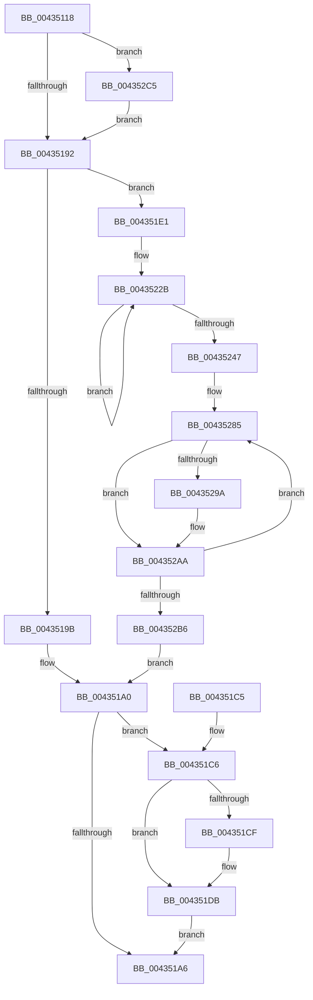

# MiDemoteLargeFreePage

- RVA: `0x00435118`–`0x004352CF` (길이 `439` bytes)
- VA: `0x0000000140435118`
- 실행 섹션: `.text`
- PDB 이름 있음: `예`; PDB Function 태그: `아니요`
- unwind 정보 RVA: `0x000A2BD0`
- 디코드: `113`개 명령, `439/439` bytes 표시
- 미해석 바이트: `0` (있으면 어셈블리에 `.byte`로 보존)

> 이 문서는 커널 이미지의 기계어와 PDB 기호를 분석해 생성했습니다. 4번과 5번은 함수 원형과 자료형을 바이너리 사용 방식에서 추정한 C 해석이며 원본 소스 복구 결과는 아닙니다.

## 1. Dependencies

- 직접 호출 지점: **7**; 고유 호출 대상: **7**
- 직접 호출자로 확인된 함수: **1**
- RIP 상대 이미지 참조: **2**

### Outgoing calls
- `0x0043516C` → [MiGetBaseResidentPage](../31/MiGetBaseResidentPage_function_0031C750.md) (function, `0x0031C750`)
- `0x00435177` → [MiGetPfnPageSizeIndex](../31/MiGetPfnPageSizeIndex_function_0031C710.md) (function, `0x0031C710`)
- `0x004351D6` → [KiLowerIrqlProcessIrqlFlags](../4F/KiLowerIrqlProcessIrqlFlags_function_004F5698.md) (function, `0x004F5698`)
- `0x004351FF` → [MiPageToNode](../33/MiPageToNode_function_00338CD0.md) (function, `0x00338CD0`)
- `0x00435254` → [MiUnlinkFreeOrZeroedPage](../33/MiUnlinkFreeOrZeroedPage_function_00336C40.md) (function, `0x00336C40`)
- `0x0043526D` → [MiInsertDemotedPages](MiInsertDemotedPages_function_004354B8.md) (function, `0x004354B8`)
- `0x004352B9` → [MiObtainedPageIsGood](MiObtainedPageIsGood_function_00435448.md) (function, `0x00435448`)

### Direct callers
- [MiTradePage](../28/MiTradePage_function_0028D160.md) at `0x0028D74B`

### Static image references
- `0x00435155` → RVA `0x00E30088` (`.data`; read)
- `0x004351C6` → RVA `0x00FC6D20` (`ALMOSTRO`; read)

## 2. Other-region calls and transfers

- 다른 실행 섹션으로 향하는 call: **0**
- 별도 외부 분기/꼬리 이동을 확인하지 못했습니다.

## 3. Assembly (complete function range)

```asm
00435118  48 89 5C 24 08                  mov qword ptr [rsp + 8], rbx
0043511D  48 89 6C 24 10                  mov qword ptr [rsp + 0x10], rbp
00435122  48 89 74 24 18                  mov qword ptr [rsp + 0x18], rsi
00435127  57                              push rdi
00435128  41 54                           push r12
0043512A  41 55                           push r13
0043512C  41 56                           push r14
0043512E  41 57                           push r15
00435130  48 83 EC 20                     sub rsp, 0x20
00435134  48 8D 1C 49                     lea rbx, [rcx + rcx*2]
00435138  0F B6 F2                        movzx esi, dl
0043513B  48 C1 E3 04                     shl rbx, 4
0043513F  49 BE 00 00 00 00 00 DE FF FF   movabs r14, 0xffffde0000000000
00435149  49 8B C6                        mov rax, r14
0043514C  48 03 D8                        add rbx, rax
0043514F  33 ED                           xor ebp, ebp
00435151  48 8B 43 28                     mov rax, qword ptr [rbx + 0x28]
00435155  48 8B 0D 2C AF 9F 00            mov rcx, qword ptr [rip + 0x9faf2c]
0043515C  48 C1 E8 2B                     shr rax, 0x2b
00435160  25 FF 03 00 00                  and eax, 0x3ff
00435165  4C 8B 3C C1                     mov r15, qword ptr [rcx + rax*8]
00435169  48 8B CB                        mov rcx, rbx
0043516C  E8 DF 75 EE FF                  call 0x14031c750
00435171  48 8B C8                        mov rcx, rax
00435174  48 8B F8                        mov rdi, rax
00435177  E8 94 75 EE FF                  call 0x14031c710
0043517C  44 8B E0                        mov r12d, eax
0043517F  49 BD FF FF FF FF FF FF FF 7F   movabs r13, 0x7fffffffffffffff
00435189  48 3B FB                        cmp rdi, rbx
0043518C  0F 85 33 01 00 00               jne 0x1404352c5
00435192  8A 47 22                        mov al, byte ptr [rdi + 0x22]
00435195  24 07                           and al, 7
00435197  3C 01                           cmp al, 1
00435199  76 46                           jbe 0x1404351e1
0043519B  F0 4C 21 6F 18                  lock and qword ptr [rdi + 0x18], r13
004351A0  40 80 FE 02                     cmp sil, 2
004351A4  72 20                           jb 0x1404351c6
004351A6  48 8B 5C 24 50                  mov rbx, qword ptr [rsp + 0x50]
004351AB  8B C5                           mov eax, ebp
004351AD  48 8B 6C 24 58                  mov rbp, qword ptr [rsp + 0x58]
004351B2  48 8B 74 24 60                  mov rsi, qword ptr [rsp + 0x60]
004351B7  48 83 C4 20                     add rsp, 0x20
004351BB  41 5F                           pop r15
004351BD  41 5E                           pop r14
004351BF  41 5D                           pop r13
004351C1  41 5C                           pop r12
004351C3  5F                              pop rdi
004351C4  C3                              ret
004351C5  CC                              int3
004351C6  83 3D 53 1B B9 00 00            cmp dword ptr [rip + 0xb91b53], 0
004351CD  74 0C                           je 0x1404351db
004351CF  44 0F 20 C1                     mov rcx, cr8
004351D3  40 8A D6                        mov dl, sil
004351D6  E8 BD 04 0C 00                  call 0x1404f5698
004351DB  44 0F 22 C6                     mov cr8, rsi
004351DF  EB C5                           jmp 0x1404351a6
004351E1  49 8B C6                        mov rax, r14
004351E4  48 8B EF                        mov rbp, rdi
004351E7  48 2B E8                        sub rbp, rax
004351EA  48 B8 AB AA AA AA AA AA AA AA   movabs rax, 0xaaaaaaaaaaaaaaab
004351F4  48 C1 FD 04                     sar rbp, 4
004351F8  48 0F AF E8                     imul rbp, rax
004351FC  48 8B CD                        mov rcx, rbp
004351FF  E8 CC 3A F0 FF                  call 0x140338cd0
00435204  8B C8                           mov ecx, eax
00435206  4C 69 F1 80 DF 00 00            imul r14, rcx, 0xdf80
0043520D  4D 03 77 10                     add r14, qword ptr [r15 + 0x10]
00435211  49 C7 C7 00 00 FF FF            mov r15, 0xffffffffffff0000
00435218  41 83 FC 02                     cmp r12d, 2
0043521C  4D 1B C0                        sbb r8, r8
0043521F  41 83 E0 08                     and r8d, 8
00435223  4B 8B 84 30 58 3B 00 00         mov rax, qword ptr [r8 + r14 + 0x3b58]
0043522B  48 8D 50 01                     lea rdx, [rax + 1]
0043522F  48 8B CA                        mov rcx, rdx
00435232  48 33 C8                        xor rcx, rax
00435235  49 23 CF                        and rcx, r15
00435238  48 33 CA                        xor rcx, rdx
0043523B  F0 4B 0F B1 8C 30 58 3B 00 00   lock cmpxchg qword ptr [r8 + r14 + 0x3b58], rcx
00435245  75 E4                           jne 0x14043522b
00435247  F0 83 0C 24 00                  lock or dword ptr [rsp], 0
0043524C  45 33 C0                        xor r8d, r8d
0043524F  33 D2                           xor edx, edx
00435251  48 8B CD                        mov rcx, rbp
00435254  E8 E7 19 F0 FF                  call 0x140336c40
00435259  F0 4C 21 6F 18                  lock and qword ptr [rdi + 0x18], r13
0043525E  41 B9 03 00 00 00               mov r9d, 3
00435264  4C 8B C3                        mov r8, rbx
00435267  48 8B D7                        mov rdx, rdi
0043526A  49 8B CE                        mov rcx, r14
0043526D  E8 46 02 00 00                  call 0x1404354b8
00435272  41 83 FC 02                     cmp r12d, 2
00435276  4D 1B C0                        sbb r8, r8
00435279  41 83 E0 08                     and r8d, 8
0043527D  4B 8B 84 30 58 3B 00 00         mov rax, qword ptr [r8 + r14 + 0x3b58]
00435285  48 8D 50 FF                     lea rdx, [rax - 1]
00435289  48 8B CA                        mov rcx, rdx
0043528C  48 33 C8                        xor rcx, rax
0043528F  49 23 CF                        and rcx, r15
00435292  48 33 CA                        xor rcx, rdx
00435295  66 85 C9                        test cx, cx
00435298  75 10                           jne 0x1404352aa
0043529A  48 8D 91 00 00 01 00            lea rdx, [rcx + 0x10000]
004352A1  48 33 D1                        xor rdx, rcx
004352A4  49 23 D7                        and rdx, r15
004352A7  48 33 CA                        xor rcx, rdx
004352AA  F0 4B 0F B1 8C 30 58 3B 00 00   lock cmpxchg qword ptr [r8 + r14 + 0x3b58], rcx
004352B4  75 CF                           jne 0x140435285
004352B6  48 8B CB                        mov rcx, rbx
004352B9  E8 8A 01 00 00                  call 0x140435448
004352BE  8B E8                           mov ebp, eax
004352C0  E9 DB FE FF FF                  jmp 0x1404351a0
004352C5  F0 4C 21 6B 18                  lock and qword ptr [rbx + 0x18], r13
004352CA  E9 C3 FE FF FF                  jmp 0x140435192
```

## 4. C-style interpretation (structured pseudocode)

```c
__int64 __fastcall MiDemoteLargeFreePage(__int64 a1, unsigned __int8 a2, __int64 a3)
{
    __int64 result;
    __int64 v_r14;
    __int64 v_rbp;
    __int64 v_rbx;
    __int64 v_rsp;
    unsigned int v_stack_p0;
    unsigned __int64 v_stack_p10;
    unsigned __int64 v_stack_p18;
    unsigned __int64 v_stack_p8;

    v_stack_p8 = v_rbx;
    v_stack_p10 = v_rbp;
    v_stack_p18 = v_rsi;
    v_rsp = (v_rsp) - (32);
    v_rbx = (a1 + a1 * 2) << (4);
    v_rbx = (v_rbx) + (v_r14);
    v_rbp = 0;
    result = (*(unsigned __int64 *)(v_rbx + 40)) >> (43);
    result = (unsigned int)((result) & (0x3FFULL));
    result = MiGetBaseResidentPage(v_rbx, a2, a3, a4);
    result = MiGetPfnPageSizeIndex(result, a2, a3, a4);
    if (result != v_rbx) goto loc_004352C5;
loc_00435192:
    result = (unsigned __int8)((*(unsigned __int8 *)(result + 34)) & (7));
    if (((unsigned __int8)(result)) <= 1) goto loc_004351E1;
loc_004351A0:
    if (a2 < 2) goto loc_004351C6;
loc_004351A6:
    v_rsp = (v_rsp) + (32);
    return 0;
loc_004351C6:
    result = 0;
    if ((*(unsigned int *)(v_rip + 12131155)) != 0) {
        a1 = v_cr8;
        a2 = (unsigned __int8)(v_stack_p18);
        result = KiLowerIrqlProcessIrqlFlags(a1, a2, a3, a4);
    }
    goto loc_004351A6;
loc_004351E1:
    v_rbp = (result) - (v_r14);
    v_rbp = (v_rbp) >> (4);
    v_rbp = (v_rbp) * (v_r14);
    result = MiPageToNode(v_rbp, a2, a3, a4);
    v_r14 = (v_r14) * ((unsigned int)((unsigned int)(result)));
    v_r14 = (v_r14) + (*(unsigned __int64 *)(*(unsigned __int64 *)(*(unsigned __int64 *)(v_rip + 10465068) + result * 8) + 16));
    a3 = (unsigned int)((a3) & (8));
loc_0043522B:
    a1 = (*(unsigned __int64 *)(a3 + v_r14 * 1 + 15192) + 1) ^ (*(unsigned __int64 *)(a3 + v_r14 * 1 + 15192));
    a1 = (a1) & (0xFFFFFFFFFFFF0000ULL);
    a1 = (a1) ^ (*(unsigned __int64 *)(a3 + v_r14 * 1 + 15192) + 1);
    if (condition_is_not_equal) goto loc_0043522B;
    a3 = 0;
    a2 = 0;
    result = MiUnlinkFreeOrZeroedPage(v_rbp, a2, a3, a4);
    result = MiInsertDemotedPages(v_r14, result, v_stack_p8, 3);
    a3 = (unsigned int)((v_stack_p8) & (8));
loc_00435285:
    a1 = (*(unsigned __int64 *)(a3 + v_r14 * 1 + 15192) - 1) ^ (*(unsigned __int64 *)(a3 + v_r14 * 1 + 15192));
    a1 = (a1) & (0xFFFFFFFFFFFF0000ULL);
    a1 = (a1) ^ (*(unsigned __int64 *)(a3 + v_r14 * 1 + 15192) - 1);
    if ((unsigned __int16)(a1) == 0) {
        a2 = a1 + 65536;
        a2 = (a2) ^ (a1);
        a2 = (a2) & (0xFFFFFFFFFFFF0000ULL);
        a1 = (a1) ^ (a2);
    }
    if (condition_is_not_equal) goto loc_00435285;
    result = MiObtainedPageIsGood(v_stack_p8, a2, a3, 3);
    goto loc_004351A0;
loc_004352C5:
    goto loc_00435192;
}
```

## 5. (Beta) C Style

```c
int64_t MiDemoteLargeFreePage(void *Arg1, uint8_t Arg2, int64_t Arg3)
{
    uint8_t *arg1 = (uint8_t *)Arg1;

    int64_t result;
    int64_t local_r14;
    int64_t local_rbp;
    int64_t local_rbx;
    int64_t local_rsp;
    uint32_t v_stack_p0;
    uint64_t v_stack_p10;
    uint64_t v_stack_p18;
    uint64_t v_stack_p8;

    v_stack_p8 = local_rbx;
    v_stack_p10 = local_rbp;
    v_stack_p18 = local_rsi;
    local_rsp = (local_rsp) - (32);
    local_rbx = (Arg1 + Arg1 * 2) << (4);
    local_rbx = (local_rbx) + (local_r14);
    local_rbp = 0;
    result = (*(uint64_t *)(local_rbx + 0x28)) >> (43);
    result = (uint32_t)((result) & (0x3FFULL));
    result = MiGetBaseResidentPage(local_rbx, Arg2, Arg3, a4);
    result = MiGetPfnPageSizeIndex(result, Arg2, Arg3, a4);
    if (result != local_rbx) goto loc_004352C5;
loc_00435192:
    result = (uint8_t)((*(uint8_t *)(result + 0x22)) & (7));
    if (((uint8_t)(result)) <= 1) goto loc_004351E1;
loc_004351A0:
    if (Arg2 < 2) goto loc_004351C6;
loc_004351A6:
    local_rsp = (local_rsp) + (32);
    return 0;
loc_004351C6:
    result = 0;
    if ((*(uint32_t *)(v_rip + 0xB91B53)) != 0) {
        Arg1 = v_cr8;
        Arg2 = (uint8_t)(v_stack_p18);
        result = KiLowerIrqlProcessIrqlFlags(Arg1, Arg2, Arg3, a4);
    }
    goto loc_004351A6;
loc_004351E1:
    local_rbp = (result) - (local_r14);
    local_rbp = (local_rbp) >> (4);
    local_rbp = (local_rbp) * (local_r14);
    result = MiPageToNode(local_rbp, Arg2, Arg3, a4);
    local_r14 = (local_r14) * ((uint32_t)((uint32_t)(result)));
    local_r14 = (local_r14) + (*(uint64_t *)(*(uint64_t *)(*(uint64_t *)(v_rip + 0x9FAF2C) + result * 8) + 0x10));
    Arg3 = (uint32_t)((Arg3) & (8));
loc_0043522B:
    Arg1 = (*(uint64_t *)(Arg3 + local_r14 * 1 + 0x3B58) + 1) ^ (*(uint64_t *)(Arg3 + local_r14 * 1 + 0x3B58));
    Arg1 = (Arg1) & (0xFFFFFFFFFFFF0000ULL);
    Arg1 = (Arg1) ^ (*(uint64_t *)(Arg3 + local_r14 * 1 + 0x3B58) + 1);
    if (condition_is_not_equal) goto loc_0043522B;
    Arg3 = 0;
    Arg2 = 0;
    result = MiUnlinkFreeOrZeroedPage(local_rbp, Arg2, Arg3, a4);
    result = MiInsertDemotedPages(local_r14, result, v_stack_p8, 3);
    Arg3 = (uint32_t)((v_stack_p8) & (8));
loc_00435285:
    Arg1 = (*(uint64_t *)(Arg3 + local_r14 * 1 + 0x3B58) - 1) ^ (*(uint64_t *)(Arg3 + local_r14 * 1 + 0x3B58));
    Arg1 = (Arg1) & (0xFFFFFFFFFFFF0000ULL);
    Arg1 = (Arg1) ^ (*(uint64_t *)(Arg3 + local_r14 * 1 + 0x3B58) - 1);
    if ((uint16_t)(Arg1) == 0) {
        Arg2 = Arg1 + 65536;
        Arg2 = (Arg2) ^ (Arg1);
        Arg2 = (Arg2) & (0xFFFFFFFFFFFF0000ULL);
        Arg1 = (Arg1) ^ (Arg2);
    }
    if (condition_is_not_equal) goto loc_00435285;
    result = MiObtainedPageIsGood(v_stack_p8, Arg2, Arg3, 3);
    goto loc_004351A0;
loc_004352C5:
    goto loc_00435192;
}
```

### 관측된 메모리 오프셋

구조체 형식이 확인되지 않은 접근은 인자 기준의 오프셋으로만 기록했습니다.

| 기준 인자 | 오프셋 표현 | 폭 (bit) | 접근 |
|---|---:|---:|---|
| `Arg1` | `+ 0x0 + rcx*2` | `64` | `R` |

## 6. Execution-region graph

[열기: 2D/3D 그래프와 함수 탐색 컨트롤 패널](../../../control-panel.html?section=text&rva=0x00435118&view=graph)

- 2D 그래프는 위에서 아래로 흐르고, 3D 그래프는 빈 공간을 드래그해 회전합니다. Shift+드래그는 이동, 휠은 확대·축소, 함수 노드 선택은 대상 보고서 이동입니다.

### Static fallback


