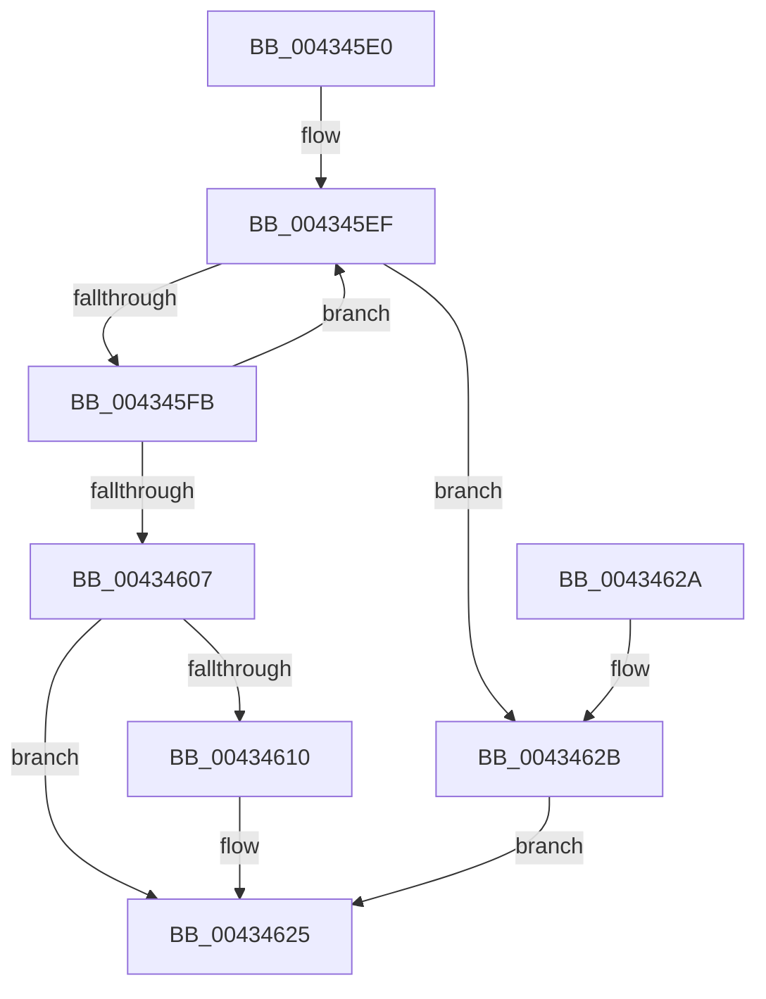

# MiDereferenceControlAreaFile

- RVA: `0x004345E0`–`0x0043463A` (길이 `90` bytes)
- VA: `0x00000001404345E0`
- 실행 섹션: `.text`
- PDB 이름 있음: `예`; PDB Function 태그: `아니요`
- unwind 정보 RVA: `0x0005D35C`
- 디코드: `25`개 명령, `90/90` bytes 표시
- 미해석 바이트: `0` (있으면 어셈블리에 `.byte`로 보존)

> 이 문서는 커널 이미지의 기계어와 PDB 기호를 분석해 생성했습니다. 4번과 5번은 함수 원형과 자료형을 바이너리 사용 방식에서 추정한 C 해석이며 원본 소스 복구 결과는 아닙니다.

## 1. Dependencies

- 직접 호출 지점: **2**; 고유 호출 대상: **2**
- 직접 호출자로 확인된 함수: **22**
- RIP 상대 이미지 참조: **1**

### Outgoing calls
- `0x00434620` → [ObpPushStackInfo](../21/ObpPushStackInfo_function_002109E4.md) (function, `0x002109E4`)
- `0x00434633` → [ObDereferenceObjectDeferDeleteWithTag](../26/ObDereferenceObjectDeferDeleteWithTag_function_00263EA0.md) (function, `0x00263EA0`)

### Direct callers
- [NtAreMappedFilesTheSame](../../page/87/NtAreMappedFilesTheSame_function_0087EC70.md) at `0x0087EE1C`
- [MiUnmapVad](../../page/88/MiUnmapVad_function_00889280.md) at `0x008892FE`
- [MiUnmapViewOfSection](../../page/88/MiUnmapViewOfSection_function_0088A4C4.md) at `0x0088A78A`
- [MiCreateSectionCommon](../../page/8A/MiCreateSectionCommon_function_008A9AA4.md) at `0x008A9DB8`
- [MiAllowImageMap](../../page/8C/MiAllowImageMap_function_008C8B10.md) at `0x008C8CA2`
- [MmIsFileMapped](../../page/91/MmIsFileMapped_function_0091D8D4.md) at `0x0091D9EC`
- [MmSectionToSectionObjectPointers](../../page/91/MmSectionToSectionObjectPointers_function_0091DF04.md) at `0x0091DF2F`
- [MiParseImageLoadConfig](../../page/94/MiParseImageLoadConfig_function_00940D18.md) at `0x00941311`
- [MiLogRelocationFaults](../../page/94/MiLogRelocationFaults_function_009418EC.md) at `0x00941930`
- [MiParseComAndCetHeaders](../../page/94/MiParseComAndCetHeaders_function_00941974.md) at `0x00941BDE`
- [MiMapImageInSystemSpace](../../page/94/MiMapImageInSystemSpace_function_00941DD8.md) at `0x00941F43`
- [MiFillMapFileInfo](../../page/97/MiFillMapFileInfo_function_0097E15C.md) at `0x0097E28F`
- [MmExtendSection](../../page/98/MmExtendSection_function_00982C38.md) at `0x00982E32`
- [MmExtendSection](../../page/98/MmExtendSection_function_00982C38.md) at `0x00982F80`
- [MmFlushVirtualMemory](../../page/9D/MmFlushVirtualMemory_function_009D6F5C.md) at `0x009D71B4`
- [MmGetFileNameForSection](../../page/A9/MmGetFileNameForSection_function_00A9AEBC.md) at `0x00A9AF8B`
- [MmGetFileNameForSection](../../page/A9/MmGetFileNameForSection_function_00A9AEBC.md) at `0x00A9AFB6`
- [MmGetFileNameForSection](../../page/A9/MmGetFileNameForSection_function_00A9AEBC.md) at `0x00A9AFE5`
- [MiConstructLoaderEntry](../../page/AA/MiConstructLoaderEntry_function_00AAA264.md) at `0x00AAA746`
- [MiMapImageForEnclaveUse](../../page/AB/MiMapImageForEnclaveUse_function_00AB213C.md) at `0x00AB2244`
- [MmCreateSpecialImageSection](../../page/AB/MmCreateSpecialImageSection_function_00AB7360.md) at `0x00AB7477`
- [MiAllocateFileExtents](../../page/AB/MiAllocateFileExtents_function_00ABDF54.md) at `0x00ABE1B8`
- [MiAllocateFileExtents](../../page/AB/MiAllocateFileExtents_function_00ABDF54.md) at `0x00ABE4D2`
- [MiAllocateFileExtents](../../page/AB/MiAllocateFileExtents_function_00ABDF54.md) at `0x00ABE4F6`
- [MiAllocateFileExtents](../../page/AB/MiAllocateFileExtents_function_00ABDF54.md) at `0x00ABE511`
- [MiLoadUserSymbols](../../page/AC/MiLoadUserSymbols_function_00AC91D0.md) at `0x00AC9217`
- [MiLoadUserSymbols](../../page/AC/MiLoadUserSymbols_function_00AC91D0.md) at `0x00AC923F`
- [MiCallImageNotify](../../page/AD/MiCallImageNotify_function_00ADB9CC.md) at `0x00ADBA72`
- [sub_00B1B1BE](../../page/B1/Unknown_function_00B1B1BE.md) at `0x00B1B1EE`

### Static image references
- `0x00434607` → RVA `0x00FC5010` (`ALMOSTRO`; read)

## 2. Other-region calls and transfers

- 다른 실행 섹션으로 향하는 call: **0**
- 별도 외부 분기/꼬리 이동을 확인하지 못했습니다.

## 3. Assembly (complete function range)

```asm
004345E0  48 83 EC 28                     sub rsp, 0x28
004345E4  4C 8B CA                        mov r9, rdx
004345E7  0F 0D 49 40                     prefetchw byte ptr [rcx + 0x40]
004345EB  48 8B 41 40                     mov rax, qword ptr [rcx + 0x40]
004345EF  4C 8B C0                        mov r8, rax
004345F2  4D 33 C1                        xor r8, r9
004345F5  49 83 F8 0F                     cmp r8, 0xf
004345F9  73 30                           jae 0x14043462b
004345FB  48 8D 50 01                     lea rdx, [rax + 1]
004345FF  F0 48 0F B1 51 40               lock cmpxchg qword ptr [rcx + 0x40], rdx
00434605  75 E8                           jne 0x1404345ef
00434607  83 3D 02 0A B9 00 00            cmp dword ptr [rip + 0xb90a02], 0
0043460E  74 15                           je 0x140434625
00434610  33 D2                           xor edx, edx
00434612  49 8D 49 D0                     lea rcx, [r9 - 0x30]
00434616  41 B9 4D 6D 53 63               mov r9d, 0x63536d4d
0043461C  44 8D 42 01                     lea r8d, [rdx + 1]
00434620  E8 BF C3 DD FF                  call 0x1402109e4
00434625  48 83 C4 28                     add rsp, 0x28
00434629  C3                              ret
0043462A  CC                              int3
0043462B  BA 4D 6D 53 63                  mov edx, 0x63536d4d
00434630  49 8B C9                        mov rcx, r9
00434633  E8 68 F8 E2 FF                  call 0x140263ea0
00434638  EB EB                           jmp 0x140434625
```

## 4. C-style interpretation (structured pseudocode)

```c
__int64 __fastcall MiDereferenceControlAreaFile(__int64 a1, __int64 a2)
{
    __int64 result;
    __int64 v_rsp;

    v_rsp = (v_rsp) - (40);
loc_004345EF:
    a3 = (*(unsigned __int64 *)(a1 + 64)) ^ (a2);
    if (a3 >= 15) goto loc_0043462B;
    if (a3 != 15) goto loc_004345EF;
    result = *(unsigned __int64 *)(a1 + 64);
    if ((*(unsigned int *)(v_rip + 12126722)) != 0) {
        a2 = 0;
        a1 = a2 - 48;
        a4 = 0x63536D4DULL;
        a3 = a2 + 1;
        result = ObpPushStackInfo(a1, a2, a3, a4);
    }
    v_rsp = (v_rsp) + (40);
    return result;
loc_0043462B:
    result = ObDereferenceObjectDeferDeleteWithTag(a4, (unsigned int)(0x63536D4DULL), a3, a4);
    goto loc_00434625;
}
```

## 5. (Beta) C Style

```c
int64_t MiDereferenceControlAreaFile(void *Arg1, void *Arg2)
{
    uint8_t *arg1 = (uint8_t *)Arg1;
    uint8_t *arg2 = (uint8_t *)Arg2;

    int64_t result;
    int64_t local_rsp;

    local_rsp = (local_rsp) - (40);
loc_004345EF:
    a3 = (*(uint64_t *)(arg1 + 0x40)) ^ (Arg2);
    if (a3 >= 15) goto loc_0043462B;
    if (a3 != 15) goto loc_004345EF;
    result = *(uint64_t *)(arg1 + 0x40);
    if ((*(uint32_t *)(v_rip + 0xB90A02)) != 0) {
        Arg2 = 0;
        Arg1 = Arg2 - 48;
        a4 = 0x63536D4DULL;
        a3 = Arg2 + 1;
        result = ObpPushStackInfo(Arg1, Arg2, a3, a4);
    }
    local_rsp = (local_rsp) + (40);
    return result;
loc_0043462B:
    result = ObDereferenceObjectDeferDeleteWithTag(a4, (uint32_t)(0x63536D4DULL), a3, a4);
    goto loc_00434625;
}
```

### 관측된 메모리 오프셋

구조체 형식이 확인되지 않은 접근은 인자 기준의 오프셋으로만 기록했습니다.

| 기준 인자 | 오프셋 표현 | 폭 (bit) | 접근 |
|---|---:|---:|---|
| `Arg1` | `+ 0x40` | `8` | `R` |
| `Arg1` | `+ 0x40` | `64` | `R` |
| `Arg2` | `- 0x30` | `64` | `R` |

## 6. Execution-region graph

[열기: 2D/3D 그래프와 함수 탐색 컨트롤 패널](../../../control-panel.html?section=text&rva=0x004345E0&view=graph)

- 2D 그래프는 위에서 아래로 흐르고, 3D 그래프는 빈 공간을 드래그해 회전합니다. Shift+드래그는 이동, 휠은 확대·축소, 함수 노드 선택은 대상 보고서 이동입니다.

### Static fallback


