# MiFinishVadDeletion

- RVA: `0x00430ED0`–`0x0043112C` (길이 `604` bytes)
- VA: `0x0000000140430ED0`
- 실행 섹션: `.text`
- PDB 이름 있음: `예`; PDB Function 태그: `예`
- unwind 정보 RVA: `0x000664BC`
- 디코드: `152`개 명령, `604/604` bytes 표시
- 미해석 바이트: `0` (있으면 어셈블리에 `.byte`로 보존)

> 이 문서는 커널 이미지의 기계어와 PDB 기호를 분석해 생성했습니다. 4번과 5번은 함수 원형과 자료형을 바이너리 사용 방식에서 추정한 C 해석이며 원본 소스 복구 결과는 아닙니다.

## 1. Dependencies

- 직접 호출 지점: **11**; 고유 호출 대상: **11**
- 직접 호출자로 확인된 함수: **1**
- RIP 상대 이미지 참조: **1**

### Outgoing calls
- `0x00430F91` → [MiReturnVadQuota](../../page/A1/MiReturnVadQuota_function_00A1E314.md) (function, `0x00A1E314`)
- `0x00430F9C` → [MiRemoveVadCharges](../../page/9B/MiRemoveVadCharges_function_009BAEC4.md) (function, `0x009BAEC4`)
- `0x00430FCD` → [KeAbPostRelease](../2E/KeAbPostRelease_function_002E1600.md) (function, `0x002E1600`)
- `0x00430FEA` → [KiCheckForKernelApcDelivery](../2E/KiCheckForKernelApcDelivery_function_002E2C80.md) (function, `0x002E2C80`)
- `0x00430FFC` → [MiGetVadWakeList](MiGetVadWakeList_function_00431134.md) (function, `0x00431134`)
- `0x0043101D` → [MiUnlockAndDereferenceVad](../31/MiUnlockAndDereferenceVad_function_00316E60.md) (function, `0x00316E60`)
- `0x00431033` → [MiDecrementVadsBeingDeleted](../34/MiDecrementVadsBeingDeleted_function_00341010.md) (function, `0x00341010`)
- `0x0043109D` → [MiDeleteVadHotPatchState](../../page/AC/MiDeleteVadHotPatchState_function_00ACA608.md) (function, `0x00ACA608`)
- `0x004310DA` → [ExfTryToWakePushLock](../26/ExfTryToWakePushLock_function_00265DD0.md) (function, `0x00265DD0`)
- `0x00431112` → [KeSignalGate](../2C/KeSignalGate_function_002C748C.md) (function, `0x002C748C`)
- `0x00431122` → [KeLeaveCriticalRegionThread](../25/KeLeaveCriticalRegionThread_function_0025EFF0.md) (function, `0x0025EFF0`)

### Direct callers
- [MiDeleteVad](../../page/88/MiDeleteVad_function_00888C80.md) at `0x00888F50`

### Static image references
- `0x00430F70` → RVA `0x00014578` (`.rdata`; read)

## 2. Other-region calls and transfers

- 다른 실행 섹션으로 향하는 call: **3**
  - `0x00430F91` → [MiReturnVadQuota](../../page/A1/MiReturnVadQuota_function_00A1E314.md) (`.text` → `PAGE`)
  - `0x00430F9C` → [MiRemoveVadCharges](../../page/9B/MiRemoveVadCharges_function_009BAEC4.md) (`.text` → `PAGE`)
  - `0x0043109D` → [MiDeleteVadHotPatchState](../../page/AC/MiDeleteVadHotPatchState_function_00ACA608.md) (`.text` → `PAGE`)
- call이 아닌 외부 분기/꼬리 이동: **1**
  - `0x004310E8` → [sub_006EE8F2](../6E/Unknown_function_006EE8F2.md) (`tail-transfer`)

## 3. Assembly (complete function range)

```asm
00430ED0  48 89 5C 24 08                  mov qword ptr [rsp + 8], rbx
00430ED5  48 89 6C 24 10                  mov qword ptr [rsp + 0x10], rbp
00430EDA  48 89 74 24 18                  mov qword ptr [rsp + 0x18], rsi
00430EDF  57                              push rdi
00430EE0  41 54                           push r12
00430EE2  41 55                           push r13
00430EE4  41 56                           push r14
00430EE6  41 57                           push r15
00430EE8  48 83 EC 20                     sub rsp, 0x20
00430EEC  65 48 8B 2C 25 88 01 00 00      mov rbp, qword ptr gs:[0x188]
00430EF5  4D 8B D0                        mov r10, r8
00430EF8  8B 41 30                        mov eax, dword ptr [rcx + 0x30]
00430EFB  4C 8B DA                        mov r11, rdx
00430EFE  48 8B D9                        mov rbx, rcx
00430F01  41 BC 01 00 00 00               mov r12d, 1
00430F07  48 8B B5 B8 00 00 00            mov rsi, qword ptr [rbp + 0xb8]
00430F0E  A8 04                           test al, 4
00430F10  0F 85 40 01 00 00               jne 0x140431056
00430F16  45 33 F6                        xor r14d, r14d
00430F19  45 33 C0                        xor r8d, r8d
00430F1C  4C 3B 96 68 03 00 00            cmp r10, qword ptr [rsi + 0x368]
00430F23  77 1C                           ja 0x140430f41
00430F25  45 84 CC                        test r12b, r9b
00430F28  75 17                           jne 0x140430f41
00430F2A  48 8B 86 28 02 00 00            mov rax, qword ptr [rsi + 0x228]
00430F31  49 2B C2                        sub rax, r10
00430F34  48 FF C8                        dec rax
00430F37  49 03 C3                        add rax, r11
00430F3A  48 89 86 28 02 00 00            mov qword ptr [rsi + 0x228], rax
00430F41  48 8B BE 10 04 00 00            mov rdi, qword ptr [rsi + 0x410]
00430F48  8B 4B 30                        mov ecx, dword ptr [rbx + 0x30]
00430F4B  48 81 C7 00 03 00 00            add rdi, 0x300
00430F52  0F BA E1 15                     bt ecx, 0x15
00430F56  0F 83 4B 01 00 00               jae 0x1404310a7
00430F5C  49 83 CF FF                     or r15, 0xffffffffffffffff
00430F60  45 85 F6                        test r14d, r14d
00430F63  74 3C                           je 0x140430fa1
00430F65  F0 44 01 A7 E8 00 00 00         lock add dword ptr [rdi + 0xe8], r12d
00430F6D  8B 4B 30                        mov ecx, dword ptr [rbx + 0x30]
00430F70  48 8D 15 01 36 BE FF            lea rdx, [rip - 0x41c9ff]
00430F77  8B C1                           mov eax, ecx
00430F79  48 C1 E8 13                     shr rax, 0x13
00430F7D  83 E0 03                        and eax, 3
00430F80  48 83 3C C2 10                  cmp qword ptr [rdx + rax*8], 0x10
00430F85  0F 84 59 01 00 00               je 0x1404310e4
00430F8B  48 8B D6                        mov rdx, rsi
00430F8E  48 8B CB                        mov rcx, rbx
00430F91  E8 7E D3 5E 00                  call 0x140a1e314
00430F96  48 8B D6                        mov rdx, rsi
00430F99  48 8B CB                        mov rcx, rbx
00430F9C  E8 23 9F 58 00                  call 0x1409baec4
00430FA1  8B 85 A8 05 00 00               mov eax, dword ptr [rbp + 0x5a8]
00430FA7  83 E0 FE                        and eax, 0xfffffffe
00430FAA  89 85 A8 05 00 00               mov dword ptr [rbp + 0x5a8], eax
00430FB0  49 8B C7                        mov rax, r15
00430FB3  F0 48 0F C1 86 58 02 00 00      lock xadd qword ptr [rsi + 0x258], rax
00430FBC  24 06                           and al, 6
00430FBE  3C 02                           cmp al, 2
00430FC0  0F 84 0D 01 00 00               je 0x1404310d3
00430FC6  48 8D 8E 58 02 00 00            lea rcx, [rsi + 0x258]
00430FCD  E8 2E 06 EB FF                  call 0x1402e1600
00430FD2  90                              nop
00430FD3  66 44 01 A5 E6 01 00 00         add word ptr [rbp + 0x1e6], r12w
00430FDB  75 12                           jne 0x140430fef
00430FDD  48 8D 85 98 00 00 00            lea rax, [rbp + 0x98]
00430FE4  90                              nop
00430FE5  48 39 00                        cmp qword ptr [rax], rax
00430FE8  74 05                           je 0x140430fef
00430FEA  E8 91 1C EB FF                  call 0x1402e2c80
00430FEF  33 F6                           xor esi, esi
00430FF1  45 85 F6                        test r14d, r14d
00430FF4  74 24                           je 0x14043101a
00430FF6  41 8B D4                        mov edx, r12d
00430FF9  48 8B CB                        mov rcx, rbx
00430FFC  E8 33 01 00 00                  call 0x140431134
00431001  4C 89 7B 10                     mov qword ptr [rbx + 0x10], r15
00431005  48 8B F0                        mov rsi, rax
00431008  48 85 C0                        test rax, rax
0043100B  0F 85 E9 00 00 00               jne 0x1404310fa
00431011  8B 4B 30                        mov ecx, dword ptr [rbx + 0x30]
00431014  0F BA E1 15                     bt ecx, 0x15
00431018  73 70                           jae 0x14043108a
0043101A  48 8B CB                        mov rcx, rbx
0043101D  E8 3E 5E EE FF                  call 0x140316e60
00431022  48 85 F6                        test rsi, rsi
00431025  0F 85 DD 00 00 00               jne 0x140431108
0043102B  45 85 F6                        test r14d, r14d
0043102E  74 08                           je 0x140431038
00431030  48 8B CF                        mov rcx, rdi
00431033  E8 D8 FF F0 FF                  call 0x140341010
00431038  48 8B 5C 24 50                  mov rbx, qword ptr [rsp + 0x50]
0043103D  48 8B 6C 24 58                  mov rbp, qword ptr [rsp + 0x58]
00431042  48 8B 74 24 60                  mov rsi, qword ptr [rsp + 0x60]
00431047  48 83 C4 20                     add rsp, 0x20
0043104B  41 5F                           pop r15
0043104D  41 5E                           pop r14
0043104F  41 5D                           pop r13
00431051  41 5C                           pop r12
00431053  5F                              pop rdi
00431054  C3                              ret
00431055  CC                              int3
00431056  45 33 C0                        xor r8d, r8d
00431059  45 8B F4                        mov r14d, r12d
0043105C  0F BA E0 15                     bt eax, 0x15
00431060  0F 82 B6 FE FF FF               jb 0x140430f1c
00431066  8B 49 34                        mov ecx, dword ptr [rcx + 0x34]
00431069  48 B8 FD FF FF FF 07 00 00 00   movabs rax, 0x7fffffffd
00431073  0F B6 53 22                     movzx edx, byte ptr [rbx + 0x22]
00431077  48 C1 E2 20                     shl rdx, 0x20
0043107B  48 0B D1                        or rdx, rcx
0043107E  48 3B D0                        cmp rdx, rax
00431081  45 0F 42 C4                     cmovb r8d, r12d
00431085  E9 92 FE FF FF                  jmp 0x140430f1c
0043108A  8B C1                           mov eax, ecx
0043108C  24 70                           and al, 0x70
0043108E  3C 20                           cmp al, 0x20
00431090  75 88                           jne 0x14043101a
00431092  F7 C1 00 00 80 01               test ecx, 0x1800000
00431098  74 80                           je 0x14043101a
0043109A  48 8B CB                        mov rcx, rbx
0043109D  E8 66 95 69 00                  call 0x140aca608
004310A2  E9 73 FF FF FF                  jmp 0x14043101a
004310A7  8B C1                           mov eax, ecx
004310A9  24 70                           and al, 0x70
004310AB  3C 20                           cmp al, 0x20
004310AD  0F 85 A9 FE FF FF               jne 0x140430f5c
004310B3  0F BA E1 16                     bt ecx, 0x16
004310B7  0F 83 9F FE FF FF               jae 0x140430f5c
004310BD  48 8B 87 40 01 00 00            mov rax, qword ptr [rdi + 0x140]
004310C4  48 FF C8                        dec rax
004310C7  48 89 87 40 01 00 00            mov qword ptr [rdi + 0x140], rax
004310CE  E9 89 FE FF FF                  jmp 0x140430f5c
004310D3  48 8D 8E 58 02 00 00            lea rcx, [rsi + 0x258]
004310DA  E8 F1 4C E3 FF                  call 0x140265dd0
004310DF  E9 E2 FE FF FF                  jmp 0x140430fc6
004310E4  0F BA E1 15                     bt ecx, 0x15
004310E8  0F 83 04 D8 2B 00               jae 0x1406ee8f2
004310EE  4C 01 BF 90 01 00 00            add qword ptr [rdi + 0x190], r15
004310F5  E9 91 FE FF FF                  jmp 0x140430f8b
004310FA  66 44 01 BD E4 01 00 00         add word ptr [rbp + 0x1e4], r15w
00431102  90                              nop
00431103  E9 09 FF FF FF                  jmp 0x140431011
00431108  48 8B 1E                        mov rbx, qword ptr [rsi]
0043110B  48 8D 4E 08                     lea rcx, [rsi + 8]
0043110F  41 8B D4                        mov edx, r12d
00431112  E8 75 63 E9 FF                  call 0x1402c748c
00431117  48 8B F3                        mov rsi, rbx
0043111A  48 85 DB                        test rbx, rbx
0043111D  75 E9                           jne 0x140431108
0043111F  48 8B CD                        mov rcx, rbp
00431122  E8 C9 DE E2 FF                  call 0x14025eff0
00431127  E9 FF FE FF FF                  jmp 0x14043102b
```

## 4. C-style interpretation (structured pseudocode)

```c
__int64 __fastcall MiFinishVadDeletion(__int64 a1, __int64 a2, __int64 a3, unsigned __int8 a4)
{
    __int64 result;
    __int64 v_r14;
    __int64 v_r15;
    __int64 v_rdi;
    __int64 v_rsi;
    __int64 v_rsp;
    unsigned __int64 v_stack_p10;
    unsigned __int64 v_stack_p18;
    unsigned __int64 v_stack_p8;

    v_stack_p8 = v_rbx;
    v_stack_p10 = v_rbp;
    v_stack_p18 = v_rsi;
    v_rsp = (v_rsp) - (32);
    if ((((unsigned __int8)((unsigned int)(*(unsigned int *)(a1 + 48)))) & (4)) != 0) goto loc_00431056;
    v_r14 = 0;
    a3 = 0;
loc_00430F1C:
    if (0 > (*(unsigned __int64 *)(*(unsigned __int64 *)(*(unsigned __int64 *)(gs_base + (0 + 392)) + 184) + 872))) goto loc_00430F41;
    result = (unsigned int)(*(unsigned int *)(a1 + 48));
    if (((1) & (a4)) == 0) {
        result = *(unsigned __int64 *)(*(unsigned __int64 *)(*(unsigned __int64 *)(gs_base + (0 + 392)) + 184) + 552);
        result = (result) - (0);
        result = (result) - 1;
        result = (result) + (a2);
        *(unsigned __int64 *)(*(unsigned __int64 *)(*(unsigned __int64 *)(gs_base + (0 + 392)) + 184) + 552) = result;
    }
    v_rdi = (*(unsigned __int64 *)(*(unsigned __int64 *)(*(unsigned __int64 *)(gs_base + (0 + 392)) + 184) + 1040)) + (768);
    if (condition_is_above_or_equal) goto loc_004310A7;
loc_00430F5C:
    v_r15 = (v_r15) | (-1);
    if (0 == 0) goto loc_00430FA1;
    result = ((unsigned int)((unsigned int)((unsigned int)(*(unsigned int *)(a1 + 48))))) >> (19);
    result = (unsigned int)((result) & (3));
    if ((*(unsigned __int64 *)(v_rip - 4311551 + result * 8)) == 16) goto loc_004310E4;
loc_00430F8B:
    result = MiReturnVadQuota(a1, *(unsigned __int64 *)(*(unsigned __int64 *)(gs_base + (0 + 392)) + 184), a3, a4);
    result = MiRemoveVadCharges(a1, *(unsigned __int64 *)(*(unsigned __int64 *)(gs_base + (0 + 392)) + 184), a3, a4);
loc_00430FA1:
    result = (unsigned int)(((unsigned int)(*(unsigned int *)(*(unsigned __int64 *)(gs_base + (0 + 392)) + 1448))) & (0xFFFFFFFEULL));
    *(unsigned int *)(*(unsigned __int64 *)(gs_base + (0 + 392)) + 1448) = (unsigned int)(result);
    result = (unsigned __int8)((v_r15) & (6));
    if (((unsigned __int8)(result)) == 2) goto loc_004310D3;
loc_00430FC6:
    result = KeAbPostRelease(*(unsigned __int64 *)(*(unsigned __int64 *)(gs_base + (0 + 392)) + 184) + 600, *(unsigned __int64 *)(*(unsigned __int64 *)(gs_base + (0 + 392)) + 184), a3, a4);
    if (((unsigned __int8)(result)) != 2) goto loc_00430FEF;
    result = *(unsigned __int64 *)(gs_base + (0 + 392)) + 152;
    if ((*(unsigned __int64 *)(*(unsigned __int64 *)(gs_base + (0 + 392)) + 152)) != (*(unsigned __int64 *)(gs_base + (0 + 392)) + 152)) {
        result = KiCheckForKernelApcDelivery(*(unsigned __int64 *)(*(unsigned __int64 *)(gs_base + (0 + 392)) + 184) + 600, *(unsigned __int64 *)(*(unsigned __int64 *)(gs_base + (0 + 392)) + 184), a3, a4);
    }
    v_rsi = 0;
    if (0 == 0) goto loc_0043101A;
    result = MiGetVadWakeList(a1, 1, a3, a4);
    *(unsigned __int64 *)(a1 + 16) = v_r15;
    if (result != 0) goto loc_004310FA;
loc_00431011:
    if (condition_is_above_or_equal) goto loc_0043108A;
loc_0043101A:
    result = MiUnlockAndDereferenceVad(a1, 1, a3, a4);
    if (result != 0) goto loc_00431108;
loc_0043102B:
    if (0 != 0) {
        a1 = v_rdi;
        result = MiDecrementVadsBeingDeleted(a1, 1, a3, a4);
    }
    v_rsp = (v_rsp) + (32);
    return result;
loc_00431056:
    a3 = 0;
    if (condition_is_below) goto loc_00430F1C;
    a2 = (*(unsigned __int8 *)(v_stack_p8 + 34)) << (32);
    a2 = (a2) | ((unsigned int)(*(unsigned int *)(a1 + 52)));
    if (a2 < result) { a3 = 1; }
    goto loc_00430F1C;
loc_0043108A:
    result = (unsigned __int8)(((unsigned int)((unsigned int)((unsigned int)(*(unsigned int *)(a1 + 52))))) & (112));
    if (((unsigned __int8)(result)) != 32) goto loc_0043101A;
    if ((((unsigned int)((unsigned int)(*(unsigned int *)(a1 + 52)))) & (0x1800000ULL)) == 0) goto loc_0043101A;
    result = MiDeleteVadHotPatchState(v_stack_p8, a2, a3, a4);
    goto loc_0043101A;
loc_004310A7:
    result = (unsigned __int8)(((unsigned int)((unsigned int)(v_stack_p8))) & (112));
    if (((unsigned __int8)(result)) != 32) goto loc_00430F5C;
    if (((unsigned __int8)(result)) >= 32) goto loc_00430F5C;
    result = (*(unsigned __int64 *)(v_rdi + 320)) - 1;
    *(unsigned __int64 *)(v_rdi + 320) = result;
    goto loc_00430F5C;
loc_004310D3:
    result = ExfTryToWakePushLock(v_stack_p18 + 600, a2, a3, a4);
    goto loc_00430FC6;
loc_004310E4:
    goto loc_00430F8B;
loc_004310FA:
    goto loc_00431011;
loc_00431108:
    result = KeSignalGate(v_stack_p18 + 8, 1, a3, a4);
    if (*(unsigned __int64 *)(v_stack_p18) != 0) goto loc_00431108;
    result = KeLeaveCriticalRegionThread(v_stack_p10, 1, a3, a4);
    goto loc_0043102B;
}
```

## 5. (Beta) C Style

```c
int64_t MiFinishVadDeletion(void *Arg1, int64_t Arg2, int64_t Arg3, uint8_t Arg4)
{
    uint8_t *arg1 = (uint8_t *)Arg1;

    int64_t result;
    int64_t local_r14;
    int64_t local_r15;
    int64_t local_rdi;
    int64_t local_rsi;
    int64_t local_rsp;
    uint64_t v_stack_p10;
    uint64_t v_stack_p18;
    uint64_t v_stack_p8;

    v_stack_p8 = local_rbx;
    v_stack_p10 = local_rbp;
    v_stack_p18 = local_rsi;
    local_rsp = (local_rsp) - (32);
    if ((((uint8_t)((uint32_t)(*(uint32_t *)(arg1 + 0x30)))) & (4)) != 0) goto loc_00431056;
    local_r14 = 0;
    Arg3 = 0;
loc_00430F1C:
    if (0 > (*(uint64_t *)(*(uint64_t *)(*(uint64_t *)(gs_base + (0 + 0x188)) + 0xB8) + 0x368))) goto loc_00430F41;
    result = (uint32_t)(*(uint32_t *)(arg1 + 0x30));
    if (((1) & (Arg4)) == 0) {
        result = *(uint64_t *)(*(uint64_t *)(*(uint64_t *)(gs_base + (0 + 0x188)) + 0xB8) + 0x228);
        result = (result) - (0);
        result = (result) - 1;
        result = (result) + (Arg2);
        *(uint64_t *)(*(uint64_t *)(*(uint64_t *)(gs_base + (0 + 0x188)) + 0xB8) + 0x228) = result;
    }
    local_rdi = (*(uint64_t *)(*(uint64_t *)(*(uint64_t *)(gs_base + (0 + 0x188)) + 0xB8) + 0x410)) + (768);
    if (condition_is_above_or_equal) goto loc_004310A7;
loc_00430F5C:
    local_r15 = (local_r15) | (-1);
    if (0 == 0) goto loc_00430FA1;
    result = ((uint32_t)((uint32_t)((uint32_t)(*(uint32_t *)(arg1 + 0x30))))) >> (19);
    result = (uint32_t)((result) & (3));
    if ((*(uint64_t *)(v_rip - 0x41C9FF + result * 8)) == 16) goto loc_004310E4;
loc_00430F8B:
    result = MiReturnVadQuota(Arg1, *(uint64_t *)(*(uint64_t *)(gs_base + (0 + 0x188)) + 0xB8), Arg3, Arg4);
    result = MiRemoveVadCharges(Arg1, *(uint64_t *)(*(uint64_t *)(gs_base + (0 + 0x188)) + 0xB8), Arg3, Arg4);
loc_00430FA1:
    result = (uint32_t)(((uint32_t)(*(uint32_t *)(*(uint64_t *)(gs_base + (0 + 0x188)) + 0x5A8))) & (0xFFFFFFFEULL));
    *(uint32_t *)(*(uint64_t *)(gs_base + (0 + 0x188)) + 0x5A8) = (uint32_t)(result);
    result = (uint8_t)((local_r15) & (6));
    if (((uint8_t)(result)) == 2) goto loc_004310D3;
loc_00430FC6:
    result = KeAbPostRelease(*(uint64_t *)(*(uint64_t *)(gs_base + (0 + 0x188)) + 0xB8) + 600, *(uint64_t *)(*(uint64_t *)(gs_base + (0 + 0x188)) + 0xB8), Arg3, Arg4);
    if (((uint8_t)(result)) != 2) goto loc_00430FEF;
    result = *(uint64_t *)(gs_base + (0 + 0x188)) + 152;
    if ((*(uint64_t *)(*(uint64_t *)(gs_base + (0 + 0x188)) + 0x98)) != (*(uint64_t *)(gs_base + (0 + 0x188)) + 152)) {
        result = KiCheckForKernelApcDelivery(*(uint64_t *)(*(uint64_t *)(gs_base + (0 + 0x188)) + 0xB8) + 600, *(uint64_t *)(*(uint64_t *)(gs_base + (0 + 0x188)) + 0xB8), Arg3, Arg4);
    }
    local_rsi = 0;
    if (0 == 0) goto loc_0043101A;
    result = MiGetVadWakeList(Arg1, 1, Arg3, Arg4);
    *(uint64_t *)(arg1 + 0x10) = local_r15;
    if (result != 0) goto loc_004310FA;
loc_00431011:
    if (condition_is_above_or_equal) goto loc_0043108A;
loc_0043101A:
    result = MiUnlockAndDereferenceVad(Arg1, 1, Arg3, Arg4);
    if (result != 0) goto loc_00431108;
loc_0043102B:
    if (0 != 0) {
        Arg1 = local_rdi;
        result = MiDecrementVadsBeingDeleted(Arg1, 1, Arg3, Arg4);
    }
    local_rsp = (local_rsp) + (32);
    return result;
loc_00431056:
    Arg3 = 0;
    if (condition_is_below) goto loc_00430F1C;
    Arg2 = (*(uint8_t *)(v_stack_p8 + 0x22)) << (32);
    Arg2 = (Arg2) | ((uint32_t)(*(uint32_t *)(arg1 + 0x34)));
    if (Arg2 < result) { Arg3 = 1; }
    goto loc_00430F1C;
loc_0043108A:
    result = (uint8_t)(((uint32_t)((uint32_t)((uint32_t)(*(uint32_t *)(arg1 + 0x34))))) & (112));
    if (((uint8_t)(result)) != 32) goto loc_0043101A;
    if ((((uint32_t)((uint32_t)(*(uint32_t *)(arg1 + 0x34)))) & (0x1800000ULL)) == 0) goto loc_0043101A;
    result = MiDeleteVadHotPatchState(v_stack_p8, Arg2, Arg3, Arg4);
    goto loc_0043101A;
loc_004310A7:
    result = (uint8_t)(((uint32_t)((uint32_t)(v_stack_p8))) & (112));
    if (((uint8_t)(result)) != 32) goto loc_00430F5C;
    if (((uint8_t)(result)) >= 32) goto loc_00430F5C;
    result = (*(uint64_t *)(local_rdi + 0x140)) - 1;
    *(uint64_t *)(local_rdi + 0x140) = result;
    goto loc_00430F5C;
loc_004310D3:
    result = ExfTryToWakePushLock(v_stack_p18 + 600, Arg2, Arg3, Arg4);
    goto loc_00430FC6;
loc_004310E4:
    goto loc_00430F8B;
loc_004310FA:
    goto loc_00431011;
loc_00431108:
    result = KeSignalGate(v_stack_p18 + 8, 1, Arg3, Arg4);
    if (*(uint64_t *)(v_stack_p18) != 0) goto loc_00431108;
    result = KeLeaveCriticalRegionThread(v_stack_p10, 1, Arg3, Arg4);
    goto loc_0043102B;
}
```

### 관측된 메모리 오프셋

구조체 형식이 확인되지 않은 접근은 인자 기준의 오프셋으로만 기록했습니다.

| 기준 인자 | 오프셋 표현 | 폭 (bit) | 접근 |
|---|---:|---:|---|
| `Arg1` | `+ 0x10` | `64` | `W` |
| `Arg1` | `+ 0x22` | `8` | `R` |
| `Arg1` | `+ 0x30` | `32` | `R` |
| `Arg1` | `+ 0x34` | `32` | `R` |

## 6. Execution-region graph

[열기: 2D/3D 그래프와 함수 탐색 컨트롤 패널](../../../control-panel.html?section=text&rva=0x00430ED0&view=graph)

- 2D 그래프는 위에서 아래로 흐르고, 3D 그래프는 빈 공간을 드래그해 회전합니다. Shift+드래그는 이동, 휠은 확대·축소, 함수 노드 선택은 대상 보고서 이동입니다.

### Static fallback

```mermaid
flowchart TD
  bb_00430ED0[BB_00430ED0]
  bb_00430F16[BB_00430F16]
  bb_00430F1C[BB_00430F1C]
  bb_00430F25[BB_00430F25]
  bb_00430F2A[BB_00430F2A]
  bb_00430F41[BB_00430F41]
  bb_00430F5C[BB_00430F5C]
  bb_00430F65[BB_00430F65]
  bb_00430F8B[BB_00430F8B]
  bb_00430FA1[BB_00430FA1]
  bb_00430FC6[BB_00430FC6]
  bb_00430FDD[BB_00430FDD]
  bb_00430FEA[BB_00430FEA]
  bb_00430FEF[BB_00430FEF]
  bb_00430FF6[BB_00430FF6]
  bb_00431011[BB_00431011]
  bb_0043101A[BB_0043101A]
  bb_0043102B[BB_0043102B]
  bb_00431030[BB_00431030]
  bb_00431038[BB_00431038]
  bb_00431055[BB_00431055]
  bb_00431056[BB_00431056]
  bb_00431066[BB_00431066]
  bb_0043108A[BB_0043108A]
  bb_00431092[BB_00431092]
  bb_0043109A[BB_0043109A]
  bb_004310A7[BB_004310A7]
  bb_004310B3[BB_004310B3]
  bb_004310BD[BB_004310BD]
  bb_004310D3[BB_004310D3]
  bb_004310E4[BB_004310E4]
  bb_004310EE[BB_004310EE]
  bb_004310FA[BB_004310FA]
  bb_00431108[BB_00431108]
  bb_0043111F[BB_0043111F]
  bb_00430ED0 -->|branch| bb_00431056
  bb_00430ED0 -->|fallthrough| bb_00430F16
  bb_00430F16 -->|flow| bb_00430F1C
  bb_00430F1C -->|branch| bb_00430F41
  bb_00430F1C -->|fallthrough| bb_00430F25
  bb_00430F25 -->|branch| bb_00430F41
  bb_00430F25 -->|fallthrough| bb_00430F2A
  bb_00430F2A -->|flow| bb_00430F41
  bb_00430F41 -->|branch| bb_004310A7
  bb_00430F41 -->|fallthrough| bb_00430F5C
  bb_00430F5C -->|branch| bb_00430FA1
  bb_00430F5C -->|fallthrough| bb_00430F65
  bb_00430F65 -->|branch| bb_004310E4
  bb_00430F65 -->|fallthrough| bb_00430F8B
  bb_00430F8B -->|flow| bb_00430FA1
  bb_00430FA1 -->|branch| bb_004310D3
  bb_00430FA1 -->|fallthrough| bb_00430FC6
  bb_00430FC6 -->|branch| bb_00430FEF
  bb_00430FC6 -->|fallthrough| bb_00430FDD
  bb_00430FDD -->|branch| bb_00430FEF
  bb_00430FDD -->|fallthrough| bb_00430FEA
  bb_00430FEA -->|flow| bb_00430FEF
  bb_00430FEF -->|branch| bb_0043101A
  bb_00430FEF -->|fallthrough| bb_00430FF6
  bb_00430FF6 -->|branch| bb_004310FA
  bb_00430FF6 -->|fallthrough| bb_00431011
  bb_00431011 -->|branch| bb_0043108A
  bb_00431011 -->|fallthrough| bb_0043101A
  bb_0043101A -->|branch| bb_00431108
  bb_0043101A -->|fallthrough| bb_0043102B
  bb_0043102B -->|branch| bb_00431038
  bb_0043102B -->|fallthrough| bb_00431030
  bb_00431030 -->|flow| bb_00431038
  bb_00431055 -->|flow| bb_00431056
  bb_00431056 -->|branch| bb_00430F1C
  bb_00431056 -->|fallthrough| bb_00431066
  bb_00431066 -->|branch| bb_00430F1C
  bb_0043108A -->|branch| bb_0043101A
  bb_0043108A -->|fallthrough| bb_00431092
  bb_00431092 -->|branch| bb_0043101A
  bb_00431092 -->|fallthrough| bb_0043109A
  bb_0043109A -->|branch| bb_0043101A
  bb_004310A7 -->|branch| bb_00430F5C
  bb_004310A7 -->|fallthrough| bb_004310B3
  bb_004310B3 -->|branch| bb_00430F5C
  bb_004310B3 -->|fallthrough| bb_004310BD
  bb_004310BD -->|branch| bb_00430F5C
  bb_004310D3 -->|branch| bb_00430FC6
  bb_004310E4 -->|fallthrough| bb_004310EE
  bb_004310EE -->|branch| bb_00430F8B
  bb_004310FA -->|branch| bb_00431011
  bb_00431108 -->|branch| bb_00431108
  bb_00431108 -->|fallthrough| bb_0043111F
  bb_0043111F -->|branch| bb_0043102B
```


