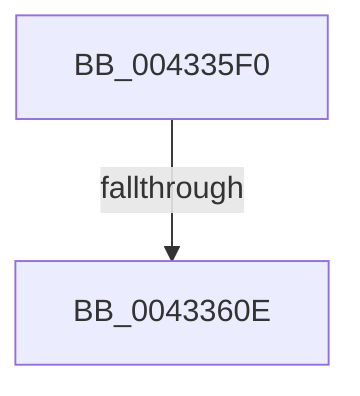

# MiFreeZeroPageSlistSufficient

- RVA: `0x004335F0`–`0x00433637` (길이 `71` bytes)
- VA: `0x00000001404335F0`
- 실행 섹션: `.text`
- PDB 이름 있음: `예`; PDB Function 태그: `아니요`
- unwind 정보 RVA: `0x000A2564`
- 디코드: `17`개 명령, `71/71` bytes 표시
- 미해석 바이트: `0` (있으면 어셈블리에 `.byte`로 보존)

> 이 문서는 커널 이미지의 기계어와 PDB 기호를 분석해 생성했습니다. 4번과 5번은 함수 원형과 자료형을 바이너리 사용 방식에서 추정한 C 해석이며 원본 소스 복구 결과는 아닙니다.

## 1. Dependencies

- 직접 호출 지점: **0**; 고유 호출 대상: **0**
- 직접 호출자로 확인된 함수: **1**
- RIP 상대 이미지 참조: **0**

### Outgoing calls
- 직접 디코드된 call 명령이 없습니다.

### Direct callers
- [MiPageFreeToZero](../33/MiPageFreeToZero_function_00337A30.md) at `0x00337C8C`

### Static image references
- 디코드된 RIP-relative 메모리 참조가 없습니다.

## 2. Other-region calls and transfers

- 다른 실행 섹션으로 향하는 call: **0**
- call이 아닌 외부 분기/꼬리 이동: **2**
  - `0x00433608` → [sub_00433711 + 0xA](Unknown_function_00433711.md) (`tail-transfer`)
  - `0x00433631` → [sub_00433711 + 0xA](Unknown_function_00433711.md) (`tail-transfer`)

## 3. Assembly (complete function range)

```asm
004335F0  41 55                           push r13
004335F2  41 56                           push r14
004335F4  48 83 EC 18                     sub rsp, 0x18
004335F8  4C 8B 89 88 3A 00 00            mov r9, qword ptr [rcx + 0x3a88]
004335FF  4C 8B F1                        mov r14, rcx
00433602  41 8B 41 04                     mov eax, dword ptr [r9 + 4]
00433606  A8 10                           test al, 0x10
00433608  0F 85 0D 01 00 00               jne 0x14043371b
0043360E  49 63 C0                        movsxd rax, r8d
00433611  44 8B EA                        mov r13d, edx
00433614  0F B6 CA                        movzx ecx, dl
00433617  48 03 C9                        add rcx, rcx
0043361A  41 C1 ED 08                     shr r13d, 8
0043361E  49 8B 84 C6 60 3A 00 00         mov rax, qword ptr [r14 + rax*8 + 0x3a60]
00433626  0F B7 0C C8                     movzx ecx, word ptr [rax + rcx*8]
0043362A  41 3B 89 50 42 00 00            cmp ecx, dword ptr [r9 + 0x4250]
00433631  0F 8D E4 00 00 00               jge 0x14043371b
```

## 4. C-style interpretation (structured pseudocode)

```c
__int64 __fastcall MiFreeZeroPageSlistSufficient(__int64 a1, int a2, int a3)
{
    __int64 v_r13;
    __int64 v_rsp;

    v_rsp = (v_rsp) - (24);
    a1 = ((unsigned __int8)(a2)) + ((unsigned __int8)(a2));
    v_r13 = (unsigned int)(((unsigned int)(a2)) >> (8));
}
```

## 5. (Beta) C Style

```c
int64_t MiFreeZeroPageSlistSufficient(void *Arg1, int32_t Arg2, int32_t Arg3)
{
    uint8_t *arg1 = (uint8_t *)Arg1;

    int64_t local_r13;
    int64_t local_rsp;

    local_rsp = (local_rsp) - (24);
    Arg1 = ((uint8_t)(Arg2)) + ((uint8_t)(Arg2));
    local_r13 = (uint32_t)(((uint32_t)(Arg2)) >> (8));
}
```

### 관측된 메모리 오프셋

구조체 형식이 확인되지 않은 접근은 인자 기준의 오프셋으로만 기록했습니다.

| 기준 인자 | 오프셋 표현 | 폭 (bit) | 접근 |
|---|---:|---:|---|
| `Arg1` | `+ 0x3A60 + rax*8` | `64` | `R` |
| `Arg1` | `+ 0x3A88` | `64` | `R` |

## 6. Execution-region graph

[열기: 2D/3D 그래프와 함수 탐색 컨트롤 패널](../../../control-panel.html?section=text&rva=0x004335F0&view=graph)

- 2D 그래프는 위에서 아래로 흐르고, 3D 그래프는 빈 공간을 드래그해 회전합니다. Shift+드래그는 이동, 휠은 확대·축소, 함수 노드 선택은 대상 보고서 이동입니다.

### Static fallback


