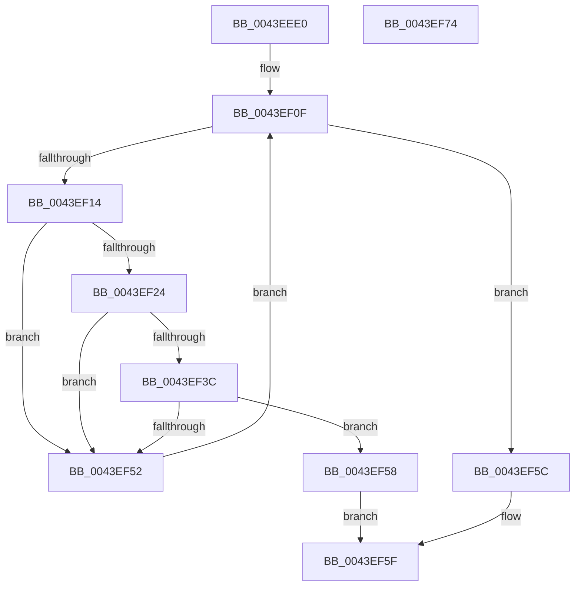

# MiGetClosestNodeWithProcessors

- RVA: `0x0043EEE0`–`0x0043EF75` (길이 `149` bytes)
- VA: `0x000000014043EEE0`
- 실행 섹션: `.text`
- PDB 이름 있음: `예`; PDB Function 태그: `아니요`
- unwind 정보 RVA: `0x0006C8E8`
- 디코드: `41`개 명령, `149/149` bytes 표시
- 미해석 바이트: `0` (있으면 어셈블리에 `.byte`로 보존)

> 이 문서는 커널 이미지의 기계어와 PDB 기호를 분석해 생성했습니다. 4번과 5번은 함수 원형과 자료형을 바이너리 사용 방식에서 추정한 C 해석이며 원본 소스 복구 결과는 아닙니다.

## 1. Dependencies

- 직접 호출 지점: **2**; 고유 호출 대상: **2**
- 직접 호출자로 확인된 함수: **3**
- RIP 상대 이미지 참조: **3**

### Outgoing calls
- `0x0043EF32` → [KeGetNodePrimarySubNode](KeGetNodePrimarySubNode_function_0043EFF4.md) (function, `0x0043EFF4`)
- `0x0043EF46` → [KiQuerySubNodeActiveAffinity](KiQuerySubNodeActiveAffinity_function_0043F060.md) (function, `0x0043F060`)

### Direct callers
- [MiComputeIdealDpcGang](MiComputeIdealDpcGang_function_0043EAAC.md) at `0x0043EB07`
- [MiComputeIdealDpcGang](MiComputeIdealDpcGang_function_0043EAAC.md) at `0x0043EEA0`
- [MiCreateZeroThreadContext](../../page/81/MiCreateZeroThreadContext_function_008105B4.md) at `0x008105DD`
- [MiCombineAllPhysicalMemory](../../page/9F/MiCombineAllPhysicalMemory_function_009F6B6C.md) at `0x009F6C75`

### Static image references
- `0x0043EEF4` → RVA `0x00FC5000` (`ALMOSTRO`; read)
- `0x0043EEFB` → RVA `0x00E2DBD0` (`.data`; read)
- `0x0043EF24` → RVA `0x00FCF6C0` (`CACHEALI`; read)

## 2. Other-region calls and transfers

- 다른 실행 섹션으로 향하는 call: **0**
- 별도 외부 분기/꼬리 이동을 확인하지 못했습니다.

## 3. Assembly (complete function range)

```asm
0043EEE0  48 89 5C 24 10                  mov qword ptr [rsp + 0x10], rbx
0043EEE5  48 89 6C 24 18                  mov qword ptr [rsp + 0x18], rbp
0043EEEA  48 89 74 24 20                  mov qword ptr [rsp + 0x20], rsi
0043EEEF  57                              push rdi
0043EEF0  48 83 EC 20                     sub rsp, 0x20
0043EEF4  0F B7 15 05 61 B8 00            movzx edx, word ptr [rip + 0xb86105]
0043EEFB  48 8B 05 CE EC 9E 00            mov rax, qword ptr [rip + 0x9eecce]
0043EF02  0F AF CA                        imul ecx, edx
0043EF05  33 ED                           xor ebp, ebp
0043EF07  48 8D 1C 88                     lea rbx, [rax + rcx*4]
0043EF0B  48 8D 34 93                     lea rsi, [rbx + rdx*4]
0043EF0F  48 3B DE                        cmp rbx, rsi
0043EF12  73 48                           jae 0x14043ef5c
0043EF14  8B 3B                           mov edi, dword ptr [rbx]
0043EF16  66 3B 3D E3 60 B8 00            cmp di, word ptr [rip + 0xb860e3]
0043EF1D  66 89 6C 24 30                  mov word ptr [rsp + 0x30], bp
0043EF22  73 2E                           jae 0x14043ef52
0043EF24  48 8D 05 95 07 B9 00            lea rax, [rip + 0xb90795]
0043EF2B  0F B7 CF                        movzx ecx, di
0043EF2E  48 8B 0C C8                     mov rcx, qword ptr [rax + rcx*8]
0043EF32  E8 BD 00 00 00                  call 0x14043eff4
0043EF37  48 85 C0                        test rax, rax
0043EF3A  74 16                           je 0x14043ef52
0043EF3C  4C 8D 44 24 30                  lea r8, [rsp + 0x30]
0043EF41  33 D2                           xor edx, edx
0043EF43  48 8B C8                        mov rcx, rax
0043EF46  E8 15 01 00 00                  call 0x14043f060
0043EF4B  66 39 6C 24 30                  cmp word ptr [rsp + 0x30], bp
0043EF50  75 06                           jne 0x14043ef58
0043EF52  48 83 C3 04                     add rbx, 4
0043EF56  EB B7                           jmp 0x14043ef0f
0043EF58  8B C7                           mov eax, edi
0043EF5A  EB 03                           jmp 0x14043ef5f
0043EF5C  83 C8 FF                        or eax, 0xffffffff
0043EF5F  48 8B 5C 24 38                  mov rbx, qword ptr [rsp + 0x38]
0043EF64  48 8B 6C 24 40                  mov rbp, qword ptr [rsp + 0x40]
0043EF69  48 8B 74 24 48                  mov rsi, qword ptr [rsp + 0x48]
0043EF6E  48 83 C4 20                     add rsp, 0x20
0043EF72  5F                              pop rdi
0043EF73  C3                              ret
0043EF74  CC                              int3
```

## 4. C-style interpretation (structured pseudocode)

```c
__int64 __fastcall MiGetClosestNodeWithProcessors(int a1)
{
    __int64 result;
    __int64 v_rbp;
    __int64 v_rbx;
    __int64 v_rsp;
    unsigned __int64 v_stack_p10;
    unsigned __int64 v_stack_p18;
    unsigned __int64 v_stack_p20;
    unsigned __int16 v_stack_p8;

    v_stack_p10 = v_rbx;
    v_stack_p18 = v_rbp;
    v_stack_p20 = v_rsi;
    v_rsp = (v_rsp) - (32);
    a1 = (unsigned int)((a1) * ((unsigned int)(*(unsigned __int16 *)(v_rip + 12083461))));
    v_rbp = 0;
loc_0043EF0F:
    if ((*(unsigned __int64 *)(v_rip + 10415310) + a1 * 4) >= (*(unsigned __int64 *)(v_rip + 10415310) + a1 * 4 + *(unsigned __int16 *)(v_rip + 12083461) * 4)) goto loc_0043EF5C;
    v_stack_p8 = 0;
    if (((unsigned __int16)((unsigned int)(*(unsigned int *)(*(unsigned __int64 *)(v_rip + 10415310) + a1 * 4)))) >= (*(unsigned __int16 *)(v_rip + 12083427))) goto loc_0043EF52;
    result = KeGetNodePrimarySubNode(*(unsigned __int64 *)(v_rip + 12126101 + (unsigned __int16)((unsigned int)(*(unsigned int *)(*(unsigned __int64 *)(v_rip + 10415310) + a1 * 4))) * 8), *(unsigned __int16 *)(v_rip + 12083461), a3, a4);
    if (result == 0) goto loc_0043EF52;
    a2 = 0;
    result = KiQuerySubNodeActiveAffinity(result, a2, v_stack_p8, a4);
    if (v_stack_p8 != 0) goto loc_0043EF58;
loc_0043EF52:
    v_rbx = (*(unsigned __int64 *)(v_rip + 10415310) + a1 * 4) + (4);
    goto loc_0043EF0F;
loc_0043EF58:
    goto loc_0043EF5F;
loc_0043EF5C:
    result = (unsigned int)(((unsigned int)((unsigned int)((unsigned int)(*(unsigned int *)(*(unsigned __int64 *)(v_rip + 10415310) + a1 * 4))))) | (0xFFFFFFFFULL));
loc_0043EF5F:
    v_rsp = (v_rsp) + (32);
    return result;
}
```

## 5. (Beta) C Style

```c
int64_t MiGetClosestNodeWithProcessors(int32_t Arg1)
{
    int64_t result;
    int64_t local_rbp;
    int64_t local_rbx;
    int64_t local_rsp;
    uint64_t v_stack_p10;
    uint64_t v_stack_p18;
    uint64_t v_stack_p20;
    uint16_t v_stack_p8;

    v_stack_p10 = local_rbx;
    v_stack_p18 = local_rbp;
    v_stack_p20 = local_rsi;
    local_rsp = (local_rsp) - (32);
    Arg1 = (uint32_t)((Arg1) * ((uint32_t)(*(uint16_t *)(v_rip + 0xB86105))));
    local_rbp = 0;
loc_0043EF0F:
    if ((*(uint64_t *)(v_rip + 0x9EECCE) + Arg1 * 4) >= (*(uint64_t *)(v_rip + 0x9EECCE) + Arg1 * 4 + *(uint16_t *)(v_rip + 0xB86105) * 4)) goto loc_0043EF5C;
    v_stack_p8 = 0;
    if (((uint16_t)((uint32_t)(*(uint32_t *)(*(uint64_t *)(v_rip + 0x9EECCE) + Arg1 * 4)))) >= (*(uint16_t *)(v_rip + 0xB860E3))) goto loc_0043EF52;
    result = KeGetNodePrimarySubNode(*(uint64_t *)(v_rip + 0xB90795 + (uint16_t)((uint32_t)(*(uint32_t *)(*(uint64_t *)(v_rip + 0x9EECCE) + Arg1 * 4))) * 8), *(uint16_t *)(v_rip + 0xB86105), a3, a4);
    if (result == 0) goto loc_0043EF52;
    a2 = 0;
    result = KiQuerySubNodeActiveAffinity(result, a2, v_stack_p8, a4);
    if (v_stack_p8 != 0) goto loc_0043EF58;
loc_0043EF52:
    local_rbx = (*(uint64_t *)(v_rip + 0x9EECCE) + Arg1 * 4) + (4);
    goto loc_0043EF0F;
loc_0043EF58:
    goto loc_0043EF5F;
loc_0043EF5C:
    result = (uint32_t)(((uint32_t)((uint32_t)((uint32_t)(*(uint32_t *)(*(uint64_t *)(v_rip + 0x9EECCE) + Arg1 * 4))))) | (0xFFFFFFFFULL));
loc_0043EF5F:
    local_rsp = (local_rsp) + (32);
    return result;
}
```

## 6. Execution-region graph

[열기: 2D/3D 그래프와 함수 탐색 컨트롤 패널](../../../control-panel.html?section=text&rva=0x0043EEE0&view=graph)

- 2D 그래프는 위에서 아래로 흐르고, 3D 그래프는 빈 공간을 드래그해 회전합니다. Shift+드래그는 이동, 휠은 확대·축소, 함수 노드 선택은 대상 보고서 이동입니다.

### Static fallback


