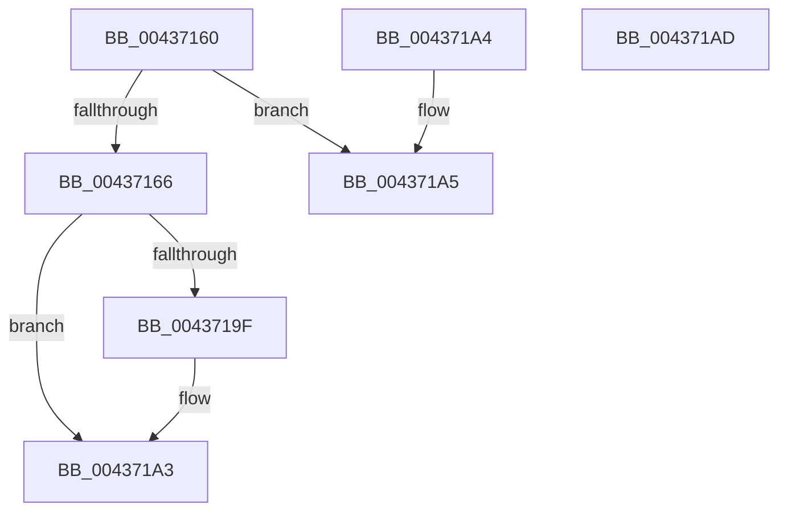

# MiGetColorHeadHugeRangeBase

- RVA: `0x00437160`–`0x004371AE` (길이 `78` bytes)
- VA: `0x0000000140437160`
- 실행 섹션: `.text`
- PDB 이름 있음: `예`; PDB Function 태그: `아니요`
- unwind 정보 RVA: `0x000DB714`
- 디코드: `20`개 명령, `78/78` bytes 표시
- 미해석 바이트: `0` (있으면 어셈블리에 `.byte`로 보존)

> 이 문서는 커널 이미지의 기계어와 PDB 기호를 분석해 생성했습니다. 4번과 5번은 함수 원형과 자료형을 바이너리 사용 방식에서 추정한 C 해석이며 원본 소스 복구 결과는 아닙니다.

## 1. Dependencies

- 직접 호출 지점: **0**; 고유 호출 대상: **0**
- 직접 호출자로 확인된 함수: **7**
- RIP 상대 이미지 참조: **1**

### Outgoing calls
- 직접 디코드된 call 명령이 없습니다.

### Direct callers
- [MiComputeHugeRangeColorHeadAtDpc](MiComputeHugeRangeColorHeadAtDpc_function_00436968.md) at `0x00436A08`
- [MiUnlinkHugeRange](MiUnlinkHugeRange_function_00436EF0.md) at `0x00436FAE`
- [MiInsertHugeRangeInList](MiInsertHugeRangeInList_function_004371E8.md) at `0x004372FF`
- [MiGetHugeBadRangeFromNode](../67/MiGetHugeBadRangeFromNode_function_00675818.md) at `0x0067584E`
- [MiGetPerfectColorHeadHugeRange](../67/MiGetPerfectColorHeadHugeRange_function_00675C08.md) at `0x00675C56`
- [MiHugePurgeZeroList](../67/MiHugePurgeZeroList_function_00676124.md) at `0x00676189`
- [MiRemoveHugeRangeAnyColor](../67/MiRemoveHugeRangeAnyColor_function_006771B4.md) at `0x0067724E`

### Static image references
- `0x00437177` → RVA `0x00E2DCC0` (`.data`; read)

## 2. Other-region calls and transfers

- 다른 실행 섹션으로 향하는 call: **0**
- 별도 외부 분기/꼬리 이동을 확인하지 못했습니다.

## 3. Assembly (complete function range)

```asm
00437160  41 83 F8 05                     cmp r8d, 5
00437164  74 3F                           je 0x1404371a5
00437166  48 8B 81 88 3A 00 00            mov rax, qword ptr [rcx + 0x3a88]
0043716D  49 B9 3F EE A0 D9 7C 5A 1E F5   movabs r9, 0xf51e5a7cd9a0ee3f
00437177  8B 15 43 6B 9F 00               mov edx, dword ptr [rip + 0x9f6b43]
0043717D  48 2B 48 10                     sub rcx, qword ptr [rax + 0x10]
00437181  48 8B 80 10 41 00 00            mov rax, qword ptr [rax + 0x4110]
00437188  48 C1 F9 07                     sar rcx, 7
0043718C  49 0F AF C9                     imul rcx, r9
00437190  0F AF CA                        imul ecx, edx
00437193  03 C9                           add ecx, ecx
00437195  48 8D 04 C8                     lea rax, [rax + rcx*8]
00437199  41 83 F8 01                     cmp r8d, 1
0043719D  75 04                           jne 0x1404371a3
0043719F  48 8D 04 D0                     lea rax, [rax + rdx*8]
004371A3  C3                              ret
004371A4  CC                              int3
004371A5  48 8D 81 20 3B 00 00            lea rax, [rcx + 0x3b20]
004371AC  C3                              ret
004371AD  CC                              int3
```

## 4. C-style interpretation (structured pseudocode)

```c
__int64 __fastcall MiGetColorHeadHugeRangeBase(__int64 a1, __int64 a2, int a3)
{
    __int64 result;

    if (a3 == 5) goto loc_004371A5;
    a1 = (a1) - (*(unsigned __int64 *)(*(unsigned __int64 *)(a1 + 14984) + 16));
    a1 = (a1) >> (7);
    a1 = (a1) * (a4);
    a1 = (unsigned int)((a1) * ((unsigned int)((unsigned int)(*(unsigned int *)(v_rip + 10447683)))));
    a1 = (unsigned int)((a1) + ((unsigned int)(a1)));
    result = *(unsigned __int64 *)(*(unsigned __int64 *)(a1 + 14984) + 16656) + a1 * 8;
    if (a3 == 1) {
        result = *(unsigned __int64 *)(*(unsigned __int64 *)(a1 + 14984) + 16656) + a1 * 8 + (unsigned int)(*(unsigned int *)(v_rip + 10447683)) * 8;
    }
    return result;
loc_004371A5:
    return a1 + 15136;
}
```

## 5. (Beta) C Style

```c
int64_t MiGetColorHeadHugeRangeBase(void *Arg1, int64_t Arg2, int32_t Arg3)
{
    uint8_t *arg1 = (uint8_t *)Arg1;

    int64_t result;

    if (Arg3 == 5) goto loc_004371A5;
    Arg1 = (Arg1) - (*(uint64_t *)(*(uint64_t *)(arg1 + 0x3A88) + 0x10));
    Arg1 = (Arg1) >> (7);
    Arg1 = (Arg1) * (a4);
    Arg1 = (uint32_t)((Arg1) * ((uint32_t)((uint32_t)(*(uint32_t *)(v_rip + 0x9F6B43)))));
    Arg1 = (uint32_t)((Arg1) + ((uint32_t)(Arg1)));
    result = *(uint64_t *)(*(uint64_t *)(arg1 + 0x3A88) + 0x4110) + Arg1 * 8;
    if (Arg3 == 1) {
        result = *(uint64_t *)(*(uint64_t *)(arg1 + 0x3A88) + 0x4110) + Arg1 * 8 + (uint32_t)(*(uint32_t *)(v_rip + 0x9F6B43)) * 8;
    }
    return result;
loc_004371A5:
    return Arg1 + 15136;
}
```

### 관측된 메모리 오프셋

구조체 형식이 확인되지 않은 접근은 인자 기준의 오프셋으로만 기록했습니다.

| 기준 인자 | 오프셋 표현 | 폭 (bit) | 접근 |
|---|---:|---:|---|
| `Arg1` | `+ 0x3A88` | `64` | `R` |
| `Arg1` | `+ 0x3B20` | `64` | `R` |

## 6. Execution-region graph

[열기: 2D/3D 그래프와 함수 탐색 컨트롤 패널](../../../control-panel.html?section=text&rva=0x00437160&view=graph)

- 2D 그래프는 위에서 아래로 흐르고, 3D 그래프는 빈 공간을 드래그해 회전합니다. Shift+드래그는 이동, 휠은 확대·축소, 함수 노드 선택은 대상 보고서 이동입니다.

### Static fallback


