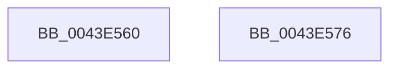

# MiGetControlAreaPartition

- RVA: `0x0043E560`–`0x0043E577` (길이 `23` bytes)
- VA: `0x000000014043E560`
- 실행 섹션: `.text`
- PDB 이름 있음: `예`; PDB Function 태그: `아니요`
- unwind 정보 RVA: `0x000DB714`
- 디코드: `6`개 명령, `23/23` bytes 표시
- 미해석 바이트: `0` (있으면 어셈블리에 `.byte`로 보존)

> 이 문서는 커널 이미지의 기계어와 PDB 기호를 분석해 생성했습니다. 4번과 5번은 함수 원형과 자료형을 바이너리 사용 방식에서 추정한 C 해석이며 원본 소스 복구 결과는 아닙니다.

## 1. Dependencies

- 직접 호출 지점: **0**; 고유 호출 대상: **0**
- 직접 호출자로 확인된 함수: **14**
- RIP 상대 이미지 참조: **1**

### Outgoing calls
- 직접 디코드된 call 명령이 없습니다.

### Direct callers
- [MiFreeInitializationCode](../../page/7F/MiFreeInitializationCode_function_007F88A0.md) at `0x007F8AB4`
- [MiCreateFileOnlyPfns](../../page/80/MiCreateFileOnlyPfns_function_00800DB4.md) at `0x00800ED3`
- [MiAllocateVirtualMemory](../../page/88/MiAllocateVirtualMemory_function_00883B40.md) at `0x00883F9B`
- [MiChargeSegmentCommit](../../page/8C/MiChargeSegmentCommit_function_008CEDE4.md) at `0x008CEE2B`
- [MiPfPrepareReadList](../../page/93/MiPfPrepareReadList_function_0093CD5C.md) at `0x0093CE6A`
- [MiPfPrepareSequentialReadList](../../page/93/MiPfPrepareSequentialReadList_function_0093D8E8.md) at `0x0093DC05`
- [MiMapImageInSystemSpace](../../page/94/MiMapImageInSystemSpace_function_00941DD8.md) at `0x0094201A`
- [MiExtendSection](../../page/98/MiExtendSection_function_00982FDC.md) at `0x0098345E`
- [sub_00984B34](../../page/98/Unknown_function_00984B34.md) at `0x00984C1B`
- [sub_00984D37](../../page/98/Unknown_function_00984D37.md) at `0x00984DE7`
- [MiCreateFileOnlyImageFixupList](../../page/98/MiCreateFileOnlyImageFixupList_function_00989AD0.md) at `0x00989B59`
- [MmQueryVirtualMemory](../../page/9D/MmQueryVirtualMemory_function_009D9280.md) at `0x009DA026`
- [MiSegmentDelete](../../page/A1/MiSegmentDelete_function_00A1FBB4.md) at `0x00A1FD30`
- [MiAllocatePerSessionProtos](../../page/A6/MiAllocatePerSessionProtos_function_00A66830.md) at `0x00A66856`

### Static image references
- `0x0043E564` → RVA `0x00E30088` (`.data`; read)

## 2. Other-region calls and transfers

- 다른 실행 섹션으로 향하는 call: **0**
- 별도 외부 분기/꼬리 이동을 확인하지 못했습니다.

## 3. Assembly (complete function range)

```asm
0043E560  0F B7 51 3C                     movzx edx, word ptr [rcx + 0x3c]
0043E564  48 8B 05 1D 1B 9F 00            mov rax, qword ptr [rip + 0x9f1b1d]
0043E56B  81 E2 FF 03 00 00               and edx, 0x3ff
0043E571  48 8B 04 D0                     mov rax, qword ptr [rax + rdx*8]
0043E575  C3                              ret
0043E576  CC                              int3
```

## 4. C-style interpretation (structured pseudocode)

```c
__int64 __fastcall MiGetControlAreaPartition(__int64 a1)
{
    a2 = (unsigned int)((*(unsigned __int16 *)(a1 + 60)) & (0x3FFULL));
    return *(unsigned __int64 *)(*(unsigned __int64 *)(v_rip + 10427165) + a2 * 8);
}
```

## 5. (Beta) C Style

```c
int64_t MiGetControlAreaPartition(void *Arg1)
{
    uint8_t *arg1 = (uint8_t *)Arg1;

    a2 = (uint32_t)((*(uint16_t *)(arg1 + 0x3C)) & (0x3FFULL));
    return *(uint64_t *)(*(uint64_t *)(v_rip + 0x9F1B1D) + a2 * 8);
}
```

### 관측된 메모리 오프셋

구조체 형식이 확인되지 않은 접근은 인자 기준의 오프셋으로만 기록했습니다.

| 기준 인자 | 오프셋 표현 | 폭 (bit) | 접근 |
|---|---:|---:|---|
| `Arg1` | `+ 0x3C` | `16` | `R` |

## 6. Execution-region graph

[열기: 2D/3D 그래프와 함수 탐색 컨트롤 패널](../../../control-panel.html?section=text&rva=0x0043E560&view=graph)

- 2D 그래프는 위에서 아래로 흐르고, 3D 그래프는 빈 공간을 드래그해 회전합니다. Shift+드래그는 이동, 휠은 확대·축소, 함수 노드 선택은 대상 보고서 이동입니다.

### Static fallback


