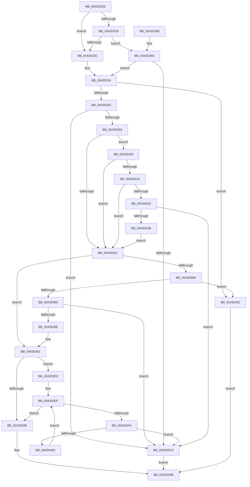

# MiGetFreeOrZeroPageAnyColor

- RVA: `0x004352D8`–`0x00435440` (길이 `360` bytes)
- VA: `0x00000001404352D8`
- 실행 섹션: `.text`
- PDB 이름 있음: `예`; PDB Function 태그: `아니요`
- unwind 정보 RVA: `0x000A2BF0`
- 디코드: `105`개 명령, `360/360` bytes 표시
- 미해석 바이트: `0` (있으면 어셈블리에 `.byte`로 보존)

> 이 문서는 커널 이미지의 기계어와 PDB 기호를 분석해 생성했습니다. 4번과 5번은 함수 원형과 자료형을 바이너리 사용 방식에서 추정한 C 해석이며 원본 소스 복구 결과는 아닙니다.

## 1. Dependencies

- 직접 호출 지점: **6**; 고유 호출 대상: **4**
- 직접 호출자로 확인된 함수: **1**
- RIP 상대 이미지 참조: **0**

### Outgoing calls
- `0x00435342` → [MiRemovePageAnyColor](../28/MiRemovePageAnyColor_function_0028A9D8.md) (function, `0x0028A9D8`)
- `0x0043537B` → [MiRemovePageAnyColor](../28/MiRemovePageAnyColor_function_0028A9D8.md) (function, `0x0028A9D8`)
- `0x004353BC` → [MiGetPageSlist](../28/MiGetPageSlist_function_0028B79C.md) (function, `0x0028B79C`)
- `0x004353E7` → [MiDemoteLocalLargePage](../28/MiDemoteLocalLargePage_function_0028A4F0.md) (function, `0x0028A4F0`)
- `0x004353F7` → [MiObtainedPageIsGood](MiObtainedPageIsGood_function_00435448.md) (function, `0x00435448`)
- `0x0043542E` → [MiGetPageSlist](../28/MiGetPageSlist_function_0028B79C.md) (function, `0x0028B79C`)

### Direct callers
- [MiGetPage](../28/MiGetPage_function_002884C0.md) at `0x002892A1`

### Static image references
- 디코드된 RIP-relative 메모리 참조가 없습니다.

## 2. Other-region calls and transfers

- 다른 실행 섹션으로 향하는 call: **0**
- 별도 외부 분기/꼬리 이동을 확인하지 못했습니다.

## 3. Assembly (complete function range)

```asm
004352D8  48 89 5C 24 08                  mov qword ptr [rsp + 8], rbx
004352DD  48 89 6C 24 10                  mov qword ptr [rsp + 0x10], rbp
004352E2  48 89 74 24 18                  mov qword ptr [rsp + 0x18], rsi
004352E7  57                              push rdi
004352E8  41 54                           push r12
004352EA  41 55                           push r13
004352EC  41 56                           push r14
004352EE  41 57                           push r15
004352F0  48 83 EC 20                     sub rsp, 0x20
004352F4  4C 8B A1 88 3A 00 00            mov r12, qword ptr [rcx + 0x3a88]
004352FB  4C 8B E9                        mov r13, rcx
004352FE  B9 00 00 03 00                  mov ecx, 0x30000
00435303  44 8B FA                        mov r15d, edx
00435306  44 23 F9                        and r15d, ecx
00435309  41 8B F9                        mov edi, r9d
0043530C  41 8B D8                        mov ebx, r8d
0043530F  8B F2                           mov esi, edx
00435311  B8 00 00 0C 00                  mov eax, 0xc0000
00435316  44 3B F9                        cmp r15d, ecx
00435319  75 13                           jne 0x14043532e
0043531B  44 8B F2                        mov r14d, edx
0043531E  44 23 F0                        and r14d, eax
00435321  41 81 FE 00 00 04 00            cmp r14d, 0x40000
00435328  0F 84 8B 00 00 00               je 0x1404353b9
0043532E  44 8B F6                        mov r14d, esi
00435331  44 23 F0                        and r14d, eax
00435334  41 B9 01 00 00 00               mov r9d, 1
0043533A  44 8B C3                        mov r8d, ebx
0043533D  8B D6                           mov edx, esi
0043533F  49 8B CC                        mov rcx, r12
00435342  E8 91 56 E5 FF                  call 0x14028a9d8
00435347  48 8B E8                        mov rbp, rax
0043534A  48 83 F8 02                     cmp rax, 2
0043534E  0F 84 AE 00 00 00               je 0x140435402
00435354  48 85 C0                        test rax, rax
00435357  75 74                           jne 0x1404353cd
00435359  F6 C3 40                        test bl, 0x40
0043535C  0F 85 A7 00 00 00               jne 0x140435409
00435362  B8 00 04 00 00                  mov eax, 0x400
00435367  85 D8                           test eax, ebx
00435369  75 27                           jne 0x140435392
0043536B  0B D8                           or ebx, eax
0043536D  41 B9 01 00 00 00               mov r9d, 1
00435373  44 8B C3                        mov r8d, ebx
00435376  8B D6                           mov edx, esi
00435378  49 8B CC                        mov rcx, r12
0043537B  E8 58 56 E5 FF                  call 0x14028a9d8
00435380  48 8B E8                        mov rbp, rax
00435383  48 83 F8 02                     cmp rax, 2
00435387  74 79                           je 0x140435402
00435389  48 85 C0                        test rax, rax
0043538C  75 3F                           jne 0x1404353cd
0043538E  0F BA F3 0A                     btr ebx, 0xa
00435392  83 7C 24 70 00                  cmp dword ptr [rsp + 0x70], 0
00435397  75 39                           jne 0x1404353d2
00435399  33 C0                           xor eax, eax
0043539B  48 8B 5C 24 50                  mov rbx, qword ptr [rsp + 0x50]
004353A0  48 8B 6C 24 58                  mov rbp, qword ptr [rsp + 0x58]
004353A5  48 8B 74 24 60                  mov rsi, qword ptr [rsp + 0x60]
004353AA  48 83 C4 20                     add rsp, 0x20
004353AE  41 5F                           pop r15
004353B0  41 5E                           pop r14
004353B2  41 5D                           pop r13
004353B4  41 5C                           pop r12
004353B6  5F                              pop rdi
004353B7  C3                              ret
004353B8  CC                              int3
004353B9  49 8B CD                        mov rcx, r13
004353BC  E8 DB 63 E5 FF                  call 0x14028b79c
004353C1  48 8B E8                        mov rbp, rax
004353C4  48 85 C0                        test rax, rax
004353C7  0F 84 67 FF FF FF               je 0x140435334
004353CD  48 8B C5                        mov rax, rbp
004353D0  EB C9                           jmp 0x14043539b
004353D2  C1 E7 12                        shl edi, 0x12
004353D5  33 FE                           xor edi, esi
004353D7  81 E7 00 00 0C 00               and edi, 0xc0000
004353DD  33 FE                           xor edi, esi
004353DF  44 8B C3                        mov r8d, ebx
004353E2  8B D7                           mov edx, edi
004353E4  49 8B CC                        mov rcx, r12
004353E7  E8 04 51 E5 FF                  call 0x14028a4f0
004353EC  48 8B E8                        mov rbp, rax
004353EF  48 85 C0                        test rax, rax
004353F2  74 A5                           je 0x140435399
004353F4  48 8B C8                        mov rcx, rax
004353F7  E8 4C 00 00 00                  call 0x140435448
004353FC  85 C0                           test eax, eax
004353FE  75 CD                           jne 0x1404353cd
00435400  EB DD                           jmp 0x1404353df
00435402  B8 02 00 00 00                  mov eax, 2
00435407  EB 92                           jmp 0x14043539b
00435409  83 E3 BF                        and ebx, 0xffffffbf
0043540C  41 81 FF 00 00 03 00            cmp r15d, 0x30000
00435413  0F 85 49 FF FF FF               jne 0x140435362
00435419  41 81 FE 00 00 04 00            cmp r14d, 0x40000
00435420  0F 85 3C FF FF FF               jne 0x140435362
00435426  44 8B C3                        mov r8d, ebx
00435429  8B D6                           mov edx, esi
0043542B  49 8B CD                        mov rcx, r13
0043542E  E8 69 63 E5 FF                  call 0x14028b79c
00435433  48 8B E8                        mov rbp, rax
00435436  48 85 C0                        test rax, rax
00435439  75 92                           jne 0x1404353cd
0043543B  E9 22 FF FF FF                  jmp 0x140435362
```

## 4. C-style interpretation (structured pseudocode)

```c
__int64 __fastcall MiGetFreeOrZeroPageAnyColor(__int64 a1, int a2, int a3, int a4, unsigned int a5)
{
    __int64 result;
    __int64 v_r14;
    __int64 v_r15;
    __int64 v_rbx;
    __int64 v_rdi;
    __int64 v_rsp;
    unsigned __int64 v_stack_p10;
    unsigned __int64 v_stack_p18;
    unsigned __int64 v_stack_p8;

    v_stack_p8 = v_rbx;
    v_stack_p10 = v_rbp;
    v_stack_p18 = v_rsi;
    v_rsp = (v_rsp) - (32);
    v_r15 = (unsigned int)(((unsigned int)(a2)) & ((unsigned int)((unsigned int)(0x30000ULL))));
    if (((unsigned int)(v_r15)) != ((unsigned int)((unsigned int)(0x30000ULL)))) goto loc_0043532E;
    v_r14 = (unsigned int)(((unsigned int)(a2)) & ((unsigned int)((unsigned int)(0xC0000ULL))));
    if (((unsigned int)(v_r14)) == 0x40000ULL) goto loc_004353B9;
loc_0043532E:
    v_r14 = (unsigned int)(((unsigned int)((unsigned int)((unsigned int)(a2)))) & ((unsigned int)((unsigned int)(0xC0000ULL))));
loc_00435334:
    result = MiRemovePageAnyColor(*(unsigned __int64 *)(a1 + 14984), (unsigned int)((unsigned int)((unsigned int)(a2))), (unsigned int)((unsigned int)((unsigned int)(a3))), 1);
    if (result == 2) goto loc_00435402;
    if (result != 0) goto loc_004353CD;
    if ((((unsigned __int8)((unsigned int)(a3))) & (64)) != 0) goto loc_00435409;
loc_00435362:
    if ((((unsigned int)((unsigned int)(0x400ULL))) & ((unsigned int)((unsigned int)(a3)))) != 0) goto loc_00435392;
    v_rbx = (unsigned int)(((unsigned int)(a3)) | ((unsigned int)((unsigned int)(0x400ULL))));
    result = MiRemovePageAnyColor(*(unsigned __int64 *)(a1 + 14984), (unsigned int)((unsigned int)((unsigned int)(a2))), (unsigned int)((unsigned int)(v_rbx)), 1);
    if (result == 2) goto loc_00435402;
    if (result != 0) goto loc_004353CD;
loc_00435392:
    if (a5 != 0) goto loc_004353D2;
loc_00435399:
    result = 0;
loc_0043539B:
    v_rsp = (v_rsp) + (32);
    return result;
loc_004353B9:
    result = MiGetPageSlist(a1, (unsigned int)((unsigned int)((unsigned int)(a2))), (unsigned int)((unsigned int)(v_rbx)), 1);
    if (result == 0) goto loc_00435334;
loc_004353CD:
    goto loc_0043539B;
loc_004353D2:
    v_rdi = (unsigned int)(((unsigned int)(a4)) << (18));
    v_rdi = (unsigned int)((v_rdi) ^ ((unsigned int)(v_stack_p18)));
    v_rdi = (unsigned int)((v_rdi) & (0xC0000ULL));
    v_rdi = (unsigned int)((v_rdi) ^ ((unsigned int)(v_stack_p18)));
loc_004353DF:
    result = MiDemoteLocalLargePage(*(unsigned __int64 *)(a1 + 14984), (unsigned int)((unsigned int)(v_rdi)), (unsigned int)((unsigned int)(v_stack_p8)), 1);
    if (result == 0) goto loc_00435399;
    result = MiObtainedPageIsGood(result, (unsigned int)((unsigned int)(v_rdi)), (unsigned int)((unsigned int)(v_stack_p8)), 1);
    if ((unsigned int)(result) != 0) goto loc_004353CD;
    goto loc_004353DF;
loc_00435402:
    goto loc_0043539B;
loc_00435409:
    v_rbx = (unsigned int)((v_stack_p8) & (0xFFFFFFBFULL));
    if (((unsigned int)(v_r15)) != 0x30000ULL) goto loc_00435362;
    if (((unsigned int)(v_r14)) != 0x40000ULL) goto loc_00435362;
    result = MiGetPageSlist(a1, (unsigned int)((unsigned int)(v_stack_p18)), (unsigned int)((unsigned int)(v_rbx)), 1);
    if (result != 0) goto loc_004353CD;
    goto loc_00435362;
}
```

## 5. (Beta) C Style

```c
int64_t MiGetFreeOrZeroPageAnyColor(void *Arg1, int32_t Arg2, int32_t Arg3, int32_t Arg4, uint32_t Arg5)
{
    uint8_t *arg1 = (uint8_t *)Arg1;

    int64_t result;
    int64_t local_r14;
    int64_t local_r15;
    int64_t local_rbx;
    int64_t local_rdi;
    int64_t local_rsp;
    uint64_t v_stack_p10;
    uint64_t v_stack_p18;
    uint64_t v_stack_p8;

    v_stack_p8 = local_rbx;
    v_stack_p10 = local_rbp;
    v_stack_p18 = local_rsi;
    local_rsp = (local_rsp) - (32);
    local_r15 = (uint32_t)(((uint32_t)(Arg2)) & ((uint32_t)((uint32_t)(0x30000ULL))));
    if (((uint32_t)(local_r15)) != ((uint32_t)((uint32_t)(0x30000ULL)))) goto loc_0043532E;
    local_r14 = (uint32_t)(((uint32_t)(Arg2)) & ((uint32_t)((uint32_t)(0xC0000ULL))));
    if (((uint32_t)(local_r14)) == 0x40000ULL) goto loc_004353B9;
loc_0043532E:
    local_r14 = (uint32_t)(((uint32_t)((uint32_t)((uint32_t)(Arg2)))) & ((uint32_t)((uint32_t)(0xC0000ULL))));
loc_00435334:
    result = MiRemovePageAnyColor(*(uint64_t *)(arg1 + 0x3A88), (uint32_t)((uint32_t)((uint32_t)(Arg2))), (uint32_t)((uint32_t)((uint32_t)(Arg3))), 1);
    if (result == 2) goto loc_00435402;
    if (result != 0) goto loc_004353CD;
    if ((((uint8_t)((uint32_t)(Arg3))) & (64)) != 0) goto loc_00435409;
loc_00435362:
    if ((((uint32_t)((uint32_t)(0x400ULL))) & ((uint32_t)((uint32_t)(Arg3)))) != 0) goto loc_00435392;
    local_rbx = (uint32_t)(((uint32_t)(Arg3)) | ((uint32_t)((uint32_t)(0x400ULL))));
    result = MiRemovePageAnyColor(*(uint64_t *)(arg1 + 0x3A88), (uint32_t)((uint32_t)((uint32_t)(Arg2))), (uint32_t)((uint32_t)(local_rbx)), 1);
    if (result == 2) goto loc_00435402;
    if (result != 0) goto loc_004353CD;
loc_00435392:
    if (Arg5 != 0) goto loc_004353D2;
loc_00435399:
    result = 0;
loc_0043539B:
    local_rsp = (local_rsp) + (32);
    return result;
loc_004353B9:
    result = MiGetPageSlist(Arg1, (uint32_t)((uint32_t)((uint32_t)(Arg2))), (uint32_t)((uint32_t)(local_rbx)), 1);
    if (result == 0) goto loc_00435334;
loc_004353CD:
    goto loc_0043539B;
loc_004353D2:
    local_rdi = (uint32_t)(((uint32_t)(Arg4)) << (18));
    local_rdi = (uint32_t)((local_rdi) ^ ((uint32_t)(v_stack_p18)));
    local_rdi = (uint32_t)((local_rdi) & (0xC0000ULL));
    local_rdi = (uint32_t)((local_rdi) ^ ((uint32_t)(v_stack_p18)));
loc_004353DF:
    result = MiDemoteLocalLargePage(*(uint64_t *)(arg1 + 0x3A88), (uint32_t)((uint32_t)(local_rdi)), (uint32_t)((uint32_t)(v_stack_p8)), 1);
    if (result == 0) goto loc_00435399;
    result = MiObtainedPageIsGood(result, (uint32_t)((uint32_t)(local_rdi)), (uint32_t)((uint32_t)(v_stack_p8)), 1);
    if ((uint32_t)(result) != 0) goto loc_004353CD;
    goto loc_004353DF;
loc_00435402:
    goto loc_0043539B;
loc_00435409:
    local_rbx = (uint32_t)((v_stack_p8) & (0xFFFFFFBFULL));
    if (((uint32_t)(local_r15)) != 0x30000ULL) goto loc_00435362;
    if (((uint32_t)(local_r14)) != 0x40000ULL) goto loc_00435362;
    result = MiGetPageSlist(Arg1, (uint32_t)((uint32_t)(v_stack_p18)), (uint32_t)((uint32_t)(local_rbx)), 1);
    if (result != 0) goto loc_004353CD;
    goto loc_00435362;
}
```

### 관측된 메모리 오프셋

구조체 형식이 확인되지 않은 접근은 인자 기준의 오프셋으로만 기록했습니다.

| 기준 인자 | 오프셋 표현 | 폭 (bit) | 접근 |
|---|---:|---:|---|
| `Arg1` | `+ 0x3A88` | `64` | `R` |

## 6. Execution-region graph

[열기: 2D/3D 그래프와 함수 탐색 컨트롤 패널](../../../control-panel.html?section=text&rva=0x004352D8&view=graph)

- 2D 그래프는 위에서 아래로 흐르고, 3D 그래프는 빈 공간을 드래그해 회전합니다. Shift+드래그는 이동, 휠은 확대·축소, 함수 노드 선택은 대상 보고서 이동입니다.

### Static fallback


