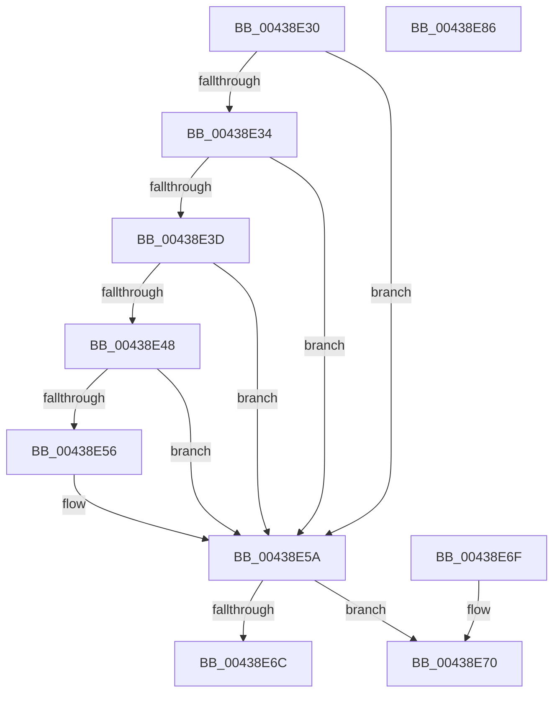

# MiGetLeafPfnBuddy

- RVA: `0x00438E30`–`0x00438E87` (길이 `87` bytes)
- VA: `0x0000000140438E30`
- 실행 섹션: `.text`
- PDB 이름 있음: `예`; PDB Function 태그: `아니요`
- unwind 정보 RVA: `0x000DB714`
- 디코드: `27`개 명령, `87/87` bytes 표시
- 미해석 바이트: `0` (있으면 어셈블리에 `.byte`로 보존)

> 이 문서는 커널 이미지의 기계어와 PDB 기호를 분석해 생성했습니다. 4번과 5번은 함수 원형과 자료형을 바이너리 사용 방식에서 추정한 C 해석이며 원본 소스 복구 결과는 아닙니다.

## 1. Dependencies

- 직접 호출 지점: **0**; 고유 호출 대상: **0**
- 직접 호출자로 확인된 함수: **8**
- RIP 상대 이미지 참조: **0**

### Outgoing calls
- 직접 디코드된 call 명령이 없습니다.

### Direct callers
- [MiFreePhysicalPageChain](../2A/MiFreePhysicalPageChain_function_002A9F1C.md) at `0x002AA023`
- [MiFreePhysicalPageChain](../2A/MiFreePhysicalPageChain_function_002A9F1C.md) at `0x002AA12A`
- [MiLockProtoPoolPage](../2B/MiLockProtoPoolPage_function_002B8B80.md) at `0x002B90DF`
- [sub_0031D54F](../31/Unknown_function_0031D54F.md) at `0x0031D5A0`
- [MiLockOwnedProtoPage](../32/MiLockOwnedProtoPage_function_00322560.md) at `0x00322610`
- [MiGetPfnPidSafe](MiGetPfnPidSafe_function_00438D88.md) at `0x00438DFD`
- [MiDeleteSubsectionLargePages](../4D/MiDeleteSubsectionLargePages_function_004D51E0.md) at `0x004D5250`
- [sub_006DCA72](../6D/Unknown_function_006DCA72.md) at `0x006DCAAB`
- [sub_006E146C](../6E/Unknown_function_006E146C.md) at `0x006E148A`

### Static image references
- 디코드된 RIP-relative 메모리 참조가 없습니다.

## 2. Other-region calls and transfers

- 다른 실행 섹션으로 향하는 call: **0**
- 별도 외부 분기/꼬리 이동을 확인하지 못했습니다.

## 3. Assembly (complete function range)

```asm
00438E30  85 D2                           test edx, edx
00438E32  74 26                           je 0x140438e5a
00438E34  48 8B 41 28                     mov rax, qword ptr [rcx + 0x28]
00438E38  48 85 C0                        test rax, rax
00438E3B  78 1D                           js 0x140438e5a
00438E3D  48 8B 41 28                     mov rax, qword ptr [rcx + 0x28]
00438E41  48 0F BA E0 28                  bt rax, 0x28
00438E46  72 12                           jb 0x140438e5a
00438E48  48 8B 41 28                     mov rax, qword ptr [rcx + 0x28]
00438E4C  48 C1 E8 3C                     shr rax, 0x3c
00438E50  24 07                           and al, 7
00438E52  3C 01                           cmp al, 1
00438E54  74 04                           je 0x140438e5a
00438E56  48 8B 41 08                     mov rax, qword ptr [rcx + 8]
00438E5A  48 8B 01                        mov rax, qword ptr [rcx]
00438E5D  48 B9 FE FF FF FF FF 0F 00 00   movabs rcx, 0xffffffffffe
00438E67  48 85 C1                        test rcx, rax
00438E6A  75 04                           jne 0x140438e70
00438E6C  33 C0                           xor eax, eax
00438E6E  C3                              ret
00438E6F  CC                              int3
00438E70  48 83 E0 FE                     and rax, 0xfffffffffffffffe
00438E74  48 B9 00 00 00 00 00 F0 FF FF   movabs rcx, 0xfffff00000000000
00438E7E  48 0B C1                        or rax, rcx
00438E81  48 C1 E0 03                     shl rax, 3
00438E85  C3                              ret
00438E86  CC                              int3
```

## 4. C-style interpretation (structured pseudocode)

```c
__int64 __fastcall MiGetLeafPfnBuddy(__int64 a1, int a2)
{
    __int64 result;

    if (a2 == 0) goto loc_00438E5A;
    if (sign_flag) goto loc_00438E5A;
    if (condition_is_below) goto loc_00438E5A;
    result = (*(unsigned __int64 *)(a1 + 40)) >> (60);
    result = (unsigned __int8)((result) & (7));
    if (((unsigned __int8)(result)) != 1) {
        result = *(unsigned __int64 *)(a1 + 8);
    }
    if (((a1) & (*(unsigned __int64 *)(a1))) != 0) goto loc_00438E70;
    result = 0;
    return result;
loc_00438E70:
    result = (result) & (-2);
    result = (result) | (a1);
    result = (result) << (3);
    return result;
}
```

## 5. (Beta) C Style

```c
int64_t MiGetLeafPfnBuddy(void *Arg1, int32_t Arg2)
{
    uint8_t *arg1 = (uint8_t *)Arg1;

    int64_t result;

    if (Arg2 == 0) goto loc_00438E5A;
    if (sign_flag) goto loc_00438E5A;
    if (condition_is_below) goto loc_00438E5A;
    result = (*(uint64_t *)(arg1 + 0x28)) >> (60);
    result = (uint8_t)((result) & (7));
    if (((uint8_t)(result)) != 1) {
        result = *(uint64_t *)(arg1 + 0x8);
    }
    if (((Arg1) & (*(uint64_t *)(arg1))) != 0) goto loc_00438E70;
    result = 0;
    return result;
loc_00438E70:
    result = (result) & (-2);
    result = (result) | (Arg1);
    result = (result) << (3);
    return result;
}
```

### 관측된 메모리 오프셋

구조체 형식이 확인되지 않은 접근은 인자 기준의 오프셋으로만 기록했습니다.

| 기준 인자 | 오프셋 표현 | 폭 (bit) | 접근 |
|---|---:|---:|---|
| `Arg1` | `+ 0x0` | `64` | `R` |
| `Arg1` | `+ 0x8` | `64` | `R` |
| `Arg1` | `+ 0x28` | `64` | `R` |

## 6. Execution-region graph

[열기: 2D/3D 그래프와 함수 탐색 컨트롤 패널](../../../control-panel.html?section=text&rva=0x00438E30&view=graph)

- 2D 그래프는 위에서 아래로 흐르고, 3D 그래프는 빈 공간을 드래그해 회전합니다. Shift+드래그는 이동, 휠은 확대·축소, 함수 노드 선택은 대상 보고서 이동입니다.

### Static fallback


