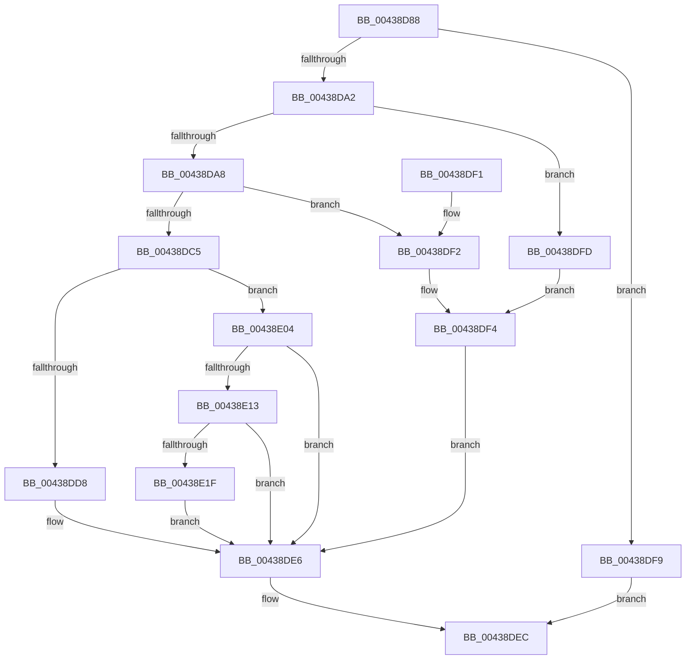

# MiGetPfnPidSafe

- RVA: `0x00438D88`–`0x00438E24` (길이 `156` bytes)
- VA: `0x0000000140438D88`
- 실행 섹션: `.text`
- PDB 이름 있음: `예`; PDB Function 태그: `아니요`
- unwind 정보 RVA: `0x000A35EC`
- 디코드: `44`개 명령, `156/156` bytes 표시
- 미해석 바이트: `0` (있으면 어셈블리에 `.byte`로 보존)

> 이 문서는 커널 이미지의 기계어와 PDB 기호를 분석해 생성했습니다. 4번과 5번은 함수 원형과 자료형을 바이너리 사용 방식에서 추정한 C 해석이며 원본 소스 복구 결과는 아닙니다.

## 1. Dependencies

- 직접 호출 지점: **1**; 고유 호출 대상: **1**
- 직접 호출자로 확인된 함수: **3**
- RIP 상대 이미지 참조: **2**

### Outgoing calls
- `0x00438DFD` → [MiGetLeafPfnBuddy](MiGetLeafPfnBuddy_function_00438E30.md) (function, `0x00438E30`)

### Direct callers
- [sub_0031CD16](../31/Unknown_function_0031CD16.md) at `0x0031CF3D`
- [MiLogMdlRangeEvent](../67/MiLogMdlRangeEvent_function_006775E4.md) at `0x00677679`
- [sub_006E1546](../6E/Unknown_function_006E1546.md) at `0x006E155D`
- [sub_006E1546](../6E/Unknown_function_006E1546.md) at `0x006E15EC`
- [sub_006E1546](../6E/Unknown_function_006E1546.md) at `0x006E1634`

### Static image references
- `0x00438DDF` → RVA `0x00E38BB8` (`.data`; read)
- `0x00438E13` → RVA `0x00FC6AB0` (`ALMOSTRO`; read)

## 2. Other-region calls and transfers

- 다른 실행 섹션으로 향하는 call: **0**
- 별도 외부 분기/꼬리 이동을 확인하지 못했습니다.

## 3. Assembly (complete function range)

```asm
00438D88  48 83 EC 28                     sub rsp, 0x28
00438D8C  48 8B 41 18                     mov rax, qword ptr [rcx + 0x18]
00438D90  44 8B CA                        mov r9d, edx
00438D93  D1 EA                           shr edx, 1
00438D95  4C 8B C1                        mov r8, rcx
00438D98  83 E2 01                        and edx, 1
00438D9B  48 0F BA E0 3E                  bt rax, 0x3e
00438DA0  72 57                           jb 0x140438df9
00438DA2  41 F6 C1 01                     test r9b, 1
00438DA6  75 55                           jne 0x140438dfd
00438DA8  48 8B 09                        mov rcx, qword ptr [rcx]
00438DAB  41 8B 50 24                     mov edx, dword ptr [r8 + 0x24]
00438DAF  81 E2 00 00 FF 03               and edx, 0x3ff0000
00438DB5  48 D1 E9                        shr rcx, 1
00438DB8  48 C1 E2 0F                     shl rdx, 0xf
00438DBC  0F BA F1 1F                     btr ecx, 0x1f
00438DC0  48 0B D1                        or rdx, rcx
00438DC3  74 2D                           je 0x140438df2
00438DC5  48 B8 00 00 00 00 00 FF FF FF   movabs rax, 0xffffff0000000000
00438DCF  48 03 C2                        add rax, rdx
00438DD2  48 83 F8 01                     cmp rax, 1
00438DD6  76 2C                           jbe 0x140438e04
00438DD8  48 FF CA                        dec rdx
00438DDB  48 C1 E2 04                     shl rdx, 4
00438DDF  48 03 15 D2 FD 9F 00            add rdx, qword ptr [rip + 0x9ffdd2]
00438DE6  8B 82 D0 01 00 00               mov eax, dword ptr [rdx + 0x1d0]
00438DEC  48 83 C4 28                     add rsp, 0x28
00438DF0  C3                              ret
00438DF1  CC                              int3
00438DF2  33 C0                           xor eax, eax
00438DF4  48 8B D0                        mov rdx, rax
00438DF7  EB ED                           jmp 0x140438de6
00438DF9  33 C0                           xor eax, eax
00438DFB  EB EF                           jmp 0x140438dec
00438DFD  E8 2E 00 00 00                  call 0x140438e30
00438E02  EB F0                           jmp 0x140438df4
00438E04  48 B8 01 00 00 00 00 01 00 00   movabs rax, 0x10000000001
00438E0E  48 3B D0                        cmp rdx, rax
00438E11  75 D3                           jne 0x140438de6
00438E13  48 8B 0D 96 DC B8 00            mov rcx, qword ptr [rip + 0xb8dc96]
00438E1A  48 85 C9                        test rcx, rcx
00438E1D  74 C7                           je 0x140438de6
00438E1F  48 8B D1                        mov rdx, rcx
00438E22  EB C2                           jmp 0x140438de6
```

## 4. C-style interpretation (structured pseudocode)

```c
__int64 __fastcall MiGetPfnPidSafe(__int64 a1, int a2)
{
    __int64 result;
    __int64 v_rsp;

    v_rsp = (v_rsp) - (40);
    a2 = (unsigned int)((a2) >> (1));
    a2 = (unsigned int)((a2) & (1));
    if (condition_is_below) goto loc_00438DF9;
    if ((((unsigned __int8)((unsigned int)(a2))) & (1)) != 0) goto loc_00438DFD;
    a2 = (unsigned int)(((unsigned int)(*(unsigned int *)(a1 + 36))) & (0x3FF0000ULL));
    a1 = (*(unsigned __int64 *)(a1)) >> (1);
    a2 = (a2) << (15);
    a2 = (a2) | (a1);
    if (condition_is_equal) goto loc_00438DF2;
    result = (*(unsigned __int64 *)(a1 + 24)) + (a2);
    if (result <= 1) goto loc_00438E04;
    a2 = (a2) - 1;
    a2 = (a2) << (4);
    a2 = (a2) + (*(unsigned __int64 *)(v_rip + 10485202));
loc_00438DE6:
loc_00438DEC:
    v_rsp = (v_rsp) + (40);
    return (unsigned int)(*(unsigned int *)(a2 + 464));
loc_00438DF2:
    result = 0;
loc_00438DF4:
    goto loc_00438DE6;
loc_00438DF9:
    result = 0;
    goto loc_00438DEC;
loc_00438DFD:
    result = MiGetLeafPfnBuddy(a1, 0, a1, (unsigned int)(a2));
    goto loc_00438DF4;
loc_00438E04:
    if (0 != result) goto loc_00438DE6;
    if (*(unsigned __int64 *)(v_rip + 12115094) == 0) goto loc_00438DE6;
    goto loc_00438DE6;
}
```

## 5. (Beta) C Style

```c
int64_t MiGetPfnPidSafe(void *Arg1, int32_t Arg2)
{
    uint8_t *arg1 = (uint8_t *)Arg1;

    int64_t result;
    int64_t local_rsp;

    local_rsp = (local_rsp) - (40);
    Arg2 = (uint32_t)((Arg2) >> (1));
    Arg2 = (uint32_t)((Arg2) & (1));
    if (condition_is_below) goto loc_00438DF9;
    if ((((uint8_t)((uint32_t)(Arg2))) & (1)) != 0) goto loc_00438DFD;
    Arg2 = (uint32_t)(((uint32_t)(*(uint32_t *)(arg1 + 0x24))) & (0x3FF0000ULL));
    Arg1 = (*(uint64_t *)(arg1)) >> (1);
    Arg2 = (Arg2) << (15);
    Arg2 = (Arg2) | (Arg1);
    if (condition_is_equal) goto loc_00438DF2;
    result = (*(uint64_t *)(arg1 + 0x18)) + (Arg2);
    if (result <= 1) goto loc_00438E04;
    Arg2 = (Arg2) - 1;
    Arg2 = (Arg2) << (4);
    Arg2 = (Arg2) + (*(uint64_t *)(v_rip + 0x9FFDD2));
loc_00438DE6:
loc_00438DEC:
    local_rsp = (local_rsp) + (40);
    return (uint32_t)(*(uint32_t *)(Arg2 + 0x1D0));
loc_00438DF2:
    result = 0;
loc_00438DF4:
    goto loc_00438DE6;
loc_00438DF9:
    result = 0;
    goto loc_00438DEC;
loc_00438DFD:
    result = MiGetLeafPfnBuddy(Arg1, 0, Arg1, (uint32_t)(Arg2));
    goto loc_00438DF4;
loc_00438E04:
    if (0 != result) goto loc_00438DE6;
    if (*(uint64_t *)(v_rip + 0xB8DC96) == 0) goto loc_00438DE6;
    goto loc_00438DE6;
}
```

### 관측된 메모리 오프셋

구조체 형식이 확인되지 않은 접근은 인자 기준의 오프셋으로만 기록했습니다.

| 기준 인자 | 오프셋 표현 | 폭 (bit) | 접근 |
|---|---:|---:|---|
| `Arg1` | `+ 0x0` | `64` | `R` |
| `Arg1` | `+ 0x18` | `64` | `R` |
| `Arg1` | `+ 0x24` | `32` | `R` |

## 6. Execution-region graph

[열기: 2D/3D 그래프와 함수 탐색 컨트롤 패널](../../../control-panel.html?section=text&rva=0x00438D88&view=graph)

- 2D 그래프는 위에서 아래로 흐르고, 3D 그래프는 빈 공간을 드래그해 회전합니다. Shift+드래그는 이동, 휠은 확대·축소, 함수 노드 선택은 대상 보고서 이동입니다.

### Static fallback


