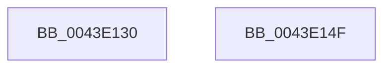

# MiGetPteAddress

- RVA: `0x0043E130`–`0x0043E150` (길이 `32` bytes)
- VA: `0x000000014043E130`
- 실행 섹션: `.text`
- PDB 이름 있음: `예`; PDB Function 태그: `아니요`
- unwind 정보 RVA: `0x000DB714`
- 디코드: `7`개 명령, `32/32` bytes 표시
- 미해석 바이트: `0` (있으면 어셈블리에 `.byte`로 보존)

> 이 문서는 커널 이미지의 기계어와 PDB 기호를 분석해 생성했습니다. 4번과 5번은 함수 원형과 자료형을 바이너리 사용 방식에서 추정한 C 해석이며 원본 소스 복구 결과는 아닙니다.

## 1. Dependencies

- 직접 호출 지점: **0**; 고유 호출 대상: **0**
- 직접 호출자로 확인된 함수: **69**
- RIP 상대 이미지 참조: **0**

### Outgoing calls
- 직접 디코드된 call 명령이 없습니다.

### Direct callers
- [MmFreeBootRegistry](../../page/7F/MmFreeBootRegistry_function_007F7C50.md) at `0x007F7CC5`
- [MiFreeInitializationCode](../../page/7F/MiFreeInitializationCode_function_007F88A0.md) at `0x007F891A`
- [MiProtectLargeKernelHalRange](../../page/7F/MiProtectLargeKernelHalRange_function_007F8D20.md) at `0x007F8DC8`
- [MmUnmapLockedRestartPages](../../page/7F/MmUnmapLockedRestartPages_function_007F90E0.md) at `0x007F913B`
- [MiMapNewPfns](../../page/7F/MiMapNewPfns_function_007FA63C.md) at `0x007FA685`
- [MiMapNewPfns](../../page/7F/MiMapNewPfns_function_007FA63C.md) at `0x007FA6A2`
- [MmAllocateNonCachedMemory](../../page/7F/MmAllocateNonCachedMemory_function_007FBB60.md) at `0x007FBCCC`
- [MmFreeSystemCacheReserveView](../../page/7F/MmFreeSystemCacheReserveView_function_007FE2D8.md) at `0x007FE2DF`
- [MmMarkHiberRange](../../page/7F/MmMarkHiberRange_function_007FE3D0.md) at `0x007FE3DA`
- [MmMarkHiberRange](../../page/7F/MmMarkHiberRange_function_007FE3D0.md) at `0x007FE3E6`
- [MmReleaseDumpHibernateResources](../../page/7F/MmReleaseDumpHibernateResources_function_007FE418.md) at `0x007FE434`
- [MiUnlockEntireDriver](../../page/80/MiUnlockEntireDriver_function_00801780.md) at `0x008017B4`
- [MiApplyHotPatchToLoadedDriver](../../page/80/MiApplyHotPatchToLoadedDriver_function_00802078.md) at `0x008020D8`
- [MiIdentifyImageDiscardablePages](../../page/80/MiIdentifyImageDiscardablePages_function_00803DB4.md) at `0x00803E33`
- [MiInitializeShadowPageTable](../../page/80/MiInitializeShadowPageTable_function_0080778C.md) at `0x00807816`
- [MiInitializeShadowPageTable](../../page/80/MiInitializeShadowPageTable_function_0080778C.md) at `0x008078AD`
- [MmCreateShadowMapping](../../page/80/MmCreateShadowMapping_function_00807AB0.md) at `0x00807BBB`
- [MmCreateShadowMapping](../../page/80/MmCreateShadowMapping_function_00807AB0.md) at `0x00807BC6`
- [MmDeleteShadowMapping](../../page/80/MmDeleteShadowMapping_function_00807D00.md) at `0x00807D56`
- [MmDeleteShadowMapping](../../page/80/MmDeleteShadowMapping_function_00807D00.md) at `0x00807D65`
- [MmAllocateIsrStack](../../page/80/MmAllocateIsrStack_function_00807ECC.md) at `0x00807FA8`
- [MmFreeIsrStack](../../page/80/MmFreeIsrStack_function_00807FC0.md) at `0x00807FEF`
- [MiCreateHardwareEnclave](../../page/80/MiCreateHardwareEnclave_function_00808500.md) at `0x008087B4`
- [NtMapUserPhysicalPages](../../page/80/NtMapUserPhysicalPages_function_0080B460.md) at `0x0080B614`
- [NtMapUserPhysicalPages](../../page/80/NtMapUserPhysicalPages_function_0080B460.md) at `0x0080B621`
- [MiDeleteSparseRange](../../page/80/MiDeleteSparseRange_function_0080C1D0.md) at `0x0080C1F1`
- [MiExpandPartitionIds](../../page/80/MiExpandPartitionIds_function_0080D258.md) at `0x0080D33C`
- [MiDecommitRegion](../../page/88/MiDecommitRegion_function_008807A0.md) at `0x008807F0`
- [MiDecommitRegion](../../page/88/MiDecommitRegion_function_008807A0.md) at `0x008807FB`
- [MiDecommitEnclavePages](../../page/88/MiDecommitEnclavePages_function_00880C28.md) at `0x00880C5C`
- [MmCommitSessionMappedView](../../page/8C/MmCommitSessionMappedView_function_008CEA60.md) at `0x008CEAA2`
- [MmCommitSessionMappedView](../../page/8C/MmCommitSessionMappedView_function_008CEA60.md) at `0x008CEAAD`
- [MiPfPrepareReadList](../../page/93/MiPfPrepareReadList_function_0093CD5C.md) at `0x0093D13E`
- [MiPfPrepareReadList](../../page/93/MiPfPrepareReadList_function_0093CD5C.md) at `0x0093D149`
- [MiPfPrepareSequentialReadList](../../page/93/MiPfPrepareSequentialReadList_function_0093D8E8.md) at `0x0093DDCE`
- [MiPfPrepareSequentialReadList](../../page/93/MiPfPrepareSequentialReadList_function_0093D8E8.md) at `0x0093DDD9`
- [MiValidateImagePfn](../../page/93/MiValidateImagePfn_function_0093EA08.md) at `0x0093ECC0`
- [MiRelocateImagePfn](../../page/93/MiRelocateImagePfn_function_0093F2A8.md) at `0x0093F598`
- [MiResidentPagesForSpan](../../page/9B/MiResidentPagesForSpan_function_009BB300.md) at `0x009BB319`
- [MiResidentPagesForSpan](../../page/9B/MiResidentPagesForSpan_function_009BB300.md) at `0x009BB324`
- [sub_009BB338](../../page/9B/Unknown_function_009BB338.md) at `0x009BB385`
- [sub_009BB338](../../page/9B/Unknown_function_009BB338.md) at `0x009BB390`
- [MiCopyPagesIntoEnclave](../../page/A4/MiCopyPagesIntoEnclave_function_00A472AC.md) at `0x00A4745F`
- [MiLockImageSection](../../page/A4/MiLockImageSection_function_00A48D78.md) at `0x00A48DCE`
- [MmResetDriverPaging](../../page/A4/MmResetDriverPaging_function_00A4ADB0.md) at `0x00A4AE7D`
- [MmResetDriverPaging](../../page/A4/MmResetDriverPaging_function_00A4ADB0.md) at `0x00A4AE89`
- [MiHandleDriverNonPagedSections](../../page/A4/MiHandleDriverNonPagedSections_function_00A4AEA8.md) at `0x00A4AF7D`
- [MiSnapDriverRange](../../page/A4/MiSnapDriverRange_function_00A4B328.md) at `0x00A4B556`
- [MiSnapDriverRange](../../page/A4/MiSnapDriverRange_function_00A4B328.md) at `0x00A4B579`
- [MiSnapDriverRange](../../page/A4/MiSnapDriverRange_function_00A4B328.md) at `0x00A4B5E5`
- [MiAllocateKernelCfgBitmapPageTables](../../page/A4/MiAllocateKernelCfgBitmapPageTables_function_00A4B80C.md) at `0x00A4B84D`
- [MiAllocateKernelCfgBitmapPageTables](../../page/A4/MiAllocateKernelCfgBitmapPageTables_function_00A4B80C.md) at `0x00A4B86B`
- [MmPageEntireDriver](../../page/A4/MmPageEntireDriver_function_00A4BBB0.md) at `0x00A4BC00`
- [MiAllocateProcessShadow](../../page/A5/MiAllocateProcessShadow_function_00A5F1A0.md) at `0x00A5F2BA`
- [MmStoreAllocateVirtualMemory](../../page/A6/MmStoreAllocateVirtualMemory_function_00A68238.md) at `0x00A68357`
- [MmStoreAllocateVirtualMemory](../../page/A6/MmStoreAllocateVirtualMemory_function_00A68238.md) at `0x00A68362`
- [MiGetSystemAddressForImage](../../page/A7/MiGetSystemAddressForImage_function_00A74EEC.md) at `0x00A74FDE`
- [MiGetSystemAddressForImage](../../page/A7/MiGetSystemAddressForImage_function_00A74EEC.md) at `0x00A75046`
- [MiReserveDriverPtes](../../page/A7/MiReserveDriverPtes_function_00A75150.md) at `0x00A7525F`
- [MiReserveDriverPtes](../../page/A7/MiReserveDriverPtes_function_00A75150.md) at `0x00A75321`
- [MiReserveDriverPtes](../../page/A7/MiReserveDriverPtes_function_00A75150.md) at `0x00A7532D`
- [MiReserveDriverPtes](../../page/A7/MiReserveDriverPtes_function_00A75150.md) at `0x00A75342`
- [MmFreeMappingAddress](../../page/A7/MmFreeMappingAddress_function_00A75F20.md) at `0x00A75F56`
- [MmFreeMappingAddress](../../page/A7/MmFreeMappingAddress_function_00A75F20.md) at `0x00A75FCE`
- [MiUnmapLockedPagesInUserSpace](../../page/A7/MiUnmapLockedPagesInUserSpace_function_00A78E54.md) at `0x00A78E79`
- [MiUpdateForkMaps](../../page/A7/MiUpdateForkMaps_function_00A7DAF8.md) at `0x00A7DBF3`
- [MiUpdateForkMaps](../../page/A7/MiUpdateForkMaps_function_00A7DAF8.md) at `0x00A7DC17`
- [MiUpdateForkMaps](../../page/A7/MiUpdateForkMaps_function_00A7DAF8.md) at `0x00A7DD5B`
- [MiUpdateForkMaps](../../page/A7/MiUpdateForkMaps_function_00A7DAF8.md) at `0x00A7DDC7`
- [MiReturnSystemImageAddress](../../page/A7/MiReturnSystemImageAddress_function_00A7F190.md) at `0x00A7F19A`
- [MiReleaseDriverPtes](../../page/A7/MiReleaseDriverPtes_function_00A7F1B4.md) at `0x00A7F385`
- [MiUnlockDriverCode](../../page/A9/MiUnlockDriverCode_function_00A9FFEC.md) at `0x00AA0027`
- [MmAllocateIndependentPagesEx](../../page/AA/MmAllocateIndependentPagesEx_function_00AA0CFC.md) at `0x00AA0F46`
- [MiUnloadSystemImage](../../page/AA/MiUnloadSystemImage_function_00AA2FD4.md) at `0x00AA30B3`
- [MiMapSystemImage](../../page/AA/MiMapSystemImage_function_00AA3558.md) at `0x00AA35AF`
- [MmUnmapProtectedKernelPageRange](../../page/AA/MmUnmapProtectedKernelPageRange_function_00AA36DC.md) at `0x00AA371B`
- [MiProtectSystemImage](../../page/AA/MiProtectSystemImage_function_00AA7D74.md) at `0x00AA7EB4`
- [MiProtectSystemImage](../../page/AA/MiProtectSystemImage_function_00AA7D74.md) at `0x00AA7EF7`
- [MiProtectSystemImage](../../page/AA/MiProtectSystemImage_function_00AA7D74.md) at `0x00AA7F19`
- [MiProtectSystemImage](../../page/AA/MiProtectSystemImage_function_00AA7D74.md) at `0x00AA7FD6`
- [MmFreeNonCachedMemory](../../page/AB/MmFreeNonCachedMemory_function_00AB4640.md) at `0x00AB4649`
- [MmMapProtectedKernelPage](../../page/AB/MmMapProtectedKernelPage_function_00AB6690.md) at `0x00AB669A`
- [MmMapProtectedKernelPage](../../page/AB/MmMapProtectedKernelPage_function_00AB6690.md) at `0x00AB66CD`
- [MiInitializeImageSectionLocks](../../page/AB/MiInitializeImageSectionLocks_function_00AB8EDC.md) at `0x00AB8F43`
- [MiInitializeImageSectionLocks](../../page/AB/MiInitializeImageSectionLocks_function_00AB8EDC.md) at `0x00AB8F72`
- [MiInitializeImageSectionLocks](../../page/AB/MiInitializeImageSectionLocks_function_00AB8EDC.md) at `0x00AB8FA5`
- [MmUnlockPreChargedPagedPool](../../page/AC/MmUnlockPreChargedPagedPool_function_00AC5940.md) at `0x00AC5947`
- [MiFreeForkMaps](../../page/AC/MiFreeForkMaps_function_00AC8534.md) at `0x00AC854F`
- [MiFreeForkMaps](../../page/AC/MiFreeForkMaps_function_00AC8534.md) at `0x00AC8576`
- [MiReleaseHotPatchResources](../../page/AC/MiReleaseHotPatchResources_function_00ACCD60.md) at `0x00ACCD95`
- [MmReturnChargesToLockPagedPool](../../page/AD/MmReturnChargesToLockPagedPool_function_00AD3A00.md) at `0x00AD3A39`
- [MmLockPreChargedPagedPool](../../page/AD/MmLockPreChargedPagedPool_function_00AD6E20.md) at `0x00AD6E27`
- [MiReserveExistingDriverPtes](../../page/AF/MiReserveExistingDriverPtes_function_00AF84DC.md) at `0x00AF85AB`
- [MiReserveExistingDriverPtes](../../page/AF/MiReserveExistingDriverPtes_function_00AF84DC.md) at `0x00AF85B6`
- [MiReserveExistingDriverPtes](../../page/AF/MiReserveExistingDriverPtes_function_00AF84DC.md) at `0x00AF85C9`
- [sub_00B3B822](../../page/B3/Unknown_function_00B3B822.md) at `0x00B3B826`
- [sub_00B41C12](../../page/B4/Unknown_function_00B41C12.md) at `0x00B41C15`
- [sub_00B42A1A](../../page/B4/Unknown_function_00B42A1A.md) at `0x00B42A1D`
- [sub_00B42A1A](../../page/B4/Unknown_function_00B42A1A.md) at `0x00B42A6D`
- [sub_00B42A1A](../../page/B4/Unknown_function_00B42A1A.md) at `0x00B42AA4`
- [MmInvalidateDumpAddresses](../../pagelk/B7/MmInvalidateDumpAddresses_function_00B74970.md) at `0x00B7497E`
- [MiReleaseEnclaveMetadataPage](../../pagelk/B7/MiReleaseEnclaveMetadataPage_function_00B74EE4.md) at `0x00B74EFD`
- [MiTerminateHardwareEnclave](../../pagelk/B7/MiTerminateHardwareEnclave_function_00B75030.md) at `0x00B75055`
- [MiTerminateHardwareEnclave](../../pagelk/B7/MiTerminateHardwareEnclave_function_00B75030.md) at `0x00B7506F`
- [MiConvertHiberPhasePte](../../pagelk/B7/MiConvertHiberPhasePte_function_00B79520.md) at `0x00B795B1`
- [sub_00B80820](../../pagelk/B8/Unknown_function_00B80820.md) at `0x00B80842`

### Static image references
- 디코드된 RIP-relative 메모리 참조가 없습니다.

## 2. Other-region calls and transfers

- 다른 실행 섹션으로 향하는 call: **0**
- 별도 외부 분기/꼬리 이동을 확인하지 못했습니다.

## 3. Assembly (complete function range)

```asm
0043E130  48 C1 E9 09                     shr rcx, 9
0043E134  48 B8 F8 FF FF FF 7F 00 00 00   movabs rax, 0x7ffffffff8
0043E13E  48 23 C8                        and rcx, rax
0043E141  48 B8 00 00 00 00 80 F6 FF FF   movabs rax, 0xfffff68000000000
0043E14B  48 03 C1                        add rax, rcx
0043E14E  C3                              ret
0043E14F  CC                              int3
```

## 4. C-style interpretation (structured pseudocode)

```c
__int64 __fastcall MiGetPteAddress(__int64 a1)
{
    __int64 result;

    a1 = (a1) >> (9);
    a1 = (a1) & (result);
    result = (result) + (a1);
    return result;
}
```

## 5. (Beta) C Style

```c
int64_t MiGetPteAddress(int64_t Arg1)
{
    int64_t result;

    Arg1 = (Arg1) >> (9);
    Arg1 = (Arg1) & (result);
    result = (result) + (Arg1);
    return result;
}
```

## 6. Execution-region graph

[열기: 2D/3D 그래프와 함수 탐색 컨트롤 패널](../../../control-panel.html?section=text&rva=0x0043E130&view=graph)

- 2D 그래프는 위에서 아래로 흐르고, 3D 그래프는 빈 공간을 드래그해 회전합니다. Shift+드래그는 이동, 휠은 확대·축소, 함수 노드 선택은 대상 보고서 이동입니다.

### Static fallback


