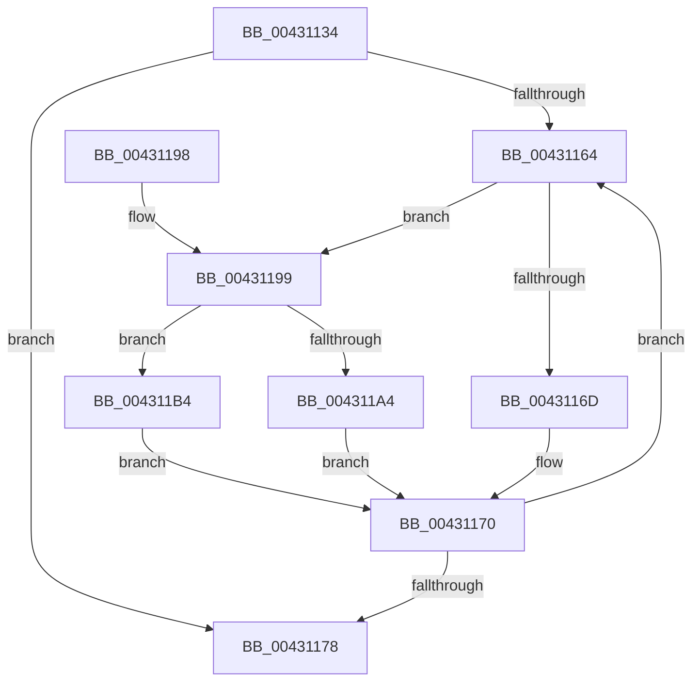

# MiGetVadWakeList

- RVA: `0x00431134`–`0x004311B9` (길이 `133` bytes)
- VA: `0x0000000140431134`
- 실행 섹션: `.text`
- PDB 이름 있음: `예`; PDB Function 태그: `아니요`
- unwind 정보 RVA: `0x0007836C`
- 디코드: `43`개 명령, `133/133` bytes 표시
- 미해석 바이트: `0` (있으면 어셈블리에 `.byte`로 보존)

> 이 문서는 커널 이미지의 기계어와 PDB 기호를 분석해 생성했습니다. 4번과 5번은 함수 원형과 자료형을 바이너리 사용 방식에서 추정한 C 해석이며 원본 소스 복구 결과는 아닙니다.

## 1. Dependencies

- 직접 호출 지점: **2**; 고유 호출 대상: **2**
- 직접 호출자로 확인된 함수: **7**
- RIP 상대 이미지 참조: **0**

### Outgoing calls
- `0x00431153` → [MiLockVadCore](../29/MiLockVadCore_function_00297170.md) (function, `0x00297170`)
- `0x0043117B` → [MiUnlockVadCore](MiUnlockVadCore_function_004311C0.md) (function, `0x004311C0`)

### Direct callers
- [MiFinishVadDeletion](MiFinishVadDeletion_function_00430ED0.md) at `0x00430FFC`
- [MiFreeRotateView](../../page/7F/MiFreeRotateView_function_007FE6CC.md) at `0x007FE6D7`
- [MiDeletePartialCloneVads](../../page/81/MiDeletePartialCloneVads_function_008116E4.md) at `0x00811734`
- [sub_009BB0AF](../../page/9B/Unknown_function_009BB0AF.md) at `0x009BB0DE`
- [MiFreePlaceholderStorage](../../page/AA/MiFreePlaceholderStorage_function_00AAC868.md) at `0x00AAC873`
- [MiDeleteVadHotPatchState](../../page/AC/MiDeleteVadHotPatchState_function_00ACA608.md) at `0x00ACA632`
- [MiFreeVadEventBitmap](../../page/AD/MiFreeVadEventBitmap_function_00ADB6B8.md) at `0x00ADB6CE`

### Static image references
- 디코드된 RIP-relative 메모리 참조가 없습니다.

## 2. Other-region calls and transfers

- 다른 실행 섹션으로 향하는 call: **0**
- 별도 외부 분기/꼬리 이동을 확인하지 못했습니다.

## 3. Assembly (complete function range)

```asm
00431134  48 89 5C 24 08                  mov qword ptr [rsp + 8], rbx
00431139  48 89 6C 24 10                  mov qword ptr [rsp + 0x10], rbp
0043113E  48 89 74 24 18                  mov qword ptr [rsp + 0x18], rsi
00431143  57                              push rdi
00431144  48 83 EC 20                     sub rsp, 0x20
00431148  8B EA                           mov ebp, edx
0043114A  48 8B D9                        mov rbx, rcx
0043114D  33 D2                           xor edx, edx
0043114F  33 F6                           xor esi, esi
00431151  33 FF                           xor edi, edi
00431153  E8 18 60 E6 FF                  call 0x140297170
00431158  4C 8B 43 38                     mov r8, qword ptr [rbx + 0x38]
0043115C  8A D0                           mov dl, al
0043115E  49 83 E0 F0                     and r8, 0xfffffffffffffff0
00431162  74 14                           je 0x140431178
00431164  49 8B 08                        mov rcx, qword ptr [r8]
00431167  41 85 68 50                     test dword ptr [r8 + 0x50], ebp
0043116B  75 2C                           jne 0x140431199
0043116D  49 8B F8                        mov rdi, r8
00431170  4C 8B C1                        mov r8, rcx
00431173  48 85 C9                        test rcx, rcx
00431176  75 EC                           jne 0x140431164
00431178  48 8B CB                        mov rcx, rbx
0043117B  E8 40 00 00 00                  call 0x1404311c0
00431180  48 8B 5C 24 30                  mov rbx, qword ptr [rsp + 0x30]
00431185  48 8B C6                        mov rax, rsi
00431188  48 8B 74 24 40                  mov rsi, qword ptr [rsp + 0x40]
0043118D  48 8B 6C 24 38                  mov rbp, qword ptr [rsp + 0x38]
00431192  48 83 C4 20                     add rsp, 0x20
00431196  5F                              pop rdi
00431197  C3                              ret
00431198  CC                              int3
00431199  49 89 30                        mov qword ptr [r8], rsi
0043119C  49 8B F0                        mov rsi, r8
0043119F  48 85 FF                        test rdi, rdi
004311A2  75 10                           jne 0x1404311b4
004311A4  48 8B 43 38                     mov rax, qword ptr [rbx + 0x38]
004311A8  83 E0 0F                        and eax, 0xf
004311AB  48 0B C1                        or rax, rcx
004311AE  48 89 43 38                     mov qword ptr [rbx + 0x38], rax
004311B2  EB BC                           jmp 0x140431170
004311B4  48 89 0F                        mov qword ptr [rdi], rcx
004311B7  EB B7                           jmp 0x140431170
```

## 4. C-style interpretation (structured pseudocode)

```c
__int64 __fastcall MiGetVadWakeList(__int64 a1, int a2)
{
    __int64 result;
    __int64 v_rdi;
    __int64 v_rsi;
    __int64 v_rsp;
    unsigned __int64 v_stack_p10;
    unsigned __int64 v_stack_p18;
    unsigned __int64 v_stack_p8;

    v_stack_p8 = v_rbx;
    v_stack_p10 = v_rbp;
    v_stack_p18 = v_rsi;
    v_rsp = (v_rsp) - (32);
    a2 = 0;
    v_rsi = 0;
    v_rdi = 0;
    result = MiLockVadCore(a1, a2, a3, a4);
    a3 = (*(unsigned __int64 *)(a1 + 56)) & (-16);
    if (condition_is_equal) goto loc_00431178;
loc_00431164:
    if (((*(unsigned int *)(a3 + 80)) & ((unsigned int)((unsigned int)(a2)))) != 0) goto loc_00431199;
loc_00431170:
    if (*(unsigned __int64 *)(a3) != 0) goto loc_00431164;
loc_00431178:
    result = MiUnlockVadCore(a1, (unsigned __int8)(result), *(unsigned __int64 *)(a3), a4);
    v_rsp = (v_rsp) + (32);
    return 0;
loc_00431199:
    *(unsigned __int64 *)(*(unsigned __int64 *)(a3)) = v_stack_p18;
    if (a3 != 0) goto loc_004311B4;
    result = (unsigned int)((*(unsigned __int64 *)(v_stack_p8 + 56)) & (15));
    result = (result) | (a1);
    *(unsigned __int64 *)(v_stack_p8 + 56) = result;
    goto loc_00431170;
loc_004311B4:
    *(unsigned __int64 *)(a3) = a1;
    goto loc_00431170;
}
```

## 5. (Beta) C Style

```c
int64_t MiGetVadWakeList(void *Arg1, int32_t Arg2)
{
    uint8_t *arg1 = (uint8_t *)Arg1;

    int64_t result;
    int64_t local_rdi;
    int64_t local_rsi;
    int64_t local_rsp;
    uint64_t v_stack_p10;
    uint64_t v_stack_p18;
    uint64_t v_stack_p8;

    v_stack_p8 = local_rbx;
    v_stack_p10 = local_rbp;
    v_stack_p18 = local_rsi;
    local_rsp = (local_rsp) - (32);
    Arg2 = 0;
    local_rsi = 0;
    local_rdi = 0;
    result = MiLockVadCore(Arg1, Arg2, a3, a4);
    a3 = (*(uint64_t *)(arg1 + 0x38)) & (-16);
    if (condition_is_equal) goto loc_00431178;
loc_00431164:
    if (((*(uint32_t *)(a3 + 0x50)) & ((uint32_t)((uint32_t)(Arg2)))) != 0) goto loc_00431199;
loc_00431170:
    if (*(uint64_t *)(a3) != 0) goto loc_00431164;
loc_00431178:
    result = MiUnlockVadCore(Arg1, (uint8_t)(result), *(uint64_t *)(a3), a4);
    local_rsp = (local_rsp) + (32);
    return 0;
loc_00431199:
    *(uint64_t *)(*(uint64_t *)(a3)) = v_stack_p18;
    if (a3 != 0) goto loc_004311B4;
    result = (uint32_t)((*(uint64_t *)(v_stack_p8 + 0x38)) & (15));
    result = (result) | (Arg1);
    *(uint64_t *)(v_stack_p8 + 0x38) = result;
    goto loc_00431170;
loc_004311B4:
    *(void **)(a3) = Arg1;
    goto loc_00431170;
}
```

### 관측된 메모리 오프셋

구조체 형식이 확인되지 않은 접근은 인자 기준의 오프셋으로만 기록했습니다.

| 기준 인자 | 오프셋 표현 | 폭 (bit) | 접근 |
|---|---:|---:|---|
| `Arg1` | `+ 0x38` | `64` | `R` |
| `Arg1` | `+ 0x38` | `64` | `W` |

## 6. Execution-region graph

[열기: 2D/3D 그래프와 함수 탐색 컨트롤 패널](../../../control-panel.html?section=text&rva=0x00431134&view=graph)

- 2D 그래프는 위에서 아래로 흐르고, 3D 그래프는 빈 공간을 드래그해 회전합니다. Shift+드래그는 이동, 휠은 확대·축소, 함수 노드 선택은 대상 보고서 이동입니다.

### Static fallback


