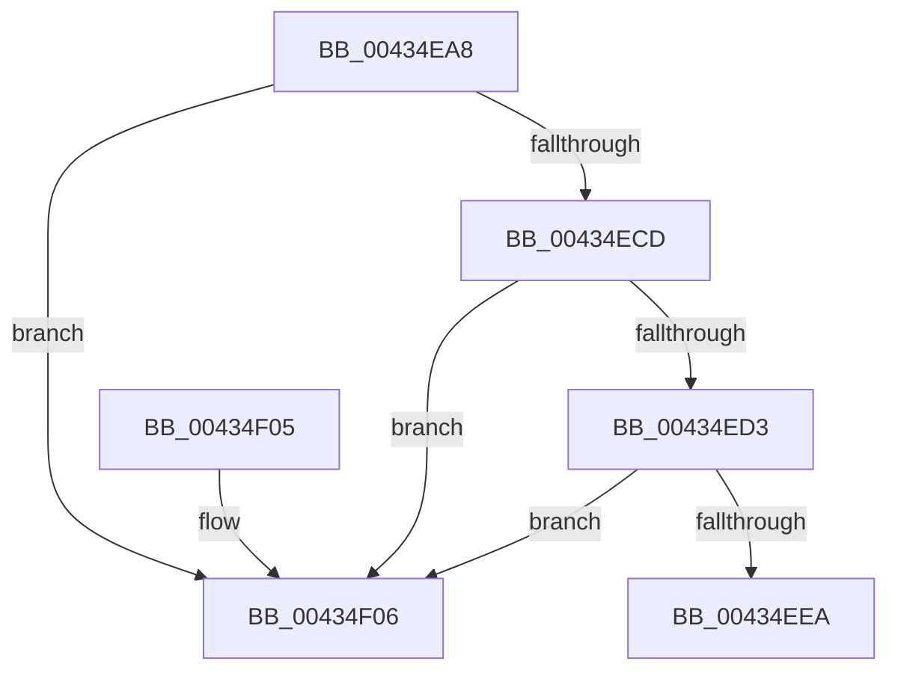

# MiGetZeroExceptionInfo

- RVA: `0x00434EA8`–`0x00434F21` (길이 `121` bytes)
- VA: `0x0000000140434EA8`
- 실행 섹션: `.text`
- PDB 이름 있음: `예`; PDB Function 태그: `아니요`
- unwind 정보 RVA: `0x000A2B78`
- 디코드: `35`개 명령, `121/121` bytes 표시
- 미해석 바이트: `0` (있으면 어셈블리에 `.byte`로 보존)

> 이 문서는 커널 이미지의 기계어와 PDB 기호를 분석해 생성했습니다. 4번과 5번은 함수 원형과 자료형을 바이너리 사용 방식에서 추정한 C 해석이며 원본 소스 복구 결과는 아닙니다.

## 1. Dependencies

- 직접 호출 지점: **2**; 고유 호출 대상: **2**
- 직접 호출자로 확인된 함수: **1**
- RIP 상대 이미지 참조: **1**

### Outgoing calls
- `0x00434EDD` → [MiZeroVaToActiveEntry](MiZeroVaToActiveEntry_function_00434F28.md) (function, `0x00434F28`)
- `0x00434F1B` → [KeBugCheckEx](../4F/KeBugCheckEx_function_004FD660.md) (function, `0x004FD660`)

### Direct callers
- [MiTryZeroMemory$filt$0](../6D/MiTryZeroMemory_filt_0_function_006D2080.md) at `0x006D2098`

### Static image references
- `0x00434EEA` → RVA `0x00EF50D8` (`.data`; read/write)

## 2. Other-region calls and transfers

- 다른 실행 섹션으로 향하는 call: **0**
- 별도 외부 분기/꼬리 이동을 확인하지 못했습니다.

## 3. Assembly (complete function range)

```asm
00434EA8  48 89 5C 24 08                  mov qword ptr [rsp + 8], rbx
00434EAD  48 89 74 24 10                  mov qword ptr [rsp + 0x10], rsi
00434EB2  57                              push rdi
00434EB3  48 83 EC 30                     sub rsp, 0x30
00434EB7  48 8B 19                        mov rbx, qword ptr [rcx]
00434EBA  49 8B F8                        mov rdi, r8
00434EBD  48 8B F2                        mov rsi, rdx
00434EC0  8B 03                           mov eax, dword ptr [rbx]
00434EC2  41 89 00                        mov dword ptr [r8], eax
00434EC5  81 3B 05 00 00 C0               cmp dword ptr [rbx], 0xc0000005
00434ECB  75 39                           jne 0x140434f06
00434ECD  83 7B 18 01                     cmp dword ptr [rbx + 0x18], 1
00434ED1  76 33                           jbe 0x140434f06
00434ED3  48 8B 53 28                     mov rdx, qword ptr [rbx + 0x28]
00434ED7  48 8B CE                        mov rcx, rsi
00434EDA  49 89 11                        mov qword ptr [r9], rdx
00434EDD  E8 46 00 00 00                  call 0x140434f28
00434EE2  48 8B 08                        mov rcx, qword ptr [rax]
00434EE5  F6 C1 01                        test cl, 1
00434EE8  74 1C                           je 0x140434f06
00434EEA  FF 05 E8 01 AC 00               inc dword ptr [rip + 0xac01e8]
00434EF0  B8 01 00 00 00                  mov eax, 1
00434EF5  48 8B 5C 24 40                  mov rbx, qword ptr [rsp + 0x40]
00434EFA  48 8B 74 24 48                  mov rsi, qword ptr [rsp + 0x48]
00434EFF  48 83 C4 30                     add rsp, 0x30
00434F03  5F                              pop rdi
00434F04  C3                              ret
00434F05  CC                              int3
00434F06  4C 63 0F                        movsxd r9, dword ptr [rdi]
00434F09  4C 8B C6                        mov r8, rsi
00434F0C  BA 01 61 00 00                  mov edx, 0x6101
00434F11  48 89 5C 24 20                  mov qword ptr [rsp + 0x20], rbx
00434F16  B9 1A 00 00 00                  mov ecx, 0x1a
00434F1B  E8 40 87 0C 00                  call 0x1404fd660
00434F20  CC                              int3
```

## 4. C-style interpretation (structured pseudocode)

```c
__int64 __fastcall MiGetZeroExceptionInfo(__int64 a1, __int64 a2, __int64 a3, __int64 a4)
{
    __int64 result;
    __int64 v_rsp;
    unsigned __int64 v_stack_p10;
    unsigned __int64 v_stack_p20;
    unsigned __int64 v_stack_p8;

    v_stack_p8 = v_rbx;
    v_stack_p10 = v_rsi;
    v_rsp = (v_rsp) - (48);
    *(unsigned int *)(a3) = (unsigned int)((unsigned int)(*(unsigned int *)(*(unsigned __int64 *)(a1))));
    if ((*(unsigned int *)(*(unsigned __int64 *)(a1))) != 0xC0000005ULL) goto loc_00434F06;
    if ((*(unsigned int *)(*(unsigned __int64 *)(a1) + 24)) <= 1) goto loc_00434F06;
    *(unsigned __int64 *)(a4) = *(unsigned __int64 *)(*(unsigned __int64 *)(a1) + 40);
    result = MiZeroVaToActiveEntry(a2, *(unsigned __int64 *)(*(unsigned __int64 *)(a1) + 40), a3, a4);
    if ((((unsigned __int8)(*(unsigned __int64 *)(result))) & (1)) == 0) goto loc_00434F06;
    v_rsp = (v_rsp) + (48);
    return 1;
loc_00434F06:
    v_stack_p20 = v_stack_p8;
    result = KeBugCheckEx(26, (unsigned int)(0x6101ULL), v_stack_p10, (int)(*(unsigned int *)(a3)));
    return result;
}
```

## 5. (Beta) C Style

```c
int64_t MiGetZeroExceptionInfo(void *Arg1, int64_t Arg2, void *Arg3, void *Arg4)
{
    uint8_t *arg1 = (uint8_t *)Arg1;
    uint8_t *arg3 = (uint8_t *)Arg3;
    uint8_t *arg4 = (uint8_t *)Arg4;

    int64_t result;
    int64_t local_rsp;
    uint64_t v_stack_p10;
    uint64_t v_stack_p20;
    uint64_t v_stack_p8;

    v_stack_p8 = local_rbx;
    v_stack_p10 = local_rsi;
    local_rsp = (local_rsp) - (48);
    *(uint32_t *)(arg3) = (uint32_t)((uint32_t)(*(uint32_t *)(*(uint64_t *)(arg1))));
    if ((*(uint32_t *)(*(uint64_t *)(arg1))) != 0xC0000005ULL) goto loc_00434F06;
    if ((*(uint32_t *)(*(uint64_t *)(arg1) + 0x18)) <= 1) goto loc_00434F06;
    *(uint64_t *)(arg4) = *(uint64_t *)(*(uint64_t *)(arg1) + 0x28);
    result = MiZeroVaToActiveEntry(Arg2, *(uint64_t *)(*(uint64_t *)(arg1) + 0x28), Arg3, Arg4);
    if ((((uint8_t)(*(uint64_t *)(result))) & (1)) == 0) goto loc_00434F06;
    local_rsp = (local_rsp) + (48);
    return 1;
loc_00434F06:
    v_stack_p20 = v_stack_p8;
    result = KeBugCheckEx(26, (uint32_t)(0x6101ULL), v_stack_p10, (int32_t)(*(uint32_t *)(arg3)));
    return result;
}
```

### 관측된 메모리 오프셋

구조체 형식이 확인되지 않은 접근은 인자 기준의 오프셋으로만 기록했습니다.

| 기준 인자 | 오프셋 표현 | 폭 (bit) | 접근 |
|---|---:|---:|---|
| `Arg1` | `+ 0x0` | `64` | `R` |
| `Arg3` | `+ 0x0` | `32` | `R` |
| `Arg3` | `+ 0x0` | `32` | `W` |
| `Arg4` | `+ 0x0` | `64` | `W` |

## 6. Execution-region graph

[열기: 2D/3D 그래프와 함수 탐색 컨트롤 패널](../../../control-panel.html?section=text&rva=0x00434EA8&view=graph)

- 2D 그래프는 위에서 아래로 흐르고, 3D 그래프는 빈 공간을 드래그해 회전합니다. Shift+드래그는 이동, 휠은 확대·축소, 함수 노드 선택은 대상 보고서 이동입니다.

### Static fallback


