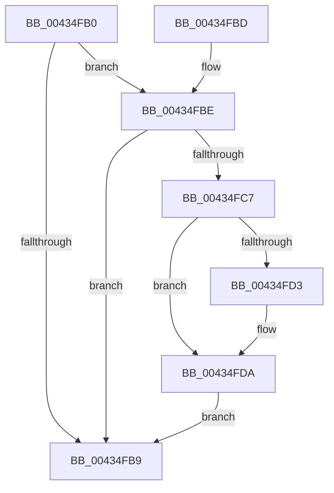

# MiGetZeroingContext

- RVA: `0x00434FB0`–`0x00434FE3` (길이 `51` bytes)
- VA: `0x0000000140434FB0`
- 실행 섹션: `.text`
- PDB 이름 있음: `예`; PDB Function 태그: `아니요`
- unwind 정보 RVA: `0x000DB714`
- 디코드: `14`개 명령, `51/51` bytes 표시
- 미해석 바이트: `0` (있으면 어셈블리에 `.byte`로 보존)

> 이 문서는 커널 이미지의 기계어와 PDB 기호를 분석해 생성했습니다. 4번과 5번은 함수 원형과 자료형을 바이너리 사용 방식에서 추정한 C 해석이며 원본 소스 복구 결과는 아닙니다.

## 1. Dependencies

- 직접 호출 지점: **0**; 고유 호출 대상: **0**
- 직접 호출자로 확인된 함수: **5**
- RIP 상대 이미지 참조: **0**

### Outgoing calls
- 직접 디코드된 call 명령이 없습니다.

### Direct callers
- [MiTryZeroMemory](../31/MiTryZeroMemory_function_0031E720.md) at `0x0031E8A4`
- [MiTryZeroMemory](../31/MiTryZeroMemory_function_0031E720.md) at `0x0031E8F6`
- [MiBackgroundZeroLocalPages](../31/MiBackgroundZeroLocalPages_function_0031EF30.md) at `0x0031F740`
- [MiZeroVaToActiveEntry](MiZeroVaToActiveEntry_function_00434F28.md) at `0x00434F32`
- [MiZeroVaToActiveEntry](MiZeroVaToActiveEntry_function_00434F28.md) at `0x00434F52`
- [MiMirrorDiscardTreePageContents](../4F/MiMirrorDiscardTreePageContents_function_004F61D4.md) at `0x004F61F0`
- [MiFailInProgressZeroing](../69/MiFailInProgressZeroing_function_00696000.md) at `0x00696073`

### Static image references
- 디코드된 RIP-relative 메모리 참조가 없습니다.

## 2. Other-region calls and transfers

- 다른 실행 섹션으로 향하는 call: **0**
- 별도 외부 분기/꼬리 이동을 확인하지 못했습니다.

## 3. Assembly (complete function range)

```asm
00434FB0  83 B9 40 01 00 00 00            cmp dword ptr [rcx + 0x140], 0
00434FB7  74 05                           je 0x140434fbe
00434FB9  48 8B C1                        mov rax, rcx
00434FBC  C3                              ret
00434FBD  CC                              int3
00434FBE  80 B9 46 01 00 00 00            cmp byte ptr [rcx + 0x146], 0
00434FC5  75 F2                           jne 0x140434fb9
00434FC7  80 B9 44 01 00 00 00            cmp byte ptr [rcx + 0x144], 0
00434FCE  48 8B C1                        mov rax, rcx
00434FD1  75 07                           jne 0x140434fda
00434FD3  48 8B 81 48 02 00 00            mov rax, qword ptr [rcx + 0x248]
00434FDA  48 85 C0                        test rax, rax
00434FDD  48 0F 45 C8                     cmovne rcx, rax
00434FE1  EB D6                           jmp 0x140434fb9
```

## 4. C-style interpretation (structured pseudocode)

```c
__int64 __fastcall MiGetZeroingContext(__int64 a1)
{
    __int64 result;

    if ((*(unsigned int *)(a1 + 320)) == 0) goto loc_00434FBE;
loc_00434FB9:
    return a1;
loc_00434FBE:
    if ((*(unsigned __int8 *)(a1 + 326)) != 0) goto loc_00434FB9;
    result = a1;
    if ((*(unsigned __int8 *)(a1 + 324)) == 0) {
        result = *(unsigned __int64 *)(a1 + 584);
    }
    if (result != 0) { a1 = result; }
    goto loc_00434FB9;
}
```

## 5. (Beta) C Style

```c
void *MiGetZeroingContext(void *Arg1)
{
    uint8_t *arg1 = (uint8_t *)Arg1;

    int64_t result;

    if ((*(uint32_t *)(arg1 + 0x140)) == 0) goto loc_00434FBE;
loc_00434FB9:
    return Arg1;
loc_00434FBE:
    if ((*(uint8_t *)(arg1 + 0x146)) != 0) goto loc_00434FB9;
    result = Arg1;
    if ((*(uint8_t *)(arg1 + 0x144)) == 0) {
        result = *(uint64_t *)(arg1 + 0x248);
    }
    if (result != 0) { Arg1 = result; }
    goto loc_00434FB9;
}
```

### 관측된 메모리 오프셋

구조체 형식이 확인되지 않은 접근은 인자 기준의 오프셋으로만 기록했습니다.

| 기준 인자 | 오프셋 표현 | 폭 (bit) | 접근 |
|---|---:|---:|---|
| `Arg1` | `+ 0x140` | `32` | `R` |
| `Arg1` | `+ 0x144` | `8` | `R` |
| `Arg1` | `+ 0x146` | `8` | `R` |
| `Arg1` | `+ 0x248` | `64` | `R` |

## 6. Execution-region graph

[열기: 2D/3D 그래프와 함수 탐색 컨트롤 패널](../../../control-panel.html?section=text&rva=0x00434FB0&view=graph)

- 2D 그래프는 위에서 아래로 흐르고, 3D 그래프는 빈 공간을 드래그해 회전합니다. Shift+드래그는 이동, 휠은 확대·축소, 함수 노드 선택은 대상 보고서 이동입니다.

### Static fallback


