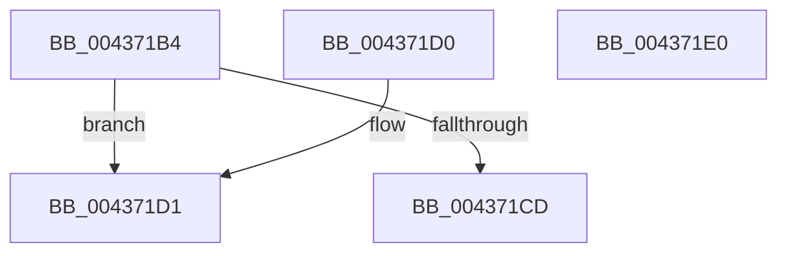

# MiHugePfnPartition

- RVA: `0x004371B4`–`0x004371E1` (길이 `45` bytes)
- VA: `0x00000001404371B4`
- 실행 섹션: `.text`
- PDB 이름 있음: `예`; PDB Function 태그: `아니요`
- unwind 정보 RVA: `0x000DB714`
- 디코드: `15`개 명령, `45/45` bytes 표시
- 미해석 바이트: `0` (있으면 어셈블리에 `.byte`로 보존)

> 이 문서는 커널 이미지의 기계어와 PDB 기호를 분석해 생성했습니다. 4번과 5번은 함수 원형과 자료형을 바이너리 사용 방식에서 추정한 C 해석이며 원본 소스 복구 결과는 아닙니다.

## 1. Dependencies

- 직접 호출 지점: **0**; 고유 호출 대상: **0**
- 직접 호출자로 확인된 함수: **9**
- RIP 상대 이미지 참조: **1**

### Outgoing calls
- 직접 디코드된 call 명령이 없습니다.

### Direct callers
- [MiComputeHugeRangeColorHeadAtDpc](MiComputeHugeRangeColorHeadAtDpc_function_00436968.md) at `0x004369A7`
- [MiHugeRangeFreeToZero](MiHugeRangeFreeToZero_function_00436A38.md) at `0x00436A78`
- [MiInsertHugeRangeInList](MiInsertHugeRangeInList_function_004371E8.md) at `0x00437231`
- [MiDereferenceIoHugeRange](../67/MiDereferenceIoHugeRange_function_006753F8.md) at `0x0067543E`
- [MiHotRemoveHugeRange](../67/MiHotRemoveHugeRange_function_00675DD0.md) at `0x00675E1E`
- [MiMakeEntireHugePfnGood](../67/MiMakeEntireHugePfnGood_function_00676644.md) at `0x00676680`
- [MiMarkHugePfnBad](../67/MiMarkHugePfnBad_function_00676744.md) at `0x006767F4`
- [MiMarkHugePfnBad](../67/MiMarkHugePfnBad_function_00676744.md) at `0x00676818`
- [MiMarkHugePfnBad](../67/MiMarkHugePfnBad_function_00676744.md) at `0x00676A5C`
- [MiMarkHugePfnGood](../67/MiMarkHugePfnGood_function_00676BB0.md) at `0x00676C2A`
- [MiReleaseMemoryRuns](../67/MiReleaseMemoryRuns_function_00676EF0.md) at `0x00676F95`

### Static image references
- `0x004371D4` → RVA `0x00E30088` (`.data`; read)

## 2. Other-region calls and transfers

- 다른 실행 섹션으로 향하는 call: **0**
- 별도 외부 분기/꼬리 이동을 확인하지 못했습니다.

## 3. Assembly (complete function range)

```asm
004371B4  48 8B 01                        mov rax, qword ptr [rcx]
004371B7  B9 FF 07 00 00                  mov ecx, 0x7ff
004371BC  48 C1 E8 04                     shr rax, 4
004371C0  66 23 C1                        and ax, cx
004371C3  B9 01 04 00 00                  mov ecx, 0x401
004371C8  66 3B C1                        cmp ax, cx
004371CB  75 04                           jne 0x1404371d1
004371CD  33 C0                           xor eax, eax
004371CF  C3                              ret
004371D0  CC                              int3
004371D1  0F B7 C8                        movzx ecx, ax
004371D4  48 8B 05 AD 8E 9F 00            mov rax, qword ptr [rip + 0x9f8ead]
004371DB  48 8B 04 C8                     mov rax, qword ptr [rax + rcx*8]
004371DF  C3                              ret
004371E0  CC                              int3
```

## 4. C-style interpretation (structured pseudocode)

```c
__int64 __fastcall MiHugePfnPartition(__int64 a1)
{
    __int64 result;

    result = (*(unsigned __int64 *)(a1)) >> (4);
    result = (unsigned __int16)((result) & ((unsigned __int16)((unsigned int)(0x7FFULL))));
    if (((unsigned __int16)(result)) != ((unsigned __int16)((unsigned int)(0x401ULL)))) goto loc_004371D1;
    result = 0;
    return result;
loc_004371D1:
    return *(unsigned __int64 *)(*(unsigned __int64 *)(v_rip + 10456749) + 0 * 8);
}
```

## 5. (Beta) C Style

```c
int64_t MiHugePfnPartition(void *Arg1)
{
    uint8_t *arg1 = (uint8_t *)Arg1;

    int64_t result;

    result = (*(uint64_t *)(arg1)) >> (4);
    result = (uint16_t)((result) & ((uint16_t)((uint32_t)(0x7FFULL))));
    if (((uint16_t)(result)) != ((uint16_t)((uint32_t)(0x401ULL)))) goto loc_004371D1;
    result = 0;
    return result;
loc_004371D1:
    return *(uint64_t *)(*(uint64_t *)(v_rip + 0x9F8EAD) + 0x0 * 8);
}
```

### 관측된 메모리 오프셋

구조체 형식이 확인되지 않은 접근은 인자 기준의 오프셋으로만 기록했습니다.

| 기준 인자 | 오프셋 표현 | 폭 (bit) | 접근 |
|---|---:|---:|---|
| `Arg1` | `+ 0x0` | `64` | `R` |

## 6. Execution-region graph

[열기: 2D/3D 그래프와 함수 탐색 컨트롤 패널](../../../control-panel.html?section=text&rva=0x004371B4&view=graph)

- 2D 그래프는 위에서 아래로 흐르고, 3D 그래프는 빈 공간을 드래그해 회전합니다. Shift+드래그는 이동, 휠은 확대·축소, 함수 노드 선택은 대상 보고서 이동입니다.

### Static fallback


