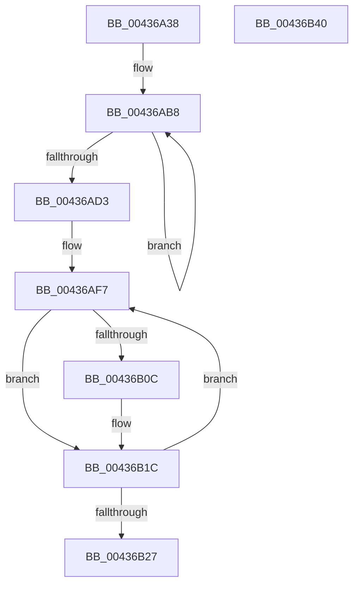

# MiHugeRangeFreeToZero

- RVA: `0x00436A38`–`0x00436B41` (길이 `265` bytes)
- VA: `0x0000000140436A38`
- 실행 섹션: `.text`
- PDB 이름 있음: `예`; PDB Function 태그: `아니요`
- unwind 정보 RVA: `0x00060300`
- 디코드: `70`개 명령, `265/265` bytes 표시
- 미해석 바이트: `0` (있으면 어셈블리에 `.byte`로 보존)

> 이 문서는 커널 이미지의 기계어와 PDB 기호를 분석해 생성했습니다. 4번과 5번은 함수 원형과 자료형을 바이너리 사용 방식에서 추정한 C 해석이며 원본 소스 복구 결과는 아닙니다.

## 1. Dependencies

- 직접 호출 지점: **6**; 고유 호출 대상: **6**
- 직접 호출자로 확인된 함수: **1**
- RIP 상대 이미지 참조: **1**

### Outgoing calls
- `0x00436A6A` → [MiLockHugeRangeColorHeadAtDpc](../4F/MiLockHugeRangeColorHeadAtDpc_function_004FAD14.md) (function, `0x004FAD14`)
- `0x00436A78` → [MiHugePfnPartition](MiHugePfnPartition_function_004371B4.md) (function, `0x004371B4`)
- `0x00436A87` → [MiPageToNode](../33/MiPageToNode_function_00338CD0.md) (function, `0x00338CD0`)
- `0x00436AA5` → [MiStopPageAccessor](MiStopPageAccessor_function_00436BB8.md) (function, `0x00436BB8`)
- `0x00436AD9` → [MiUnlinkHugeRange](MiUnlinkHugeRange_function_00436EF0.md) (function, `0x00436EF0`)
- `0x00436AEB` → [MiInsertHugeRangeInList](MiInsertHugeRangeInList_function_004371E8.md) (function, `0x004371E8`)

### Direct callers
- [sub_0031FE0C](../31/Unknown_function_0031FE0C.md) at `0x0031FE2F`

### Static image references
- `0x00436A50` → RVA `0x00E300C0` (`.data`; read)

## 2. Other-region calls and transfers

- 다른 실행 섹션으로 향하는 call: **0**
- 별도 외부 분기/꼬리 이동을 확인하지 못했습니다.

## 3. Assembly (complete function range)

```asm
00436A38  48 89 5C 24 08                  mov qword ptr [rsp + 8], rbx
00436A3D  48 89 6C 24 10                  mov qword ptr [rsp + 0x10], rbp
00436A42  48 89 74 24 18                  mov qword ptr [rsp + 0x18], rsi
00436A47  57                              push rdi
00436A48  41 56                           push r14
00436A4A  41 57                           push r15
00436A4C  48 83 EC 20                     sub rsp, 0x20
00436A50  48 8B 05 69 96 9F 00            mov rax, qword ptr [rip + 0x9f9669]
00436A57  48 8B F9                        mov rdi, rcx
00436A5A  48 8B D9                        mov rbx, rcx
00436A5D  81 E7 FF FF 3F 00               and edi, 0x3fffff
00436A63  48 8D 34 F8                     lea rsi, [rax + rdi*8]
00436A67  48 8B CE                        mov rcx, rsi
00436A6A  E8 A5 42 0C 00                  call 0x1404fad14
00436A6F  48 8B 16                        mov rdx, qword ptr [rsi]
00436A72  48 8B CE                        mov rcx, rsi
00436A75  4C 8B F0                        mov r14, rax
00436A78  E8 37 07 00 00                  call 0x1404371b4
00436A7D  48 C1 E7 12                     shl rdi, 0x12
00436A81  4C 8B F8                        mov r15, rax
00436A84  48 8B CF                        mov rcx, rdi
00436A87  E8 44 22 F0 FF                  call 0x140338cd0
00436A8C  8B D0                           mov edx, eax
00436A8E  45 33 C0                        xor r8d, r8d
00436A91  48 69 EA 80 DF 00 00            imul rbp, rdx, 0xdf80
00436A98  41 8D 78 01                     lea edi, [r8 + 1]
00436A9C  48 8B CE                        mov rcx, rsi
00436A9F  49 03 6F 10                     add rbp, qword ptr [r15 + 0x10]
00436AA3  8B D7                           mov edx, edi
00436AA5  E8 0E 01 00 00                  call 0x140436bb8
00436AAA  48 8B 85 68 3B 00 00            mov rax, qword ptr [rbp + 0x3b68]
00436AB1  48 C7 C6 00 00 FF FF            mov rsi, 0xffffffffffff0000
00436AB8  48 8D 50 01                     lea rdx, [rax + 1]
00436ABC  48 8B CA                        mov rcx, rdx
00436ABF  48 33 C8                        xor rcx, rax
00436AC2  48 23 CE                        and rcx, rsi
00436AC5  48 33 CA                        xor rcx, rdx
00436AC8  F0 48 0F B1 8D 68 3B 00 00      lock cmpxchg qword ptr [rbp + 0x3b68], rcx
00436AD1  75 E5                           jne 0x140436ab8
00436AD3  48 8B D3                        mov rdx, rbx
00436AD6  49 8B CF                        mov rcx, r15
00436AD9  E8 12 04 00 00                  call 0x140436ef0
00436ADE  F0 49 83 26 F7                  lock and qword ptr [r14], 0xfffffffffffffff7
00436AE3  44 8B C7                        mov r8d, edi
00436AE6  48 8B D3                        mov rdx, rbx
00436AE9  33 C9                           xor ecx, ecx
00436AEB  E8 F8 06 00 00                  call 0x1404371e8
00436AF0  48 8B 85 68 3B 00 00            mov rax, qword ptr [rbp + 0x3b68]
00436AF7  48 8D 50 FF                     lea rdx, [rax - 1]
00436AFB  48 8B CA                        mov rcx, rdx
00436AFE  48 33 C8                        xor rcx, rax
00436B01  48 23 CE                        and rcx, rsi
00436B04  48 33 CA                        xor rcx, rdx
00436B07  66 85 C9                        test cx, cx
00436B0A  75 10                           jne 0x140436b1c
00436B0C  48 8D 91 00 00 01 00            lea rdx, [rcx + 0x10000]
00436B13  48 33 D1                        xor rdx, rcx
00436B16  48 23 D6                        and rdx, rsi
00436B19  48 33 CA                        xor rcx, rdx
00436B1C  F0 48 0F B1 8D 68 3B 00 00      lock cmpxchg qword ptr [rbp + 0x3b68], rcx
00436B25  75 D0                           jne 0x140436af7
00436B27  48 8B 5C 24 40                  mov rbx, qword ptr [rsp + 0x40]
00436B2C  48 8B 6C 24 48                  mov rbp, qword ptr [rsp + 0x48]
00436B31  48 8B 74 24 50                  mov rsi, qword ptr [rsp + 0x50]
00436B36  48 83 C4 20                     add rsp, 0x20
00436B3A  41 5F                           pop r15
00436B3C  41 5E                           pop r14
00436B3E  5F                              pop rdi
00436B3F  C3                              ret
00436B40  CC                              int3
```

## 4. C-style interpretation (structured pseudocode)

```c
__int64 __fastcall MiHugeRangeFreeToZero(__int64 a1, __int64 a2, int a3)
{
    __int64 result;
    __int64 v_rbp;
    __int64 v_rdi;
    __int64 v_rsp;
    unsigned __int64 v_stack_p10;
    unsigned __int64 v_stack_p18;
    unsigned __int64 v_stack_p8;

    v_stack_p8 = v_rbx;
    v_stack_p10 = v_rbp;
    v_stack_p18 = v_rsi;
    v_rsp = (v_rsp) - (32);
    v_rdi = (unsigned int)((a1) & (0x3FFFFFULL));
    result = MiLockHugeRangeColorHeadAtDpc(*(unsigned __int64 *)(v_rip + 10458729) + v_rdi * 8, a2, a3, a4);
    result = MiHugePfnPartition(*(unsigned __int64 *)(v_rip + 10458729) + v_rdi * 8, *(unsigned __int64 *)(*(unsigned __int64 *)(v_rip + 10458729) + v_rdi * 8), a3, a4);
    v_rdi = (v_rdi) << (18);
    result = MiPageToNode(v_rdi, *(unsigned __int64 *)(*(unsigned __int64 *)(v_rip + 10458729) + v_rdi * 8), a3, a4);
    a3 = 0;
    v_rbp = (v_rbp) * ((unsigned int)((unsigned int)(result)));
    v_rbp = (v_rbp) + (*(unsigned __int64 *)(result + 16));
    result = MiStopPageAccessor(*(unsigned __int64 *)(v_rip + 10458729) + v_rdi * 8, (unsigned int)((unsigned int)(a3 + 1)), a3, a4);
loc_00436AB8:
    a1 = (*(unsigned __int64 *)(v_rbp + 15208) + 1) ^ (*(unsigned __int64 *)(v_rbp + 15208));
    a1 = (a1) & (0xFFFFFFFFFFFF0000ULL);
    a1 = (a1) ^ (*(unsigned __int64 *)(v_rbp + 15208) + 1);
    if (condition_is_not_equal) goto loc_00436AB8;
    result = MiUnlinkHugeRange(result, a1, a3, a4);
    a1 = 0;
    result = MiInsertHugeRangeInList(a1, a1, (unsigned int)((unsigned int)(a3 + 1)), a4);
loc_00436AF7:
    a1 = (*(unsigned __int64 *)(v_rbp + 15208) - 1) ^ (*(unsigned __int64 *)(v_rbp + 15208));
    a1 = (a1) & (0xFFFFFFFFFFFF0000ULL);
    a1 = (a1) ^ (*(unsigned __int64 *)(v_rbp + 15208) - 1);
    if ((unsigned __int16)(a1) == 0) {
        a2 = a1 + 65536;
        a2 = (a2) ^ (a1);
        a2 = (a2) & (0xFFFFFFFFFFFF0000ULL);
        a1 = (a1) ^ (a2);
    }
    if (condition_is_not_equal) goto loc_00436AF7;
    v_rsp = (v_rsp) + (32);
    return *(unsigned __int64 *)(v_rbp + 15208);
}
```

## 5. (Beta) C Style

```c
int64_t MiHugeRangeFreeToZero(int64_t Arg1, int64_t Arg2, int32_t Arg3)
{
    int64_t result;
    int64_t local_rbp;
    int64_t local_rdi;
    int64_t local_rsp;
    uint64_t v_stack_p10;
    uint64_t v_stack_p18;
    uint64_t v_stack_p8;

    v_stack_p8 = local_rbx;
    v_stack_p10 = local_rbp;
    v_stack_p18 = local_rsi;
    local_rsp = (local_rsp) - (32);
    local_rdi = (uint32_t)((Arg1) & (0x3FFFFFULL));
    result = MiLockHugeRangeColorHeadAtDpc(*(uint64_t *)(v_rip + 0x9F9669) + local_rdi * 8, Arg2, Arg3, a4);
    result = MiHugePfnPartition(*(uint64_t *)(v_rip + 0x9F9669) + local_rdi * 8, *(uint64_t *)(*(uint64_t *)(v_rip + 0x9F9669) + local_rdi * 8), Arg3, a4);
    local_rdi = (local_rdi) << (18);
    result = MiPageToNode(local_rdi, *(uint64_t *)(*(uint64_t *)(v_rip + 0x9F9669) + local_rdi * 8), Arg3, a4);
    Arg3 = 0;
    local_rbp = (local_rbp) * ((uint32_t)((uint32_t)(result)));
    local_rbp = (local_rbp) + (*(uint64_t *)(result + 0x10));
    result = MiStopPageAccessor(*(uint64_t *)(v_rip + 0x9F9669) + local_rdi * 8, (uint32_t)((uint32_t)(Arg3 + 1)), Arg3, a4);
loc_00436AB8:
    Arg1 = (*(uint64_t *)(local_rbp + 0x3B68) + 1) ^ (*(uint64_t *)(local_rbp + 0x3B68));
    Arg1 = (Arg1) & (0xFFFFFFFFFFFF0000ULL);
    Arg1 = (Arg1) ^ (*(uint64_t *)(local_rbp + 0x3B68) + 1);
    if (condition_is_not_equal) goto loc_00436AB8;
    result = MiUnlinkHugeRange(result, Arg1, Arg3, a4);
    Arg1 = 0;
    result = MiInsertHugeRangeInList(Arg1, Arg1, (uint32_t)((uint32_t)(Arg3 + 1)), a4);
loc_00436AF7:
    Arg1 = (*(uint64_t *)(local_rbp + 0x3B68) - 1) ^ (*(uint64_t *)(local_rbp + 0x3B68));
    Arg1 = (Arg1) & (0xFFFFFFFFFFFF0000ULL);
    Arg1 = (Arg1) ^ (*(uint64_t *)(local_rbp + 0x3B68) - 1);
    if ((uint16_t)(Arg1) == 0) {
        Arg2 = Arg1 + 65536;
        Arg2 = (Arg2) ^ (Arg1);
        Arg2 = (Arg2) & (0xFFFFFFFFFFFF0000ULL);
        Arg1 = (Arg1) ^ (Arg2);
    }
    if (condition_is_not_equal) goto loc_00436AF7;
    local_rsp = (local_rsp) + (32);
    return *(uint64_t *)(local_rbp + 0x3B68);
}
```

## 6. Execution-region graph

[열기: 2D/3D 그래프와 함수 탐색 컨트롤 패널](../../../control-panel.html?section=text&rva=0x00436A38&view=graph)

- 2D 그래프는 위에서 아래로 흐르고, 3D 그래프는 빈 공간을 드래그해 회전합니다. Shift+드래그는 이동, 휠은 확대·축소, 함수 노드 선택은 대상 보고서 이동입니다.

### Static fallback


