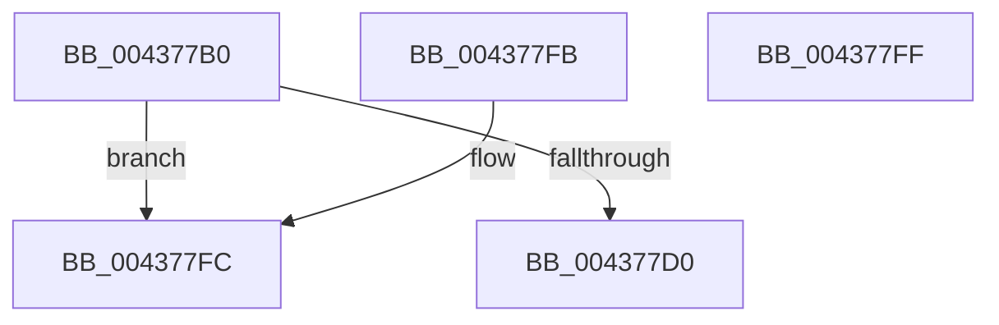

# MiIncrementPageTableLockCheckWrap

- RVA: `0x004377B0`–`0x00437800` (길이 `80` bytes)
- VA: `0x00000001404377B0`
- 실행 섹션: `.text`
- PDB 이름 있음: `예`; PDB Function 태그: `아니요`
- unwind 정보 RVA: `0x000DB714`
- 디코드: `20`개 명령, `80/80` bytes 표시
- 미해석 바이트: `0` (있으면 어셈블리에 `.byte`로 보존)

> 이 문서는 커널 이미지의 기계어와 PDB 기호를 분석해 생성했습니다. 4번과 5번은 함수 원형과 자료형을 바이너리 사용 방식에서 추정한 C 해석이며 원본 소스 복구 결과는 아닙니다.

## 1. Dependencies

- 직접 호출 지점: **0**; 고유 호출 대상: **0**
- 직접 호출자로 확인된 함수: **1**
- RIP 상대 이미지 참조: **0**

### Outgoing calls
- 직접 디코드된 call 명령이 없습니다.

### Direct callers
- [sub_0023E278](../23/Unknown_function_0023E278.md) at `0x0023E33C`
- [sub_0023E278](../23/Unknown_function_0023E278.md) at `0x0023E45C`

### Static image references
- 디코드된 RIP-relative 메모리 참조가 없습니다.

## 2. Other-region calls and transfers

- 다른 실행 섹션으로 향하는 call: **0**
- 별도 외부 분기/꼬리 이동을 확인하지 못했습니다.

## 3. Assembly (complete function range)

```asm
004377B0  48 8B 41 18                     mov rax, qword ptr [rcx + 0x18]
004377B4  48 BA FF FF FF FF FF FF FF 3F   movabs rdx, 0x3fffffffffffffff
004377BE  48 23 C2                        and rax, rdx
004377C1  48 BA FF FD FE FF FF FF FF 3F   movabs rdx, 0x3ffffffffffefdff
004377CB  48 3B C2                        cmp rax, rdx
004377CE  73 2C                           jae 0x1404377fc
004377D0  48 8B 41 18                     mov rax, qword ptr [rcx + 0x18]
004377D4  48 8D 90 00 00 01 00            lea rdx, [rax + 0x10000]
004377DB  4C 8B C2                        mov r8, rdx
004377DE  4C 33 C0                        xor r8, rax
004377E1  48 B8 00 00 00 00 00 00 00 C0   movabs rax, 0xc000000000000000
004377EB  4C 23 C0                        and r8, rax
004377EE  B8 01 00 00 00                  mov eax, 1
004377F3  4C 33 C2                        xor r8, rdx
004377F6  4C 89 41 18                     mov qword ptr [rcx + 0x18], r8
004377FA  C3                              ret
004377FB  CC                              int3
004377FC  33 C0                           xor eax, eax
004377FE  C3                              ret
004377FF  CC                              int3
```

## 4. C-style interpretation (structured pseudocode)

```c
__int64 __fastcall MiIncrementPageTableLockCheckWrap(__int64 a1)
{
    __int64 result;

    result = (*(unsigned __int64 *)(a1 + 24)) & (a2);
    if (result >= a2) goto loc_004377FC;
    a3 = (*(unsigned __int64 *)(a1 + 24) + 65536) ^ (*(unsigned __int64 *)(a1 + 24));
    a3 = (a3) & (*(unsigned __int64 *)(a1 + 24));
    a3 = (a3) ^ (*(unsigned __int64 *)(a1 + 24) + 65536);
    *(unsigned __int64 *)(a1 + 24) = a3;
    return 1;
loc_004377FC:
    result = 0;
    return result;
}
```

## 5. (Beta) C Style

```c
int64_t MiIncrementPageTableLockCheckWrap(void *Arg1)
{
    uint8_t *arg1 = (uint8_t *)Arg1;

    int64_t result;

    result = (*(uint64_t *)(arg1 + 0x18)) & (a2);
    if (result >= a2) goto loc_004377FC;
    a3 = (*(uint64_t *)(arg1 + 0x18) + 65536) ^ (*(uint64_t *)(arg1 + 0x18));
    a3 = (a3) & (*(uint64_t *)(arg1 + 0x18));
    a3 = (a3) ^ (*(uint64_t *)(arg1 + 0x18) + 65536);
    *(uint64_t *)(arg1 + 0x18) = a3;
    return 1;
loc_004377FC:
    result = 0;
    return result;
}
```

### 관측된 메모리 오프셋

구조체 형식이 확인되지 않은 접근은 인자 기준의 오프셋으로만 기록했습니다.

| 기준 인자 | 오프셋 표현 | 폭 (bit) | 접근 |
|---|---:|---:|---|
| `Arg1` | `+ 0x18` | `64` | `R` |
| `Arg1` | `+ 0x18` | `64` | `W` |

## 6. Execution-region graph

[열기: 2D/3D 그래프와 함수 탐색 컨트롤 패널](../../../control-panel.html?section=text&rva=0x004377B0&view=graph)

- 2D 그래프는 위에서 아래로 흐르고, 3D 그래프는 빈 공간을 드래그해 회전합니다. Shift+드래그는 이동, 휠은 확대·축소, 함수 노드 선택은 대상 보고서 이동입니다.

### Static fallback


