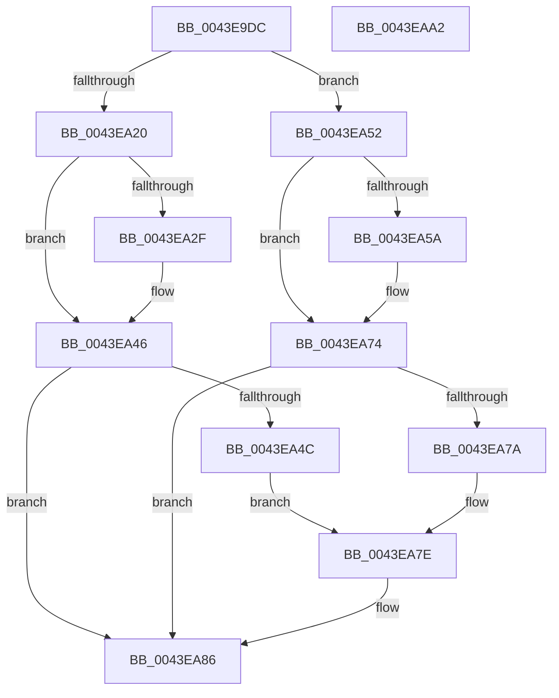

# MiInitializeDpcGang

- RVA: `0x0043E9DC`–`0x0043EAA3` (길이 `199` bytes)
- VA: `0x000000014043E9DC`
- 실행 섹션: `.text`
- PDB 이름 있음: `예`; PDB Function 태그: `아니요`
- unwind 정보 RVA: `0x0006F978`
- 디코드: `56`개 명령, `199/199` bytes 표시
- 미해석 바이트: `0` (있으면 어셈블리에 `.byte`로 보존)

> 이 문서는 커널 이미지의 기계어와 PDB 기호를 분석해 생성했습니다. 4번과 5번은 함수 원형과 자료형을 바이너리 사용 방식에서 추정한 C 해석이며 원본 소스 복구 결과는 아닙니다.

## 1. Dependencies

- 직접 호출 지점: **4**; 고유 호출 대상: **3**
- 직접 호출자로 확인된 함수: **3**
- RIP 상대 이미지 참조: **0**

### Outgoing calls
- `0x0043EA01` → [memset](../6C/memset_function_006C6C40.md) (function, `0x006C6C40`)
- `0x0043EA0E` → [MiComputeIdealDpcGang](MiComputeIdealDpcGang_function_0043EAAC.md) (function, `0x0043EAAC`)
- `0x0043EA3E` → [MiAllocatePool](../35/MiAllocatePool_function_0035B540.md) (function, `0x0035B540`)
- `0x0043EA6C` → [MiAllocatePool](../35/MiAllocatePool_function_0035B540.md) (function, `0x0035B540`)

### Direct callers
- [MiAllocateFastLargePagesForMdl](../3B/MiAllocateFastLargePagesForMdl_function_003B701C.md) at `0x003B729A`
- [MiInitializeDynamicPfns](../67/MiInitializeDynamicPfns_function_00672BD0.md) at `0x00672E3C`
- [MiZeroHotAddMemory](../../page/7F/MiZeroHotAddMemory_function_007FB324.md) at `0x007FB3C1`

### Static image references
- 디코드된 RIP-relative 메모리 참조가 없습니다.

## 2. Other-region calls and transfers

- 다른 실행 섹션으로 향하는 call: **0**
- 별도 외부 분기/꼬리 이동을 확인하지 못했습니다.

## 3. Assembly (complete function range)

```asm
0043E9DC  48 89 5C 24 08                  mov qword ptr [rsp + 8], rbx
0043E9E1  48 89 74 24 10                  mov qword ptr [rsp + 0x10], rsi
0043E9E6  48 89 7C 24 18                  mov qword ptr [rsp + 0x18], rdi
0043E9EB  41 56                           push r14
0043E9ED  48 83 EC 20                     sub rsp, 0x20
0043E9F1  41 8B F8                        mov edi, r8d
0043E9F4  8B DA                           mov ebx, edx
0043E9F6  33 D2                           xor edx, edx
0043E9F8  41 B8 68 01 00 00               mov r8d, 0x168
0043E9FE  48 8B F1                        mov rsi, rcx
0043EA01  E8 3A 82 28 00                  call 0x1406c6c40
0043EA06  44 8B C7                        mov r8d, edi
0043EA09  8B D3                           mov edx, ebx
0043EA0B  48 8B CE                        mov rcx, rsi
0043EA0E  E8 99 00 00 00                  call 0x14043eaac
0043EA13  40 F6 C7 01                     test dil, 1
0043EA17  8B D8                           mov ebx, eax
0043EA19  BF 08 00 00 00                  mov edi, 8
0043EA1E  74 32                           je 0x14043ea52
0043EA20  83 8E B8 00 00 00 01            or dword ptr [rsi + 0xb8], 1
0043EA27  4C 8D 76 10                     lea r14, [rsi + 0x10]
0043EA2B  3B DF                           cmp ebx, edi
0043EA2D  76 17                           jbe 0x14043ea46
0043EA2F  8B D3                           mov edx, ebx
0043EA31  8D 4F 38                        lea ecx, [rdi + 0x38]
0043EA34  48 C1 E2 04                     shl rdx, 4
0043EA38  41 B8 4D 69 44 65               mov r8d, 0x6544694d
0043EA3E  E8 FD CA F1 FF                  call 0x14035b540
0043EA43  49 89 06                        mov qword ptr [r14], rax
0043EA46  49 83 3E 00                     cmp qword ptr [r14], 0
0043EA4A  75 3A                           jne 0x14043ea86
0043EA4C  48 8D 46 18                     lea rax, [rsi + 0x18]
0043EA50  EB 2C                           jmp 0x14043ea7e
0043EA52  4C 8D 76 08                     lea r14, [rsi + 8]
0043EA56  3B DF                           cmp ebx, edi
0043EA58  76 1A                           jbe 0x14043ea74
0043EA5A  48 8B D3                        mov rdx, rbx
0043EA5D  B9 40 00 00 00                  mov ecx, 0x40
0043EA62  48 C1 E2 03                     shl rdx, 3
0043EA66  41 B8 4D 69 44 65               mov r8d, 0x6544694d
0043EA6C  E8 CF CA F1 FF                  call 0x14035b540
0043EA71  49 89 06                        mov qword ptr [r14], rax
0043EA74  49 83 3E 00                     cmp qword ptr [r14], 0
0043EA78  75 0C                           jne 0x14043ea86
0043EA7A  48 8D 46 10                     lea rax, [rsi + 0x10]
0043EA7E  3B DF                           cmp ebx, edi
0043EA80  49 89 06                        mov qword ptr [r14], rax
0043EA83  0F 47 DF                        cmova ebx, edi
0043EA86  48 8B 7C 24 40                  mov rdi, qword ptr [rsp + 0x40]
0043EA8B  89 9E BC 00 00 00               mov dword ptr [rsi + 0xbc], ebx
0043EA91  48 8B 5C 24 30                  mov rbx, qword ptr [rsp + 0x30]
0043EA96  48 8B 74 24 38                  mov rsi, qword ptr [rsp + 0x38]
0043EA9B  48 83 C4 20                     add rsp, 0x20
0043EA9F  41 5E                           pop r14
0043EAA1  C3                              ret
0043EAA2  CC                              int3
```

## 4. C-style interpretation (structured pseudocode)

```c
__int64 __fastcall MiInitializeDpcGang(__int64 a1, int a2, int a3)
{
    __int64 result;
    __int64 v_rbx;
    __int64 v_rsp;
    unsigned __int64 v_stack_p10;
    unsigned __int64 v_stack_p18;
    unsigned __int64 v_stack_p8;

    v_stack_p8 = v_rbx;
    v_stack_p10 = v_rsi;
    v_stack_p18 = v_rdi;
    v_rsp = (v_rsp) - (32);
    a2 = 0;
    result = memset(a1, a2, 360, a4);
    result = MiComputeIdealDpcGang(a1, (unsigned int)((unsigned int)((unsigned int)(a2))), (unsigned int)((unsigned int)((unsigned int)(a3))), a4);
    if ((((unsigned __int8)((unsigned int)(a3))) & (1)) == 0) goto loc_0043EA52;
    if (((unsigned int)((unsigned int)((unsigned int)(result)))) >= = 8) {
        a2 = (unsigned int)((unsigned int)((unsigned int)(result)));
        a1 = 8 + 56;
        a2 = (a2) << (4);
        a3 = 0x6544694DULL;
        result = MiAllocatePool(a1, a2, a3, a4);
        *(unsigned __int64 *)(a1 + 16) = result;
    }
    if ((*(unsigned __int64 *)(a1 + 16)) != 0) goto loc_0043EA86;
    goto loc_0043EA7E;
loc_0043EA52:
    result = a1 + 24;
    if (((unsigned int)((unsigned int)((unsigned int)(result)))) >= = 8) {
        a2 = (unsigned int)((unsigned int)(result));
        a1 = 64;
        a2 = (a2) << (3);
        a3 = 0x6544694DULL;
        result = MiAllocatePool(a1, a2, a3, a4);
        *(unsigned __int64 *)(a1 + 8) = result;
    }
    if ((*(unsigned __int64 *)(a1 + 8)) != 0) goto loc_0043EA86;
loc_0043EA7E:
    *(unsigned __int64 *)(a1 + 8) = a1 + 16;
    v_rbx = (unsigned int)((unsigned int)(result));
    if (((unsigned int)((unsigned int)((unsigned int)(result)))) > 8) { v_rbx = 8; }
loc_0043EA86:
    *(unsigned int *)(a1 + 188) = (unsigned int)(v_rbx);
    v_rsp = (v_rsp) + (32);
    return a1 + 16;
}
```

## 5. (Beta) C Style

```c
void *MiInitializeDpcGang(void *Arg1, int32_t Arg2, int32_t Arg3)
{
    uint8_t *arg1 = (uint8_t *)Arg1;

    int64_t result;
    int64_t local_rbx;
    int64_t local_rsp;
    uint64_t v_stack_p10;
    uint64_t v_stack_p18;
    uint64_t v_stack_p8;

    v_stack_p8 = local_rbx;
    v_stack_p10 = local_rsi;
    v_stack_p18 = local_rdi;
    local_rsp = (local_rsp) - (32);
    Arg2 = 0;
    result = memset(Arg1, Arg2, 360, a4);
    result = MiComputeIdealDpcGang(Arg1, (uint32_t)((uint32_t)((uint32_t)(Arg2))), (uint32_t)((uint32_t)((uint32_t)(Arg3))), a4);
    if ((((uint8_t)((uint32_t)(Arg3))) & (1)) == 0) goto loc_0043EA52;
    if (((uint32_t)((uint32_t)((uint32_t)(result)))) >= = 8) {
        Arg2 = (uint32_t)((uint32_t)((uint32_t)(result)));
        Arg1 = 8 + 56;
        Arg2 = (Arg2) << (4);
        Arg3 = 0x6544694DULL;
        result = MiAllocatePool(Arg1, Arg2, Arg3, a4);
        *(uint64_t *)(arg1 + 0x10) = result;
    }
    if ((*(uint64_t *)(arg1 + 0x10)) != 0) goto loc_0043EA86;
    goto loc_0043EA7E;
loc_0043EA52:
    result = Arg1 + 24;
    if (((uint32_t)((uint32_t)((uint32_t)(result)))) >= = 8) {
        Arg2 = (uint32_t)((uint32_t)(result));
        Arg1 = 64;
        Arg2 = (Arg2) << (3);
        Arg3 = 0x6544694DULL;
        result = MiAllocatePool(Arg1, Arg2, Arg3, a4);
        *(uint64_t *)(arg1 + 0x8) = result;
    }
    if ((*(uint64_t *)(arg1 + 0x8)) != 0) goto loc_0043EA86;
loc_0043EA7E:
    *(void **)(arg1 + 0x8) = Arg1 + 16;
    local_rbx = (uint32_t)((uint32_t)(result));
    if (((uint32_t)((uint32_t)((uint32_t)(result)))) > 8) { local_rbx = 8; }
loc_0043EA86:
    *(uint32_t *)(arg1 + 0xBC) = (uint32_t)(local_rbx);
    local_rsp = (local_rsp) + (32);
    return Arg1 + 16;
}
```

### 관측된 메모리 오프셋

구조체 형식이 확인되지 않은 접근은 인자 기준의 오프셋으로만 기록했습니다.

| 기준 인자 | 오프셋 표현 | 폭 (bit) | 접근 |
|---|---:|---:|---|
| `Arg1` | `+ 0x0` | `64` | `R` |
| `Arg1` | `+ 0x0` | `64` | `W` |
| `Arg1` | `+ 0x8` | `64` | `R` |
| `Arg1` | `+ 0x10` | `64` | `R` |
| `Arg1` | `+ 0x18` | `64` | `R` |
| `Arg1` | `+ 0xB8` | `32` | `R/W` |
| `Arg1` | `+ 0xBC` | `32` | `W` |

## 6. Execution-region graph

[열기: 2D/3D 그래프와 함수 탐색 컨트롤 패널](../../../control-panel.html?section=text&rva=0x0043E9DC&view=graph)

- 2D 그래프는 위에서 아래로 흐르고, 3D 그래프는 빈 공간을 드래그해 회전합니다. Shift+드래그는 이동, 휠은 확대·축소, 함수 노드 선택은 대상 보고서 이동입니다.

### Static fallback


