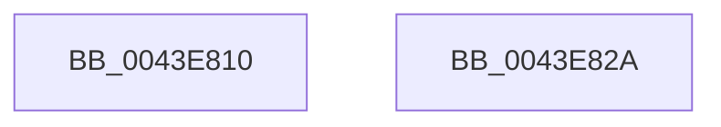

# MiInitializeFaultVaListCore

- RVA: `0x0043E810`–`0x0043E82B` (길이 `27` bytes)
- VA: `0x000000014043E810`
- 실행 섹션: `.text`
- PDB 이름 있음: `예`; PDB Function 태그: `아니요`
- unwind 정보 RVA: `0x000DB714`
- 디코드: `9`개 명령, `27/27` bytes 표시
- 미해석 바이트: `0` (있으면 어셈블리에 `.byte`로 보존)

> 이 문서는 커널 이미지의 기계어와 PDB 기호를 분석해 생성했습니다. 4번과 5번은 함수 원형과 자료형을 바이너리 사용 방식에서 추정한 C 해석이며 원본 소스 복구 결과는 아닙니다.

## 1. Dependencies

- 직접 호출 지점: **0**; 고유 호출 대상: **0**
- 직접 호출자로 확인된 함수: **2**
- RIP 상대 이미지 참조: **0**

### Outgoing calls
- 직접 디코드된 call 명령이 없습니다.

### Direct callers
- [MiInitializePrototypePtes](../../page/98/MiInitializePrototypePtes_function_009829AC.md) at `0x00982AD0`
- [MmVirtualAccessFault](../../page/9F/MmVirtualAccessFault_function_009FF98C.md) at `0x009FF9E6`

### Static image references
- 디코드된 RIP-relative 메모리 참조가 없습니다.

## 2. Other-region calls and transfers

- 다른 실행 섹션으로 향하는 call: **0**
- 별도 외부 분기/꼬리 이동을 확인하지 못했습니다.

## 3. Assembly (complete function range)

```asm
0043E810  33 C0                           xor eax, eax
0043E812  44 88 09                        mov byte ptr [rcx], r9b
0043E815  48 89 41 18                     mov qword ptr [rcx + 0x18], rax
0043E819  48 89 41 20                     mov qword ptr [rcx + 0x20], rax
0043E81D  C6 41 01 00                     mov byte ptr [rcx + 1], 0
0043E821  48 89 51 08                     mov qword ptr [rcx + 8], rdx
0043E825  4C 89 41 10                     mov qword ptr [rcx + 0x10], r8
0043E829  C3                              ret
0043E82A  CC                              int3
```

## 4. C-style interpretation (structured pseudocode)

```c
__int64 __fastcall MiInitializeFaultVaListCore(__int64 a1, __int64 a2, __int64 a3, unsigned __int8 a4)
{
    __int64 result;

    result = 0;
    *(unsigned __int8 *)(a1) = a4;
    *(unsigned __int64 *)(a1 + 24) = 0;
    *(unsigned __int64 *)(a1 + 32) = 0;
    *(unsigned __int8 *)(a1 + 1) = 0;
    *(unsigned __int64 *)(a1 + 8) = a2;
    *(unsigned __int64 *)(a1 + 16) = a3;
    return result;
}
```

## 5. (Beta) C Style

```c
int64_t MiInitializeFaultVaListCore(void *Arg1, int64_t Arg2, int64_t Arg3, uint8_t Arg4)
{
    uint8_t *arg1 = (uint8_t *)Arg1;

    int64_t result;

    result = 0;
    *(uint8_t *)(arg1) = Arg4;
    *(uint64_t *)(arg1 + 0x18) = 0;
    *(uint64_t *)(arg1 + 0x20) = 0;
    *(uint8_t *)(arg1 + 0x1) = 0;
    *(uint64_t *)(arg1 + 0x8) = Arg2;
    *(uint64_t *)(arg1 + 0x10) = Arg3;
    return result;
}
```

### 관측된 메모리 오프셋

구조체 형식이 확인되지 않은 접근은 인자 기준의 오프셋으로만 기록했습니다.

| 기준 인자 | 오프셋 표현 | 폭 (bit) | 접근 |
|---|---:|---:|---|
| `Arg1` | `+ 0x0` | `8` | `W` |
| `Arg1` | `+ 0x1` | `8` | `W` |
| `Arg1` | `+ 0x8` | `64` | `W` |
| `Arg1` | `+ 0x10` | `64` | `W` |
| `Arg1` | `+ 0x18` | `64` | `W` |
| `Arg1` | `+ 0x20` | `64` | `W` |

## 6. Execution-region graph

[열기: 2D/3D 그래프와 함수 탐색 컨트롤 패널](../../../control-panel.html?section=text&rva=0x0043E810&view=graph)

- 2D 그래프는 위에서 아래로 흐르고, 3D 그래프는 빈 공간을 드래그해 회전합니다. Shift+드래그는 이동, 휠은 확대·축소, 함수 노드 선택은 대상 보고서 이동입니다.

### Static fallback


